# QUANTIX 2K26: 19 hackathon-ready prototypes

[](https://github.com/jayeskumar/a/actions/workflows/tests.yml)

Working prototypes, reports and pitch decks for **QUANTIX 2K26**, the 24-hour hackathon at
K.S.R. College of Engineering (23–24 Oct 2026). All six hackathon domains are covered, with three or
four projects each.

Every project is **offline-first and zero-install**: Python 3.9+ standard library only, vanilla
HTML/JS with hand-drawn SVG charts, and no CDNs or network calls. Every ML, statistics and crypto
algorithm is written from scratch, unit-tested and measured.

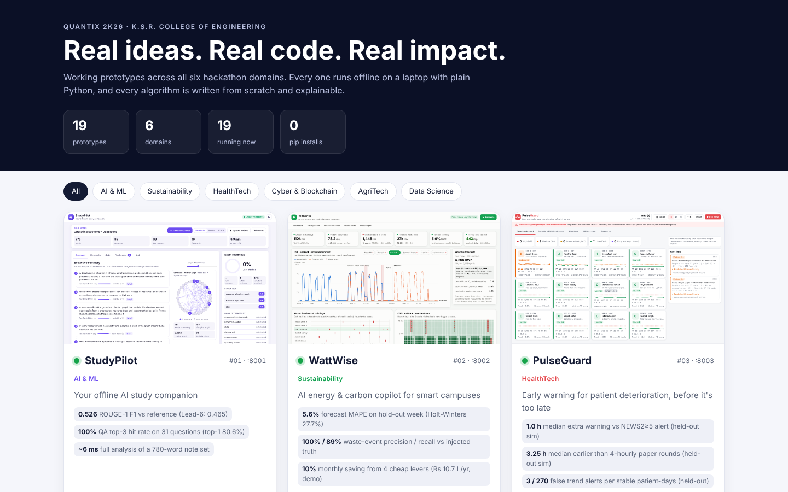

> **Read [`docs/STRATEGY.md`](docs/STRATEGY.md) first.** It covers the event rules (including
> asking the organisers whether pre-built code is allowed), which project to pitch for each domain,
> a 24-hour game plan, demo-day and submission checklists, and Q&A prep.

| # | Project | Domain | What it does | Port |
|---|---|---|---|---|
| 01 | [StudyPilot](projects/01-studypilot/) | AI & ML | Offline study companion: TextRank summaries, auto-quizzes, SM-2 flashcards, BM25 Q&A over your notes | 8001 |
| 08 | [ResumeRadar](projects/08-resumeradar/) | AI & ML | Explainable resume ↔ JD matching, blind (bias-free) screening, skill-gap learning paths | 8008 |
| 14 | [NeuroCanvas](projects/14-neurocanvas/) | AI & ML | Draw a digit and watch a from-scratch neural network think: activations, saliency, live training | 8014 |
| 02 | [WattWise](projects/02-wattwise/) | Sustainability | Campus energy forecasting, waste detection, carbon accounting, rooftop-solar ROI | 8002 |
| 09 | [WasteWise](projects/09-wastewise/) | Sustainability | Smart-bin fill forecasting plus Clarke-Wright / 2-opt collection routing | 8009 |
| 15 | [AirSense](projects/15-airsense/) | Sustainability | Hyperlocal CPCB AQI from calibrated low-cost sensors, kriging maps, 24 h forecasts, source hints | 8015 |
| 03 | [PulseGuard](projects/03-pulseguard/) | HealthTech | NEWS2 early-warning ward monitor with trend-based alerts | 8003 |
| 10 | [BloodLink](projects/10-bloodlink/) | HealthTech | Emergency blood-donor matching, blood-bank FEFO stock and transfer suggestions | 8010 |
| 16 | [MindEase](projects/16-mindease/) | HealthTech | Private student-wellbeing companion: PHQ-9/GAD-7, mood trends, safety net, counsellor view | 8016 |
| 04 | [CertChain](projects/04-certchain/) | Cyber & Blockchain | Tamper-proof certificates: pure-Python Ed25519, Merkle proofs, signed PoW chain, QR | 8004 |
| 07 | [PhishGuard](projects/07-phishguard/) | Cyber & Blockchain | Explainable scam-SMS and phishing-link detector built for Indian scams | 8007 |
| 13 | [LogSentinel](projects/13-logsentinel/) | Cyber & Blockchain | Pocket SOC: detects brute force, SQLi/XSS and scans in logs, mapped to MITRE ATT&CK | 8013 |
| 17 | [CampusVote](projects/17-campusvote/) | Cyber & Blockchain | Verifiable anonymous e-voting: RSA blind signatures, commitments, hash-chained bulletin board | 8017 |
| 05 | [KrishiMitra](projects/05-krishimitra/) | AgriTech | Tamil/English farm advisor: crop ML, fertiliser, FAO-56 irrigation, market timing | 8005 |
| 11 | [SchemeSetu](projects/11-schemesetu/) | AgriTech & Rural | Welfare-scheme eligibility engine with an adaptive questionnaire, in Tamil/English | 8011 |
| 18 | [AgriSky](projects/18-agrisky/) | AgriTech | Drone NDVI crop-health maps, stress diagnosis, variable-rate prescriptions, spray missions | 8018 |
| 06 | [PlaceIQ](projects/06-placeiq/) | Data Science | Placement prediction plus a minimum-effort "what to fix next" plan for each student | 8006 |
| 12 | [StockSense](projects/12-stocksense/) | Data Science | Retail demand forecasting, safety stock / EOQ, ABC-XYZ, Apriori basket analysis | 8012 |
| 19 | [CivicLens](projects/19-civiclens/) | Data Science | Citizen-complaint triage in English/Tamil/Tanglish: routing, urgency, duplicates, hotspots, SLA | 8019 |

Measured results for every project are in [`docs/PORTFOLIO.md`](docs/PORTFOLIO.md).

## Deliverables

| What | Where |
|---|---|
| **Complete report (PDF, A4, ~180 pages)**: cover, strategy playbook, portfolio overview and all 19 project reports with screenshots and architecture diagrams | [`docs/QUANTIX2K26_Report.pdf`](docs/QUANTIX2K26_Report.pdf) |
| **Pitch decks**: 19 × 11-slide PowerPoint decks with speaker notes and a scan-to-code QR on the closing slide | [`decks/`](decks/) |
| **Demo videos**: a ~45 s captioned walkthrough per project (title card, live demo, every tab, results card), ready to upload as the "demo link" | `node tools/record_demos.js` → `build/videos/*.mp4` |
| **Per-project reports**: problem, architecture, algorithms, results, demo script, judges' Q&A | `projects/NN-name/REPORT.md` |
| **Strategy playbook**: rules, domain picks, 24-hour plan, checklists | [`docs/STRATEGY.md`](docs/STRATEGY.md) |
| **Working code**: 19 offline demos + showcase hub, 1,159 unit tests, a start-up smoke test of every server and a browser QA sweep; CI on Linux/Windows × Python 3.9/3.13 | [`projects/`](projects/), [`run_all.py`](run_all.py) |

## Gallery

<table>
<tr><td align="center" width="33%"><a href="projects/01-studypilot/"></a><br><sub><b>01</b> · <a href="projects/01-studypilot/REPORT.md">report</a></sub></td><td align="center" width="33%"><a href="projects/08-resumeradar/">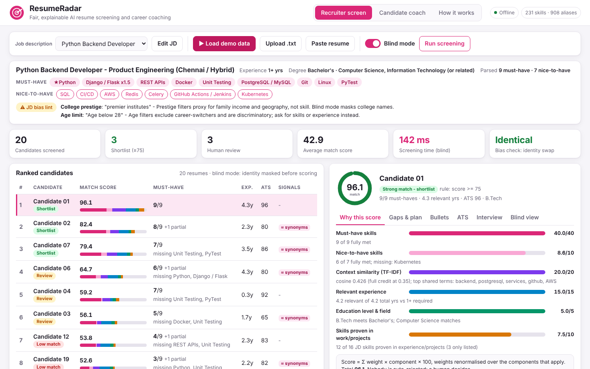</a><br><sub><b>08</b> · <a href="projects/08-resumeradar/REPORT.md">report</a></sub></td><td align="center" width="33%"><a href="projects/14-neurocanvas/">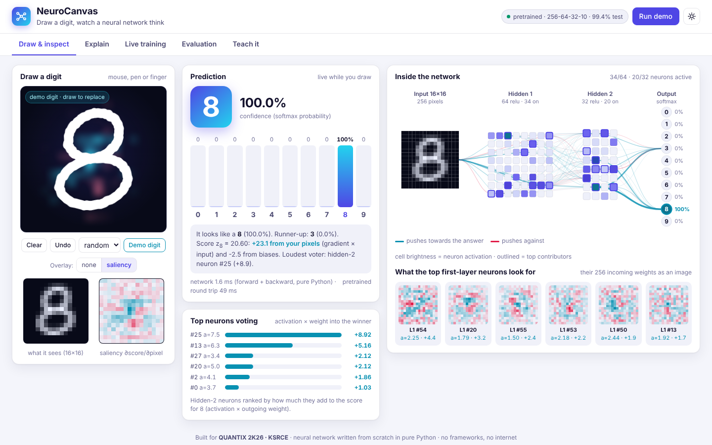</a><br><sub><b>14</b> · <a href="projects/14-neurocanvas/REPORT.md">report</a></sub></td></tr>
<tr><td align="center" width="33%"><a href="projects/02-wattwise/">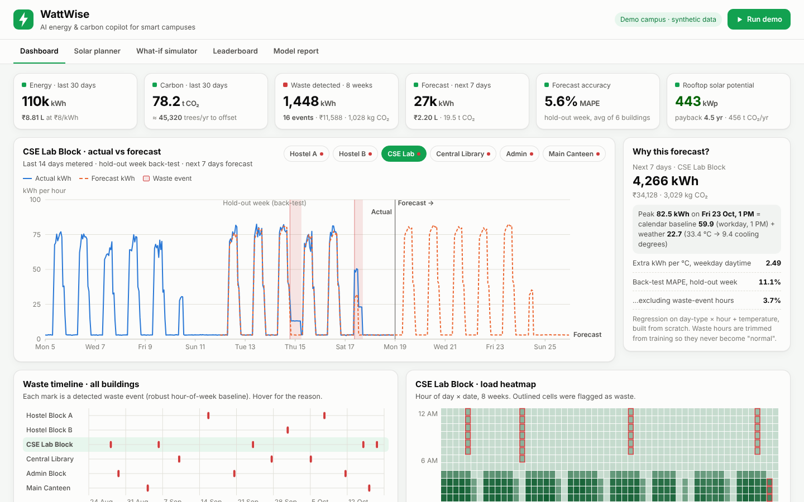</a><br><sub><b>02</b> · <a href="projects/02-wattwise/REPORT.md">report</a></sub></td><td align="center" width="33%"><a href="projects/09-wastewise/">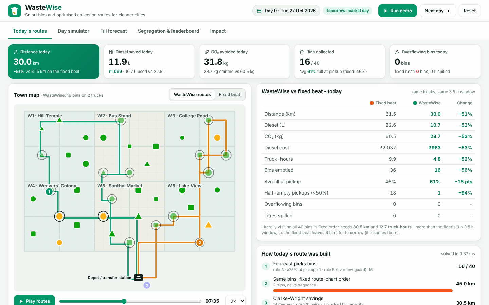</a><br><sub><b>09</b> · <a href="projects/09-wastewise/REPORT.md">report</a></sub></td><td align="center" width="33%"><a href="projects/15-airsense/">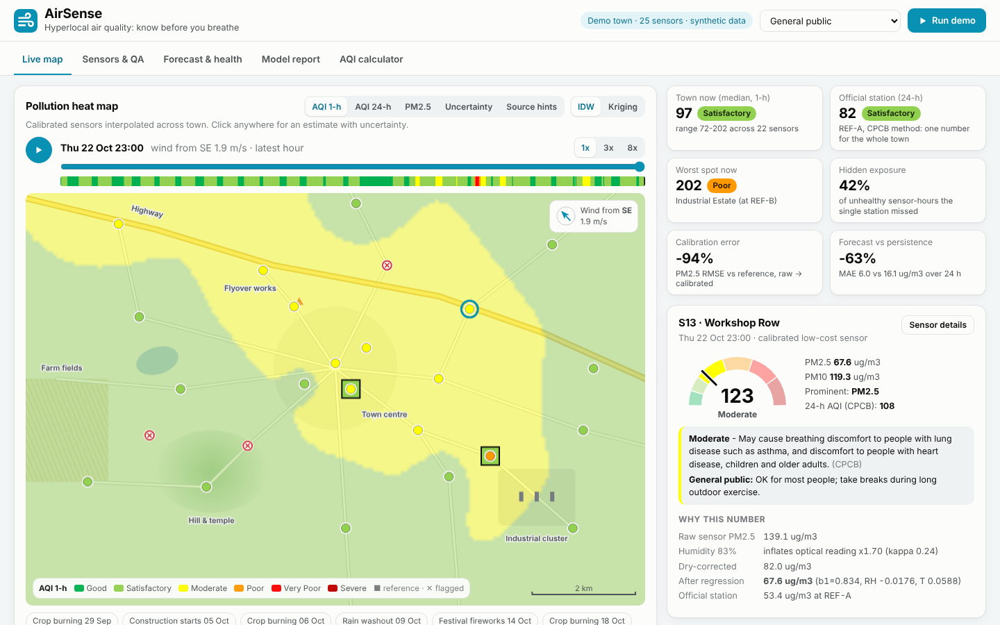</a><br><sub><b>15</b> · <a href="projects/15-airsense/REPORT.md">report</a></sub></td></tr>
<tr><td align="center" width="33%"><a href="projects/03-pulseguard/"></a><br><sub><b>03</b> · <a href="projects/03-pulseguard/REPORT.md">report</a></sub></td><td align="center" width="33%"><a href="projects/10-bloodlink/">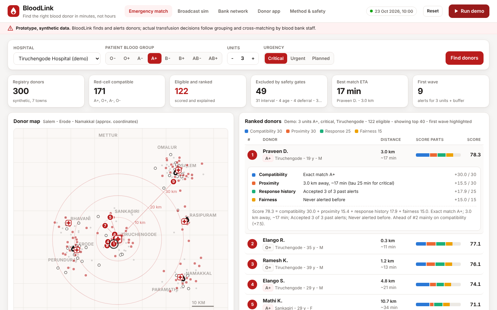</a><br><sub><b>10</b> · <a href="projects/10-bloodlink/REPORT.md">report</a></sub></td><td align="center" width="33%"><a href="projects/16-mindease/"></a><br><sub><b>16</b> · <a href="projects/16-mindease/REPORT.md">report</a></sub></td></tr>
<tr><td align="center" width="33%"><a href="projects/04-certchain/"></a><br><sub><b>04</b> · <a href="projects/04-certchain/REPORT.md">report</a></sub></td><td align="center" width="33%"><a href="projects/07-phishguard/">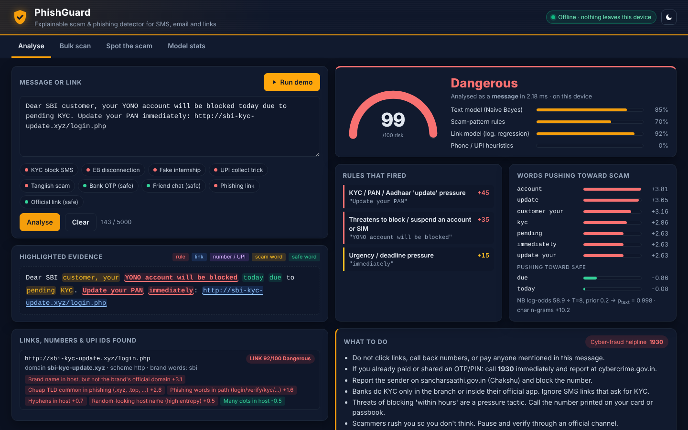</a><br><sub><b>07</b> · <a href="projects/07-phishguard/REPORT.md">report</a></sub></td><td align="center" width="33%"><a href="projects/13-logsentinel/">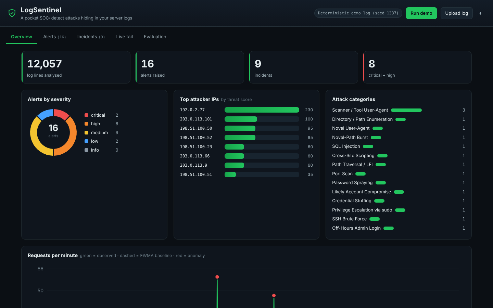</a><br><sub><b>13</b> · <a href="projects/13-logsentinel/REPORT.md">report</a></sub></td></tr>
<tr><td align="center" width="33%"><a href="projects/17-campusvote/">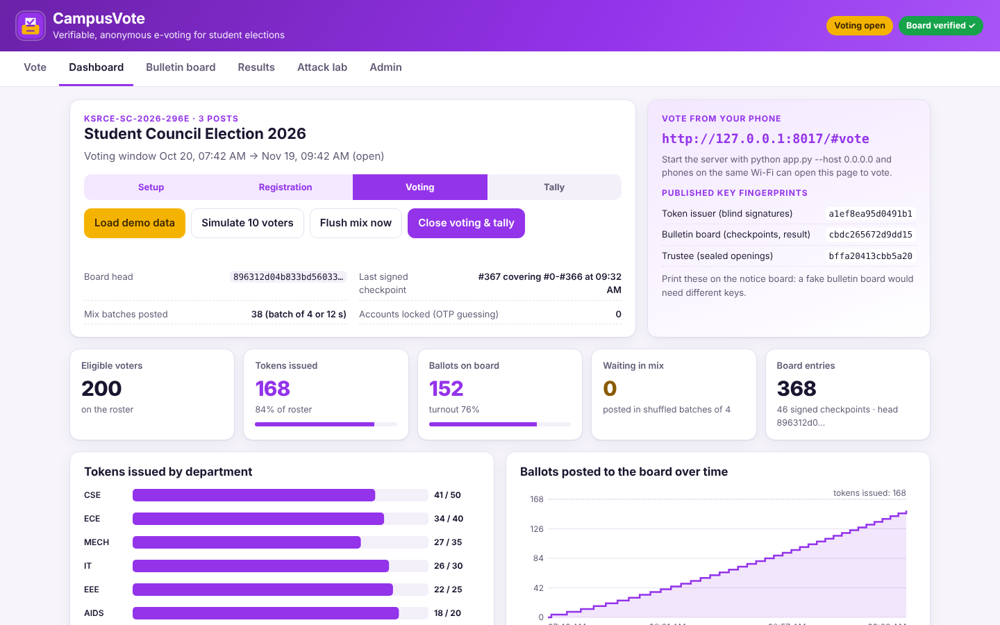</a><br><sub><b>17</b> · <a href="projects/17-campusvote/REPORT.md">report</a></sub></td><td align="center" width="33%"><a href="projects/05-krishimitra/">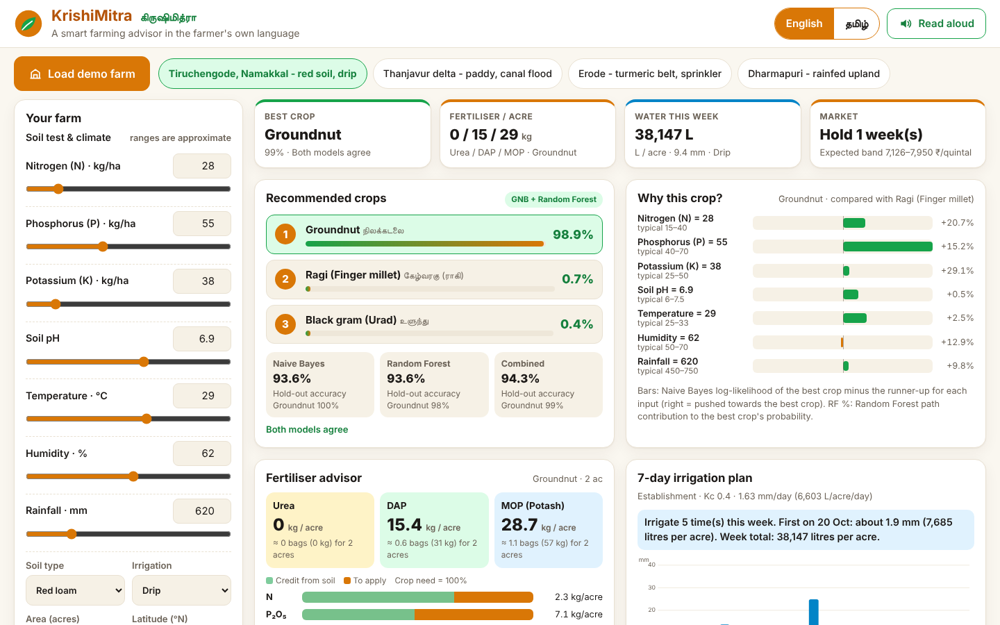</a><br><sub><b>05</b> · <a href="projects/05-krishimitra/REPORT.md">report</a></sub></td><td align="center" width="33%"><a href="projects/11-schemesetu/">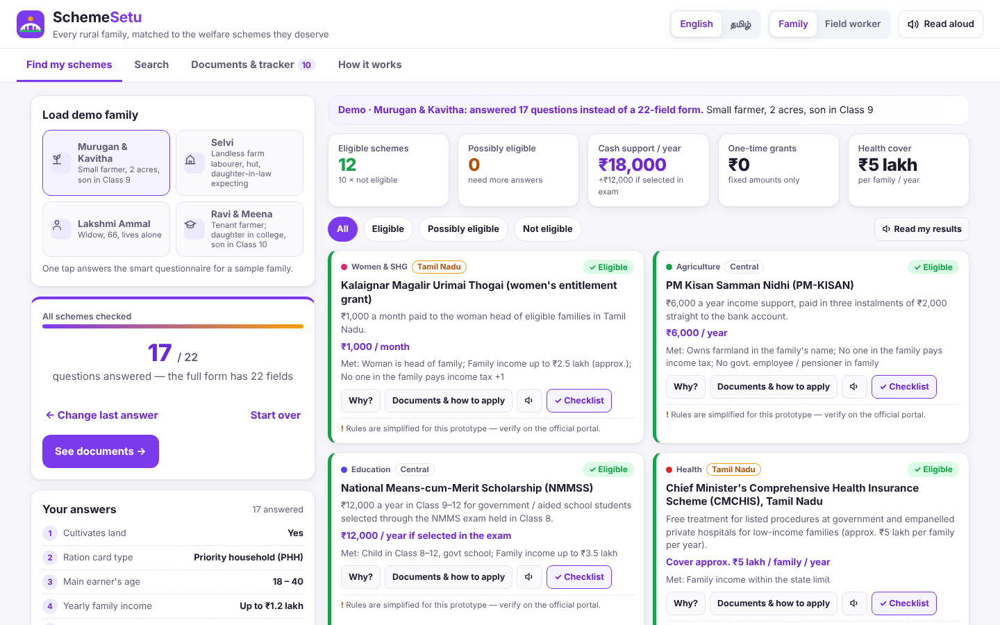</a><br><sub><b>11</b> · <a href="projects/11-schemesetu/REPORT.md">report</a></sub></td></tr>
<tr><td align="center" width="33%"><a href="projects/18-agrisky/">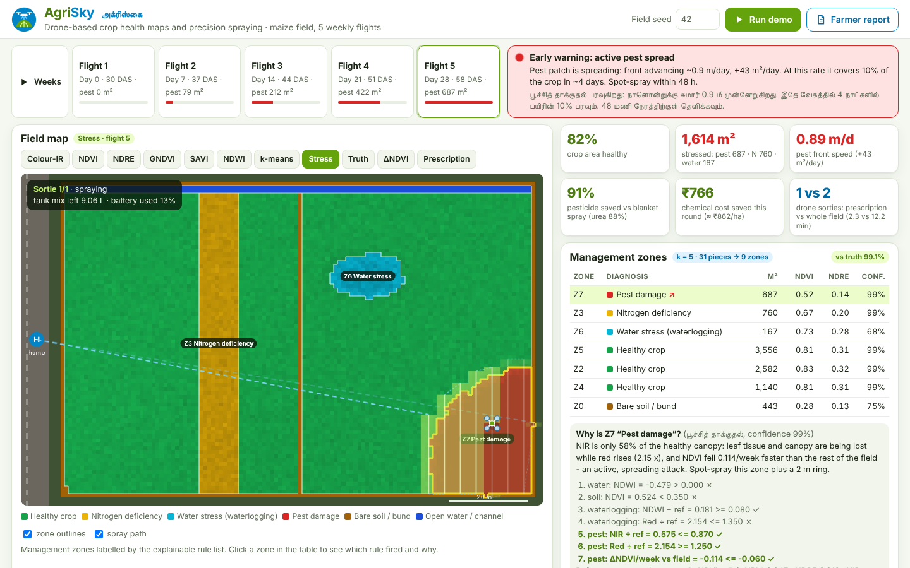</a><br><sub><b>18</b> · <a href="projects/18-agrisky/REPORT.md">report</a></sub></td><td align="center" width="33%"><a href="projects/06-placeiq/">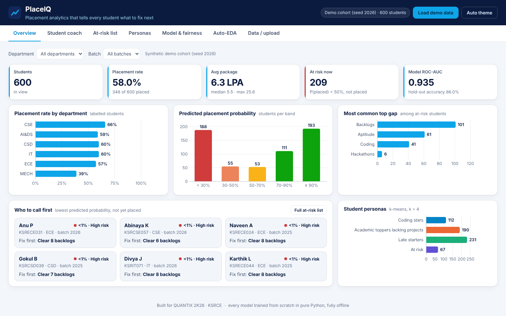</a><br><sub><b>06</b> · <a href="projects/06-placeiq/REPORT.md">report</a></sub></td><td align="center" width="33%"><a href="projects/12-stocksense/">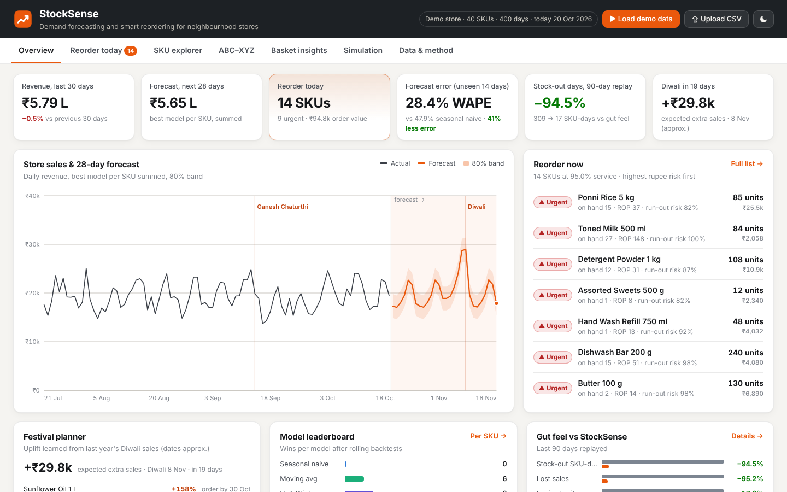</a><br><sub><b>12</b> · <a href="projects/12-stocksense/REPORT.md">report</a></sub></td></tr>
<tr><td align="center" width="33%"><a href="projects/19-civiclens/">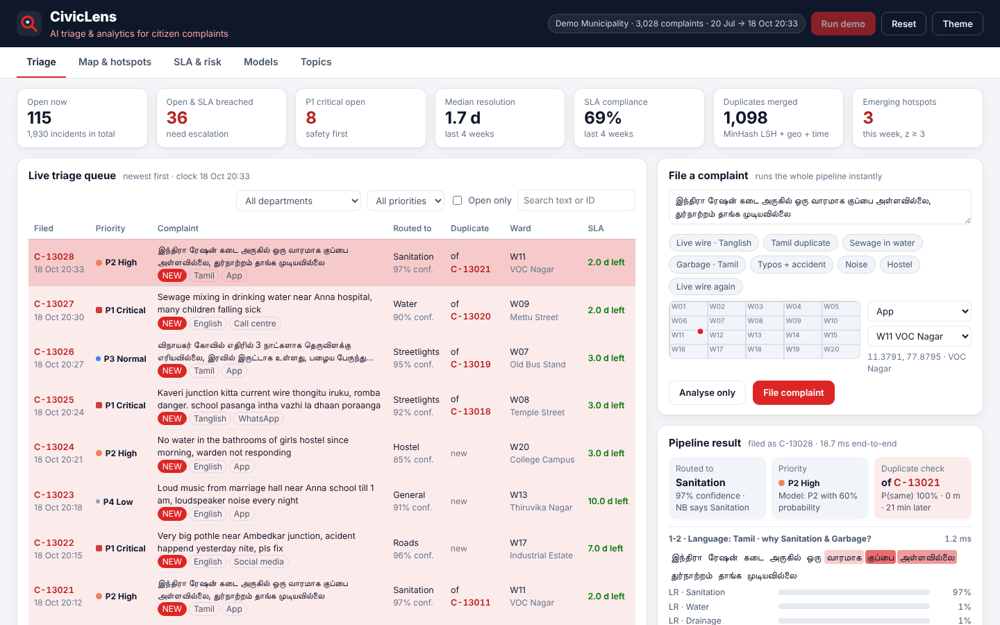</a><br><sub><b>19</b> · <a href="projects/19-civiclens/REPORT.md">report</a></sub></td></tr>
</table>

## Quick start

```bash
cd projects/03-pulseguard && python app.py      # one project → http://127.0.0.1:8003
python run_all.py                               # every project at once + showcase hub on :8000
python run_all.py --lan                         # bind 0.0.0.0 so judges can open demos on their phones
python tools/run_tests.py                       # every project's unit tests
python tools/smoke_test.py                      # start every server once and check it answers
```

Browser QA (needs Node 18+ and Playwright, with the demos running via `python run_all.py`):

```bash
NODE_PATH="$(npm root -g)" node tools/qa_sweep.js       # clicks every demo button and tab at desktop and
                                                        # phone size; reports console errors, failed
                                                        # requests and horizontal overflow
```

## Repository layout

```
projects/NN-name/     app.py · <package>/ (pure logic) · static/ · data/ · tests/ · docs/screenshot.png
                      README.md · REPORT.md (15-section hackathon report) · pitch.json (deck content)
decks/                one generated .pptx pitch deck per project (11 slides, with speaker notes)
hub/                  showcase page served on :8000 by run_all.py
docs/STRATEGY.md      how to win: rules, domain picks, 24 h plan, checklists, Q&A
docs/PORTFOLIO.md     generated summary of every project and its measured results
docs/BUILD_SPEC.md    the conventions every project follows
tools/                build_decks.js (pptx) · build_report.py (PDF) · build_portfolio.py · record_demos.js (MP4)
                      run_tests.py · smoke_test.py · qa_sweep.js · screenshot.js
team.json             team name, members and GitHub link, used on the title and closing slides
```

## Regenerating the reports

```bash
# 1. Put your team's details in team.json
# 2. Pitch decks (needs Node 18+):
cd tools && npm install && node build_decks.js          # → decks/*.pptx
# 3. Portfolio summary:
python tools/build_portfolio.py                          # → docs/PORTFOLIO.md
# 4. Complete PDF report (needs pandoc + poppler-utils; uses the tools/ npm packages):
python tools/build_report.py                             # → build/QUANTIX2K26_Report.pdf (copy to docs/)
# 5. Fresh screenshot for a project (server must be running):
NODE_PATH="$(npm root -g)" node tools/screenshot.js http://127.0.0.1:8003/ projects/03-pulseguard/docs/screenshot.png
# 6. Demo videos (needs Playwright + ffmpeg; run on a scratch copy, since the demos write state files):
python run_all.py --no-hub &                             # in the copy
NODE_PATH="$(npm root -g)" node tools/record_demos.js build/videos 8003   # omit ports to record all 19
```

## Honesty notes

- All datasets are **synthetic**, generated by seeded code inside each project, so measured accuracy
  shows the implementation is correct, not real-world performance. Each REPORT.md says this and
  explains how real data plugs in.
- Real-world statistics on the slides are marked *approx.* where they are rounded; double-check them
  before presenting.
- HealthTech projects are decision-support prototypes, **not medical devices**.
