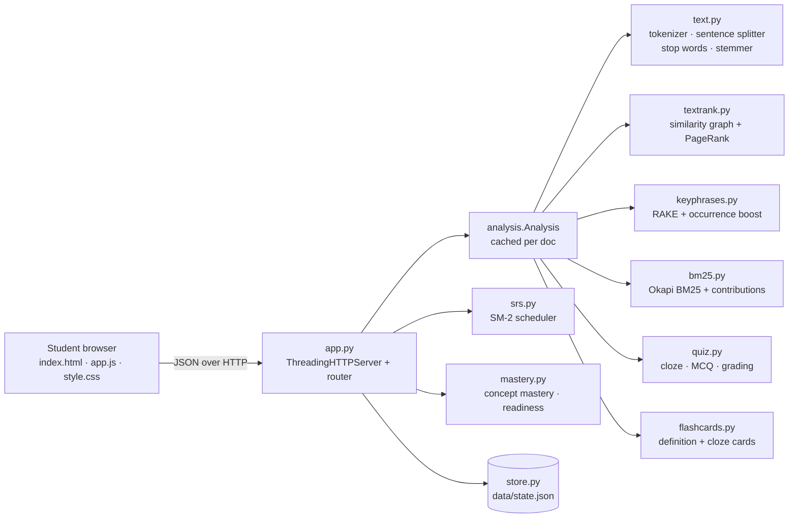
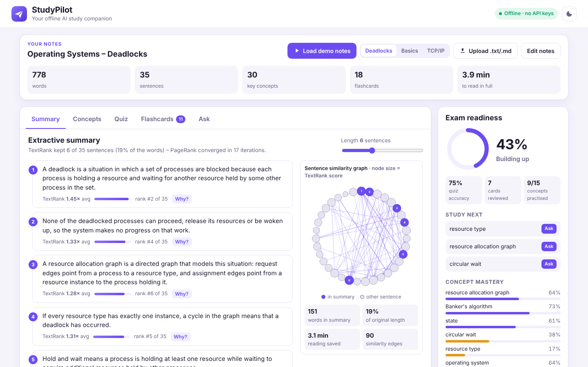

# StudyPilot – Hackathon Report

## 1. Title, tagline, domain

**StudyPilot** – *Your offline AI study companion*
**Domain:** Artificial Intelligence & Machine Learning
QUANTIX 2K26 · K.S.R. College of Engineering · project folder `projects/01-studypilot` · port 8001

## 2. Problem statement

**Who suffers.** Engineering and arts students preparing for internal and semester exams. They
collect pages of lecture notes, PDF extracts and photocopied textbook chapters, then try to revise
all of it in the last few days. India has roughly 4.3 crore students in higher education (AISHE
2021-22, approx.), and many of them study at tier-2 and tier-3 colleges where hostel Wi-Fi is weak
and mobile data runs out.

**How much it hurts.**
- Re-reading is slow: a single unit of notes takes 30–60 minutes to read again, and a semester has
  dozens of units. Skimming misses the key ideas.
- Without spaced review, new material fades within days (the Ebbinghaus forgetting curve). Students
  cram once and forget it before the exam.
- Students have no honest signal of *how ready they are*, so they spend time on what they already
  know.

**Why existing solutions fail.**
- Generic AI chatbots need a stable internet connection and often a paid key, and they can
  *hallucinate* answers that are not in the syllabus. A student cannot tell which sentences of
  their own notes the answer came from.
- Flashcard apps (Anki and similar) are powerful, but every card has to be typed by hand, which is
  exactly the work a stressed student skips.
- Summariser websites upload the notes to a server. That is a privacy concern and does not work
  offline.

## 3. Our solution

StudyPilot is a local web app (`python app.py`) that reads a student's own notes and turns them
into a complete revision kit in about 6 ms on a normal laptop. Every result comes **only from the
student's notes**, and every result shows *why* it was produced, so StudyPilot cannot invent
facts. It needs no internet, no API key and no installation beyond Python.

- **Summary**: an extractive TextRank summary with an adjustable length. Each sentence shows its
  score, its rank and the sentences it is most strongly connected to. A similarity-graph view is
  included.
- **Key concepts**: RAKE keyphrases shown as weighted chips. Clicking a chip shows its evidence:
  word scores, occurrence count and the highlighted sentences that mention it.
- **Quiz**: automatic cloze (fill-in-the-blank) and MCQ questions. MCQ distractors are other
  concepts of a *similar type*. Answers are graded with typo tolerance, and each result shows the
  source sentence as the explanation.
- **Flashcards**: definition and cloze cards are generated automatically and scheduled with SM-2
  spaced repetition using Again / Hard / Good / Easy. Each button previews the next interval, and
  the schedule is saved in `data/`.
- **Ask your notes**: BM25 retrieval over the notes' sentences, plus a definition-aware
  re-ranker. It returns highlighted passages, a confidence score and a per-term score breakdown.
  If the notes do not cover a question, it says so.
- **Exam readiness**: an importance-weighted mastery score built from quiz and flashcard history,
  with a "study next" list.
- Three bundled demo note sets (OS Deadlocks, ML Basics, TCP/IP), plus paste, `.txt`/`.md` upload
  and drag-and-drop.

## 4. Innovation / what makes it different

1. **Hallucination-free by design.** StudyPilot is extractive end to end. Every summary line,
   quiz answer, flashcard and QA answer is a sentence from the student's own notes, linked back to
   its source.
2. **Explainability on every screen.** The app shows TextRank scores and their strongest links,
   the RAKE degree and frequency behind each concept, the reason each distractor was chosen, the
   SM-2 easiness and interval change after each review, BM25 per-term tf·idf contributions, and
   the formula behind the readiness score.
3. **A complete learning loop, not just a summariser.** Reading (summary), then active recall
   (quiz and cards), then spaced repetition (SM-2), then measured readiness. The loop closes
   because quiz and card results update concept mastery.
4. **Runs on a ₹15k laptop with Wi-Fi off.** The app is pure Python standard library, about 1,500
   lines of from-scratch NLP, with no model download and no GPU. Notes never leave the device.

## 5. System architecture



| Component | File | Responsibility |
|---|---|---|
| Web UI | `static/*` | Tabbed dashboard (Summary · Concepts · Quiz · Flashcards · Ask), readiness sidebar, SVG graph, light/dark themes, responsive layout |
| HTTP server | `app.py` | Static files, JSON API, input validation, JSON errors, LRU cache of analyses |
| Text processing | `studypilot/text.py` | Regex tokenizer with offsets, markdown-aware sentence splitter, stop words, light stemmer |
| Summariser | `studypilot/textrank.py` | Sentence graph, weighted PageRank power iteration |
| Concepts | `studypilot/keyphrases.py` | RAKE candidates, verb heuristics, ranking, concept "type" features |
| Retrieval | `studypilot/bm25.py` + `analysis.ask` | BM25 scoring, definition bonus, confidence, highlights |
| Quiz | `studypilot/quiz.py` | Question selection, distractors, typo-tolerant grading |
| Flashcards | `studypilot/flashcards.py` + `srs.py` | Card generation, SM-2 scheduling |
| Mastery | `studypilot/mastery.py` | Per-concept mastery, readiness, study-next |
| Persistence | `studypilot/store.py` | Atomic JSON writes, tolerant of a corrupt file |
| Evaluation | `studypilot/evaluation.py` | ROUGE-1, QA hit rate, latency benchmark |

## 6. Algorithms & models

**Tokenizer, splitter and stemmer.** The tokenizer is the regex
`[A-Za-z0-9]+('[A-Za-z]+)?(-[A-Za-z0-9]+)*`, so *Banker's*, *wait-for*, *SYN-ACK* and *48-bit*
each stay one token, and every token keeps its character offsets so it can be highlighted later.
The sentence splitter breaks on `.`, `!` or `?` when followed by whitespace and an upper-case
letter or digit. It skips abbreviations (e.g., i.e., Dr.) and initials (E. Dijkstra). Markdown
headings become section names, and each bullet becomes its own sentence. The stemmer is a light
Porter-style suffix stripper. It handles plurals, *-ing*, *-ed*, *-ly*, *-ation→ate*,
*-isation/-ization→ize*, a final *e* and *y→i*, so *schedule*, *scheduled* and *scheduling* share
one stem. *Limits:* the stemmer is English-only and does not handle irregular forms
(matrix/matrices).

**TextRank (Mihalcea & Tarau, 2004).** Each sentence is a node. Edge weights are
`sim(Si,Sj) = |Si ∩ Sj| / (log(|Si|+1) + log(|Sj|+1))` over content-word stems. Scores come from
weighted PageRank, computed by power iteration over sparse incoming lists:

```
WS(i) = (1-d)/N + d·Σ_j  w_ji / Σ_k w_jk · WS(j)   (+ dangling mass), d = 0.85, stop when L1 Δ < 1e-8
```

The top-k sentences are returned in document order. *Why:* TextRank is unsupervised and needs no
training data, and the graph explains itself ("this sentence shares *deadlock, process* with 9
others"). *Limits:* it rewards repetition and cannot paraphrase. Graph construction is O(n²),
which takes about 160 ms for 376 sentences.

**Key concepts: RAKE (Rose et al., 2010) plus a boost.** Candidate phrases are word runs split at
stop words, punctuation, a general verb list, and a POS heuristic (an *-s* word followed by a
determiner, or a phrase-final *-ed* participle). The RAKE word score is `deg(w)/freq(w)`.
StudyPilot then ranks phrases by:

```
score = mean(word scores) × LengthBonus{1:0.9, 2:1.6, 3:1.8} × (1 + log2(occurrences))
        × 2 if the phrase opens a sentence (definition position) × 1.3 if acronym
```

A sub-phrase that only ever appears inside a longer phrase is merged into it. *Why:* plain RAKE
over-rates one-off three-word phrases and under-rates the topic word. *Limits:* there is no real
POS tagger, so some verb phrases slip through, for example *assignment edges point*.

**Quiz generation.** StudyPilot walks the sentences in TextRank order and blanks the most specific
unused *quizzable* concept in each one. A concept is quizzable if it is a multi-word phrase, a
defined term or an acronym, and not the topic word that appears in more than 30% of sentences. For
MCQs, distractors are the other concepts that score highest on a type-similarity function:

```
sim = 2·[same word count] + 2·[both acronyms] + 1.5·[same suffix class, e.g. -tion/-ing/-or]
      + 2.5·[share a word] + 1·[same head word] + (1 − |weight_a − weight_b|)
```

A candidate distractor is excluded if it overlaps the answer or appears in the question sentence.
Cloze answers are normalised (lower-case, stop words removed, stemmed) and accepted within a
Levenshtein distance of ⌊len/6⌋. The `seed` reshuffles the pool for a new quiz, and grading is
stateless because the server regenerates the quiz from (doc, n, seed). *Limits:* a distractor can
occasionally also be a valid answer (e.g. *IP address* vs *IPv4 address*).

**Flashcards and SM-2 (Wozniak, 1987).** A sentence that opens with a concept becomes a
definition card ("What is a resource allocation graph?"). Other important concepts become cloze
cards. The four buttons map to SM-2 quality q = 1/3/4/5. The schedule follows SM-2:

```
q < 3 : reps = 0, interval = 1 d (re-shown after 10 min in this session)
q ≥ 3 : reps += 1, interval = 1, 6, then ⌈interval·EF⌉
EF' = max(1.3, EF + 0.1 − (5−q)(0.08 + (5−q)·0.02))
```

*Limits:* SM-2 is older than modern schedulers such as FSRS, but it is simple, proven and fully
explainable.

**Ask your notes: Okapi BM25** (k1 = 1.5, b = 0.75), computed per sentence:

```
score(D,Q) = Σ IDF(t)·tf·(k1+1) / (tf + k1·(1 − b + b·|D|/avgdl)),  IDF = ln(1 + (N−n+0.5)/(n+0.5))
```

For questions of the form "what is / define / explain …", a **definition bonus** is added:
`2.0 × (IDF share of the question found in the sentence's opening words)`, doubled when the
opening is followed by *is / are / means / refers …*. Confidence is
`0.65·IDF-coverage + 0.35·margin over the runner-up`, and is labelled High (≥ 0.7), Medium (≥ 0.4)
or Low. *Limits:* BM25 is lexical, so synonyms are missed (e.g. *matrix* vs *matrices*, or
"stops" vs "terminates").

**Readiness.** For each concept, quiz mastery is `(correct+1)/(attempts+2)` (Laplace) with weight
`a/(a+1)`. Card strength is `0.6·strength(last button) + 0.4·min(reps,3)/3` with weight
`r/(r+1)`. Mastery is the weighted blend of the two. Readiness is the importance-weighted mean
mastery of the top 15 quizzable concepts. "Study next" lists the concepts with the largest
`importance × (1 − mastery)`.

## 7. Tech stack and why it is offline-first

- **Python 3.9+ standard library only**: `http.server`, `json`, `re`, `math`, `hashlib`,
  `threading`. There is no `pip install`, so a Windows lab PC with Python works immediately.
- **Vanilla HTML, CSS and JS** with no CDN, fonts or frameworks. The graph is inline SVG.
  `prefers-color-scheme` gives dark mode, and the layout is responsive down to phone width.
- **JSON file persistence** (`data/state.json`) with atomic writes.
- *Offline-first rationale:* the notes never leave the laptop, nothing breaks when the venue
  Wi-Fi drops, and there are no per-query costs.

## 8. Results / evaluation

All numbers come from `python -m studypilot.evaluation` on the bundled samples. The test machine
was a 4-core x86_64 container running Python 3.13.

**Summary quality.** ROUGE-1 against a hand-written 6-sentence reference summary of the Deadlocks
notes (k = 6 sentences, stemmed):

| Method | Precision | Recall | F1 |
|---|---|---|---|
| **TextRank (StudyPilot)** | **0.497** | **0.560** | **0.526** |
| Lead-6 baseline | 0.440 | 0.493 | 0.465 |
| Random-6 (mean of 200 draws) | – | – | 0.481 |

TextRank beats both baselines (F1 +0.061 over Lead-6). Without stemming, its F1 is 0.470.

**Ask-your-notes QA.** 31 hand-written question → answer-sentence pairs across all 3 note sets:

| Metric | BM25 + definition bonus (StudyPilot) | Plain BM25 | Word-overlap baseline |
|---|---|---|---|
| Top-1 hit rate | **80.6%** | 74.2% | 83.9% |
| Top-3 hit rate | **100%** | – | 96.8% |
| MRR@3 | 0.898 | – | – |

The correct passage is always in the three passages StudyPilot shows. Confidence is calibrated in
the right direction: the mean is 0.83 when top-1 is correct and 0.57 when it is wrong. A simple
count of overlapping words, with ties broken by earliest sentence, gets slightly better top-1 on
this small set. Notes usually define a term first, so the first matching sentence is often the
right one. We report this honestly. The baseline gives no confidence, term weighting or
explanation, and with 31 questions the difference is only one question. All six misses rank the
gold sentence 2nd or 3rd.

**Latency** (median ms, single thread):

| Notes | Sentences | Words | Analyse (all steps) | Summary | Quiz (8 q) | Ask |
|---|---|---|---|---|---|---|
| OS – Deadlocks | 35 | 778 | 6.1 | 0.80 | 0.55 | 0.04 |
| ML – Basics | 28 | 635 | 4.9 | 0.55 | 0.55 | 0.05 |
| CN – TCP/IP | 31 | 594 | 5.4 | 0.94 | 0.62 | 0.05 |
| Stress: 12 note sets | 376 | 8,028 | 158.8 | 45.8 | 1.38 | 0.32 |

End-to-end HTTP round trips measured with `curl` on localhost: Ask about 1.0 ms, Summary about
1.9 ms, Quiz about 1.6 ms.

**Tests.** `python -m unittest discover -s tests` runs 34 tests, all passing. They cover the
stemmer, splitter, TextRank (fixed-point check on a star graph), BM25 (hand-computed score,
saturation), SM-2 (interval sequence 1→6→15→38, EF update, lapses), quiz invariants (blank
reconstructs the source, four unique options, distractors not in the sentence), grading, mastery,
store and the full HTTP API including error codes.

## 9. Screenshots



The screenshot shows the Deadlocks demo notes after one real quiz (6/8 correct) and 7 flashcard
reviews. It includes the TextRank summary, the sentence-similarity graph and the readiness
sidebar at 43% (*Building up*).

## 10. 3-minute live demo script

1. **(0:00) Hook.** "Exams are next week, I have 40 pages of notes, and the hostel Wi-Fi is down."
   Point to the green *Offline · no API keys* pill. If possible, turn the laptop's Wi-Fi off live.
2. **(0:15) Click "Load demo notes"** (OS Deadlocks). "778 words were analysed in about 6 ms on
   this laptop, using pure Python with no model download."
3. **(0:30) Summary tab.** Drag the length slider to 6. "TextRank kept 6 of 35 sentences and saved
   about 3 minutes of reading." Click **Why?** on a sentence to show its score and the sentences it
   links to. Click a node in the graph.
4. **(0:55) Concepts tab.** "These chips are RAKE keyphrases, and bigger means more important."
   Click *circular wait* to show its word scores and highlighted mentions.
5. **(1:15) Quiz tab.** Answer two questions, including one deliberate typo in a blank, then click
   **Check answers**. "The typo was accepted. Each answer shows the source sentence, and the MCQ
   distractors were chosen because they are similar concepts." Point at the readiness ring as it
   updates.
6. **(1:45) Flashcards tab.** Press Space to flip, then press 3 (Good). Point to the
   "next review in 1 d · EF 2.50" explanation. Press 1 (Again) on the next card: "It comes back in
   10 minutes."
7. **(2:10) Ask tab.** Type "How can circular wait be prevented?". Show the highlighted best
   passage, the High confidence and the BM25 term bars. Then ask "What is quantum computing?" and
   show the "not covered in your notes" message: "It doesn't make things up."
8. **(2:35) Readiness sidebar.** "This is my exam readiness, and the *Study next* list tells me
   what to revise." Switch to the *TCP/IP* chip to show it works on any subject. Close by
   mentioning phone access with `--host 0.0.0.0`.

## 11. Impact

- **Social.** Every student gets an AI study assistant regardless of connectivity or ability to
  pay, which matters most in tier-2 and tier-3 colleges and rural areas. Because it is extractive,
  it does not teach wrong facts.
- **Economic.** No subscription or API cost, and no mobile data. *Assumption:* if a student would
  otherwise spend 20–30 minutes a day re-reading notes, extractive summaries plus active recall
  could save a meaningful share of that time. We have not measured this with real students; a
  pilot study is the next step.
- **Environmental.** Inference runs in a few milliseconds on an existing CPU, with no data-centre
  GPU calls, so the energy per query is negligible.
- **Privacy.** Notes, quiz history and schedules never leave the device.

## 12. Feasibility, scalability & business model

- **Feasibility.** The app works today. It is one folder with zero dependencies and runs on
  Windows, Linux and macOS with Python 3.9+.
- **Scalability.** A single document of about 400 sentences (a full unit) is analysed in about
  160 ms. Analyses are cached per document, and the server is multi-threaded. For whole textbooks,
  the next steps are chunked TextRank and an inverted index.
- **Deployment options.** The app can run on a student laptop, on a college lab server on the
  LAN (`--host 0.0.0.0`, accessible from phones), or be packaged as a single executable.
- **Business model.** The core stays free for students. Revenue could come from:
  - *College licence*: a LAN server for a department, with faculty-curated note sets and
    class-level readiness dashboards.
  - *Ed-tech or coaching partners*: white-label quiz generation from their own content.
  - *Premium offline packs*: Tamil and Hindi stemmers, and PDF import.

## 13. Future scope

- PDF and scanned-notes import (offline OCR), with diagrams kept as images.
- Indian-language support: Tamil and Hindi tokenisers, stop-word lists and stemmers.
- Query expansion from the notes' own co-occurrence statistics, to handle synonyms in QA.
- An FSRS scheduler option, and an exam-date-aware review planner.
- A faculty mode: share a note set with a class and see which concepts the class is weakest in.

## 14. Judges' Q&A prep

1. **"Is this real AI or just keyword matching?"** It is classical NLP and IR: graph-based ranking
   (TextRank/PageRank), statistical keyphrase extraction (RAKE), probabilistic retrieval (BM25)
   and a learning-science scheduler (SM-2). These are the same families of algorithms used in
   search engines. We chose them deliberately because they are explainable, run offline and
   cannot hallucinate.
2. **"Why not use an LLM?"** An LLM needs internet or a multi-GB model and a GPU, costs money per
   query, and can invent facts that are not in the syllabus. Our users often have none of those
   resources. An optional local LLM for paraphrasing is listed in future scope.
3. **"How do you know the summary is good?"** Its ROUGE-1 F1 is 0.526 against a hand-written
   reference, compared with 0.465 for Lead-6 and 0.481 for random. Every sentence also shows its
   score, so the student can see why it was picked.
4. **"Your QA baseline beats BM25 at top-1. Why keep BM25?"** On 31 questions the gap is one
   question, and the baseline gains from note structure (definitions come first). BM25 gets the
   answer in the top 3 100% of the time, weights rare terms properly, gives a calibrated
   confidence (0.83 vs 0.57) and explains itself. On larger, messier notes, IDF weighting matters
   much more.
5. **"How are MCQ distractors chosen?"** They are other key concepts from the same notes, ranked
   by a type-similarity score (same length, acronym-ness, word form, shared head word, similar
   importance). The reason for each distractor is shown after grading.
6. **"What if the notes don't contain the answer?"** No passage matches, or only low-confidence
   ones do, and StudyPilot says "your notes don't seem to cover this". It never makes up an answer.
7. **"Does it scale to a whole textbook?"** About 400 sentences take roughly 160 ms. TextRank is
   O(n²), so for whole books we would run TextRank per chapter and keep BM25, which is already
   fast.
8. **"Which languages does it support?"** English today. The pipeline is language-agnostic apart
   from the stop-word list, the stemmer and the verb list, which are small swappable files.
   Tamil and Hindi are next.
9. **"Is the readiness score meaningful?"** It is a transparent heuristic: Laplace-smoothed quiz
   accuracy blended with flashcard strength, weighted by concept importance. The formula is shown
   in the UI. Validating it against real exam marks is our proposed pilot.
10. **"Where is the data stored? Is it private?"** In `data/state.json` on the student's own
    machine. There are no network calls, and you can check this in the browser's network tab.

## 15. How to run

```bash
cd projects/01-studypilot
python app.py                       # open http://127.0.0.1:8001/
python app.py --host 0.0.0.0        # LAN / phone access
python app.py --port 9000 --data /tmp/sp.json   # custom port / state file

python -m unittest discover -s tests   # run tests
python -m studypilot.evaluation        # reproduce section 8 numbers
```

No installation is needed: Python 3.9+ is the only requirement. Delete `data/state.json` to reset
all progress.
