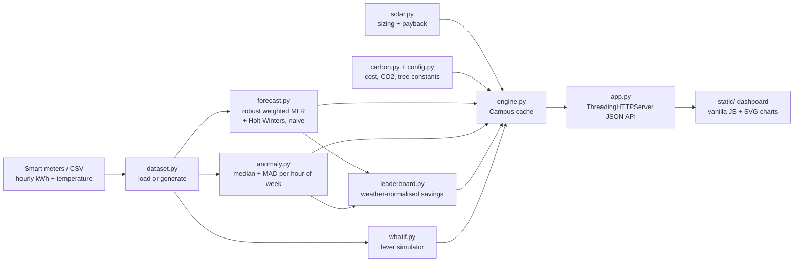

# WattWise - Hackathon Report

## 1. Title, tagline, domain

**WattWise**: *AI energy & carbon copilot for smart campuses*
**Domain:** Sustainability, CleanTech & Green Energy
**Event:** QUANTIX 2K26, K.S.R. College of Engineering (23–24 Oct 2026)

## 2. Problem statement

**Who is affected.** Colleges, hostels, offices and homes. On a campus the bill is paid centrally, so no
student, lab in-charge or warden ever sees the cost of a lab left running overnight or an admin block
that kept its AC on all Saturday.

**How big the problem is.** Buildings use a large share of India's electricity (approx. a third,
according to Bureau of Energy Efficiency material), and India's grid emits roughly 0.7 kg CO₂ per kWh
(approx., CEA CO₂ Baseline Database). Our 6-building demo campus uses about **1.34 GWh a year**. That
costs about **₹1.07 Cr** and emits about **950 t CO₂**. All of these are synthetic-data figures.

**Why current solutions fall short.**
- The only feedback is a **monthly bill**: one number that arrives weeks late and is not broken down by building, hour or cause.
- Commercial building-management and energy-analytics platforms are **expensive, cloud-locked and opaque**. A facilities manager cannot see why an alert fired.
- Rooftop solar decisions are made from **vendor quotes**, with no independent check that the payback suits the building's own load.
- Awareness drives fade because **savings are never measured**, and any measurement is not adjusted for weather.

## 3. Our solution

WattWise reads the hourly smart-meter data each building already has (or can get from a low-cost
CT-clamp logger). It forecasts the next week, catches waste as it happens, and says in plain language
what happened, what it cost and what to do. It converts everything to ₹ and kg CO₂, sizes rooftop
solar, lets managers try savings levers before spending money, and ranks buildings fairly to keep people motivated.

- **7-day hourly forecast** per building, with a "why" breakdown into calendar baseline plus weather effect
- **Waste and anomaly detection** with reasons, for example *"CSE Lab Block drew 18.1 kW at 3 AM Sun 6 Sep vs 3.0 kW typical for that hour (robust z = 40.8). After-hours load: computers, lights or AC were left on."*
- **Carbon accounting**: kWh → ₹ → kg CO₂ → trees-equivalent, with every factor a named constant
- **Rooftop solar planner**: kWp, generation, capex, payback, 25-year cash flow, CO₂ avoided
- **What-if simulator**: AC setpoint, auto-off timer, LED and BLDC retrofit, applied without double counting
- **Gamified leaderboard**: weather-normalised % saving against each building's own past, with a Green Champion badge
- **Model report tab**: live MAPE and precision/recall, so judges can check the claims

## 4. Innovation / what makes it different

1. **Explainable by construction.** Every forecast splits into "calendar baseline + weather". Every alert shows its baseline, its robust z-score and the rule that fired. Nothing is a black box.
2. **Fair gamification.** Buildings compete against their **own weather-normalised baseline** (the idea behind IPMVP Option C), not on raw kWh. A 400-bed hostel and a library can share a leaderboard.
3. **Robust learning.** The forecaster trims waste hours from its own training data, so waste never becomes the new normal. The detector uses median and MAD for the same reason.
4. **Offline and free.** It needs only Python's standard library and runs on a ₹15k laptop with no internet, so a college can install it on the facilities PC today.
5. **One tool from detection to decision.** It goes from detecting waste, to pricing it in ₹ and CO₂, to simulating a fix, to sizing solar, to motivating people.

## 5. System architecture



| Component | Responsibility |
|---|---|
| `wattwise/config.py` | Every assumption as a named constant with its source (emission factor, tariff, solar yield, BEE AC rule, thresholds) |
| `wattwise/dataset.py` | Deterministic synthetic campus (seed 2026): 6 buildings × 1,344 h, weather, holiday, campaigns, 18 injected waste events; CSV/JSON persistence |
| `wattwise/stats.py` | Median, MAD, percentile, Gaussian elimination, MAPE/WAPE, all from scratch |
| `wattwise/forecast.py` | Robust recency-weighted multiple linear regression; Holt-Winters; seasonal-naive; back-test |
| `wattwise/anomaly.py` | Hour-of-week robust baseline, event merging, rule-based causes, precision/recall evaluation |
| `wattwise/carbon.py` | kWh → ₹ → CO₂ → trees |
| `wattwise/solar.py` | Solar sizing, 25-year degraded cash flow, payback, CO₂ avoided, input validation |
| `wattwise/whatif.py` | Sequential lever simulation on the last 28 days |
| `wattwise/leaderboard.py` | Baseline on weeks 1–6, challenge weeks 7–8, badges and points |
| `wattwise/engine.py` | Runs everything once (~300 ms) and serves JSON-ready views |
| `app.py` | Static files plus JSON API with validation and JSON errors; never crashes on bad input |
| `static/` | Dashboard, solar, what-if, leaderboard and model-report tabs; light/dark; phone-friendly |

## 6. Algorithms & models

### 6.1 Load forecaster: robust, recency-weighted multiple linear regression

```
kWh(t) = Σ_k β_k · 1[daytype(t), hour(t) = k]                 72 calendar dummies
       + Σ_k γ_k · CDD(t) · 1[daytype(t), hour(t) = k]        72 weather slopes
CDD(t) = max(0, T(t) − 24 °C)          daytype ∈ {workday, saturday, sunday/holiday}

Solve (XᵀWX + λI) β = XᵀWy by Gaussian elimination (λ = 0.01)
W_t = 0.5^(age_days / 21)                         recent behaviour weighs more
Robust training:
  pass 0: start from per-category medians
  pass 1-2: drop hours whose relative residual has modified z > 3.5, refit
```

- **Why this model.** It is fully explainable: β is "a normal Tuesday 2 PM" and γ is "+kWh per °C at that hour". It handles holidays and weather, trains in milliseconds, and its sparse rows (≤ 2 non-zeros each) make XᵀX cheap without numpy.
- **Comparators.** Additive Holt-Winters (season 168 h, α/β/γ found by grid search on one-step SSE) and seasonal-naive ("same hour last week").
- **Limits.** It is linear in temperature above 24 °C and has no humidity, occupancy or exam-calendar inputs. The 7-day forecast needs a temperature forecast, which the demo data supplies; in deployment it would be typed in or fetched when online. A sudden behaviour change takes about a week to be learned.

### 6.2 Waste detector: hour-of-week median + MAD

```
for each building, for each of the 168 hours of the week:
    baseline = median(x),  MAD = median(|x − baseline|)
z = 0.6745 · (x − baseline) / max(MAD, 5% · baseline, 0.25)       (Iglewicz–Hoaglin)
flag hour if z > 3.5 AND excess > 2 kWh AND excess > 30% of baseline
merge flagged hours with gaps ≤ 1 h; keep events ≥ 2 h
wasted kWh = Σ max(0, x − baseline);  ₹ = kWh · tariff;  CO₂ = kWh · 0.71
cause = rules(hour, weekend/holiday, building type)
        → after-hours / weekend AC / empty-room load / kitchen equipment
```

- **Why.** The median and MAD are not inflated by the waste being hunted (mean and standard deviation are). The model is easy to explain to a warden, and holidays are compared with Sunday.
- **Limits.** It needs about 4 weeks of history per hour-of-week. Slow drifts (a gradual 10% creep) are not events; the leaderboard catches those instead. Very small leaks (< 30% of baseline) are deliberately ignored to avoid alarm fatigue. The 2 missed ground-truth events below are exactly these.

### 6.3 Carbon accounting

`CO₂ kg = kWh × 0.71` (approx., CEA India grid). `₹ = kWh × 8` (planning tariff).
`trees = annual CO₂ / 21 kg` (approx.). All three are in `config.py`.

### 6.4 Rooftop solar planner

```
kWp_roof   = roof_m² × 0.75 usable / 10 m² per kWp
kWp_demand = annual_kWh / 1,450 kWh per kWp            (net-metering cap)
kWp        = min(kWp_roof, kWp_demand)                 binding limit reported
gen(y)     = kWp × 1,450 × (1 − 0.5%)^(y−1)
saving(y)  = gen(y) × tariff − 1% × capex (O&M)
payback    = capex / saving(1)
```

- **Limits.** Simple payback is undiscounted. It ignores subsidies, tariff escalation, inverter replacement and shading. The 1,450 kWh/kWp/yr yield is an approx. Tamil Nadu planning figure. Every input can be overridden in the form.

### 6.5 What-if simulator

The month is the last 28 days scaled to 30. Levers are applied in sequence on the remaining energy:
1. **Auto-off** after 9, 10 or 11 PM in non-residential buildings: Σ max(0, load − essential base) × 85%, where essential base = 20th percentile of 00–05 h load.
2. **AC setpoint +d °C**: approx. 6% of AC energy per °C (BEE guidance) × AC share.
3. **LED retrofit** of p% of the remaining tubes: lighting share × p × approx. 50%.
4. **BLDC fans** for p% of fans: fan share × p × approx. 50%.

- **Limits.** End-use shares are audit-style assumptions per building, not sub-metered.

### 6.6 Leaderboard

A regression baseline is trained on weeks 1–6. Its prediction for weeks 7–8 (using the actual weather) is
the *expected* use. Saving % = (expected − actual) / expected. Badges: Green Champion (rank 1 and > 0%),
Energy Saver (≥ 3%), Zero Waste Alerts, Needs Attention (< 0%).
Points = 50 + 10 × saving % − 15 × waste alerts.

## 7. Tech stack and why it is offline-first

| Layer | Choice | Why |
|---|---|---|
| Backend | Python 3.9+ standard library (`http.server`, `json`, `csv`, `random`) | `python app.py` works on any venue laptop, including Windows, with no pip |
| Analytics | Hand-written linear algebra, robust statistics, Holt-Winters | No numpy/sklearn; every number can be traced |
| Frontend | Vanilla HTML/CSS/JS, inline SVG charts | No CDN, fonts or network, so the demo survives dead Wi-Fi |
| Data | Deterministic generator + committed CSV | Identical demo every time |

The whole pipeline (6 buildings × 1,344 h: forecasts, back-tests, Holt-Winters grid search, anomalies,
leaderboard) runs in **≈ 300 ms** at start-up. API responses take **1–2 ms**; `/api/evaluation`, which
re-runs 5 threshold presets, takes ≈ 65 ms.

## 8. Results / evaluation

All numbers below were measured on the synthetic campus with `python -m unittest` and `/api/evaluation`.

**Forecasting.** Trained on weeks 1–7, tested on the hold-out week 8 (12–18 Oct 2026, 168 h × 6 buildings).

| Building | Regression MAPE | Holt-Winters | Seasonal naive | Regression, waste hours excluded |
|---|---|---|---|---|
| Hostel Block A | **3.3%** | 5.5% | 6.1% | 3.3% |
| Hostel Block B | 5.2% | 7.7% | **4.9%** | 5.2% |
| CSE Lab Block | **11.1%** | 50.0% | 13.6% | 3.7% |
| Central Library | **3.6%** | 31.4% | 11.8% | 3.6% |
| Admin Block | **3.8%** | 59.9% | 19.7% | 3.8% |
| Main Canteen | 6.5% | 11.5% | **6.4%** | 4.8% |
| **Average** | **5.6%** | 27.7% | 10.4% | |

- The CSE Lab's 11.1% comes from two waste events inside the hold-out week, which the model correctly does *not* predict. With those hours excluded, its error is 3.7%.
- Hostel B and the Canteen began savings campaigns in week 7. The regression still carries some of the older, higher level, so seasonal-naive edges ahead for those two.
- Holt-Winters is poor on the office-type buildings because the 2 Oct holiday and the weekend waste events become part of its seasonal profile.

**Waste detection.** Compared with the 18 injected ground-truth waste events (1,503 kWh in total).

| Metric | Value |
|---|---|
| Event precision | **100%** (16 of 16 flagged events are real) |
| Event recall | **88.9%** (16 of 18) |
| Event F1 | 0.94 |
| Hour-level precision / recall | 100% / 93.3% |
| Estimated wasted kWh | 1,449 kWh vs 1,503 kWh true (−3.6%) |

Threshold sweep (from the Model report tab):

| Preset | z | Min excess | Flagged | Precision | Recall |
|---|---|---|---|---|---|
| high | 2.5 | 1 kWh / 10% | 19 | 90% | 94% |
| medium-high | 3.0 | 1.5 kWh / 20% | 16 | 100% | 89% |
| **default** | 3.5 | 2 kWh / 30% | 16 | 100% | 89% |
| low | 5.0 | 3 kWh / 50% | 14 | 100% | 72% |
| very low | 8.0 | 5 kWh / 80% | 11 | 100% | 61% |

The two misses are deliberately subtle: +4 kW on a 25 kW hostel night load, and +3 kW for 3 h in the
canteen. Both fall below the 30%-of-baseline gate.

**Honesty note.** The data is synthetic and its noise is cleaner than real meters (no meter dropouts,
no tariff-period resets). We expect real-world precision to be lower, and the threshold presets are there to tune it.

**Other outputs on the demo campus**
- Leaderboard: Hostel B (pledge drive) is Green Champion at **+7.5%** weather-normalised saving, against a true injected 10% cut. Admin is last at −3.8% (new server room plus a weekend AC event).
- What-if (AC +1 °C, auto-off at 10 PM, 50% LED, 30% BLDC): **10.0%** saving, 11,104 kWh/month, **₹10.7 L/yr**, 7.9 t CO₂/month.
- Solar on all roofs (5,900 m²): **442.5 kWp**, 642 MWh/yr (48.5% of use), simple payback **4.5 yr**, about 456 t CO₂ avoided per year.
- Tests: **30 unit and API tests pass** in about 1.5 s.

## 9. Screenshots


`docs/screenshot.png` shows the dashboard at 1440×900: KPI tiles, the CSE Lab actual-vs-forecast chart
with waste bands and the hold-out/forecast split, the "why this forecast" panel, the waste timeline and the load heatmap.

## 10. 3-minute live demo script

1. **(0:00) Open `http://<laptop-ip>:8002` and click "Run demo".** *"WattWise has just re-read 8 weeks of hourly data for 6 buildings and retrained every model in about 300 ms, offline."*
2. **(0:20) KPI tiles.** *"Last 30 days: 110k kWh, ₹8.8 L, 78 t CO₂. We found 16 waste events, and next week's forecast is ₹2.2 L."*
3. **(0:40) Chart, CSE Lab selected.** Hover over the red band on Thu 15. *"The lab drew 13 kW all night against a 3 kW baseline. The tooltip gives the reason. The dashed orange line is our forecast: it fits the hold-out week and continues into next week."*
4. **(1:05) "Why this forecast?" panel.** *"Next Friday's peak is a 60 kWh calendar baseline plus 23 kWh of weather at 33 °C. No black box."*
5. **(1:20) Waste timeline and heatmap.** Click Admin. *"Weekend AC left on, three times. Each outlined cell in the heatmap is an hour we flagged."*
6. **(1:40) Solar planner tab → "Load demo values".** *"All roofs: 442 kWp, payback 4.5 years, 456 t CO₂ a year. The cash-flow bars cross zero at the payback year."*
7. **(2:05) What-if tab.** Drag AC to +2 °C and LED to 100%. *"Savings update live: about 16% of campus use, roughly ₹17.5 L a year. Levers are applied in sequence so nothing is counted twice."*
8. **(2:30) Leaderboard.** *"Hostel B's pledge drive saved 7.5% after weather adjustment, so it is Green Champion. Rankings are fair because each building competes with its own past."*
9. **(2:45) Model report.** *"5.6% MAPE against 27.7% for Holt-Winters, and 100% precision with 89% recall on injected waste. Measured live, not claimed."*

## 11. Impact

- **Economic.** On the demo campus, catching the detected waste alone is worth about ₹75k/yr. Cheap operational levers (setpoint, timers, a partial LED/BLDC retrofit) are worth about ₹10.7 L/yr, roughly 10% of the bill. These are synthetic-data estimates; real savings depend on the campus.
- **Environmental.** The 10% what-if scenario avoids about 95 t CO₂/yr. Rooftop solar on all six roofs avoids about 456 t CO₂/yr (using the approx. 0.71 kg/kWh factor).
- **Social and educational.** Students see their own building's effect. The leaderboard turns NSS, eco-club or hostel pledge drives into measurable contests, and the transparent maths doubles as a teaching aid.
- **Assumptions.** Tariff ₹8/kWh, approx. CEA emission factor, approx. BEE 6%-per-°C AC rule, approx. 50% LED and BLDC savings, approx. 1,450 kWh/kWp/yr. All are editable in `config.py`.

## 12. Feasibility, scalability & business model

- **Feasibility.** It only needs hourly kWh per building, from existing smart meters, a building-management export or a low-cost CT-clamp logger, plus temperature. It runs on any PC. The CSV in `data/` uses the same format a real export would.
- **Scalability.** The cost is linear in buildings × hours; one building-year (8,760 h) fits in milliseconds. A 100-building campus is still under a few seconds on a laptop. The models are per building, so they parallelise trivially.
- **Business model.**
  1. Free, open-source core for colleges, to build adoption through student clubs.
  2. A paid "WattWise Pro" for institutions and housing societies (priced per building per year): meter connectors, WhatsApp/SMS alerts and monthly sustainability reports for NAAC/IGBC paperwork.
  3. A referral fee from empanelled solar EPC vendors when the planner leads to an installation.
  4. Energy-as-a-service: a share of verified savings, measured with the same weather-normalised baseline.

## 13. Future scope

- Live meter ingestion (Modbus/MQTT) and WhatsApp/SMS alerts to the lab in-charge or warden
- Humidity, occupancy and the academic calendar (exams, vacations) as forecast features
- Time-of-day tariffs and peak-demand (kVA) charge optimisation
- Solar production forecast and battery dispatch; carbon-aware load scheduling
- Sub-metering and NILM to learn end-use shares instead of assuming them

## 14. Judges' Q&A prep

1. **"Is the data real?"** No. It is synthetic, from a fixed seed, and shaped like a typical campus with weather, a holiday, campaigns and 18 injected waste events. Synthetic data is what lets us measure precision and recall honestly, because we know the ground truth. Real data drops into the same CSV format.
2. **"Why not deep learning or LSTMs?"** With 8 weeks of hourly data per building, a 144-parameter regression is the right size. It gets 5.6% MAPE, trains in milliseconds offline, and every forecast can be explained in one line. We also benchmarked Holt-Winters (27.7%) and seasonal-naive (10.4%).
3. **"100% precision sounds too good."** It is on clean synthetic data. The threshold sweep shows the trade-off (90% precision, 94% recall at the "high" preset). On real meters we expect more false positives, which is why the thresholds are configurable and every alert shows its evidence.
4. **"How do you avoid false alarms on hot days?"** The hour-of-week baseline already includes normal heat variation, and we need both z > 3.5 and > 30% excess for at least 2 hours. The forecaster models temperature explicitly, and the leaderboard is weather-normalised.
5. **"Where do 0.71 kg CO₂/kWh and 1,450 kWh/kWp come from?"** Both are approximate: the CEA CO₂ Baseline Database puts the India grid near 0.7, and 1,400–1,500 kWh/kWp/yr is the usual Tamil Nadu planning range. They are named constants in `config.py`, so a user can plug in the latest values.
6. **"Is a 4.5-year solar payback realistic?"** For the default ₹8/kWh tariff and ₹50k/kWp it is simple arithmetic: 1,450 × 8 ≈ ₹11.6k per kWp per year, minus O&M. The model ignores subsidy, tariff escalation and discounting, and the form lets you change tariff and cost.
7. **"How is the leaderboard fair between a hostel and a library?"** Each building is compared only with its own weather-adjusted past (regression baseline on weeks 1–6), never with another building's raw kWh.
8. **"What hardware does a college need?"** Existing smart meters, or a CT-clamp logger per building panel that exports hourly kWh, plus this app on any PC.
9. **"Does it scale?"** The cost is linear in buildings × hours. The full 6-building pipeline takes about 300 ms, and the API responds in 1–2 ms.
10. **"What if the AC end-use share is wrong?"** The what-if results scale linearly with the share, and the explanation says so. Sub-metering or NILM (future scope) would replace the assumed shares.

## 15. How to run

```bash
cd projects/02-wattwise
python app.py                         # http://127.0.0.1:8002/
python app.py --host 0.0.0.0 --port 8002
python -m unittest discover -s tests  # 30 tests
```

Regenerate the sample data with `python -c "from wattwise import dataset; dataset.save(dataset.generate(), 'data')"`, or click **Run demo** in the UI.
