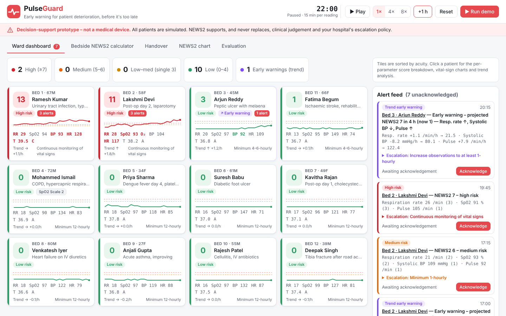

# PulseGuard

**Early warning for patient deterioration, before it's too late.** Domain: HealthTech & Biomedical Innovation · QUANTIX 2K26

PulseGuard is a ward early-warning dashboard. It scores every vital-sign reading with
**NEWS2** (Royal College of Physicians, 2017), including SpO2 Scale 2 for hypercapnic COPD
patients. On top of that it runs a **trend detector** written from scratch: least-squares
slopes over the last 3 hours, projected 4 hours ahead. It flags patients whose score is
*heading* towards the urgent-response threshold before they cross it. Everything runs
offline on the Python standard library.

> **Decision-support prototype – not a medical device.** All patients are simulated.



## Quick start

```bash
cd projects/03-pulseguard
python app.py                 # http://127.0.0.1:8003/
python app.py --host 0.0.0.0  # let phones on the same Wi-Fi open it
python -m unittest discover -s tests
python -m pulseguard.evaluation   # re-measure the numbers in REPORT.md -> data/evaluation.json
python -m pulseguard.simulator    # re-export the seeded ward -> data/sample_ward.json
```

Click **Run demo** to reset the 12-bed ward and start the clock (15 simulated minutes per second). You can also
use **+1 h** to step forward.

## Features

- Every NEWS2 parameter and band is implemented exactly as published: the aggregate score,
  the single-parameter "red" 3, and the low / low–medium / medium / high response.
- A ward simulator with 12 seeded patients. Three of them deteriorate (a sepsis-like
  patient, a post-op pneumonia patient and an upper GI bleed), two improve, and one COPD
  patient is scored on Scale 2. The clock runs on the server, with play, pause, speed (1×, 4×
  and 8×), +1 h and reset.
- Trend early warning based on OLS slopes, with R² gating, projection, a debounce and a
  cooldown.
- The dashboard sorts patients by acuity and shows a sparkline on every tile. The alert
  feed has Acknowledge buttons and the escalation steps for each alert.
- The patient drawer shows a per-parameter breakdown of the score, vital-sign charts
  shaded by scoring zone, projected trends, and a Scale 1 vs Scale 2 comparison.
- A bedside calculator with input validation. You can also save a reading to a ward
  patient as a manual observation.
- A printable handover summary for each patient: current score, 4-hour trend, last change
  and action. It can also be exported as plain text.
- An Evaluation tab with lead time, false-alert counts, a held-out check, a sensitivity
  table and latency.

## API

| Method | Path | Purpose |
|---|---|---|
| GET | `/api/health` | liveness + clock |
| GET | `/api/ward` | clock, acuity-sorted patient tiles, band counts, latest alerts |
| POST | `/api/sim` | `{"action": "play"/"pause"/"reset"/"demo"/"step"/"skip", "hours": 1}` or `{"action":"speed","speed":4}` |
| GET | `/api/patients/<id>` | full history, NEWS2 breakdown, trend analysis, alerts, handover note |
| POST | `/api/patients/<id>/observations` | add a validated manual observation at current ward time |
| GET | `/api/alerts[?unacked=1]` | alert feed |
| POST | `/api/alerts/<id>/ack` | acknowledge `{"by": "Sr. Meena"}` |
| POST | `/api/news2` | bedside calculator: `{"rr","spo2","sbp","hr","temp","o2","acvpu","scale"}` → score, band, response, breakdown |
| GET | `/api/news2/reference` | the NEWS2 threshold tables and response bands |
| GET | `/api/handover[?format=text]` | handover summary (JSON or printable text) |
| GET | `/api/evaluation` | the metrics reported in REPORT.md (computed on first call, ~10 s) |

Invalid input returns JSON errors with status 400, 404 or 405, and the server keeps running.

## Layout

`pulseguard/` holds the pure logic. It contains `news2.py`, `trend.py`, `alerts.py`,
`simulator.py`, `ward.py`, `handover.py`, `evaluation.py`, and `config.py`, which holds
all the tunable assumptions. The rest of the project is:

- `app.py`: the HTTP server.
- `static/`: the vanilla HTML, CSS and JS front end.
- `tests/`: 75 unittest tests.
- `data/`: the seeded ward and the evaluation output.
