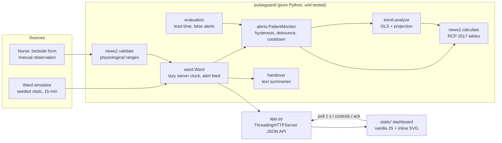

# PulseGuard: hackathon report

## 1. Title, tagline, domain

**PulseGuard**: *Early warning for patient deterioration, before it's too late.*
Domain: **HealthTech & Biomedical Innovation**. QUANTIX 2K26, K.S.R. College of Engineering.

> PulseGuard is a decision-support prototype, not a medical device. All patients and data in this report are simulated.

## 2. Problem statement

**Who suffers.** Patients on general wards whose condition slowly gets worse between
observation rounds. Typical examples are early sepsis after a urinary infection,
pneumonia after surgery, or a slow GI bleed. The nurses caring for them are also affected,
especially in understaffed Indian district and rural hospitals. There a single nurse may
cover a large ward on a night shift. We do not quote a precise ratio because figures vary
widely by state and facility.

**How much it matters.**
- Deterioration is usually visible in the vital signs hours before a crisis. A widely
  cited study (Schein et al., *Chest* 1990) found that **approx. 8 in 10** in-hospital
  cardiac arrests had documented clinical deterioration within the 8 hours before the arrest.
- NEWS2 itself only asks for observations **every 12 hours** when the score is 0, and
  **every 4–6 hours** for scores of 1–4 (RCP 2017). A patient can go from "fine" to
  "urgent" within one of those gaps.
- On paper charts, nobody calculates or plots a trend. Each round is a snapshot, so a
  heart rate that climbs from 82 to 100 over 4 hours looks "only 1 point" each time.

**Why existing solutions fail.** Commercial early-warning and central-monitoring systems
need networked monitors, an EHR and a licence budget, which district hospitals do not have.
Paper NEWS2 charts help, but they depend on manual adding-up and on someone noticing the
trend. Plain threshold alarms only fire once the patient has already crossed the line.

## 3. Our solution

PulseGuard takes a stream of vital signs, either from a bedside monitor or wearable, or
entered by a nurse. It scores every reading with a full NEWS2 implementation and adds a
trend detector that projects where each patient is heading. A ward dashboard sorts beds by
acuity and turns alerts into the NEWS2 escalation instructions. It also explains every
score parameter by parameter and writes the shift handover automatically. It runs on any
laptop with Python and no internet.

- **NEWS2 exactly as published.** It covers all seven parameters, SpO2 Scale 1 and
  Scale 2, air or oxygen, ACVPU, the aggregate score, the single-parameter red score, the
  four risk bands and the monitoring frequency and response for each band.
- **A trend early warning.** It uses least-squares slopes, R² gating and a 4-hour
  projection. It raises a purple "early warning" while the score is still in the low band.
- **A live ward simulator.** It has 12 seeded patients. Three deteriorate, two improve and
  one COPD patient is scored on Scale 2. A server-side clock drives it, with play, pause,
  speed, +1 h and reset.
- **Explainability everywhere.**
  - Each parameter's points and its share of the score.
  - Vital-sign charts shaded by NEWS2 scoring zone.
  - A slope, R² and projected value for each vital.
  - The rule that fired for each alert.
- **An alert feed** with an Acknowledge button and the exact escalation steps. Threshold
  alerts use hysteresis so they do not flicker.
- **A bedside calculator** with validation. It works on its own, or the nurse can save the
  reading to a ward patient.
- **An auto-generated, printable handover**: current score and band, contributors, 4-hour
  trend, last change, and the action to take.

## 4. Innovation / what makes it different

1. **It looks at the trajectory as well as the threshold.** NEWS2 is a snapshot.
   PulseGuard projects each vital's trend and scores the projected vitals with NEWS2
   itself. The early warning therefore speaks the same language the nurses already use:
   "projected NEWS2 7 in 4 h".
2. **Explainable by construction.** Every number is computed by a transparent rule or a
   two-line formula that a nurse educator can check on paper. There is no black-box model.
3. **Scale 2 done properly.** A COPD patient kept at 88–92% would trigger a red score on
   every reading under Scale 1. In our simulation that is 2,903 of 2,910 readings, against 0
   on Scale 2. PulseGuard shows that comparison on screen, which helps prevent alarm fatigue.
4. **Offline and cheap.** One Python file and a browser run it on a ₹15k laptop. It needs no
   cloud, no pip packages and no CDN, so it also works when the hospital Wi-Fi is down.
5. **Honest evaluation.** We report the trade-off between lead time and false alerts,
   including a held-out set of seeds that we never used for tuning.

## 5. System architecture



| Component | File | Responsibility |
|---|---|---|
| NEWS2 engine | `pulseguard/news2.py` | Threshold tables, Scale 1 and 2, bands, responses, validation, reference chart |
| Trend detector | `pulseguard/trend.py` | OLS slope and R² per vital and for the score, projection, early-warning rule |
| Alert state machine | `pulseguard/alerts.py` | Threshold alerts with hysteresis; trend alerts with confirmation and cooldown |
| Simulator | `pulseguard/simulator.py` | 12 seeded patient trajectories (baseline + severity ramp + AR(1) drift + noise) |
| Ward | `pulseguard/ward.py` | Simulated clock, reveals and scores readings, alert feed, ack, manual observations |
| Handover | `pulseguard/handover.py` | Per-patient text: score, contributors, 4-h trend, last change, action |
| Evaluation | `pulseguard/evaluation.py` | Replays 30 + 30 ward-days, sensitivity table, latency |
| Config | `pulseguard/config.py` | Every tunable assumption, each with a comment |
| Server | `app.py` | Static files plus JSON API, input validation, JSON errors, never crashes |
| UI | `static/` | Ward tiles, sparklines, alert feed, patient drawer, calculator, handover, chart, evaluation |

## 6. Algorithms & models

### 6.1 NEWS2 (RCP 2017)

Each parameter maps to points through a lookup table, where the first row whose upper
bound is at least the value applies. Values are first rounded to chart precision: whole
numbers for most parameters and 0.1 °C for temperature, rounding half up.

| Parameter | 3 | 2 | 1 | 0 | 1 | 2 | 3 |
|---|---|---|---|---|---|---|---|
| Resp. rate | ≤8 | | 9–11 | 12–20 | | 21–24 | ≥25 |
| SpO2 Scale 1 | ≤91 | 92–93 | 94–95 | ≥96 | | | |
| SpO2 Scale 2 | ≤83 | 84–85 | 86–87 | 88–92, ≥93 on air | 93–94 on O2 | 95–96 on O2 | ≥97 on O2 |
| Air or oxygen | | Oxygen | | Air | | | |
| Systolic BP | ≤90 | 91–100 | 101–110 | 111–219 | | | ≥220 |
| Pulse | ≤40 | | 41–50 | 51–90 | 91–110 | 111–130 | ≥131 |
| Consciousness | | | | Alert | | | CVPU |
| Temperature | ≤35.0 | | 35.1–36.0 | 36.1–38.0 | 38.1–39.0 | ≥39.1 | |

The aggregate score is the sum of the seven parameter scores, from 0 to 20. The band is
chosen in this order: **high** if the total is 7 or more; **medium** if it is 5–6;
**low–medium** if any single parameter scores 3; otherwise **low**. Each band carries the
RCP's minimum monitoring frequency and clinical response. A score of 0 means 12-hourly
monitoring and 1–4 means 4–6-hourly. Low–medium and medium both mean at least hourly; for
medium, the nurse also requests an urgent clinical review. High means continuous
monitoring and emergency assessment. The unit tests check every boundary.

*Why chosen:* NEWS2 is the early-warning score endorsed in the UK NHS and widely used
elsewhere. Nurses already know it, and it needs no training data. *Limits:* it was designed
for adults, not for pregnancy or children. It is a snapshot, and it weights all
parameters by fixed points.

### 6.2 Trend detector (from scratch)

The detector looks at the last *N* = 12 readings (3 hours at one reading every 15 minutes).
For each vital *y*, and for the aggregate score, it fits a least-squares line:

```
b  = Σ(t − t̄)(y − ȳ) / Σ(t − t̄)²         slope per hour
a  = ȳ − b·t̄
R² = 1 − Σ(y − a − b t)² / Σ(y − ȳ)²
```

A vital's trend is **significant** when R² ≥ 0.55 and |b·H| reaches a clinically
meaningful change over the horizon H = 4 h. The minimum changes are 2 breaths/min,
1.5% SpO2, 8 mmHg, 8 beats/min and 0.4 °C.

For each significant vital, the projected value is the fitted current value plus b·H.
Vitals without a significant trend keep their last observed value. The projected vitals
are then scored with NEWS2.

A vital counts as **worsening** if it is significant and either its projected points
rise, or it is moving away from the centre of its normal range without passing back
through that range.

The **early warning** applies only while the current NEWS2 is below 5, and fires when
either of these holds:
- (a) the projected NEWS2 is 5 or more, at least 2 points above the current score, and at
  least 2 vitals are worsening;
- (b) the aggregate score's slope is at least 1 point per hour, with R² ≥ 0.6 and a
  current score of at least 3.

The condition must hold for **2 consecutive readings**. After it fires there is a
**3-hour cooldown**, and it is suppressed once a medium or high threshold alert has already
been raised.

*Why chosen:* it is explainable (slope, R² and projection are shown on screen), it
needs no labelled data, and it runs in microseconds. *Limits:*
- It is linear, so it cannot anticipate a sudden collapse.
- It needs about 2 hours of frequent readings, so it is weak with 4-hourly manual data.
- The thresholds were tuned on simulated physiology.

### 6.3 Alert state machine

- **Threshold alerts** fire when the band rank goes up. They re-arm only after the patient
  has stayed in a lower band for 4 consecutive readings. This is hysteresis: without it, a
  4↔5 flicker would raise an alert on every reading.
- **Trend alerts** are debounced and rate-limited as described in 6.2.
- Alerts raised during the 2-hour history loaded on reset are marked as acknowledged
  by the night shift.

### 6.4 Simulator

Each vital is built as:

```
value = baseline + severity(t)·Δ + AR(1) drift + measurement noise
```

- **Severity** ramps from 0 to 1, as a blend of linear and smoothstep curves, so the early
  changes are subtle.
- **Drift** uses φ = 0.85, with standard deviations of 0.45, 0.35, 2.2, 1.6 and 0.05.
- **Measurement noise** has standard deviations of 0.8, 0.6, 4, 2.5 and 0.06 for RR,
  SpO2, SBP, HR and temperature.
- The pneumonia patient is started on oxygen at 60% severity, which lifts SpO2 by 4%.
- The sepsis-like patient becomes newly confused at 85% severity.
- For the evaluation, each seed shifts the onset by up to ±2 h, scales the duration by
  0.75–1.3× and scales the size of the changes (Δ) by ±15%.

*Limits:* the trajectories are illustrative, not fitted to real patient data.

## 7. Tech stack

- **Backend:** Python 3.9+ standard library only: `http.server.ThreadingHTTPServer`,
  `json`, `random`, `statistics`, `threading`. No pip, no numpy, no Flask.
- **Frontend:** vanilla HTML, CSS and JS, with charts and sparklines drawn as inline SVG.
  No CDN and no web fonts. It supports light and dark mode and works at phone width.
- **Offline-first.** The browser only talks to the laptop. The simulated clock runs lazily
  on the server, so it needs no background threads or timers. The data is generated
  deterministically from a fixed seed (`data/sample_ward.json`). With `--host 0.0.0.0`,
  judges can open the dashboard on their phones over a local hotspot.

## 8. Results / evaluation

All numbers come from `python -m pulseguard.evaluation` and are saved in
`data/evaluation.json`. The evaluation replays complete simulated 24-hour ward-days
through the same `PatientMonitor` class the live server uses. **Every number is from
simulation, not from real patients.**

**Definitions:**
- *Threshold alert time* is the first reading with NEWS2 ≥ 5 under continuous 15-minute
  monitoring.
- *Manual round* is the first 4-hourly observation round (06:00, 10:00, and so on) that
  finds NEWS2 ≥ 5.
- *PulseGuard time* is the earlier of the trend alert and the threshold alert.
- *Lead time* is the comparison time minus PulseGuard time.

### 8.1 Alert lead time on the deteriorating patients

| Measure | Tuning seeds 1–30 (90 episodes) | **Held-out seeds 101–130 (90 episodes)** |
|---|---|---|
| Extra warning vs. continuous NEWS2 ≥ 5 (median / mean) | 1.25 h / 1.26 h | **1.0 h / 1.08 h** |
| Range | 0 – 3.75 h | 0 – 3.5 h |
| Trend alert fired before the threshold | 83 / 90 | **76 / 90** |
| Earlier than a 4-hourly paper round (median / mean) | 3.12 h / 3.21 h | **3.25 h / 3.17 h** |
| Continuous threshold vs. paper round (median) | 1.75 h | – |

Median lead time over the tuning seeds, for each type of deterioration:

| Patient | Lead vs. threshold | Lead vs. 4-h round |
|---|---|---|
| Sepsis-like (Ramesh Kumar) | 1.5 h | 3.75 h |
| Post-op pneumonia (Lakshmi Devi) | 0.75 h | 2.25 h |
| Upper GI bleed (Arjun Reddy) | 1.38 h | 3.0 h |

Demo ward (seed 42, what the judges see live):

| Patient | Onset | Trend alert | NEWS2 ≥ 5 | 4-h round | Lead vs threshold |
|---|---|---|---|---|---|
| Ramesh Kumar | 10:00 | 12:15 | 14:00 | 14:00 | 1.75 h |
| Lakshmi Devi | 14:00 | 17:00 | 17:15 | 18:00 | 0.25 h |
| Arjun Reddy | 18:00 | 20:15 | 22:30 | 02:00 | 2.25 h |

### 8.2 False alerts on patients who do not deteriorate

There are 9 such patients: 7 stable, including the COPD patient, and 2 improving.

| Measure | Tuning seeds | **Held-out seeds** |
|---|---|---|
| Trend false alerts | 7 in 270 patient-days (0.026/day, about 1 per 38 patient-days) | **3 in 270 (0.011/day)** |
| Trend alerts fired before onset in deteriorating patients | 1 | 0 |
| NEWS2 ≥ 5 threshold alerts on the 7 stable patients | 0 in 210 patient-days | 1 in 210 |

The improving patients do raise genuine medium-band NEWS2 alerts at admission (06:00),
when they really are unwell. These are correct escalations, not false alarms, and the trend
detector raised 0 alerts on them.

**COPD and SpO2 Scale 2.** Across the 30 tuning seeds, 2,903 of 2,910 readings from the
COPD patient would be at least low–medium under Scale 1, because SpO2 ≤ 91% scores 3. Under
Scale 2 the count is 0.

### 8.3 Sensitivity of the trade-off (tuning seeds)

| Setting | Median lead vs threshold | Trend first | False trend alerts | Per patient-day |
|---|---|---|---|---|
| **Shipped** (window 12, H 4 h, R² 0.55, confirm 2) | 1.25 h | 83/90 | 7 | 0.026 |
| Horizon 2 h | 0.25 h | 53/90 | 1 | 0.004 |
| R² ≥ 0.4 | 1.5 h | 87/90 | 25 | 0.093 |
| No confirmation | 1.5 h | 89/90 | 27 | 0.100 |
| Window 16 readings | 0.75 h | 73/90 | 2 | 0.007 |

Every knob trades earlier warning against more false alerts. We chose the shipped
setting so that extra false alerts stay below about one per month for each bed.

### 8.4 Scoring latency

Measured on the development container. The numbers will vary on venue laptops.

| Operation | Latency |
|---|---|
| `news2.calculate` (pure function, 20,000 runs) | **≈ 6 µs** per score |
| Score + 12-point trend analysis + alert logic | ≈ 84 µs per reading |
| `POST /api/news2` over HTTP on localhost (200 requests) | median 0.77 ms, p95 2.1 ms |
| `GET /api/ward` (12 patients, all tiles, alerts) | median 1.2 ms, p95 1.45 ms |

The test suite has 75 unittest tests, which pass in about 2 s. They cover every NEWS2
boundary, the Scale 2 logic, the band rules, OLS, the trend rules, the alert hysteresis,
the simulator, the ward clock and the API.

## 9. Screenshots


The screenshot shows the ward dashboard at 22:00 of the demo scenario. Two septic and
respiratory patients are in the high band. Arjun Reddy (GI bleed) shows a purple **early
warning** while his NEWS2 is still 3 (low). The alert feed explains why: "projected NEWS2 7
in 4 h — Resp. rate ↑, Systolic BP ↓, Pulse ↑".

## 10. 3-minute live demo script

1. **(0:00) Hook.** "In a district hospital at night, one nurse may be watching dozens of
   beds. Deterioration starts hours before a crash, but a paper chart only sees snapshots."
   Point at the red disclaimer: decision support, not a device.
2. **(0:20) Click *Run demo*.** The ward resets to 08:00 and plays at 15 simulated minutes per second, so the whole day takes about 90 s. Pause on each event while you talk. "Twelve virtual
   patients, one reading every 15 minutes, all generated from a fixed seed." Point at the
   tiles, which are sorted by acuity, and the sparklines.
3. **(0:45) First early warning (~12:15).** Bed 1, Ramesh, gets a purple **Early warning**
   while his NEWS2 is still low. Open the alert: "Resp rate, pulse and temperature are all
   rising; projected NEWS2 5 within 4 h." Click **Acknowledge**.
4. **(1:15) Click the tile and open the patient drawer.**
   - The **per-parameter breakdown** shows each parameter's points and share of the score.
   - The **charts are shaded by NEWS2 scoring zone**, and a dashed line shows the projection.
   - The trend table shows the slope and R² for each vital.

   "No black box. Every number can be checked by hand."
5. **(1:45) The threshold fires at 14:00 (NEWS2 5, medium).** "PulseGuard warned 1 h 45 min
   earlier. A 4-hourly paper round would also only see it at 14:00, and for the GI bleed
   patient the paper round sees it 5.75 h after our alert." Open the **Evaluation** tab:
   median 1 h extra warning on held-out seeds, and 3 false alerts in 270 patient-days.
6. **(2:15) Bed 4, COPD.** Open the drawer. "Scale 2 keeps his 89% at 0 points. On Scale 1
   he would trigger a red score on every reading, which leads to alarm fatigue."
7. **(2:30) Bedside calculator.** Click **Early sepsis**: the result is NEWS2 7 (High), computed
   in microseconds with the escalation text. Type an impossible SpO2 of 140 to show the
   validation.
8. **(2:45) Handover tab, then Print.** "The night-shift handover writes itself: score, 4-hour
   trend, last change and action." Close with: "Runs offline on a ₹15k laptop, pure Python,
   75 tests."

## 11. Impact

- **Social.** Catching sepsis, pneumonia or bleeding an hour or more earlier gives time for
  fluids, antibiotics or a transfer, which is when outcomes are most time-sensitive. A
  common aspiration is that earlier escalation reduces unplanned ICU transfers and cardiac
  arrests on general wards. *Assumption:* our lead times are simulated, and the real benefit
  has to be proven in a clinical study.
- **Workforce.** Nurses spend less time adding up scores and drawing charts. The dashboard
  points scarce attention at the 1–2 beds that need it, and the handover becomes consistent.
- **Economic.** The software runs on existing laptops at no cost. Combined with low-cost
  vital-sign sensors, it targets facilities that cannot afford central-monitoring systems.
  We do not claim specific rupee savings.
- **Environmental.** It needs no paper charts if adopted fully, and no cloud compute. It
  runs on a single low-power machine.

## 12. Feasibility, scalability & business model

- **Feasibility.** NEWS2 is already the accepted clinical standard, so the new part is the
  software and the trend layer. Sensor input could come from existing multiparameter
  monitors with serial or HL7 output, from low-cost BLE pulse oximeters and wearables, or
  from manual entry on a ₹10k Android tablet.
- **Regulatory path.** As decision support that computes a published score, a real
  deployment would still need assessment under India's medical-device rules (CDSCO,
  software as a medical device), plus clinical validation and IEC 62304-style development.
  We are explicit that this prototype has none of that.
- **Scalability.**
  - One laptop serves a ward. The logic costs about 84 µs per reading, so one core can
    handle thousands of beds.
  - Hospitals could aggregate wards by moving the state to SQLite or Postgres and running
    one dashboard for each nursing station.
- **Business model.**
  1. A free and open bedside calculator to drive adoption.
  2. A per-bed monthly subscription for the ward dashboard. The software is installed
     on-premises and the subscription includes support.
  3. A bundle with low-cost sensors for district hospitals, sold through state health
     missions or CSR programmes.
  4. An analytics add-on for quality teams, covering escalation compliance and
     time-to-review.

## 13. Future scope

- Validate on real, de-identified vital-sign datasets, such as the public critical-care
  databases, and then run a prospective silent pilot on one ward.
- Ingest data from monitors and wearables through HL7/FHIR or BLE, and add an SMS or
  WhatsApp escalation to the doctor on call, with the acknowledgement time recorded.
- Make the trend detector personal, with baselines for each patient, for example someone
  whose normal heart rate is 95. Add robust regression (Theil–Sen) and an estimated
  probability of deterioration with calibration.
- Add a sepsis screen (qSOFA prompts) and fluid-balance and urine-output inputs.
- Add multilingual UI and voice entry (Tamil, Hindi) for the bedside form.

## 14. Judges' Q&A prep

1. **Is this a medical device?** No. It is a decision-support prototype on simulated data,
   and we say so on every screen. A real product would need CDSCO approval as software as a
   medical device and clinical validation.
2. **Why not deep learning?** There are no labelled data from Indian wards, and clinicians
   need to trust the output. NEWS2 plus a linear trend is fully explainable, runs in
   microseconds offline, and can be audited by a nurse educator. ML is on the roadmap once
   real data exist.
3. **Your lead times come from your own simulator, aren't they circular?** Partly, yes, and
   we say so. To limit that, we tuned on seeds 1–30 and also report seeds 101–130, which were
   never used for tuning (1.0 h median). We also publish the full sensitivity table. Real
   validation needs real data.
4. **Won't trend alerts cause alarm fatigue?** We measured it: 3 false trend alerts in 270
   stable patient-days on held-out seeds. Two consecutive confirming readings, R² gating, a
   3-hour cooldown and suppression after escalation keep the volume down. Every knob is in
   `config.py`.
5. **Where do vitals come from in a hospital without monitors?** Manual entry works today
   through the bedside calculator, which saves to the patient. The trend layer needs frequent
   readings, so low-cost wearables (SpO2, HR, RR, temperature) are the intended input.
   Manual 4-hourly entry still gets correct NEWS2 scores, the per-parameter breakdown and
   the handover.
6. **How do you know your NEWS2 is right?** Every boundary of every parameter is unit-tested
   against the RCP 2017 chart. That includes the Scale 2 behaviour on and off oxygen, the
   precedence of the aggregate score over the red-score rule, and the maximum score of 20.
   The on-screen chart is generated from the same tables the scorer uses.
7. **Why Scale 2 at all?** COPD patients with hypercapnic respiratory failure are
   deliberately kept at 88–92% SpO2. Scale 1 would score them 3 every time. NEWS2 says to use
   Scale 2 only when a clinician prescribes it, and our UI shows that warning.
8. **What if the network or power fails?** There is no network dependency. Everything runs on
   one laptop, and the UI works over a local hotspot. Persistent storage and a UPS would be
   needed for production.
9. **What about privacy?** All the data here is simulated. In a real deployment the data
   stays on premises and is never sent to the cloud. Next steps are role-based login and
   audit logs.
10. **What does it cost?** The software is free to run, and the target hardware is an existing
    PC or a ₹10–15k laptop. The only real cost at scale is sensors.

## 15. How to run

```bash
cd projects/03-pulseguard
python app.py                       # http://127.0.0.1:8003/  (Ctrl+C to stop)
python app.py --host 0.0.0.0 --port 8003   # open from a phone on the same Wi-Fi
python -m unittest discover -s tests       # 75 tests
python -m pulseguard.evaluation            # recompute every number in section 8
python -m pulseguard.simulator             # regenerate data/sample_ward.json
```

Use Python 3.9 or newer. There is nothing to install.
