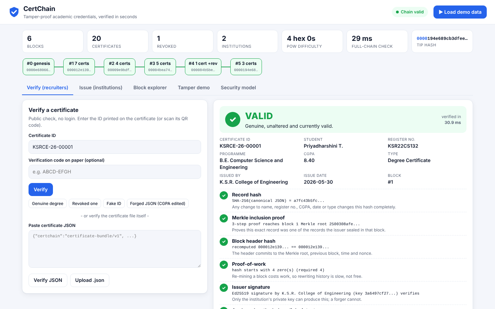

# CertChain

**Tamper-proof academic credentials, verified in seconds**. Domain: Cybersecurity & Blockchain Technology.

CertChain is a permissioned blockchain for degree, marksheet and internship certificates. The project's own pure-Python code covers Ed25519 (RFC 8032), Merkle proofs, proof-of-work and a QR encoder, all built on Python's stdlib (`hashlib`). Colleges issue and sign certificates. Recruiters scan the QR code or enter the certificate ID and get VALID, REVOKED or INVALID, with a step-by-step explanation.



## Quick start

```bash
python app.py                  # http://127.0.0.1:8004/
python app.py --host 0.0.0.0   # open from a phone on the same LAN (QR scanning)
python -m unittest discover -s tests
python bench.py                # sign/verify/mining/verification timings
python -m certchain.demo       # regenerate deterministic demo data in data/
```

No dependencies. Python 3.9+ only. If `data/` is missing, the demo ledger is created on first run.

## API

| Method | Path | Purpose |
|---|---|---|
| GET | `/api/health` | liveness |
| GET | `/api/stats` | ledger stats + integrity |
| GET | `/api/institutions` | registered issuers + certificate types |
| GET | `/api/chain` | all blocks (summaries) + validation |
| GET | `/api/block/<n>` | raw block |
| GET | `/api/certificates?q=` | search issued certificates |
| GET | `/api/certificate/<id>` | certificate bundle, verify URL, QR SVG, status |
| GET | `/api/certificate/<id>/qr.svg` | QR code image |
| GET | `/api/verify/<id>?code=` | explainable verification by ID |
| POST | `/api/verify` | `{cert_id, code?}` or `{bundle}` |
| POST | `/api/issue` | `{issuer_id, student_name, register_no, programme, cgpa, issue_date, cert_type}` |
| POST | `/api/issue/bulk` | `{issuer_id, csv}` |
| POST | `/api/revoke` | `{issuer_id, cert_id, reason}` |
| GET | `/api/validate` | full-chain validation report |
| POST | `/api/tamper` | `{mode: "edit" or "rehash", cert_id?}` simulates a database attacker |
| POST | `/api/restore` | restore `chain.json` from the pre-tamper backup |
| POST | `/api/demo/reset` | reload the deterministic demo ledger |
| GET | `/api/security` | threat model |
| GET | `/api/sample.csv` | sample bulk-issue CSV |

The printable certificate page is `/certificate.html?id=<cert id>`.

## Layout

- `certchain/` holds the pure logic: `ed25519`, `merkle`, `chain`, `records`, `qr`, `service`, `demo`, `security`, `config`.
- `static/` holds the dashboard (`index.html`, `app.js`, `style.css`) and `certificate.html`.
- `data/` holds `chain.json`, `keys.json` (deterministic **demo** keys) and `sample_bulk.csv`.
- `tests/` holds 44 unit tests: RFC 8032 vectors, Merkle proofs (odd counts included), chain validation, tamper detection, revocation and the service flows.

See `REPORT.md` for the full hackathon report.
