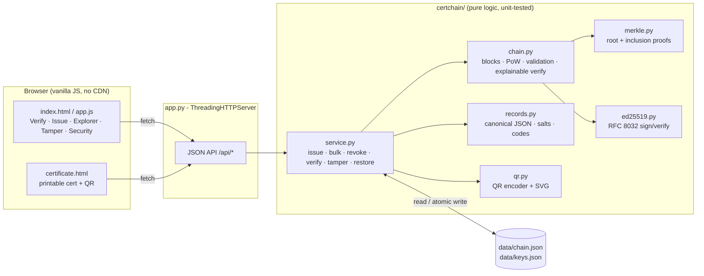

# CertChain: hackathon report

## 1. Title, tagline, domain

**CertChain**: *Tamper-proof academic credentials, verified in seconds*
**Domain:** Cybersecurity & Blockchain Technology
**Event:** QUANTIX 2K26, K.S.R. College of Engineering

## 2. Problem statement

- **Who suffers:**
  - **Recruiters and HR teams** cannot tell a genuine degree or marksheet PDF from a doctored one.
  - **Universities** spend staff time answering verification emails and phone calls.
  - **Honest students** lose out when a peer with a faked CGPA or internship certificate gets the job.
- **How much:** fake degree, marksheet and internship certificates come up again and again in Indian hiring and admissions news. Manual verification with the issuing college over email, letter or phone usually takes **days to weeks** (approx.; it depends on the college). A doctored PDF takes minutes to make with free editing tools. We have not quoted a national fraud rate because we could not find a figure we trust.
- **Why existing solutions fail:**
  - Paper seals and holograms can be copied, and PDFs can be edited.
  - **Phone or email confirmation** is slow, has no audit trail and can be socially engineered.
  - **Central repositories** such as DigiLocker / NAD help, but coverage varies by institution. A verifier also has to trust whoever runs the central database: an insider or an attacker with database access could change a record and nobody outside could tell.
  - **Third-party background-verification agencies** cost money per check and still rely on the college replying.

## 3. Our solution

CertChain is a small **permissioned blockchain** for academic credentials. Each registered institution has an Ed25519 key pair. When it issues a certificate, the record is hashed as canonical JSON with a random salt, placed in a Merkle tree, mined into a block with light proof-of-work, and the block is **signed by the institution**. The student gets a printable certificate with a **QR code**, a **certificate ID** and an **8-character verification code**, plus a downloadable JSON "certificate bundle" that holds the record and its Merkle proof. A recruiter scans the QR code or types the ID. In about 30 ms they get VALID, REVOKED or INVALID, with a step-by-step explanation of each cryptographic check.

- Issue a single certificate through a form, or a batch from CSV (one block per batch, all-or-nothing validation)
- Printable certificate page with a QR code made by our own QR encoder (no libraries), the verification code and the hashes
- Public verification by ID or QR, by printed code, or by uploading or pasting the certificate JSON, with 7 explained checks
- Signed, on-chain **revocation registry**. Only the original issuer can revoke a certificate.
- **Tamper demo:** play a database attacker who edits a CGPA in `chain.json`, then watch exactly which block and which link break. Restore with one click.
- **Block explorer:** blocks shown as linked cards with hashes, Merkle roots, nonces, signatures and per-check status, plus a ledger stats bar
- **Threat model** built into the UI: forgery, tampering, database attacker, insider, key theft, rogue institution, privacy

## 4. Innovation / what makes it different

- **All the crypto is written from scratch on top of `hashlib`:**
  - Ed25519 (RFC 8032), validated against the RFC's own test vectors
  - a Merkle tree with domain separation
  - a hash-linked chain with proof-of-work
  - a QR encoder with Reed–Solomon error correction over GF(256)

  Nothing is a black box, and it runs offline with `python app.py`.
- **Explainable verification.** The result is not just a yes or no. It shows *which* guarantee failed and *why that matters*, for example "Merkle proof does NOT reach block 1 root", so a non-technical recruiter can follow it.
- **Verification without trusting a central database.** The certificate bundle carries its own Merkle proof and the signed block header, so any copy of the ledger, or even just the issuers' public keys, can check it.
- **Two attacker levels in the demo.** A naive edit is caught by the Merkle root. A sophisticated attacker who also recomputes the Merkle root and re-mines the block is caught by the signature check and the next block's `prev_hash` link. Judges see why each layer exists.
- **Hardening details that are easy to miss:**
  - salted record hashes, so a public hash does not leak a student's details
  - promoting the odd node instead of duplicating it, which avoids the CVE-2012-2459-style Merkle ambiguity
  - rejecting non-canonical S in signatures
  - domain-separated signature messages
  - nodes refuse to extend a chain that fails validation

## 5. System architecture



| Component | Responsibility |
|---|---|
| `certchain/ed25519.py` | Pure-Python Ed25519 key generation, signing and verification (extended coordinates, SHA-512) |
| `certchain/merkle.py` | Merkle root with 0x00/0x01 domain separation; inclusion proofs; proof verification |
| `certchain/records.py` | Input validation, canonical JSON, record hashing, salts, verification codes, signed revocations |
| `certchain/chain.py` | Block building, PoW mining, signing, full-chain validation, step-by-step certificate verification |
| `certchain/service.py` | Use cases, persistence to `data/*.json` (atomic replace), tamper/restore simulation |
| `certchain/qr.py` | QR code (byte mode, ECC M, versions 1–10) → SVG |
| `certchain/demo.py` | Deterministic demo: consortium, 2 colleges, 6 blocks, 20 certificates, 1 revocation |
| `certchain/security.py` | Threat model served to the UI |
| `app.py` | HTTP server, routing, input checks, JSON errors |
| `static/` | Dashboard SPA and the printable certificate page |

**Data model.** The block header holds `{version, index, timestamp, prev_hash, merkle_root, issuer_id, difficulty, record_count, nonce}`. Block hash = `SHA256(canonical(header without nonce) ‖ "|nonce:" ‖ nonce)`. Block signature = `Ed25519(issuer_key, "CertChain-block-v1:" ‖ hash)`. A block holds three record types: `certificate`, `revocation` (signed separately by the issuer) and `authority`. Authority records may only appear in blocks signed by the consortium root key, and they are how the chain stays permissioned.

## 6. Algorithms & models

### 6.1 Ed25519 (RFC 8032 §5.1)
- Curve: −x² + y² = 1 + d·x²y² over GF(2²⁵⁵−19), base point B, group order L = 2²⁵² + 27742317777372353535851937790883648493.
- **Key:** h = SHA512(seed). a = clamp(h[0:32]). A = [a]B.
- **Sign:** r = SHA512(h[32:64] ‖ M) mod L. R = [r]B. k = SHA512(R ‖ A ‖ M) mod L. S = (r + k·a) mod L. The signature is R ‖ S.
- **Verify:** decode A and R, reject S ≥ L, and check [S]B = R + [k]A.
- **Why:** small 32/64-byte keys and signatures, deterministic (no RNG needed while signing), fast, widely standardised.
- **Validated** against RFC 8032 §7.1 TEST 1, TEST 2, TEST 3 and TEST SHA(abc): all public keys and signatures match byte for byte.
- **Limits:**
  - Python big integers are not constant-time, so a co-located attacker could in theory recover a key through timing.
  - Production should use libsodium or an HSM. The protocol and data format stay the same.

### 6.2 Merkle tree with inclusion proofs
```
leaf_i = SHA256(0x00 ‖ record_hash_i)
node   = SHA256(0x01 ‖ left ‖ right)
odd node at a level → promoted unchanged (never duplicated)
proof  = [(side, sibling_hash)…] from leaf to root, ⌈log2 n⌉ steps at most
```
- **Why:** a recruiter can check one certificate against a 32-byte root without seeing any other student's record. Proofs stay logarithmic in batch size: 9 steps for 500 certificates.
- **Limits:** a proof only shows a record is in the block. Freshness (not revoked) and authenticity (signature) are separate checks, and we run both.

### 6.3 Hash-linked chain + proof-of-work
- Each header contains `prev_hash`. Mining searches nonces until the hash has `difficulty` leading hex zeros: 4 zeros means 16 bits, about 65,536 tries on average.
- **Why:** PoW is **not** the consensus mechanism here; the signatures are. PoW adds a cost to rewriting history and makes the "re-mine" step visible in the demo.
- **Limits:** PoW at this difficulty is cheap on purpose. Real protection comes from the signatures and from several institutions keeping copies of the chain.

### 6.4 Full-chain validation (per block)
1. `index` equals the block's position.
2. `prev_hash` equals the stored hash of the previous block (the genesis block points to `000…0`).
3. The recomputed header hash equals the stored hash.
4. PoW holds and difficulty ≥ `MIN_DIFFICULTY`.
5. The Merkle root recomputed from the records matches, and so does `record_count`.
6. The signer is a registered authority (or the consortium for the genesis block), and the Ed25519 signature over the *recomputed* hash verifies.
7. Record rules hold:
   - certificates are only issued by the block's signer, with no duplicate IDs
   - a revocation comes from the original issuer and carries a valid signature, at most once per certificate
   - authority records appear only in consortium blocks
8. Timestamps never go backwards.

### 6.5 Explainable certificate verification
The checks run in this order: record hash → printed code (optional) → Merkle proof → block hash → PoW → issuer signature → anchored on the ledger with links intact → not revoked. The verdict is **VALID**, **REVOKED** (genuine but withdrawn), **INVALID** or **NOT FOUND**. Each step returns `{ok, detail, why}`.

### 6.6 Verification code and QR
- **Code** = first 40 bits of SHA256("CertChain-vcode:" ‖ record_hash), written in Base32 as `XXXX-XXXX`.
- **QR:**
  1. Byte-mode bitstream, then padding.
  2. Split into blocks and compute Reed–Solomon ECC over GF(256) with polynomial 0x11D.
  3. Interleave the blocks and place them in a zig-zag pattern.
  4. Try all 8 masks and pick the one with the lowest ISO penalty score.
- **Tested:** during development an external decoder (zxing-cpp, test-time only, not a dependency) decoded every QR version 1–10 with every mask (120/120). It also decoded the QR in the rendered certificate page screenshot.

## 7. Tech stack and why it is offline-first

- **Python 3.9+ standard library only:** `hashlib`, `json`, `http.server`, `csv`, `secrets`, `threading`. No `pip install`.
- **Vanilla HTML, CSS and JS.** Inline SVG for icons, CSS for the chain visuals, QR codes rendered as server-side SVG. No CDNs, no web fonts, no network calls.
- **JSON files** in `data/` hold the state, written atomically with `os.replace`.
- **Why offline-first:** venue Wi-Fi can fail, and colleges often run on modest machines. Verification needs only the ledger file and the public keys, so a recruiter can check a certificate even on an air-gapped laptop.

## 8. Results / evaluation

Measured with `python bench.py` (Python 3.13, Intel Xeon @ 2.1 GHz, single thread):

| Measurement | Result |
|---|---|
| Ed25519 sign | **3.4 ms** median (n=200) |
| Ed25519 verify | **3.8 ms** median (n=200) |
| Block mining at difficulty 4 | **37 ms** median, 47 ms mean (n=30 blocks, about 84k hashes on average) |
| Verify one certificate, end to end, including full-chain validation | **33 ms** median |
| Verify one certificate, chain check cached | **4.0 ms** median |
| Full-chain validation, demo ledger (6 blocks, 23 records) | **30 ms** median |
| Full-chain validation, 56 blocks with 1,020 certificates | **223 ms** median (about 4 ms per block, dominated by signature checks) |
| Merkle root of 500 records / verify one 9-step proof | 0.59 ms / 0.01 ms |

**Correctness:**
- 44 unit tests pass (`python -m unittest discover -s tests`).
- **RFC 8032 vectors:** 4 of 4 match (keys, signatures, verification).
- **Merkle proofs:** verified for every leaf of trees with 1–17, 31, 33 and 100 leaves. Proofs with a tampered side, sibling or leaf are rejected.
- **Tamper scenarios, all detected (8/8):**
  - edited record
  - edited record with recomputed Merkle root and re-mined block
  - edited header without re-hashing
  - lowered difficulty
  - deleted block
  - forged bundle with an edited CGPA
  - block signed by an unregistered key
  - revocation with a forged signature
- Verification time drops from **days–weeks** (manual) to **under 0.1 s** (approx. comparison).

## 9. Screenshots


`docs/screenshot.png` is the recruiter verification view after **Load demo data**: a VALID certificate with the step-by-step checks, the ledger stats bar and the live block strip.

## 10. 3-minute live demo script

1. **(0:00) Hook.** "A fake marksheet takes 5 minutes in a PDF editor; checking it with the college takes days. CertChain makes it 30 milliseconds." Click **Load demo data**.
2. **(0:20) Verify.** The genuine KSRCE degree shows **VALID**. Walk down the 7 ticks: record hash, Merkle proof, block hash, PoW, issuer signature, anchored, not revoked. Point at "verified in ~30 ms".
3. **(0:45) Forgery.** Click **Forged JSON (CGPA edited)**. The app downloads a genuine certificate, changes CGPA 8.40 → 9.99 and verifies it: **INVALID, Merkle proof fails**. Then click **Fake ID**: **NOT FOUND**. Then **Revoked one**: **REVOKED**, with the reason taken from the signed on-chain entry.
4. **(1:15) Issue.** Open the **Issue** tab and click **Fill sample** → **Issue & mine block**. Show mining time, hash count and signing time. Click **Open printable certificate** and show the QR code, verification code and hashes. Scan the QR with a phone on the same LAN (run with `--host 0.0.0.0`) to open the verify page.
5. **(1:45) Bulk.** Click **Load sample CSV** → **Issue batch**: 5 certificates in one block under one Merkle root.
6. **(2:05) Attack.** Open the **Tamper demo** tab and click **Attack 1**. The console shows the attacker editing CGPA 6.84 → 9.91 in `chain.json`, and the matrix turns block 1's Merkle cell red. Click **Attack 2**: the attacker re-mines the block, but now the **signature** fails, the **link** from block 2 breaks, and the strip shows a broken chain. Mention that new issuance is refused while the chain is broken.
7. **(2:40) Restore and close.** Click **Restore**: the chain is valid again. Close with the **Security model** tab: "forgery, tampering, insiders and key theft are each covered by a specific mechanism, and it's all built from scratch in Python, offline."

## 11. Impact

- **Social:** honest graduates are no longer undercut by forged credentials, and students get a portable, self-verifiable proof they can share with any employer, including overseas ones.
- **Economic:**
  - Colleges save staff hours spent answering verification requests.
  - Recruiters cut onboarding delays and background-verification fees. Assumption: each manual check costs some hours of staff time on both sides; we did not quantify this further.
- **Environmental:** unlike public PoW blockchains, CertChain uses a few hundred milliseconds of CPU per block at most (difficulty 4), and fewer couriered verification letters means less paper.
- **Honest caveat:** cryptography proves *who issued* a record and that it *has not changed*. It cannot stop a corrupt insider from issuing a false record. It does make every issuance permanent, attributable and revocable.

## 12. Feasibility, scalability & business model

- **Feasibility:** it runs today on any laptop with Python 3.9+. Colleges already have the data (exam cell exports), and CSV bulk issue fits their workflow.
- **Scalability:**
  - Validation is linear, about 4 ms per block in CPython. A university issuing 5,000 degrees per convocation produces a handful of blocks.
  - For a national scale:
    - validate incrementally from a signed checkpoint instead of re-checking the whole chain on every request
    - shard by consortium
    - move signing to libsodium/HSM (Ed25519 verification gets about 100× faster)
  - Merkle proofs stay O(log n).
- **Deployment model:** the chain is replicated across consortium members (a university plus its affiliated colleges), and each node can verify everything on its own.
- **Business model:**
  1. Free public verification for recruiters (drives adoption).
  2. Per-institution annual licence for issuance, CSV/ERP integration and hosting.
  3. Paid API for background-verification firms and job portals doing bulk checks.
  4. A white-label version for skill or bootcamp certificate issuers.

## 13. Future scope

- **Multi-node replication and BFT-style consensus** among consortium members, with fork handling
- **Key rotation and HSM support:** key-compromise events recorded on-chain, plus automatic suspicion flags on blocks signed after a compromise
- **Selective disclosure:** a per-field Merkle tree, so a student can prove "degree awarded" without revealing their CGPA
- **W3C Verifiable Credentials / DigiLocker export**, and a mobile verifier app that scans the QR offline
- **Staff accounts with SSO, maker-checker approval and audit dashboards** for exam cells

## 14. Judges' Q&A prep

1. **Why a blockchain and not just a signed PDF?**
   A signature alone proves authorship but cannot be withdrawn. Revocation needs a public registry with an ordering. The chain gives an append-only, ordered, publicly checkable log of issuances and revocations, and makes insider edits detectable.
2. **Isn't PoW wasteful?**
   Ours is difficulty 4, about 40 ms per block. In a permissioned chain the signatures provide authenticity. PoW just makes rewriting history cost something and shows the mechanism.
3. **Did you really implement Ed25519 yourselves? How do you know it's correct?**
   Yes, about 150 lines on top of `hashlib.sha512`. It reproduces the RFC 8032 §7.1 test vectors byte for byte (TEST 1/2/3 + SHA(abc)), and the unit tests check that bit-flipped and non-canonical signatures are rejected.
4. **What if someone steals a college's private key?**
   They could sign new blocks, so keys belong in an HSM or smart card. The consortium can register a new key and the college can revoke anything issued after the compromise. Key-compromise records are on our roadmap.
5. **What stops a fake university from joining?**
   Only keys registered by the consortium root in an on-chain authority record can sign blocks. A diploma mill's blocks fail the "registered signer" check.
6. **What about student privacy? Is all data public?**
   Records carry a 128-bit random salt, so hashes reveal nothing. In deployment, full records stay with the consortium nodes and the student. Verifiers only need the bundle the student shares.
7. **What if the server itself is hacked and the database edited?**
   That is exactly the tamper demo. A plain edit breaks the Merkle root. A re-mined edit breaks the issuer's signature and the next block's link. And nodes refuse to extend a broken chain.
8. **How does a recruiter verify without internet access?**
   With a copy of the ledger file, or just the issuers' public keys, the bundle can be verified locally. The server is stdlib Python and runs offline.
9. **How do you handle mistakes on a certificate?**
   The issuer publishes a signed revocation with a reason and re-issues a new certificate. Block 4 of the demo does exactly this.
10. **Why is Python fast enough?**
    Signing takes 3.4 ms, verification 3.8 ms, and a full end-to-end certificate check about 33 ms. That is far faster than a human needs, and the hot paths could move to libsodium later without changing the data format.

## 15. How to run

```bash
cd projects/04-certchain
python app.py                       # http://127.0.0.1:8004/
python app.py --host 0.0.0.0        # let phones on the same LAN scan the QR codes
python -m unittest discover -s tests
python bench.py                     # timings in section 8
python -m certchain.demo            # regenerate deterministic demo data in data/
```
