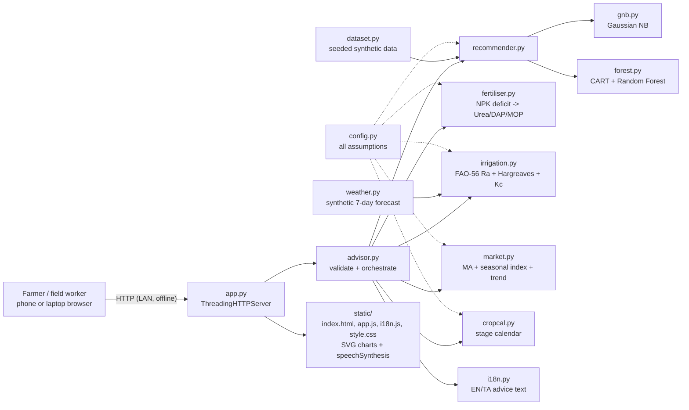

# KrishiMitra · கிருஷிமித்ரா — Hackathon Report

## 1. Title, tagline, domain

- **Title:** KrishiMitra ("farmer's friend")
- **Tagline:** A smart farming advisor in the farmer's own language
- **Domain:** Smart Agriculture & Rural Development (AgriTech)
- **Event:** QUANTIX 2K26, K.S.R. College of Engineering, Tiruchengode (23–24 Oct 2026)

## 2. Problem statement

**Who suffers.** Smallholder farmers. Most Indian farm holdings are small or marginal (about 86% in Agriculture Census 2015-16, approx.). A farmer with 1–3 acres in Namakkal, Erode or the Cauvery delta makes four costly decisions every season, usually with nobody to ask:

1. **What to grow.** Crops are picked by habit or by what the neighbour grew, not by what the soil and season suit.
2. **How much fertiliser.** Urea is cheap and familiar, so farmers use too much nitrogen and too little phosphorus and potassium. India's actual N:P:K use is well off the commonly quoted 4:2:1 target (approx.). That wastes money, wears out the soil and leaches nitrate into groundwater. Soil Health Cards exist, but it is hard to turn their numbers into "how many bags do I buy".
3. **When and how much to irrigate.** Farmers irrigate by guesswork: too much in wet weeks, too little at flowering. Agriculture uses most of India's freshwater (often quoted as about 80%, approx.), so over-irrigation hurts everyone.
4. **When to sell.** Produce is sold right at harvest, when everyone else is selling and prices are lowest. Crops that store, such as turmeric, pulses and chilli, could earn more if held a few weeks.

**Why existing solutions fail.**
- Advisory apps and portals are **English-first** or badly machine-translated. Many farmers read Tamil comfortably but English poorly, and some read neither well.
- They need **good connectivity** and often a login or OTP. Rural data connections are patchy.
- They are **black boxes**. "Grow maize" with no reason given means farmers do not trust it.
- They cover **one decision**, only weather or only prices. They do not join soil, crop, water and market into one plan.

## 3. Our solution

KrishiMitra is a web app that works without internet. The farmer, or a KVK / FPO field worker, enters a soil test (N, P, K, pH) and the local climate. The app returns one plan in two languages:
- the **best 3 crops**, with the reasons behind them
- a **fertiliser shopping list** in kg per acre and in bags
- a **7-day irrigation plan** in millimetres *and litres*
- a **sell-now-or-hold** suggestion with an expected price band
- a **crop calendar**

The whole plan can be **read aloud in Tamil** by the browser's built-in speech engine. It runs on any laptop with no internet, and phones on the same Wi-Fi can open it.

- Crop recommendation for 14 Tamil Nadu crops, using two models written from scratch: Gaussian Naive Bayes and a Random Forest
- An explanation for each input ("rainfall pushed towards rice over sugarcane"), plus a flag when an input is outside the crop's usual range
- Fertiliser advisor: soil test vs crop dose → shortfall → Urea / DAP / MOP kg per acre, number of bags, when to apply each, organic alternatives and bio-fertiliser tips
- Irrigation planner: FAO-56 extraterrestrial radiation plus the Hargreaves ET0 equation, a crop coefficient for each growth stage, effective rainfall, soil type, and irrigation method (drip, sprinkler, furrow or flood)
- Market timing: moving averages, a seasonal index and the trend → "sell now" or "hold N weeks", after storage cost
- A visual crop calendar from land preparation to harvest
- A full **Tamil / English** switch, large touch targets, a phone-first layout, and read-aloud via the Web Speech API
- One-tap **demo farms**: Tiruchengode (red soil, drip), Thanjavur delta paddy, Erode turmeric, Dharmapuri rainfed

## 4. Innovation / what makes it different

- **One plan instead of four apps.** The chosen crop drives the fertiliser dose, the water curve, the price model and the calendar. Change the crop and every card updates.
- **Machine learning you can see into.** Every recommendation shows:
  - Naive Bayes log-odds for each input
  - Random Forest path contributions (the Saabas "tree interpreter" method, hand-written) and RF feature importance
  - both models side by side, with a note saying whether they agree
- **Written in the farmer's language, not just translated labels.** Every advice sentence is generated in both languages from templates. Crop names, soils, irrigation methods, dates and units appear in Tamil script. The whole summary can be spoken aloud.
- **Agronomy done properly but simply.** Solar radiation is calculated from the FAO-56 formulas, not looked up in a table. Water is shown in litres per acre because farmers think in pump-hours and tanks, not millimetres.
- **Runs offline on a ₹15k laptop.** Pure Python standard library, no CDN, no API keys. The models train in about 0.6 s when the server starts.

## 5. System architecture



| Component | File | Responsibility |
|---|---|---|
| HTTP server | `app.py` | Serves static files and the JSON API; checks input and request size; returns JSON errors; prints the start-up banner |
| Orchestrator | `krishimitra/advisor.py` | Checks the request, runs every module, builds the spoken summary |
| Data generator | `krishimitra/dataset.py` | 1,680 seeded samples (14 crops × 120), stratified 75/25 split, CSV export |
| Naive Bayes | `krishimitra/gnb.py` | Training, probabilities via log-sum-exp, log-odds explanation per input |
| Random Forest | `krishimitra/forest.py` | Gini decision trees with an O(n log n) split search, bootstrap sampling, feature bagging, out-of-bag score, importances, path contributions |
| Recommender | `krishimitra/recommender.py` | Trains both models once, blends them, measures hold-out accuracy |
| Fertiliser | `krishimitra/fertiliser.py` | Shortfall → product quantities, bags, schedule, organic options, pH tips |
| Irrigation | `krishimitra/irrigation.py` | Radiation, ET0, crop coefficient curve, effective rain, soil water bucket schedule |
| Weather | `krishimitra/weather.py` | Repeatable 7-day forecast from approximate climate averages |
| Market | `krishimitra/market.py` | Synthetic weekly prices, moving averages, seasonal index, trend, forecast band, decision |
| Calendar | `krishimitra/cropcal.py` | Stage dates, nursery and land preparation, key operations |
| Language | `krishimitra/i18n.py`, `static/i18n.js` | Tamil and English templates and labels |
| Config | `krishimitra/config.py` | Every adjustable assumption, each with a comment giving its source or reasoning |

## 6. Algorithms & models

### 6.1 Synthetic training data
`config.CROP_RANGES` gives an approximate range for each of the 7 inputs for each crop. Each sample is drawn as `uniform(lo, hi) + N(0, (0.06·(hi−lo))²)`, clipped to physical limits, with seed 42. Similar crops (cotton / maize / chilli, black gram / green gram) overlap on purpose, so the task is not trivially easy.

*Limit:* this measures how well the models learn the agronomic knowledge we encoded, **not** how well they match real fields. Real Soil Health Card plus yield records can replace the CSV with no code change.

### 6.2 Gaussian Naive Bayes
`log P(c|x) = log P(c) + Σ_f [ −½ log(2πσ²_cf) − (x_f − μ_cf)² / (2σ²_cf) ] − log Z`. Z is computed with log-sum-exp, and variances are smoothed by ε = 1e-9 × the largest feature variance.

**Explanation:** for the best crop *b* and the runner-up *r*, each input's score is `Δ_f = log N(x_f | b) − log N(x_f | r)`. The scores plus the prior difference add up exactly to `log P(b|x)/P(r|x)`, so each bar shows how far that input pushed the choice.

*Why this model:* it trains in milliseconds, gives probabilities and is easy to explain. *Limit:* it assumes the inputs are independent and normally distributed, which makes it over-confident (often 99%+).

### 6.3 Decision trees (CART) + Random Forest
- **Split rule:** choose the split that minimises weighted Gini impurity `G = 1 − Σ p_k²`. Each feature is sorted once and swept, with class counts and Σcount² updated in O(1) per step, so each split search is O(n log n).
- **Forest:** 30 trees, maximum depth 10, minimum 4 samples to split. Each split considers 3 of the 7 features (feature bagging), and each tree trains on a bootstrap sample (n rows drawn with replacement). The prediction averages the trees' leaf class distributions (soft voting). Out-of-bag accuracy comes for free.
- **Explanation:** every node stores its class distribution. Along the path a sample takes, `P(c|x) = P_root(c) + Σ_splits [P_child(c) − P_parent(c)]`, and each change is credited to the feature that was split on (the Saabas method). A unit test checks that the starting value plus all contributions equals the predicted probability.
- **Why this model:** it captures thresholds and combinations that Naive Bayes cannot, such as "high K **and** high rainfall → banana". **Limits:** training is slower (about 0.5 s), and its probabilities move in steps of 1/30.
- **Blend:** `P = ½ P_GNB + ½ P_RF`. The UI shows the blended top 3, each model's top choice, and a "models agree / re-check soil test" flag.

### 6.4 Fertiliser advisor
```
deficit_X = max(0, dose_X − b_X · soil_X)      X ∈ {N, P2O5, K2O}, b = (0.4, 0.3, 0.3)
DAP   = deficit_P2O5 / 0.46                   (DAP = 18-46-0)
Urea  = max(0, deficit_N − 0.18·DAP) / 0.46   (urea = 46% N)
MOP   = deficit_K2O / 0.60                    (MOP = 60% K2O)
per acre = per ha × 0.404686;  bags: urea 45 kg, DAP/MOP 50 kg
```
`dose` is an approximate standard recommendation per crop, in the style of TNAU's irrigated-crop guidance. The calculation follows the form of the STCR targeted-yield equation `F = a·T − b·S`.
- **Timing:** urea is split into a basal dose plus 2 top dressings (coconut: 2 splits a year).
- **Organic options:** FYM, vermicompost and neem cake, each sized to replace 25% of the nitrogen shortfall.
- **Tips:** pulses get a Rhizobium tip and other crops an Azospirillum tip; acidic soil gets a lime tip and alkaline soil a gypsum tip.

*Limits:* the soil credit factors are rounded assumptions. Soil P and K test values are treated as P2O5 / K2O equivalents. Micronutrients are not covered.

### 6.5 Irrigation: FAO-56 radiation + Hargreaves
```
dr  = 1 + 0.033 cos(2πJ/365)        δ = 0.409 sin(2πJ/365 − 1.39)
ωs  = arccos(−tanφ · tanδ)
Ra  = (24·60/π) · 0.0820 · dr · [ωs sinφ sinδ + cosφ cosδ sin ωs]        MJ m⁻² day⁻¹
ET0 = 0.0023 · (Tmean + 17.8) · √(Tmax − Tmin) · 0.408 · Ra             mm/day
ETc = Kc(stage) · ET0   (+4 mm/day percolation for puddled rice, approx.)
Peff = 0 if rain < 5 mm else 0.8 · rain
deficit_t = max(0, deficit_{t−1} + ETc − Peff)
irrigate when deficit ≥ refill depth (sandy 20, red 30, alluvial 35, black 45 mm; rice 50 mm)
          or every day with drip;  gross = net / efficiency;  litres/acre = gross_mm × 4046.86
```
The crop coefficient Kc follows the FAO-56 four-stage curve: flat in the initial stage, rising through development, flat in mid-season, falling to the end. Start, mid and end values come from FAO-56 Table 12, or the closest similar crop.

*Checked:* a unit test reproduces **FAO-56 Example 8** (20°S, 3 September: dr 0.985, δ 0.120 rad, ωs 1.527 rad, **Ra 32.2 MJ m⁻² day⁻¹**) and a hand-worked Hargreaves value (4.794 mm/day).

*Why Hargreaves:* it needs only the day's minimum and maximum temperature, which any farmer or forecast has. Penman-Monteith needs wind, humidity and radiation sensors. *Limits:* it is less accurate in humid coastal weeks. The forecast is synthetic unless one is supplied. The bucket model ignores water rising from below and runoff.

### 6.6 Market timing (synthetic data)
- **Price series:** `p_t = base · (1.04)^(t/52) · [1 + A cos(2π(month − peak)/12)] · e^{ε_t}`, with week-to-week noise `ε_t = 0.6 ε_{t−1} + N(0, s²)`, seeded per crop. It is generated week by week from a fixed start date, so past prices never change between runs.
- **Analysis:** 4-week and 12-week trailing moving averages. The seasonal index is the price divided by a centred 53-week average, averaged by month and normalised to a mean of 1. The current level is the average of the last 8 weeks with the seasonal effect removed; the trend is a straight-line fit over 52 weeks.
- **Forecast:** `f_h = (level + slope·h) · SI[month(t+h)]`, with a band of `f_h · exp(±1.28 σ √(1+h/4))` (about 80%).
- **Decision:** hold for h weeks (no more than the crop can be stored) only if `f_h (1 − hold_cost·h)` beats today's price by at least 2%; otherwise sell. Perishables (tomato, banana) and sugarcane, which is sold to the mill, are handled separately.

*Limits:* the prices are **synthetic**, not real market data. Real Agmarknet price series would plug into the same functions.

### 6.7 Crop calendar
Approximate stage lengths for each crop give dates for land preparation, a nursery (for transplanted crops), establishment, vegetative growth, flowering, maturity and a harvest window. Key operations are dated too. Coconut shows one year of care.

## 7. Tech stack and why it is offline-first

- **Backend:** Python 3.9+ standard library only (`http.server`, `json`, `math`, `random`, `statistics`). No numpy, no Flask, no pip.
- **Frontend:** plain HTML, CSS and JS. Every chart is hand-drawn SVG. No CDN and no web fonts; Tamil uses the system font (Noto Sans Tamil, Nirmala UI or Latha).
- **Speech:** the browser's built-in `speechSynthesis` with `ta-IN` or `en-IN`. If it is not available, the app shows a short message instead of breaking.
- **Data:** generated with fixed seeds, so it is the same every run; `data/crop_dataset.csv` is committed.
- **Why offline-first:** rural Wi-Fi and mobile data are unreliable, and so is the venue's. One laptop running `python app.py --host 0.0.0.0` on a local hotspot can serve the phones at a village meeting.

## 8. Results / evaluation

Measured with `python -m krishimitra.evaluate` (output in `data/metrics.json`) on the build container: Linux x86-64, Python 3.13. The hold-out set is a stratified 25% split: 420 of 1,680 samples, 30 per crop.

| Metric | Gaussian NB | Random Forest | Blend |
|---|---|---|---|
| Hold-out top-1 accuracy | **93.6%** | **93.6%** | **94.3%** |
| Hold-out top-3 accuracy | 100% | 100% | – |
| RF out-of-bag accuracy | – | 94.8% | – |
| Training time | 1.8 ms | 0.54 s | ≈0.6 s in total at start-up |

The mistakes happen where the crops' ranges overlap: cotton, maize and chilli (RF accuracy 70–77% for these) and black gram vs green gram. Ten of the 14 crops score 100%.

Random Forest feature importance: K 0.22, N 0.21, rainfall 0.17, P 0.17, humidity 0.11, temperature 0.09, pH 0.04.

**Speed** (median / p95 over 300 runs in-process; HTTP over 100 runs on localhost):

| Operation | Median | p95 |
|---|---|---|
| GNB prediction | 0.023 ms | 0.028 ms |
| RF prediction (30 trees) | 0.046 ms | 0.062 ms |
| Recommendation (both models + explanations) | 0.18 ms | 0.36 ms |
| Fertiliser advice | 0.035 ms | 0.064 ms |
| 7-day irrigation plan | 0.066 ms | 0.12 ms |
| Market analysis (~250 weeks) | 1.0 ms | 1.9 ms |
| Full advisory (all modules) | 1.45 ms | 2.7 ms |
| **HTTP POST /api/advise** | **2.9 ms** | **4.4 ms** |
| HTTP POST /api/recommend | 1.1 ms | 1.4 ms |

**Correctness checks** (56 unit tests):
- Naive Bayes probabilities and log-odds match hand calculations
- a Gini split threshold and gain match a hand calculation
- tree and forest contributions add up to the predicted probability
- FAO-56 Example 8 radiation (32.2) and a hand-worked Hargreaves value
- crop coefficient interpolation between stages
- a rice fertiliser example worked by hand: Urea 90.7, DAP 33.4, MOP 25.6 kg/acre
- the seasonal index finds the right peak month
- the API returns 400, 404 and 405 correctly

**Honesty note:** the 93–94% accuracy is on synthetic data generated from our own ranges. It shows the from-scratch models are built correctly and learn the agronomy we encoded. It is **not** an accuracy figure tested on real fields.

## 9. Screenshots


`docs/screenshot.png` (1440×900) shows the Tiruchengode demo farm:
- groundnut recommended at 98.9%, with both models agreeing
- the "why" bar for each input
- fertiliser of 0 / 15.4 / 28.7 kg per acre (Urea / DAP / MOP)
- the drip irrigation plan
- the market decision

## 10. 3-minute live demo script

1. **(0:00) Open** `http://<laptop-ip>:8005` on a phone and the projector. *"KrishiMitra runs on this laptop with Wi-Fi off. Everything here is computed locally in pure Python."*
2. **(0:15) Default farm: Tiruchengode red soil.** Point at the four summary tiles. *"A soil test goes in, four decisions come out: crop, fertiliser, water, market."*
3. **(0:35) Recommended crops and "Why this crop?"** *"Groundnut, 99%. Two models we wrote ourselves, Naive Bayes and a Random Forest, both agree. Low nitrogen and medium phosphorus push it towards groundnut over ragi. These bars are the real log-likelihoods, not a black box."*
4. **(1:00) Tap "தமிழ்", then "குரலில் கேளுங்கள்" (Read aloud).** *"Every label and every sentence of advice is in Tamil, and the phone can read it aloud for farmers who can't read either language."* Switch back to English.
5. **(1:25) Fertiliser card.** *"The Soil Health Card says N 28. The crop needs 17:34:54. So no urea at all: 15 kg of DAP and 29 kg of potash per acre, with bag counts for his 2 acres and an organic option. Most farmers would have bought urea anyway."*
6. **(1:50) Tap "Thanjavur delta – paddy".** On the irrigation card: *"Hargreaves water demand from FAO-56 radiation, the crop coefficient for this growth stage, plus water lost through the puddled field. Irrigate once this week, on Thursday, about 3.5 lakh litres per acre. Not every day."*
7. **(2:15) Market card.** *"These are synthetic market prices. The seasonal index shows paddy prices peak around September. The forecast, after storage cost, says sell now. For Erode turmeric it says hold, with a price band."* Tap **Erode** to show "Hold".
8. **(2:40) Crop calendar, then pick Coconut in the "Advise for" dropdown.** *"Every card updates for the chosen crop: fertiliser dose, water curve, prices, calendar."*
9. **(2:55) Close.** *"Works offline, speaks two languages, explains itself, and answers in about 3 ms on a ₹15k laptop."*

## 11. Impact

- **Economic:** getting the fertiliser amount right is the biggest saving. In the Tiruchengode demo, a farmer used to top-dressing a bag of urea per acre out of habit would buy none at all, which also cuts the government's fertiliser subsidy bill. Holding crops that store well, instead of selling at harvest, can add a few percent to the farm-gate price (illustrative, from the synthetic model).
- **Environmental:** less surplus nitrogen means less nitrate in groundwater and lower N₂O emissions. Irrigating by crop water demand instead of by habit cuts over-watering, and drip users get a daily litre figure.
- **Social:** Tamil-first advice that can be read aloud includes farmers with low literacy, women farmers and older farmers, who are often left out of English apps. Offline LAN mode suits KVK or FPO village meetings.
- **Assumptions:** these impact figures are illustrative, taken from the demo farms. Measuring real impact needs field trials against a comparison group.

## 12. Feasibility, scalability & business model

- **Feasibility:** it works today on any laptop with Python. The codebase is small: about 1,900 lines of Python including config, and about 1,000 lines of HTML/CSS/JS. Adding a crop means adding a few rows to `config.py`.
- **Scalability:** one request costs a few milliseconds, so one ₹15k laptop can serve hundreds of farmers. For state-wide use, the same standard-library server can run on a ₹500/month VPS, or the logic can move into the phone itself (browser or Android WebView).
- **Business model:**
  - Government (B2G): licence it to the state agriculture department, KVKs and the Soil Health Card scheme as the tool that explains the card.
  - Business (B2B): white-label advisories for FPOs and input dealers, who can also plan fertiliser stock from farmers' real shortfalls.
  - Farmers (freemium): the basic plan is free; paid SMS/voice-call advisories cost ₹10–20 per season.
  - Data partnerships: anonymised soil and crop data, shared with consent, for agricultural research.

## 13. Future scope

- Train on real Soil Health Card and yield data (the pipeline is ready: replace the CSV), with ranges per district
- Live IMD forecasts and Agmarknet market prices when online, saved for offline use
- More languages (Kannada, Telugu, Malayalam, Hindi), and voice *input* for the soil test
- Pest and disease alerts based on weather, plus diagnosis from a photo
- An installable Android web app, an SMS / voice-call option for basic phones, and an FPO dashboard for group buying

## 14. Judges' Q&A prep

1. **"Your accuracy is on synthetic data. Isn't that meaningless?"** It proves the from-scratch models are correct and learn the agronomy we encoded, and we say so on the slide. The data is one CSV: real Soil Health Card and yield data plug in with no code change, and the same hold-out test will then give a real-world figure.
2. **"Why Naive Bayes and Random Forest, not deep learning?"** We have about 1,700 rows and 7 inputs, and farmers need reasons. Both models train in under a second on a laptop and give explanations we can show. A neural network would be harder to explain and gain nothing at this size.
3. **"Naive Bayes says 99.9%. Is that real confidence?"** No. Naive Bayes is over-confident because it treats the inputs as independent. That is why we blend it with the Random Forest's votes and show both models with an agreement flag.
4. **"Why Hargreaves and not Penman-Monteith?"** Penman-Monteith needs wind, humidity and radiation measurements a village doesn't have. Hargreaves needs only the daily minimum and maximum temperature, and FAO-56 recommends it as the fallback. Our radiation value matches FAO-56 Example 8.
5. **"Where do the fertiliser doses come from?"** They are rounded, TNAU-style standard recommendations, clearly marked as approximate and kept in one config file. The shortfall calculation follows the STCR equation F = a·T − b·S. A real rollout would load the state's official STCR coefficients.
6. **"Are the prices real?"** No. They are synthetic, and the UI says so. The analysis (moving averages, seasonal index, trend, price band, storage-cost rule) doesn't depend on the data source, and Agmarknet price files would plug straight in.
7. **"How good is the Tamil?"** Every string was written by hand in Tamil script using farmers' own words: தழைச்சத்து / மணிச்சத்து / சாம்பல்சத்து for N/P/K, and local soil names such as செம்மண் and கரிசல். A test fails if any advice string is missing its Tamil version.
8. **"What if the phone has no Tamil voice?"** The app checks for one, tells the user if it is missing, and uses the default voice instead. If the phone has no speech support at all, it shows a message rather than an error.
9. **"How does it reach farmers without smartphones?"** In LAN mode, one KVK laptop serves a whole meeting. Next is an SMS / voice-call channel that reads out the same two-language summary the app already builds.
10. **"How is this different from Kisan Suvidha and other advisory apps?"** It works offline, it is Tamil-first with voice, it explains its decisions, and it combines crop, fertiliser, water, market and calendar into one plan built from the farmer's own soil test.

## 15. How to run

```bash
cd projects/05-krishimitra
python app.py                         # http://127.0.0.1:8005/
python app.py --host 0.0.0.0          # LAN / phone access
python app.py --port 9000             # another port
python -m unittest discover -s tests  # run tests
python -m krishimitra.evaluate        # re-measure accuracy + latency (data/metrics.json)
python -m krishimitra.dataset         # regenerate data/crop_dataset.csv
```
