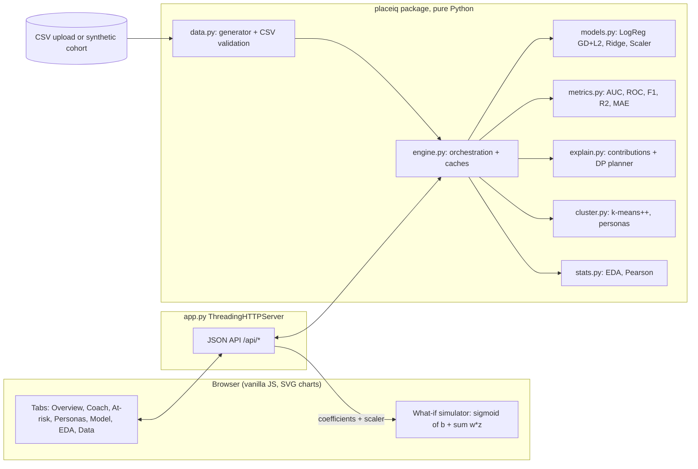

# PlaceIQ: hackathon report

## 1. Title, tagline, domain

**PlaceIQ**: *Placement analytics that tells every student what to fix next.*
Domain: **Data Science & Analytics** · QUANTIX 2K26, K.S.R. College of Engineering.

## 2. Problem statement

**Who suffers.**
- **Students** get feedback like "improve your profile" with no sense of priority. They can't tell
  whether one more project, 100 more coding problems or clearing a backlog would matter most.
- **Placement officers** track hundreds of students in spreadsheets. They only find out who got
  placed after each drive is over, so help reaches the weakest students too late.
- **HoDs and principals** can't see department-level trends early enough to schedule aptitude
  classes, mock interviews or backlog-clearing drives where they would count.

**How much.** Indian colleges admit on the order of 10 lakh+ engineering students a year
(AICTE intake, approx.). Industry surveys such as the *India Skills Report* have repeatedly put
graduate employability at only about half (approx.; the figure varies by year and method). Every
final-year batch at a college is a few hundred students whose readiness is judged by gut feel.

**Why existing solutions fail.**
- Spreadsheets describe the past. They don't predict or prescribe.
- Commercial campus-hiring platforms serve recruiters, need cloud accounts and paid licences, and
  are black boxes. A placement officer can't explain *why* a student was flagged.
- Generic BI dashboards show averages. They can't answer "what should *this* student do next?".

## 3. Our solution

PlaceIQ is an offline web app that reads the placement cell's existing sheet (or a realistic
synthetic cohort). It profiles the data automatically, trains a transparent placement model, and
turns each prediction into a ranked, effort-aware action plan for that student. The placement cell
gets an at-risk list it can call through today, persona groups for batch-level training, and a
fairness audit across departments.

- **Auto-EDA**: summary statistics, histograms, placement rate by department, a Pearson heatmap and ranked drivers.
- **Placement prediction**: from-scratch logistic regression (standardised features, gradient descent, L2), with hold-out accuracy, precision, recall, F1, ROC-AUC, a confusion matrix and the ROC curve.
- **Package prediction**: ridge linear regression with R² and MAE.
- **Explainability**: a per-student contribution chart, where each bar is coefficient × standardised value and the bars add up exactly to the model's log-odds.
- **"What to fix next"**: an exact minimum-effort counterfactual plan to reach P(placed) ≥ 70%, ranked by effort, plus single-lever alternatives.
- **What-if simulator**: 12 sliders with a live probability gauge, computed in the browser from the model's coefficients.
- **At-risk list**: a threshold slider, department and batch filters, each student's top gap, and CSV export.
- **Personas**: k-means++ clusters named automatically, e.g. *Coding stars*, *Academic toppers lacking projects*, *Late starters*, *At risk*.
- **Department/batch dashboard**: KPI tiles, probability bands and the most common gaps.
- **Fairness check**: per-department accuracy, FPR, FNR and calibration gap on out-of-fold predictions.
- **CSV upload**: row-level validation with line numbers and reasons. A blank `placed` cell marks a *pending* student (current batch), who is scored but not used for training.

## 4. Innovation / what makes it different

1. **Prescriptive, not just predictive.** Most student-analytics demos stop at a probability.
   PlaceIQ solves an optimisation problem for every student: the cheapest set of realistic
   improvements that clears 70%. The solution is exact (dynamic programming), not a heuristic.
2. **Glass-box by construction.** One linear model in log-odds space means the contribution bars,
   the simulator and the plan all describe the same model, with nothing hidden in between.
3. **Effort-aware.** Each lever has a step size, a realistic cap (e.g. at most +400 coding problems
   or +3 projects) and an effort cost in weeks. All of these are named constants a placement
   officer can edit in `placeiq/config.py`.
4. **Fairness built in.** Department is deliberately *not* a model input. The app then audits the
   errors by department and explains the gaps it finds.
5. **Runs anywhere.** Pure Python standard library, no internet. It starts in about 3 s on a laptop.

## 5. System architecture



| Component | Responsibility |
|---|---|
| `app.py` | HTTP routing, input validation, JSON errors with proper status codes, static files, start-up banner |
| `placeiq/config.py` | every assumption: schema, ranges, hyper-parameters, lever steps, caps, effort costs |
| `placeiq/data.py` | documented latent-variable cohort generator; CSV parser with aliases, range checks and duplicate detection |
| `placeiq/models.py` | `StandardScaler`, `LogisticRegression` (batch GD + L2), `LinearRegression` (ridge, normal equations), stratified split, k-fold |
| `placeiq/metrics.py` | confusion matrix, accuracy, precision, recall, F1, FPR/FNR, ROC-AUC (Mann–Whitney ranks), ROC curve, R², MAE, RMSE |
| `placeiq/stats.py` | summary statistics, quantiles, histograms, Pearson correlation matrix |
| `placeiq/cluster.py` | k-means++ initialisation, Lloyd iterations with restarts, rule-based persona naming |
| `placeiq/explain.py` | per-feature contributions and the exact minimum-effort counterfactual planner |
| `placeiq/engine.py` | trains the hold-out, 5-fold and deployed models; serves dashboards, at-risk lists and fairness |
| `static/` | single-page UI with hand-drawn SVG charts, tooltips, light and dark themes, responsive layout |

## 6. Algorithms & models

**Synthetic cohort (latent model).** Each student has hidden traits: academic ability *A*, coding
drive *C* (correlated with *A*, ρ = 0.35, shifted by department) and soft skills *S*. An
"exam-focused" 18% get *A* + 0.7 and *C* − 0.9. Observed columns are noisy functions of these
traits; for example CGPA = 7.2 + 0.85·A + N(0, 0.4²) and coding problems = exp(4.6 + 0.8·C + noise).
Placement ~ Bernoulli(σ(z)), where *z* is a hand-written recruiter score. It is non-linear on purpose:
log of coding problems, extra penalties for more than 2 backlogs and for CGPA below 6, and a small
department market term. Packages are log-normal. Fixed seed 2026. *Why:* the relationships behave
like real ones, and the trained model has to approximate a truth it can't express exactly.
*Limit:* it is synthetic; real data will be noisier.

**Logistic regression (from scratch).**
`p = σ(b + w·z)`, where `z = (x − μ)/σ` is the standardised feature vector.
Loss `L = −(1/n) Σ [y log p + (1−y) log(1−p)] + (λ/2)‖w‖²`.
Gradients `∂L/∂w = (1/n) Xᵀ(p − y) + λw` and `∂L/∂b = mean(p − y)`.
Full-batch gradient descent with lr = 0.5 and λ = 0.01 stops when max|∇| < 10⁻⁶. It converges in
619 iterations. *Why:* it is calibrated, fast in pure Python, and every weight is readable as
"odds × e^w per +1 SD". *Limits:* linear in log-odds, and collinear features (10th %, 12th %, CGPA)
can split weight in odd ways.

**ROC-AUC.** Computed with average ranks (Mann–Whitney U):
`AUC = (Σ ranks of positives − n₊(n₊+1)/2) / (n₊·n₋)`, with ties counted as ½. A unit test checks
it against a hand-computed 8/9 case and against the trapezoid area under our own ROC curve.

**Package regression.** Ridge regression on standardised features, trained on placed students only:
`(XᵀX + αI) w = Xᵀ(y − ȳ)`, solved with Gaussian elimination and partial pivoting (α = 1). *Limit:*
packages are right-skewed, so the few very high packages are under-predicted.

**Contributions.** `cⱼ = wⱼ · zⱼ` (log-odds relative to an average student). The contributions plus
`b` reproduce the prediction exactly; a unit test checks this.

**Counterfactual "what to fix next".** Each lever *j* has step `sⱼ` (e.g. +40 problems), a cap
`Sⱼ`, effort `eⱼ` weeks and logit gain `gⱼ = wⱼ·sⱼ/σⱼ`. Only levers with `gⱼ > 0` are used, so
10th/12th marks are never suggested. The planner solves

`minimise Σ kⱼ·eⱼ  subject to  logit + Σ kⱼ·gⱼ ≥ logit(0.70),  0 ≤ kⱼ ≤ Sⱼ (and within valid ranges)`

which is a bounded multiple-choice knapsack. It is solved **exactly** by dynamic programming over
the effort budget in half-week units (`best[c]` = largest gain reachable with budget *c*), about 30k
operations per student. Steps are shown cheapest first, with a cumulative probability staircase.
If 70% is unreachable within the caps, the strongest feasible plan is shown and marked as such.
A unit test checks optimality against brute force. *Limits:* it assumes the model is causal, that
levers are independent, and that the effort numbers are right; all three are assumptions to state
honestly to students.

**k-means++ personas.** k-means++ seeding picks each new centre with probability ∝ D(x)². Lloyd
iterations run with 4 restarts, keeping the lowest inertia, on 9 standardised features. Clusters
are named by scoring each centroid's z-profile against persona templates, each with an eligibility
rule, and choosing the best unique assignment by permutation search. *Limits:* k is a user choice,
and k-means favours spherical clusters.

**Fairness.** We use 5-fold out-of-fold predictions, so every student is scored by a model that
never saw them. For each department we compute accuracy, FPR, FNR and calibration gap
(mean predicted − actual rate). A gap above 10 points is **flagged**; a calibration gap above 5
points goes on a **watch** list.

## 7. Tech stack and why it is offline-first

- **Backend:** Python 3.9+ standard library only (`http.server`, `csv`, `json`, `math`, `random`, `itertools`).
- **Frontend:** vanilla HTML/CSS/JS with hand-drawn inline SVG charts, no frameworks, no CDN, no web fonts.
- **Data:** a CSV in and a CSV out. State lives in memory; the demo cohort is regenerated deterministically.

Why offline-first: venue Wi-Fi is unreliable, college lab PCs can't `pip install`, and student
records are personal data that shouldn't leave the campus. `python app.py` on any laptop is the
whole deployment.

## 8. Results / evaluation

All numbers below were measured on the deterministic demo cohort (600 students, seed 2026). They
are computed live by the server, and the UI shows the same numbers.

**Placement classifier: hold-out test set (stratified 25%, n = 150, never seen in training)**

| Metric | Value |
|---|---|
| Accuracy | **86.0%** (majority-class baseline 58.0%) |
| Precision | 85.9% |
| Recall | 90.8% |
| F1 | 0.883 |
| ROC-AUC | **0.935** |
| Confusion matrix | TP 79 · FN 8 · FP 13 · TN 50 |
| Train accuracy (n = 450) | 88.7%, so no material overfitting |
| 5-fold cross-validation | AUC 0.938 · accuracy 86.5% |
| Gradient descent | converged (max\|∇\| < 1e-6) in 619 iterations |

**Package regression (placed students, hold-out n = 87, train n = 261):** R² **0.588**,
MAE **1.17 LPA** (predicting the mean gives MAE 1.93 LPA), RMSE 1.56 LPA.

**Top drivers (deployed model, log-odds per +1 SD):** backlogs −1.00, aptitude +0.95, CGPA +0.84,
coding problems +0.69, mock interview +0.54, communication +0.52, internships +0.34. The 12th %
weight is −0.26: CGPA and 10th % are correlated with it, so after accounting for them extra 12th
marks add nothing.

**Fairness (5-fold out-of-fold, threshold 0.5).** Overall FPR 17.9%, FNR 10.3%.

| Dept | n | Actual placed | Mean P | Accuracy | FPR | FNR | Calibration gap |
|---|---|---|---|---|---|---|---|
| CSE | 150 | 66.0% | 60.9% | 89.3% | 9.8% | 11.1% | −5.1 pts (watch) |
| AI&DS | 100 | 59.0% | 60.4% | 88.0% | 17.1% | 8.5% | +1.4 pts |
| CSD | 70 | 60.0% | 57.3% | 80.0% | 25.0% | 16.7% | −2.7 pts |
| IT | 90 | 60.0% | 57.9% | 84.4% | 19.4% | 13.0% | −2.1 pts |
| ECE | 110 | 57.3% | 61.1% | 84.5% | 25.5% | 7.9% | +3.8 pts |
| MECH | 80 | 38.8% | 46.5% | 90.0% | 14.3% | 3.2% | **+7.8 pts (watch)** |

No department passes the 10-point flag. The check *does* surface MECH, where the model is about
8 points over-optimistic, and CSE, where it is about 5 points pessimistic. That is exactly the small
"department market" effect hidden in the generator, which the model can't see because department
is excluded. In the report to the placement cell this reads as: *MECH students need a stronger push
than their profile suggests, because there are fewer software-firm openings for the branch; don't
read their probabilities at face value.* CSD and ECE have FPRs about 7 points above overall, within
noise at n ≈ 70 to 110.

**Personas (k = 4):** Coding stars 112 students (96% placed), Academic toppers lacking projects
190 (89%), Late starters 231 (30%), At risk 67 (1%).

**At-risk list (P < 50%, not placed): 209 students.** Their top gaps: clear backlogs (101),
aptitude (61), coding practice (41), hackathons (6). Example: demo student KSRIT083 (IT, CGPA
7.49, 0 backlogs) moves from 40% to 71% with "Raise aptitude score by 10" plus "Take part in 3 more
hackathons", about 11 weeks in total.

**Upload validation:** the bundled `static/samples/students_with_errors.csv` (140 rows) loads 132
valid rows and rejects 8, each with its line number and reason. It has 20 pending students who are
scored but not trained on. Retrained on its 112 labelled rows: hold-out AUC 0.88.

**Latency (laptop, CPython 3.13):** cold start, which generates the data and trains 7 logistic
models plus 2 ridge models, takes 2.7 s. Retrain after upload or demo takes 2.7 s (0.8 s for 132
rows). The first dashboard call, which plans for all 209 at-risk students, takes 0.61 s; after that
dashboard, student and at-risk calls take 1–3 ms. `/api/predict` takes 2.5 ms, k-means (k = 6, 4
restarts) 0.49 s, and EDA 31 ms. The simulator updates instantly in the browser.

**Tests:** 46 `unittest` tests pass in about 11 s. They cover GD convergence on a separable toy
set, monotone loss, L2 shrinkage, Gaussian elimination, a hand-computed AUC with and without ties,
AUC against the ROC trapezoid area, k-means blob recovery and k-means++ spread, persona naming,
CSV validation (line numbers, aliases, pending rows, garbage input), counterfactual optimality
against brute force, bounds and harmful-lever exclusion, contribution additivity, engine sanity,
and the HTTP API including error codes.

## 9. Screenshots


The other tabs (Overview KPIs, At-risk list, Personas, Model & fairness, Auto-EDA, Data/upload)
all render from the same live API.

## 10. 3-minute live demo script

1. **(0:00) Overview.** "This is one batch of 600 students. Placement rate is 58%, and 209 students
   are below 50% right now. MECH is lagging at 39%." Change the department filter to MECH.
2. **(0:25) Who to call first.** Click the first card. "Every flagged student comes with the one fix
   that matters most for them."
3. **(0:45) Student coach: Tarun M (KSRIT083), the default student on the tab.** "40% today. *Why
   this prediction*: blue bars push him up (no backlogs), red bars pull him down (mock interview,
   coding, communication). The bars add up exactly to the model's score, so this isn't a black box."
4. **(1:15) What to fix next.** "The optimiser found the cheapest plan to reach 70%: raise aptitude
   by 10, then 3 hackathons, about 11 weeks. Alternative: 280 more coding problems in 14 weeks."
   Click **Try this plan in the simulator**. The gauge turns green at 71%.
5. **(1:40) What-if.** Drag *Backlogs* to 2. "The score drops live; backlogs are the strongest
   negative driver." Click **Plan from here** and the server re-plans.
6. **(2:00) At-risk list.** Move the threshold to 40% and click **Export CSV**. "That's the placement
   officer's call sheet for tomorrow."
7. **(2:15) Model & fairness.** "Hold-out accuracy 86%, AUC 0.935, against a 58% baseline.
   Department isn't an input, yet the audit shows MECH is over-predicted by 8 points. We report
   that instead of hiding it."
8. **(2:40) Data / upload.** Click **Try a file with errors**. "Drop in your own sheet: 8 bad rows,
   each with a line number and reason; the rest retrains in under a second, fully offline." Click
   **Load demo data** to reset.

## 11. Impact

- **Students:** a concrete, ranked to-do list in place of "improve your profile". Effort goes
  where the model says it moves the needle most. Assumption: the model's associations are roughly
  causal for actionable levers, and we say so plainly.
- **Placement cell:** about 200 at-risk students identified *before* drives, not after. Coaching
  hours can go to the students and gaps that matter. Assumption: early intervention converts some
  borderline students; we claim no specific uplift without a pilot.
- **Departments:** batch-level personas such as "190 academic toppers lacking projects" turn into
  targeted workshops (project sprints, mock-interview drives).
- **Equity:** the fairness audit keeps branch-level blind spots visible, and the tool runs on any
  existing lab PC, so small colleges without analytics budgets get the same capability.
- **Environmental:** negligible. It is one Python process with no cloud or GPU.

## 12. Feasibility, scalability & business model

- **Feasibility:** it needs only a CSV export of data colleges already hold. There is nothing to
  install beyond Python. A pilot could run on last year's batch (labelled) plus this year's batch
  (pending) in a day.
- **Scalability:** pure-Python training is O(n·d·iterations). 600 rows train in about 0.4 s per
  model, so 10,000 rows (a university) is still well under a minute. Planning is about 30k
  operations per student. Beyond that, the same algorithms port directly to NumPy.
- **Business model:**
  - free for single colleges (open source);
  - a paid multi-campus edition for university groups and training partners, with history, role
    logins and scheduled exports;
  - sponsored pre-placement pipelines, where hiring firms (like this hackathon's sponsor) see opt-in,
    readiness-verified students;
  - implementation and analytics workshops for placement officers.

## 13. Future scope

- Track each student's progress over the semester and show how their probability moves.
- Company-specific models (service vs. product firms) and package-band classification.
- Calibrated effort costs learned from students who actually improved, replacing assumed weeks.
- Interaction features and gradient-boosted trees, kept explainable through additive contributions.
- WhatsApp or email nudges with each student's weekly "next fix"; a Tamil/English UI.

## 14. Judges' Q&A prep

1. **Is the data real?** No. It is a documented synthetic cohort, with a fixed seed and a latent
   model whose relationships are realistic. Any college can upload its real sheet; validation and
   retraining take seconds.
2. **Why logistic regression and not XGBoost or a neural net?** We wanted explainability and
   honesty. With AUC 0.935 there is little left to gain, and a linear log-odds model makes the
   contributions, the simulator and the planner exactly consistent. A black box can't produce an
   exact minimum-effort plan.
3. **How do you know it isn't overfitting?** Train accuracy is 88.7% and test is 86.0%; 5-fold CV
   AUC is 0.938 against a hold-out AUC of 0.935. L2 regularisation is on.
4. **Isn't "+3 hackathons → placed" just correlation?** Yes, the model learns associations. The
   plan is a prioritised hypothesis, and the levers are ones that also build real skills. We cap
   steps at realistic sizes and never suggest unchangeable history (10th/12th marks).
5. **Where do the effort numbers come from?** They are assumptions, named constants in
   `config.py` (e.g. 40 problems ≈ 2 weeks). A placement officer can change them, and future scope
   learns them from data.
6. **Is the plan really optimal?** Yes, given the model and the levers. It is a bounded knapsack
   solved exactly by dynamic programming, and a unit test checks it against brute force.
7. **Why is the 12th % weight negative?** Collinearity: once CGPA and 10th % are known, 12th % adds
   no information, so the weights share credit oddly. Since it isn't an actionable lever, it doesn't
   affect any plan.
8. **Fairness: doesn't predicting from scores penalise MECH students?** Department isn't a feature.
   We audit error rates by department. The audit found MECH over-predicted by about 8 points, so we
   tell the cell to push MECH students harder rather than relaxing about them.
9. **What about student privacy?** Everything runs on campus, offline. No data leaves the laptop,
   and nothing is persisted except what the user exports.
10. **How does it handle the current batch whose outcome isn't known?** Leave `placed` blank. Those
    students are scored, explained and planned, but never used as training labels.

## 15. How to run

```bash
cd projects/06-placeiq
python app.py                              # http://127.0.0.1:8006/
python app.py --host 0.0.0.0 --port 8006   # open from a phone on the same LAN
python -m unittest discover -s tests       # 46 tests
python data/make_samples.py                # regenerate data/students_demo.csv and the error sample
```
