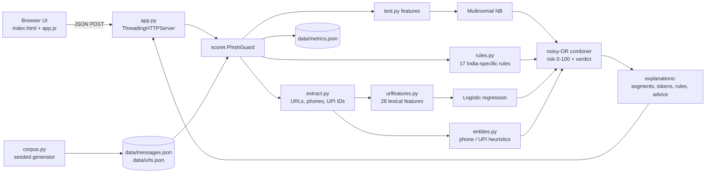

# PhishGuard - Hackathon Report

## 1. Title, tagline, domain

**PhishGuard** - *Explainable scam & phishing detector for SMS, email and links*

Domain: **Cybersecurity & Blockchain Technology** · QUANTIX 2K26, K.S.R. College of Engineering · port 8007.

## 2. Problem statement

**Who suffers.** Almost every Indian phone user gets fake "KYC expired / account blocked" SMS, "electricity will be
disconnected tonight" messages, parcel-on-hold links, lottery and KBC prizes, UPI "collect request" tricks and, more
recently, "digital arrest" threats. Students are a favourite target of fake internships and "part-time job" offers that
ask for a registration fee. Elderly people and first-time smartphone users are hit hardest.

**How much.** Digital payments have grown very fast (UPI handles well over 10 billion transactions a month - NPCI,
approx.), and so has fraud: the national cyber-crime reporting portal receives on the order of a million
cyber-financial-fraud complaints a year (I4C, approx.). The government runs a dedicated cyber-fraud helpline, **1930**,
and the portal **cybercrime.gov.in**. We deliberately quote nothing more precise than this.

**Why existing solutions fail.**
- Spam filters in messaging apps are black boxes: they hide a message or do nothing, and never say *why*. People learn
  nothing and fall for the next variant.
- Link checkers need an internet lookup (blocklists, reputation APIs). Fresh phishing domains are not on any list yet,
  and you are sending your private messages to a third-party server.
- Generic (Western) phishing models don't know Indian patterns: KYC/PAN/Aadhaar updates, EB bill disconnection, UPI PIN
  "to receive money", Tanglish/Hinglish text, `.apk` "bank reward" apps.

## 3. Our solution

PhishGuard is an offline web app (Python standard-library server + vanilla JS UI) that scores a message or link from
0 to 100 and *explains* the score. A Multinomial Naive Bayes model reads the text, a logistic-regression model reads
every embedded URL from its characters alone, a rule layer looks for India-specific scam patterns, and heuristics score
phone numbers and UPI IDs. The four signals are combined with a transparent noisy-OR formula; the UI highlights the
exact words, links and numbers that raised the alarm and tells the user what to do next.

- **Analyse**: paste an SMS / WhatsApp forward / e-mail / link -> risk gauge, verdict, per-signal bars.
- **Explanation panel**: highlighted spans, rules fired with weights, top Naive Bayes tokens (log-likelihood ratios)
  pushing toward scam and toward safe, per-feature URL contributions.
- **Entity scoring**: every URL, phone number and UPI ID in the message is scored, each with a reason.
- **"What to do" advice**: verdict-level steps plus rule-specific advice; 1930 and cybercrime.gov.in always visible.
- **Bulk scan**: paste up to 200 lines -> table of verdicts and main reasons; click a row for its full explanation.
- **Spot the scam quiz**: 10 hand-written examples with scoring, an explanation and the model's own verdict.
- **Model stats**: accuracy / precision / recall / F1, four confusion-matrix charts, LR weights, top tokens.
- **Privacy**: no network calls, nothing stored; an "Offline - nothing leaves this device" badge says so.

## 4. Innovation / what makes it different

- **Explainable by construction**: NB token LLRs sum to the text log-odds, LR contributions `w_i * x_i` sum to the link
  log-odds, and the final risk is a noisy-OR of components shown as bars. Nothing on screen is a mystery number.
- **India-first**: rules and templates cover KYC/PAN/Aadhaar, EB disconnection, UPI collect / PIN-to-receive, job
  registration fees, digital arrest, `.apk` reward apps and Tanglish / Hinglish ("block aagum", "kat jayega",
  "OTP bata do").
- **Negation-aware rules**: "Do not share this OTP with anyone" (a genuine bank SMS) does not fire the OTP-request rule,
  "please share the OTP" does - the classic false-positive trap for keyword filters.
- **No lookups at all**: URL risk comes from lexical features only (IP host, `@` trick, punycode, look-alike spellings
  like `amaz0n` / `paytrn`, brand on a non-official domain, cheap TLDs, shorteners, entropy...), so it works on
  brand-new domains with Wi-Fi off.
- **Honest evaluation**: besides the usual random split we report an *unseen-template* split, which shows how much
  synthetic data flatters a model.
- **Awareness, not just detection**: the quiz turns the detector into a teaching tool for families and hostels.

## 5. System architecture



| Component | File | Responsibility |
|---|---|---|
| HTTP server | `app.py` | static files, JSON API, validation, error codes, start-up training |
| Corpus generator | `phishguard/corpus.py` | 760 messages (56 scam + 68 ham templates), 440 URLs, stratified and template splits |
| Text features | `phishguard/text.py` | normalisation with placeholders (`<link>`, `<amount>`, `<phone>`, `<upi-id>`, `<number>`), words, bigrams, char 3-4-grams |
| Naive Bayes | `phishguard/naive_bayes.py` | Multinomial NB, Laplace smoothing, LLR explanations |
| URL features | `phishguard/urlfeatures.py` | parsing, registrable domain, brand / look-alike checks, 28 features in [0, 1] |
| Logistic regression | `phishguard/logreg.py` | batch gradient descent with L2, per-feature contributions |
| Rule layer | `phishguard/rules.py` | 17 weighted regex rules, negation handling, URL masking |
| Entities | `phishguard/extract.py`, `phishguard/entities.py` | find URLs / phones / UPI IDs with offsets; heuristic scores with reasons |
| Combiner & explainer | `phishguard/scorer.py` | calibration, noisy-OR, highlighted segments, advice, bulk, stats |
| Config | `phishguard/config.py` | every tunable constant with its reasoning |
| UI | `static/` | 4 tabs, SVG gauge and confusion matrices, light/dark theme, phone layout |

## 6. Algorithms & models

### 6.1 Multinomial Naive Bayes (text)
Features per message: lower-cased words (entities replaced by placeholders), word bigrams, and character 3-4-grams of
each word; the char n-grams of one word share a total weight of 1 so long words don't dominate.

```
P(t | c)    = (N_tc + alpha) / (N_c + alpha * |V|)              alpha = 1 (Laplace)
log-odds(d) = log P(scam)/P(ham) + sum_t n_t * LLR(t)            LLR(t) = log P(t|scam) - log P(t|ham)
p_text      = sigmoid(log-odds / T + log(pi / (1 - pi)))         T = 8, pi = 0.2
```
*Why:* trains in milliseconds, works with a few hundred examples, and every token's push is one readable number. Char
n-grams catch spelling variants ("updation", "verifcation") and Tanglish/Hinglish word forms.
*Limits:* the independence assumption double-counts correlated evidence, so raw posteriors are over-confident; we divide
by a hand-picked temperature `T` and swap the balanced training prior for an assumed deployment prior `pi = 0.2` (both
in `config.py`; both are assumptions, not fitted). Unseen vocabulary is ignored.

### 6.2 Logistic regression on lexical URL features (links)
28 features scaled to [0, 1]: URL/host length, dots, sub-domains, digit ratio, `@` in the authority, raw IP host,
punycode `xn--`, non-ASCII characters, look-alike brand (homoglyph map `0->o, 1->l, rn->m ...` or edit distance 1), brand
word in host / path outside the brand's official domain, known official domain, registry-restricted zone (`.gov.in`,
`.ac.in`, `.bank.in` ...), suspicious TLD, generic shortener, host entropy, hyphens, https, plain http, phishing path
words (login, verify, kyc, refund ...), path depth, query parameters, non-standard port, `//` redirect, `.apk/.exe`
download, government words outside `.gov.in`, long random token.

```
p    = sigmoid(b + sum_i w_i x_i)
loss = mean(-y log p - (1-y) log(1-p)) + (l2/2)|w|^2           batch GD, lr 0.8, 900 epochs, l2 0.002
```
*Why:* weights are directly interpretable ("cheap TLD +2.6", "known official domain -2.2") and contributions are shown
per link. *Limits:* purely lexical - a phishing page on a clean-looking new `.com` with no brand words scores low;
generic shorteners are inherently ambiguous (they land in "Suspicious").

### 6.3 Rule layer
17 weighted regular-expression rules (OTP request 0.60, UPI collect 0.60, remote-access app 0.60, upfront fee 0.55,
sensitive info 0.55, police/CBI/digital arrest 0.55, APK install 0.55, EB disconnection 0.50, KYC/PAN/Aadhaar 0.45,
prize/lottery 0.45, investment 0.45, parcel hold 0.40, loan 0.40, account block 0.35, refund bait 0.35, easy money 0.35,
urgency 0.15). OTP / PIN rules are cancelled by nearby negations (`not, never, don't, mat, nahi, vendam ...`), and URLs
are masked before matching so words inside an official link (`uidai.gov.in/.../update-aadhaar.html`) don't fire text
rules. `rule_score = 1 - prod(1 - w_r)`. *Limits:* hand-written, so new scam scripts need new rules; regexes can be dodged
by deliberate misspelling (the NB char n-grams partly cover that).

### 6.4 Phone and UPI heuristics
Phone: toll-free 1800 -> 0.10; a mobile number in a message about a bank / EB / officer / refund that asks you to call
-> 0.75; and so on. UPI ID: named like `kyc.update@`, `refund.help@`, `hr.recruit@` plus a payment request -> 0.85;
an unknown ID with a payment request -> 0.35. Each score carries its reason string. *Limits:* no labelled data, so these
are transparent heuristics, not learned.

### 6.5 Combined score
```
risk = 100 * (1 - (1 - 0.85 p_text) * prod_r (1 - w_r) * (1 - 0.92 p_link) * (1 - 0.55 p_entity))
Safe < 35 <= Suspicious < 65 <= Dangerous              (displayed risk capped at 99)
```
Noisy-OR lets any single strong signal raise the alarm, while weights below 1 stop one soft signal from claiming
certainty. *Limits:* weights and thresholds are design choices, not fitted on real data.

## 7. Tech stack and why it is offline-first

- **Python 3.9+ standard library only** (`http.server`, `json`, `re`, `math`, `urllib.parse`, `ipaddress`, `unittest`).
  No pip, no numpy - `python app.py` works on any venue laptop, Windows included.
- **Vanilla HTML/CSS/JS** with an inline-SVG gauge and confusion matrices; no CDN, no web fonts.
- **Training at start-up from a seeded corpus** (~1 s), so there are no opaque model files to ship or trust.
- Offline-first because the product promise is privacy: personal SMS and bank alerts should never be uploaded to be
  checked, and the demo must not depend on venue Wi-Fi.

## 8. Results / evaluation

All numbers were measured by `PhishGuard.stats()` (shown on the **Model stats** tab and saved to `data/metrics.json`).
Hardware: 4-vCPU Intel Xeon @ 2.1 GHz, Python 3.13, single thread.

**Data.** 760 synthetic messages (380 scam / 380 ham from 56 scam + 68 ham templates; English, Tanglish, Hinglish; SMS
and e-mail style) and 440 URLs (220 phishing / 220 benign). Seeded, stratified 75 / 25 split; the deployed models are
trained on the training part only, so these are the numbers of exactly the model you demo.

| Model | Split | n | Accuracy | Precision | Recall | F1 |
|---|---|---|---|---|---|---|
| Naive Bayes only | random hold-out | 190 | 100.0% | 100.0% | 100.0% | 1.000 |
| Rules only (rule score >= 0.35) | random hold-out | 190 | 91.6% | 100.0% | 83.2% | 0.908 |
| Full pipeline (flag if risk >= 35) | random hold-out | 190 | 100.0% | 100.0% | 100.0% | 1.000 |
| Naive Bayes only | **unseen templates** | 168 | 86.3% | 91.8% | 79.8% | 0.854 |
| Full pipeline (risk >= 35) | **unseen templates** | 168 | **97.0%** | 94.4% | 100.0% | 0.971 |
| URL logistic regression (p >= 0.5) | random hold-out | 110 | 93.6% | 100.0% | 87.3% | 0.932 |

Confusion matrices: NB random split TP 95 / FN 0 / FP 0 / TN 95; full pipeline on unseen templates TP 84 / FN 0 /
FP 5 / TN 79; URL model TP 48 / FN 7 / FP 0 / TN 55.

**Reading these honestly.**
- 100% on the random split is an artefact: test messages come from the same templates as training messages. It shows
  the code works, not that PhishGuard is perfect.
- The **unseen-template split** (about 20% of templates per class held out entirely, 592 train / 168 test) is the more
  realistic number: Naive Bayes alone drops to 86%, and the rule + link + entity layers lift the pipeline back to 97% -
  the argument for a hybrid design. Its 5 false alarms are genuine bank debit alerts ("Dear Customer, Rs.X debited ...
  to VPA name@paytm") scoring around 38, i.e. Suspicious rather than Dangerous.
- All 7 URL misses are generic shorteners or brand-free domains such as `getkycpoint.in/auth/claim`, with probabilities
  0.37-0.47; after the 0.92 link weight most land at 34-44 - on the Safe / Suspicious border.
- **Synthetic data overestimates real-world performance.** Real scam SMS use phrasings, languages and tricks we did not
  template. Expect clearly lower accuracy until the model is retrained on real, consented, labelled messages.

**Latency.** Full message analysis with explanations: p50 **0.99 ms**, p95 2.0 ms. Scoring only: 0.49 ms per message.
Link-only analysis: p50 0.35 ms. Bulk scan of the 15 demo lines: ~13 ms end-to-end including HTTP. Training both models
from scratch: **~1.0 s**. The 55 unit tests run in ~3 s.

## 9. Screenshots


`docs/screenshot.png` - Analyse tab in the dark "security console" theme after **Run demo**: risk gauge 99 / Dangerous,
per-signal bars, highlighted rule spans and link, rules fired, Naive Bayes tokens, link feature reasons and advice.

## 10. 3-minute live demo script

1. **(0:00)** Open `http://127.0.0.1:8007`. Say: "PhishGuard runs entirely on this laptop - see the *Offline* badge; the
   Wi-Fi could be off." Toggle dark mode for the console look.
2. **(0:15)** Click **Run demo** (KYC block SMS). Say: "Risk 99, Dangerous - and not a black box. Red spans are rules:
   *YONO account will be blocked*, *Update your PAN*. The blue link is scored on its own: brand 'sbi' on a non-SBI
   `.xyz` domain. On the right, Naive Bayes shows which words pushed it toward scam."
3. **(0:50)** Click the **Bank OTP (safe)** chip. Say: "A real OTP SMS also contains 'OTP' and 'share', but 'Do not share'
   is a negation, so the OTP rule stays silent. Risk 0." Then **Tanglish scam**: "It understands *block aagum* and
   *KYC update pannunga*."
4. **(1:20)** Click **UPI collect trick**. Say: "You never need a UPI PIN to *receive* money - the rule says exactly that,
   and the UPI ID `refund.help@ybl` is scored separately." Point at **What to do**: helpline 1930, cybercrime.gov.in.
5. **(1:45)** **Bulk scan** tab -> **Load demo lines** -> **Scan all**. Say: "15 messages in about 13 ms, each with its
   main reason." Click the FedEx row to jump to its full explanation.
6. **(2:15)** **Spot the scam** tab: answer a question. Say: "After each answer we explain the trick and show the model's
   verdict - an awareness tool for parents and hostel mates."
7. **(2:35)** **Model stats** tab. Say: "Accuracy, precision, recall, F1 and confusion matrices. And we're honest: 100% on
   the random split is synthetic-data optimism; on templates the model never saw, the pipeline still gets 97%. Real
   labelled data is the next step."

## 11. Impact

- **Social**: explains *why* a message is a scam, and that lesson carries over to the next variant; the quiz can be
  shared in families, colleges and self-help groups. Assumption: many victims lose money because they act within
  minutes under pressure, and a 10-second check that gives a clear reason breaks that.
- **Economic**: each prevented UPI / OTP fraud saves money that is very hard to get back once transferred. We claim no
  rupee figure because we have no measured data on prevented losses.
- **Privacy / inclusion**: runs on a cheap laptop or a phone browser on the same Wi-Fi without uploading personal
  messages, and handles Tanglish/Hinglish text that many tools ignore.
- **Environmental**: negligible compute (about 1 ms per check, no GPU, no cloud calls).

## 12. Feasibility, scalability & business model

- **Feasibility**: a working prototype today: ~2,100 lines of pure Python (~2,600 with tests) plus an ~800-line vanilla JS/CSS/HTML UI,
  55 tests, trains in ~1 s.
- **Scalability**: inference is linear in message length at about 1 ms, so one laptop core handles hundreds of messages
  per second. The same models port to an Android app (on-device SMS scanning) or a browser extension, still offline.
- **Business model**: free consumer app / awareness kit for colleges and NGOs; paid B2B SDK for banks, telcos and
  wallet apps that want explainable in-app warnings; white-label training mode for corporate security awareness.
- **Data flywheel**: an opt-in "report this message" flow (sent only with explicit consent) would build the real
  labelled corpus the model needs.

## 13. Future scope

- Retrain on real, consented, labelled SMS / WhatsApp data and fit `T`, the prior and the weights (e.g. Platt scaling).
- Android app with an on-device SMS listener and warning notifications; WhatsApp "share to check".
- Tamil and Hindi script support (the tokenizer already accepts Unicode letters).
- QR-code and screenshot (OCR) checking; patterns for voice-call scams.
- Optional, user-approved online lookups (domain age, blocklists) as an extra signal, clearly marked as leaving the device.

## 14. Judges' Q&A prep

1. **Your accuracy is 100% - isn't that suspicious?** Yes, and the stats page says so. Template-generated test data
   overlaps with training. The unseen-template split (97% pipeline, 86% NB alone) is the honest number, and real-world
   accuracy will be lower again.
2. **Why Naive Bayes and not BERT?** It runs offline in pure Python on a ₹15k laptop, trains in a second on a few hundred
   examples, and every word's contribution is one readable number. A transformer needs GPU/numpy, far more data, and is a
   black box.
3. **How do you avoid flagging genuine bank OTP messages?** Negation-aware rules ("do not share the OTP" doesn't fire),
   genuine bank alerts in the ham training data, and official domains / toll-free numbers that lower the risk.
4. **Can scammers evade it?** Some will, with new phrasing or clean domains. Defence in depth helps: text, rule, link and
   entity signals are independent; char n-grams catch misspellings; a new rule takes minutes to add.
5. **Where does the training data come from?** A seeded generator with 124 hand-written templates and random slots
   (banks, amounts, names, links). It is synthetic on purpose, so no real person's messages were used.
6. **How do you check a URL without internet?** From its characters only: IP hosts, '@' tricks, punycode, look-alike
   spellings, brand names on non-official domains, cheap TLDs, shorteners, entropy and more.
7. **Is any data stored or sent?** No. The server keeps nothing from requests; only the generated corpus and metrics
   live in `data/`. The frontend makes no external calls.
8. **How did you pick weights and thresholds?** By hand, documented in `config.py`, so strong single signals reach
   "Dangerous" and weak ones only "Suspicious". With real data we would fit them.
9. **What about voice-call scams?** Out of scope for the prototype; follow-up texts ("digital arrest", "customs officer
   will call you") are covered by rules.
10. **What is 1930?** India's national cyber-fraud helpline (I4C, Ministry of Home Affairs); reporting quickly can help
    stop money in transit. Complaints can also be filed at cybercrime.gov.in.

## 15. How to run

```bash
cd projects/07-phishguard
python app.py                               # open http://127.0.0.1:8007/
python app.py --host 0.0.0.0 --port 8007    # judges on the same Wi-Fi: http://<laptop-ip>:8007/
python -m unittest discover -s tests        # 55 tests
python -m phishguard.corpus                 # regenerate the deterministic corpus in data/
```
