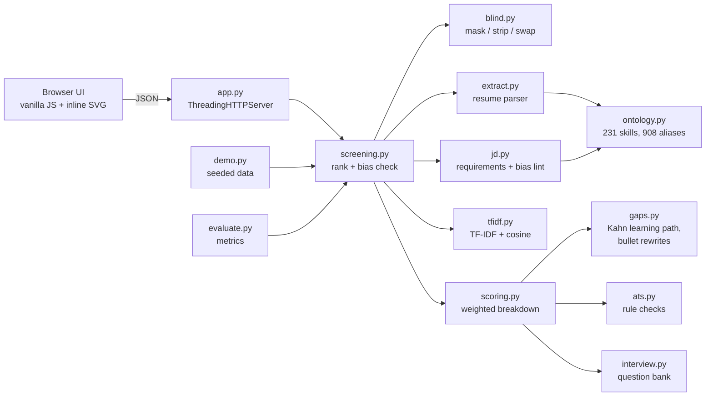

# ResumeRadar – Hackathon Report

## 1. Title, tagline, domain

**ResumeRadar** – *Fair, explainable AI resume screening and career coaching*
**Domain:** Artificial Intelligence & Machine Learning
QUANTIX 2K26 · K.S.R. College of Engineering · project folder `projects/08-resumeradar` · port 8008

## 2. Problem statement

**Who suffers.** Two groups, on opposite sides of the same table.

- **Recruiters** at software firms that hire through campus and pre-placement drives get hundreds of
  resumes for each opening. A first human scan lasts only seconds (about 7 s in the widely cited Ladders
  eye-tracking study, 2018, approx.). Most firms therefore put a keyword-matching applicant tracking
  system (ATS) in front of the recruiter.
- **Students and early-career candidates** are rejected without feedback. They never learn whether the
  problem was a missing skill, a badly worded bullet or a resume layout the ATS could not read.

**How much it hurts.**
- **Wording beats skill.** A literal keyword filter treats "JS", "ReactJS" and "Postgres" as different
  from "JavaScript", "React" and "PostgreSQL". In our own demo set, a strong frontend resume written with
  those common abbreviations drops to **rank 11 of 20** under a literal keyword ATS. ResumeRadar ranks it
  **#2** (Section 8).
- **Keyword stuffing wins.** A resume that lists 48 technologies but shows none of them in real work
  ranks **#3** under the keyword ATS for the backend role. ResumeRadar ranks it **#9** and flags it.
- **Identity bias is real and well documented.** In the field experiment by Bertrand & Mullainathan
  (American Economic Review, 2004), identical resumes got about 50% more callbacks with a white-sounding
  name than with a Black-sounding one (approx.). In 2018 Reuters reported that Amazon dropped an
  experimental ML recruiting model because it learned to penalise resumes containing the word "women's".
  In India, college brand and age limits often appear in job descriptions themselves
  ("IIT/NIT preferred", "age below 28").

**Why existing solutions fail.**
- Keyword ATS tools are literal. They miss synonyms, reward stuffing and never explain a rejection.
- Black-box "AI screening" products can learn historical bias from past hiring data. They give a
  recruiter a number without reasons, and they give a candidate nothing at all.
- Resume-checker websites upload personal data to a server, and most of them only check formatting.

## 3. Our solution

ResumeRadar is a local web app (`python app.py`) with two faces. The **recruiter screen** bulk-ranks
resumes against a job description. Every score is a transparent weighted sum, and every component is
explained in plain words. **Blind mode** removes identity before the model sees the text. A built-in
**bias check** proves, on the actual batch, that identity cannot change the ranking. The **candidate
coach** gives a student the same analysis for their own resume: what is missing, what to learn first,
how to rewrite weak bullets, whether an ATS can read the file, and which interview questions to expect.
Every model is written from scratch in Python's standard library and runs offline in milliseconds.

- **Skill ontology:** 231 skills in 19 categories, 908 aliases ("JS", "k8s", "DRF", "Postgres", "ML",
  "MERN"), 204 prerequisite edges and 31 "related skill" families.
- **Resume parser:** sections, skills (with where each skill appears), dated roles with internships at
  half weight, degree, field and CGPA, projects, certifications, contact details and bullets.
- **JD parser:** must-have vs nice-to-have from headings and cue words; either-or groups such as
  "Django or Flask"; extra weight for skills in the job title or on "strong/expert" lines; minimum
  experience; degree requirement; soft skills reported but never scored.
- **Match score:** must-have 40%, nice-to-have 10%, TF-IDF context 20%, relevant experience 15%,
  education 5%, proven-in-work evidence 10%. Exact or synonym matches earn 1.0, an implied prerequisite
  0.8/0.6 and a related skill 0.4. The breakdown shows every point.
- **Bulk ranking** with recommendation bands (shortlist / human review / low match). Nobody is auto-rejected.
- **Blind mode** masks name, pronouns, titles, gender words, age and date of birth, photo, marital
  status, family names, religion, nationality, city, college names, graduation years and contact
  details, and keeps an audit trail of what was hidden.
- **Bias check:** each resume is scored as submitted, with identity deleted, and with identity swapped
  (gender, name, college tier, age, city), in blind and in standard mode.
- **JD bias lint:** flags college-prestige filters, age limits, gendered wording and marital-status requirements.
- **Gap analysis and learning path:** missing must-haves, then a prerequisite-ordered study plan
  (Kahn topological sort) with hours, weeks and a practice project for each step.
- **Bullet coach:** detects missing action verbs, weak phrases ("responsible for"), missing numbers,
  passive voice and first-person words, and suggests a rewrite template.
- **ATS checker:** 9 rule checks (contact, sections, length, bullets, literal keyword match, stuffing,
  bias-inviting personal data, layout, dates), each with points and a fix.
- **Interview prep:** 115 questions over 66 skills. It asks deep-dive questions on skills you claim,
  fundamentals for your gaps, and project and behavioural questions.
- **Deterministic demo:** 3 JDs and 20 synthetic resumes (strong, alias-worded, weak bullets,
  keyword-stuffed, career switcher, freshers, unrelated). Identities are seeded and independent of quality.

## 4. Innovation / what makes it different

1. **Fairness you can verify, not just claim.** The bias check reruns the real pipeline on the real
   batch with identity deleted and with identity swapped. In blind mode the maximum score change is
   exactly **0.00** on all three demo jobs. In standard mode the same check shows up to **1.7 points**
   of drift and up to **4 rank changes**. The judges see both numbers side by side.
2. **Skill-aware, not word-aware.** Synonyms, prerequisite implication ("uses Django ⇒ knows Python")
   and related families ("Angular ↔ React") replace literal matching. The ATS check still tells
   students which exact JD words to mirror, because real ATS tools are literal.
3. **Evidence over listing.** A skill shown in an experience or project bullet counts. A skill that is
   only listed does not, so keyword stuffing is detected and down-weighted.
4. **One model, two audiences.** The recruiter's score breakdown becomes the student's coaching report:
   a gap list, a topologically ordered learning plan, bullet rewrites and interview questions.
5. **The JD is audited too.** Biased requirements such as "IIT/NIT preferred" and "age below 28" are
   flagged before any resume is read.
6. **Offline and explainable.** About 4 ms per full candidate report on a laptop CPU, no cloud, no data
   leaves the machine, and every number traces to a line of Python.

## 5. System architecture



| Component | File | Responsibility |
|---|---|---|
| HTTP server | `app.py` | Static files, 14 JSON endpoints, input validation, JSON errors, LAN mode |
| Config | `resumeradar/config.py` | Every weight, credit and threshold in one place, with reasoning |
| Ontology | `resumeradar/ontology.py` | Skill table, alias index (case rules), prerequisite closure, families |
| Resume parser | `resumeradar/extract.py` | Sections, longest-match skill extraction, date ranges, education, projects |
| JD parser | `resumeradar/jd.py` | Must/nice classification, either-or groups, weights, years, degree, bias lint |
| Blind mode | `resumeradar/blind.py` | Identity span finder; mask, strip and counterfactual rendering |
| TF-IDF | `resumeradar/tfidf.py` | Sublinear TF, smoothed IDF, L2 vectors, cosine, term contributions |
| Scoring | `resumeradar/scoring.py` | Requirement credit, components, renormalised weights, flags, bands |
| Screening | `resumeradar/screening.py` | Batch pipeline, ranking, bias check, Spearman |
| Coaching | `gaps.py`, `ats.py`, `interview.py` | Learning path, bullet analysis, ATS rules, interview questions |
| Demo + eval | `demo.py`, `evaluate.py` | Seeded data, hand labels, baselines, metrics, latency |
| Front-end | `static/` | Recruiter screen, candidate coach, how-it-works; light and dark themes |

## 6. Algorithms & models

**6.1 Skill extraction (dictionary longest-match with case rules).**
Every alias is tokenised with the same tokenizer as the resume (it keeps `c++`, `c#`, `.net`, `node.js`
and strips `ES6+` to `es6`). The aliases are stored in a dictionary keyed by token tuples, plus the
maximum phrase length for each first token. For each line the matcher tries the longest phrase first
and then skips past the match. So "React Testing Library" is one skill, not React plus noise.
Ambiguous words use case rules. `=Go`, `=R`, `=C`, `=REST` and `=ML` match only in exact case.
`~React`, `~Excel` and `~Spring` match in any case inside a Skills section or a JD, but only in exact
case elsewhere, so "I react quickly" is not a skill. URLs and emails are blanked before matching.
*Why:* it is deterministic, explainable (each match keeps its surface form and line) and runs in
microseconds per line. *Limits:* it only knows the 231 skills in the table. Words like "regression" on
their own are missed, and "Excel at teamwork" is a false positive (both are listed in Section 8).

**6.2 JD parsing.** Lines are assigned to sections (about, responsibilities, must, nice, education)
from headings. A line with a nice cue ("preferred", "exposure", "good to have") becomes nice-to-have.
When a must-have section exists, responsibilities count as nice-to-have. Skills joined by "or" or "/"
form an either-or group, and the group's credit is the best of its members. Requirement weight is 2.0
for skills in the job title and 1.5 on "strong/expert/proficient" lines. A single skill that also appears
in a must-have group is absorbed by the group. Minimum years come from patterns such as "1+ years",
and "or equivalent experience" removes the degree requirement.

**6.3 TF-IDF and cosine similarity.**
`tf = 1 + ln(count)`, `idf = ln((1+N)/(1+df)) + 1`, `w = tf·idf` with L2 normalisation, and
`cos(a,b) = Σ a_t b_t`. Tokens are lower-cased and stemmed, with stop words, numbers and blind-mode
placeholders removed. Each detected skill also adds a canonical token (`skill:javascript`), so synonyms
share a dimension. IDF is fitted on a fixed background corpus (the masked demo set) plus the current
batch, so one resume's score does not swing with batch size. The component is `min(1, cos/0.35)`.
*Why:* it catches context the ontology does not know (domain words such as "billing" or "invoices").
*Limits:* bag-of-words ignores word order and meaning beyond shared terms.

**6.4 Match score.**
```
score = 100 · Σ_c w_c · s_c / Σ_c w_c        over the components that apply
must_have    = Σ_r weight_r · credit_r / Σ_r weight_r
credit       = 1 (exact or synonym) | 0.8 implied by a skill that directly requires it
               | 0.6 implied further away | 0.4 related family | 0
experience   = min(1, relevant_years / required_years)     (not scored if the JD sets no minimum)
education    = 0.7 · level_fit + 0.3 · field_fit          (never the college)
evidence     = Σ weight of requirements matched AND shown in experience/projects / Σ weight
```
Relevant years are the merged (union) month intervals of roles that mention a JD skill or share a role
word with the JD title. Internships count at half weight. Bands: shortlist ≥ 75, human review ≥ 55.
*Why:* a linear, additive score is the most explainable model there is, because every point has a
reason. *Limits:* the weights are expert choices, not learned. With a few hundred labelled hires,
logistic regression on these same components would give calibrated weights and keep them explainable.

**6.5 Blind masking and the counterfactual bias test.**
A span finder uses regex rules for key-value personal fields ("Gender:", "Date of Birth:",
"Father's Name:"), the name (first line or a "Name:" field, then every occurrence), contact details,
pronouns, titles, gender words, ages, photo lines, institutions (capitalised words ending in College,
University, Institute and similar, plus IIT/NIT/BITS...), cities and graduation years. Overlapping spans
are resolved by earliest start, then longest. Three renderers use the same spans: `mask` (placeholders
and neutral pronouns), `strip` (delete) and `counterfactual` (swap to the other gender, the other
college tier, age +6, a different city). The bias check compares the rankings with Spearman ρ, counts
rank changes and records the maximum |Δscore|.
*Why:* removing the inputs is stronger than "de-biasing" a model afterwards, and the counterfactual
test checks it directly. *Limits:* proxies that remain in job content (for example a women's-college
hackathon named in a bullet, or an employer's name) can still leak. The check proves invariance only
for the fields it swaps.

**6.6 Learning path (prerequisite closure + Kahn's topological sort).**
Targets are the missing requirements, choosing the quickest-to-learn option of an either-or group.
Every unmet prerequisite is added recursively. Skills the candidate has, or that are implied by skills
they have, are treated as known. Kahn's algorithm orders the steps, and a priority heap breaks ties:
must-have support first, then fewer hours, then name. A cycle raises `CycleError`, and a unit test sorts
the whole 231-skill graph to prove it is acyclic. Hours (approx. estimates) become weeks at 8 h/week.
*Limits:* hours are rough, and the graph uses AND-prerequisites only.

**6.7 Bullet analysis and rewrite.** Each bullet scores 100 minus penalties: no action verb −30, weak
phrase −25, no number −25, too short −15, too long −10, first person −10, passive voice −10. The rewrite
removes the weak lead, turns gerunds or activity nouns into past-tense verbs ("deployment" → "Deployed"),
keeps the object and adds an impact placeholder. *Limits:* these are templates, not generated prose,
so the student still fills in the real number.

**6.8 ATS checker.** Nine rule checks with explicit points (total 100 when a JD is given). The keyword
check counts only literal matches, to mirror what a real ATS does.

**6.9 Interview generator.** It looks up the question bank for must-haves you meet (two questions for
weighted skills), fundamentals for must-haves you miss, nice-to-haves you have, a project walk-through,
a scale question and a behavioural question. Each type has a cap, with 12 questions at most.

**6.10 Evaluation metrics.** Spearman ρ with average ranks for ties; NDCG@5 with gain 2^label − 1;
top-5 overlap with the five resumes hand-labelled ≥ 2 for each job.

## 7. Tech stack and why it is offline-first

- **Python 3.9+ standard library only:** `http.server`, `re`, `math`, `heapq`, `json`, `random`.
  `python app.py` works on any venue laptop (Windows, macOS or Linux) without pip or internet.
- **Vanilla HTML/CSS/JS:** charts are hand-drawn inline SVG. There are no CDNs, external fonts or
  trackers, and the app works in light and dark mode and down to phone width.
- **No model downloads, no API keys:** every algorithm is under 400 lines of readable Python.
- **Privacy by design:** resumes never leave the machine, and blind mode means even the local scorer
  never sees identity.
- **unittest:** 77 tests covering the extractor, TF-IDF/cosine, scoring, JD parsing, blind masking and
  invariance, topological sort and learning paths, bullets/ATS/interview, demo determinism and the HTTP API.

## 8. Results / evaluation

All numbers come from `python -m resumeradar.evaluate` on the bundled demo set (Python 3.13,
4-core Intel Xeon @ 2.1 GHz container). **Caveat:** the 20 resumes are synthetic, and the 0–3
relevance labels were assigned by the author from resume content before looking at scores. That makes
this a sanity check of behaviour, not a benchmark. A real validation would use resumes labelled
independently by recruiters.

**Ranking agreement with hand labels (20 resumes × 3 jobs)**

| Job | System | Spearman ρ | NDCG@5 | Top-5 overlap |
|---|---|---|---|---|
| Python Backend Developer | **ResumeRadar** | **0.897** | **0.950** | 0.80 |
| | Keyword ATS (literal) | 0.873 | 0.916 | 0.80 |
| | Plain TF-IDF | 0.768 | 0.924 | 0.80 |
| Data Analyst | ResumeRadar | 0.793 | 1.000 | 1.00 |
| | **Keyword ATS (literal)** | **0.874** | 1.000 | 1.00 |
| | Plain TF-IDF | 0.818 | 1.000 | 1.00 |
| Frontend Developer (React) | **ResumeRadar** | **0.837** | **1.000** | **1.00** |
| | Keyword ATS (literal) | 0.721 | 0.785 | 0.80 |
| | Plain TF-IDF | 0.814 | 0.948 | 1.00 |
| **Mean** | **ResumeRadar** | **0.842** | **0.983** | **0.933** |
| | Keyword ATS | 0.823 | 0.900 | 0.867 |
| | Plain TF-IDF | 0.800 | 0.957 | 0.933 |

Honest reading: ResumeRadar has the best mean on every metric, but not on every job. On the analyst JD
the literal keyword baseline orders the low-relevance tail better. The top 5 are identical across all
three systems there, and our model scores the keyword-stuffed resume 6th instead of lower.

**Where wording matters (case studies)**

| Resume | Hand label | ResumeRadar | Keyword ATS | Plain TF-IDF |
|---|---|---|---|---|
| R15 frontend, written "ReactJS, JS, TS, HTML5/CSS3" | 3/3 | **#2** | #11 | #4 |
| R02 backend, written "Py, DRF, Postgres, k8s" | 3/3 | **#2** | #5 | #5 |
| R05 keyword-stuffed (48 skills, no evidence) | 1/3 | **#9** (flagged) | #3 | #9 |

**Skill extraction** on 28 hand-labelled tricky snippets (79 skills):
ResumeRadar precision 0.987 / recall 0.987 / F1 0.987, against a literal-name keyword baseline at
precision 0.943 / recall 0.633 / F1 0.758. The two known errors are "Excel at teamwork" (false positive
Excel) and a bare "regression" (missed Regression Analysis).

**Fairness: maximum score change when identity is deleted or swapped**

| Job | Blind mode | Standard mode (no masking) |
|---|---|---|
| Python Backend Developer (JD says "IIT/NIT preferred, age below 28") | **0.00 pts, 0 rank changes** | 1.1 pts, 4 rank changes |
| Data Analyst | **0.00 pts, 0 rank changes** | 1.7 pts, 0 rank changes |
| Frontend Developer (React) | **0.00 pts, 0 rank changes** | 0.8 pts, 3 rank changes |

**Latency** (median of 5 runs, 100 synthetic resumes against the backend JD, blind mode):
score and rank in **190 ms**; full reports (gaps, learning path, ATS, interview) in **378 ms**,
i.e. **3.8 ms per resume**. A 20-resume demo batch is screened in about 90 ms, and the full bias check
(6 re-screenings) takes about 250 ms.

## 9. Screenshots


`docs/screenshot.png` (1440×900) shows the recruiter screen after **Load demo data**. On top is the
parsed backend JD with must-have and nice-to-have chips and two JD bias-lint warnings. Below that are the
KPI row (bias check "Identical"), the blind-ranked table with stacked score bars and synonym/stuffing
signals, and the score breakdown for the top candidate.

## 10. 3-minute live demo script

1. **(0:00) Hook.** "Recruiters scan a resume in seconds, and keyword filters reject good people for
   their wording. ResumeRadar ranks fairly and explains why." Turn Wi-Fi off and open `http://127.0.0.1:8008`.
2. **(0:15) Load demo data.** "Twenty resumes against a real-looking Python backend JD, in about 90 ms,
   on a laptop, offline." Point at the JD bias lint: "The JD itself asks for IIT/NIT and an age limit.
   We flag that before reading any resume."
3. **(0:35) Explain a score.** Click Candidate 01: "Each point has a reason. 40/40 must-have, the TF-IDF
   terms shared with the JD, experience computed from dates, evidence from real bullets."
4. **(0:55) Wording.** Click Candidate 02 (≈ synonyms): "It wrote Py, DRF, Postgres, k8s. A literal ATS
   ranks this #5. We rank it #2." Then point at Candidate 05 with ⚠ stuffing: "48 skills listed, none
   proven. A keyword ATS puts this #3. We put it #9."
5. **(1:20) Fairness.** Open the **Blind view** tab: name, gender, college, age and photo are all
   masked. Scroll to **Bias check**: "We re-scored everyone with identity deleted and with gender,
   college and age swapped. Blind mode moves nothing: 0.00. Standard mode drifts up to 1.1 points and
   shuffles 4 ranks." Toggle Blind mode off to show the names appear and the KPI change.
6. **(1:50) Coach the student.** Open Candidate coach, then Try a sample resume (a weak Flask
   developer). Show Gaps & plan ("Docker before Kubernetes, Linux first", via topological sort,
   ~weeks at 8 h/week), Bullets ("Responsible for developing APIs" → "Developed APIs using Flask –
   add impact"), ATS and Interview.
7. **(2:30) Proof.** Open How it works, then Run evaluation: mean Spearman 0.84 vs 0.82 for keyword
   ATS, extraction F1 0.99 vs 0.76, blind Δ 0.00 on all jobs, 3.8 ms per resume. "No cloud, no black
   box, and every line is readable Python."

## 11. Impact

- **Social:** candidates from non-brand colleges, women, career switchers and older applicants are
  judged on skills, and the bias check makes that visible to the recruiter. Rejected students get a
  concrete plan instead of silence. *Assumption:* a recruiter keeps blind mode on; the default is on.
- **Economic:** a recruiter screening 300 resumes for one role gets a ranked, explained shortlist in
  under a second instead of hours of skimming (illustrative, not a measured field result). Better
  matching on skill reduces mis-hires and missed good hires; we make no claim about their cost.
- **Campus:** placement cells can run every student's resume against every visiting company's JD
  before the drive and hand out personalised learning plans.
- **Environmental:** about 4 ms of CPU per resume on an existing laptop. No GPU and no data-centre
  inference, so the energy cost is negligible.

## 12. Feasibility, scalability & business model

- **Feasibility:** it works today. It runs on any machine with Python 3.9+ and needs no setup, keys or
  hardware. The ontology is a plain-text table that HR teams can extend.
- **Scalability:** screening is linear in the number of resumes (3.8 ms each for a full report), so
  10,000 resumes take about 40 s on one core and the work parallelises per resume. The ontology lookup is
  O(1) per token. For a cloud deployment the same package sits behind any WSGI server.
- **Business model:**
  - Free candidate coach for students and colleges (placement cells).
  - Recruiter licence per seat or per hiring drive, with batch upload and an exportable bias-audit report.
  - On-premise enterprise edition for firms that cannot send resumes to SaaS.
  - Paid domain ontology packs (core engineering, finance, healthcare) and ATS integrations.

## 13. Future scope

- PDF and DOCX import with layout-aware text extraction (offline).
- Learn the component weights from recruiter decisions with logistic regression, so they stay explainable.
- Embedding-based similarity as an optional plug-in, with the same bias check run over it.
- Tamil and Hindi resume support, and region-aware masking of proxy fields.
- Exportable fairness audit (PDF) per drive, and four-fifths-rule adverse-impact monitoring when
  demographic data is collected voluntarily.
- A recruiter feedback loop to grow the ontology and the interview bank.

## 14. Judges' Q&A prep

1. **Is this really AI if it is rule-based?** It is classic, explainable NLP and IR: a dictionary
   entity extractor, TF-IDF vector-space similarity, a linear scoring model, graph algorithms and a
   counterfactual fairness test. We chose interpretable models on purpose, because hiring decisions
   must be explainable. The pipeline can take a learned weighting later (Section 13).
2. **Where do the weights come from?** They are expert defaults in one file, `config.py`, with the
   reasoning written beside each one. A recruiter can change them, and the breakdown updates. We do not
   claim they are optimal.
3. **How do you know the ranking is good?** It agrees with hand labels (mean Spearman 0.84, NDCG@5
   0.98) and beats a literal keyword ATS and plain TF-IDF on average. The honest caveat is that the data
   is synthetic and the labels are ours. The next step is recruiter-labelled real resumes.
4. **Can blind mode be fooled?** It removes the fields that identify a person. Proxies inside job
   content (an employer's name, a women's-college event) can remain. The bias check proves invariance
   for the swapped fields only, and the audit trail shows exactly what was masked.
5. **Why does standard mode change scores at all?** The JD contains "IIT/NIT" and "age". Without
   masking, the TF-IDF component rewards resumes that mention IIT, and name tokens change vector
   lengths. That is exactly the silent leak blind mode removes.
6. **Can candidates game it by stuffing keywords?** That is harder than with a keyword ATS. Ten
   percent of the score requires skills to appear in real experience or project bullets, and a stuffing
   flag fires when many skills are listed but few are proven.
7. **What if the JD uses a skill you do not know?** It still counts in the TF-IDF context score. If the
   JD names no known skill at all, the result is flagged "review manually" instead of a fake ranking.
   Adding a skill is one line in the ontology table.
8. **Privacy and the DPDP Act?** Everything runs locally, nothing is uploaded and nothing is stored on
   disk. Blind mode is also data minimisation, because the scorer never processes identity.
9. **Does it replace recruiters?** No. It produces a shortlist with reasons. "Low match" means "send
   coaching feedback", and a human makes every decision.
10. **How fast and how big can it go?** 3.8 ms per full report on a laptop core, linear scaling, and
    no external services to rate-limit.

## 15. How to run

```bash
cd projects/08-resumeradar
python app.py                       # http://127.0.0.1:8008/
python app.py --host 0.0.0.0        # LAN mode for phones
python app.py --port 9000           # another port

python -m unittest discover -s tests   # 77 tests
python -m resumeradar.evaluate         # metrics in Section 8 (JSON)
python -m resumeradar.demo             # regenerate data/demo.json
```

From the repository root, `python run_all.py 08` starts it together with the other demos.
