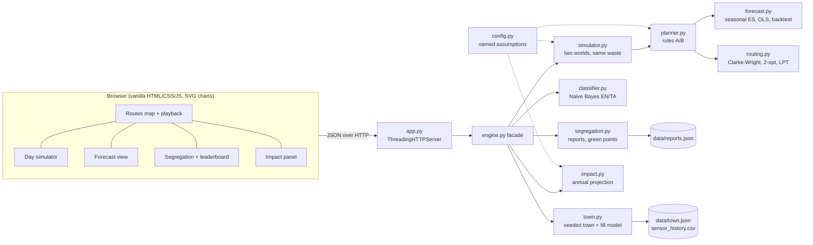

# WasteWise - Hackathon Report

## 1. Title, tagline, domain

- **Title:** WasteWise
- **Tagline:** Smart bins and optimised collection routes for cleaner cities
- **Domain:** Sustainability, CleanTech & Green Energy
- **Event:** QUANTIX 2K26, K.S.R. College of Engineering (23-24 Oct 2026)

## 2. Problem statement

**Who suffers.** Residents near overflowing community bins live with litter, stray animals, flies and smell. Municipal sanitation workers drive and lift more than they need to. Small urban local bodies (ULBs) pay the diesel bill. When segregation fails, recyclers and compost yards receive mixed waste that they cannot process.

**How much.** India's cities generate on the order of 1.5 lakh+ tonnes of municipal solid waste per day (CPCB annual reports, approx.). The Solid Waste Management Rules 2016 require source segregation into wet, dry and domestic hazardous streams, but compliance on the ground is patchy. In our simulated town, a crew following a fixed beat empties bins at only **40% average fill**: 872 of its 1,068 pickups in a month are less than half full. In the same month, **12 bin-days overflow** because the bins that fill fastest (market, bus stand) wait their turn on the rotation.

**Why existing practice fails.**

- **Fixed routes ignore demand.** The beat is the same on a quiet Monday and on the weekly santhai (market) day.
- **No prediction.** Even where fill sensors exist, a dashboard that shows "bin is 90% full now" is too late to plan the morning's route.
- **Commercial route optimisers** need cloud access, licences and GIS staff, which a small ULB does not have.
- **Segregation drives are one-off.** Citizens do not know which bin an item belongs in (especially for Tamil item names), and nobody measures or rewards compliance.

## 3. Our solution

Every morning, WasteWise reads each smart bin's fill sensor and forecasts how much waste will arrive today and tomorrow. It selects only the bins that will be ≥75% full when the truck passes, or that would overflow before tomorrow's run. It then computes capacitated routes for the 3 trucks with Clarke-Wright savings and 2-opt, packs the trips into the 06:00-09:30 collection window, and shows the result on an animated map next to what the fixed beat would have done with the same waste. A day simulator replays weeks of operation. A bilingual classifier and a ward leaderboard improve segregation. The impact panel turns the measured savings into annual litres of diesel, rupees and tonnes of CO₂, with every assumption shown.

Key features:

- **Fill forecasting per bin.** Seasonal exponential smoothing learns weekday and market-day patterns and gives time-to-full in hours.
- **Explainable bin selection.** Rule A (≥75% at pickup) or rule B (overflow guard with a +1σ safety margin). Every bin shows its reason.
- **Capacitated vehicle routing.** Clarke-Wright savings, then 2-opt, then longest-trip-first packing onto trucks within the shift. The step-by-step km trace is shown.
- **Side-by-side KPIs against the fixed beat.** Distance, diesel, CO₂, ₹, truck-hours, fill at pickup, half-empty pickups, overflowing bins and litres spilled.
- **Animated truck playback** on an SVG street map (bins coloured by fill, shaped by waste type).
- **Day simulator.** Two worlds with identical waste: a running comparison, overflow event log and daily charts.
- **Segregation module.** English / தமிழ் / Tanglish "which bin?" classifier with evidence, citizen reports, green points and a compliance-weighted ward leaderboard.
- **Impact panel.** Annual projection with live sliders (diesel price, town size, mileage) and named constants.

## 4. Innovation / what makes it different

- **Predict, then route.** Most "smart bin" demos only alert when a bin is already full. WasteWise forecasts the fill at the truck's arrival time and the risk of overflow before the next run, so the route is planned before anything overflows.
- **A fair baseline.** Both policies use the same 3 trucks, the same 6,000 L capacity, the same 3.5 h window and exactly the same waste. We also report the routing-only gain (same bins, fixed order vs Clarke-Wright) separately, so selection and routing are not mixed up.
- **Explainable end to end.** Each bin carries the rule that fired with its numbers. The route card shows fixed order → savings merge → 2-opt in km. The classifier shows the words that decided its answer. The impact panel shows its formulas.
- **Built for a ₹15k laptop.** Pure Python standard library, no internet. Planning a day takes under 1 ms, a 30-day dual simulation about 160 ms, and 400 bins about 130 ms.
- **Local language.** Tamil item names (தேங்காய் ஓடு, பால் பாக்கெட், மீன் கழிவு…) and Tanglish (thengai odu, paal packet) are first-class. Tamil bin names are shown with every answer.
- **Gamification you cannot game.** The ward score is points × (0.5 + 0.5 × compliance), so spamming wrong reports never wins.

## 5. System architecture



| Component | File | Responsibility |
|---|---|---|
| HTTP server | `app.py` | Static files, JSON API, input validation, JSON errors, never crashes |
| Facade | `wastewise/engine.py` | Holds simulation state behind a lock; shapes responses |
| Town & fill model | `wastewise/town.py` | 6 wards, 40 bins, depot, trucks + fixed beats; deterministic daily fill per bin |
| Forecasting | `wastewise/forecast.py` | Seasonal ES (main), naive, seasonal naive, SES, OLS + weekday; backtest; time-to-full |
| Planner | `wastewise/planner.py` | Rules A/B, demand estimate, CW → 2-opt → truck packing, deferral |
| Routing | `wastewise/routing.py` | Savings list, Clarke-Wright, 2-opt, fixed order, LPT assignment |
| Simulator | `wastewise/simulator.py` | Executes routes minute by minute (arrival-time fill, unloads, shift end), overflow accounting |
| Classifier | `wastewise/classifier.py` | 274 labelled item names + 120-word lexicon; NB with word + char-3-gram features |
| Segregation | `wastewise/segregation.py` | Reports, points, leaderboard, persistence |
| Impact | `wastewise/impact.py` | Month → year projection, assumption table, formulas, caveats |
| Config | `wastewise/config.py` | Every tunable constant with its source or reasoning |
| UI | `static/` | Dashboard, map, playback, charts (no libraries) |

## 6. Algorithms & models

### 6.1 Fill model (ground truth of the simulation)

For bin *b* on day *d*:

```
Δ(b,d) = base_rate(b) × profile[zone(b)][weekday(d)] × exp(N(0, 0.13))
```

The zone profiles are residential, commercial, market, institutional and temple. They are normalised to mean 1 and include a weekly market-day spike (×2.1 for market bins, ×1.3 for commercial) plus a carry-over the next day. Each (bin, day) uses its own integer-seeded RNG stream, so results do not depend on evaluation order or `PYTHONHASHSEED`. Waste arrives uniformly between 05:00 and 23:00, so a bin's level when the truck arrives depends on the arrival time. The sensor reports Δ with ±2% noise.

*Limits:* real waste has festivals, rain and holiday effects, and bins get stuffed beyond capacity. We do not model those.

### 6.2 Forecaster - seasonal exponential smoothing (Holt-Winters, multiplicative weekday season, no trend)

```
level_t   = α · x_t / s[dow_t] + (1-α) · level_{t-1}
s[dow_t]  = γ · x_t / level_t   + (1-γ) · s[dow_t]
x̂_{t+1}   = level_t · s[dow_{t+1}]          σ = RMSE of one-step errors
```

α ∈ {0.05…0.7} and γ ∈ {0.05…0.5} are chosen per bin by grid search on one-step-ahead squared error over 6 weeks of history. After that, each new day's reading is an O(1) update. Time-to-full walks the daily forecasts through the 05:00-23:00 deposit window and interpolates the hour at which the level crosses 100%.

*Why:* it is tiny, explainable ("Wednesday = ×1.7 of an average day"), updates online in O(1), and adapts when a new shop opens (unit-tested).
*Compared against:* naive, seasonal naive, SES and **OLS with a day-index trend + 6 weekday dummies** (normal equations solved by our own Gaussian elimination). On our stationary synthetic data, OLS is marginally better (4.48 vs 4.63 pts MAE). We kept seasonal ES for its online updates and adaptivity, and we report the comparison honestly.
*Limits:* one seasonal period (weekly), no holiday calendar, and σ is assumed constant over the horizon.

### 6.3 Bin selection rules

With F(h) = share of the day's waste deposited by hour h, and L = sensor level at 00:00:

```
at_pickup   = L + F(07:45) · Δ̂_today
if_skipped  = L + Δ̂_today + F(09:30) · Δ̂_tomorrow + SAFETY_SIGMA · σ · √(1 + F(09:30)²)
Rule A: collect if at_pickup  ≥ 0.75   (worth the stop)
Rule B: collect if if_skipped ≥ 1.00   (would overflow before tomorrow's latest pickup)
```

If the fleet window is full, the bins with the lowest `if_skipped` are deferred one at a time and the routes are rebuilt.

*Limits:* a single planning arrival time for rule A (actual arrival times are used in the simulation).

### 6.4 Clarke-Wright savings (parallel version)

```
start: one route 0→i→0 per selected bin
s_ij = d(0,i) + d(0,j) − d(i,j)     for all pairs, sorted high → low
for each (i, j): if i and j are ends of different routes,
                 load(Ri)+load(Rj) ≤ 0.92·Q and duration(merged) ≤ shift:
                     link them (reversing a route if needed)
```

Distances are Manhattan km on the street grid. Demand = predicted litres at pickup. Duration = drive time at 15 km/h + 8 min per bin + 20 min unload. O(n² log n).
*Why:* a classic, well-understood CVRP construction heuristic that is easy to explain on a whiteboard and fast enough for real time.
*Limits:* greedy, so it gives good but not optimal routes. Ties on a Manhattan grid are broken by bin index.

### 6.5 2-opt improvement

For each trip (closed at the depot), reverse the segment between edges (a, a+1) and (b, b+1) whenever `d(a,b) + d(a+1,b+1) < d(a,a+1) + d(b,b+1)`. Repeat until no strict improvement remains. Because only strict improvements are applied, a route can **never get longer**; this is a unit-tested property over 60 random routes.
*Limits:* intra-route only, with no relocation between trucks. On our grid, Clarke-Wright already produces near-2-opt-optimal routes (2-opt adds 0.9%).

### 6.6 Truck packing (LPT)

Trips are sorted by duration, longest first. Each trip goes to the truck with the least work that can still fit it within the 210-minute window.

### 6.7 Waste-item classifier - multinomial Naive Bayes

Features are word tokens (with a light English plural stem) plus character 3-grams inside each word. The 3-grams make Tamil suffixes and spelling variants match. Tokenisation splits on whitespace/punctuation rather than `\w`, because Python's `\w` breaks Tamil vowel signs. Laplace smoothing uses α = 0.5. An exact-name dictionary is checked first. Displayed confidences are tempered (log-scores ÷ max(1, n_features/5)), because the char n-grams of one word are correlated. The explanation lists the words with the largest log-odds versus the runner-up class. Answers with low feature coverage or <50% confidence are flagged "not sure".
*Limits:* 78% on unseen names. It is a name classifier, not an image classifier, and it has no notion of "soiled" vs "clean".

### 6.8 Green points & leaderboard

A correct report earns +10 points; any report earns +2 for participation. Ward score = points × (0.5 + 0.5 × compliance). Badges: Champion (rank 1), Green Star (≥80%), Rising (≥65%), Needs a drive.

## 7. Tech stack and why it is offline-first

| Layer | Choice | Why |
|---|---|---|
| Backend | Python 3.9+ standard library (`http.server`, `json`, `random`, `math`) | `python app.py` works on any venue laptop, including Windows, with no pip |
| Algorithms | Hand-written forecasting, linear algebra, CVRP heuristics, NB | Explainable, auditable, nothing hidden behind a library |
| Frontend | Vanilla HTML/CSS/JS, inline SVG map and charts | No CDN, no fonts, no build step; works if the Wi-Fi is down |
| Data | Deterministic generator (seed 2026) + JSON/CSV in `data/` | Same numbers on every machine, in every rehearsal |
| Tests | `unittest` (45 tests) | Runs anywhere Python runs |

Light/dark theme follows `prefers-color-scheme`. The layout works down to phone width (390 px tested), and the server binds `0.0.0.0` so judges can use their phones.

## 8. Results / evaluation

All numbers below are reproduced by `python -m wastewise.evaluate` (about 2 s on a laptop).

**Simulated month (30 days, same waste, same fleet: 3 trucks × 6,000 L × 3.5 h):**

| Metric | Fixed beat | WasteWise | Change |
|---|---:|---:|---:|
| Truck distance | 1,906.5 km | 1,085.0 km | **−43.1%** |
| Diesel | 690.2 L | 390.1 L | **−43.5%** |
| CO₂ (2.68 kg/L) | 1,849.8 kg | 1,045.4 kg | −43.5% |
| Diesel cost (₹90/L) | ₹62,121 | ₹35,105 | −43.5% |
| Truck-hours | 299.5 h | 177.5 h | −40.7% |
| Bins emptied | 1,068 | 594 | −44.4% |
| Average fill at pickup | 40% | 70% | +30 pts |
| Half-empty pickups (<50%) | 872 | 62 | −92.9% |
| Overflowing bin-days | 12 | 1 | **−91.7%** |
| Litres spilled on the street | 615.8 L | 2.5 L | −99.6% |
| Waste collected | 352,102 L | 348,666 L | −1.0% (same waste) |

**Robustness on three other randomly generated towns** (`config.SEED` changed): 42.7%, 47.0% and 43.2% fewer km. Overflowing bin-days went 24 → 1, 15 → 2 and 26 → 0.

**Routing only (the same selected bins, 30 days):** fixed route-chart order 1,544.0 km → Clarke-Wright 1,094.5 km (**−29.1%**) → +2-opt 1,085.0 km (a further −0.87%).

**Solver runtime:** daily planning (decide + CW + 2-opt + packing) takes 0.43 ms on average (median 0.46 ms, max 0.80 ms). The full 30-day dual simulation takes about 160 ms. On random instances, CW + 2-opt took 0.8 ms for 40 bins, 5.5 ms for 100, 25.9 ms for 200 and 130 ms for 400.

**Forecast backtest** (last 14 of 42 history days, one-step-ahead MAE in fraction of capacity/day, all 40 bins; the mean daily fill is 35% of capacity):

| Model | MAE |
|---|---:|
| OLS trend + weekday dummies | 0.0448 |
| **Seasonal exponential smoothing (used)** | **0.0463** |
| Seasonal naive (same weekday last week) | 0.0548 |
| Simple exponential smoothing | 0.0706 |
| Naive (yesterday) | 0.0871 |

Seasonal ES has 47% lower error than naive. The injected noise (13% multiplicative + sensor noise) sets a floor of about 0.04, so both regression models are close to it.

**Classifier hold-out** (every 5th item name held out and never seen in training): **43/55 = 78.2%**. By class: wet 18/20, recyclable 12/13, dry 8/12, hazardous 5/10. Most errors are on items with no shared words, e.g. "power bank" or "hair dye". Known names are answered from the dictionary.

**Sensitivity note:** the overflow comparison depends on the 3.5 h collection window (`config.py`). With that window the fixed beat cannot reach all 40 bins every day and resumes next morning where it stopped. The distance savings hold across settings; the overflow numbers depend on the window.

**Tests:** 45 unit tests pass (`python -m unittest discover -s tests`). They cover a hand-checked Clarke-Wright instance, 2-opt monotonicity, capacity/duration constraints, OLS/Gaussian elimination, forecaster seasonality, time-to-full, rule logic, overflow accounting, determinism, the API and error handling.

## 9. Screenshots


The screenshot shows today's routes at 07:35 during playback: KPI strip, street map with two WasteWise trucks on route (the third stays at the depot), the comparison against the fixed beat, and the algorithm trace.

## 10. 3-minute live demo script

1. **(0:00) Hook.** Open `http://127.0.0.1:8009/`. "Every morning our town's 3 trucks drive the same beat. They empty bins that are 40% full while the market bins overflow."
2. **(0:20) Click "Run demo".** The trucks animate. "WasteWise collects only the 16 bins that need it today. That is **30 km instead of 61.5 km, −51%**, 11.9 L of diesel saved today." Point at the KPI strip.
3. **(0:45) Toggle "Fixed beat".** "Same trucks, same window: the beat empties 36 bins at 46% average fill and still leaves 4 bins for tomorrow."
4. **(1:05) "How today's route was built" card.** "Fixed order on the same bins is 45 km. Clarke-Wright savings merge the bins into trips, 30.5 km. 2-opt uncrosses them, 30.0 km. Solved in under a millisecond on this laptop."
5. **(1:25) "Why these bins?" table → click B30 (Santhai Market).** "Each decision has a reason. The forecaster learned that Wednesday is market day, about ×1.7. So rule B fires: if skipped, it would overflow before tomorrow's run."
6. **(1:50) Click "Next day"** (it is market day). The toast reports the overflowing bins: fixed beat 1, WasteWise 0.
7. **(2:05) Day simulator → "Run to day 30".** "Over a month: **−43% km and diesel, overflowing bin-days 12 → 1**, and half-empty pickups 872 → 62."
8. **(2:25) Segregation.** Click the chip **தேங்காய் ஓடு** → Green bin, with the evidence words. Submit a report → "+10 green points". Show the ward leaderboard.
9. **(2:45) Impact.** Drag "Smart bins" to 400. "That is about **₹33 lakh and ~98 t CO₂ a year** at ₹90/L. Every assumption is on screen, and it runs offline on a ₹15k laptop."

## 11. Impact

- **Environmental.** In the 40-bin pilot simulation, about **3,650 L diesel and ~9.8 t CO₂ avoided per year**. Scaled linearly to 400 bins (rough), that is about 36,500 L and ~98 t CO₂. Less overflow means less litter reaching drains and water bodies (12 → 1 overflowing bin-days a month in the simulation).
- **Economic.** About **₹3.3 lakh/year in diesel** for the 40-bin pilot at ₹90/L (₹33 lakh at 400 bins). Crew wages are not included. About 1,480 truck-hours/year are freed for sweeping, drain cleaning or bulky-waste runs.
- **Social and health.** Fewer overflowing bins mean fewer stray-animal and vector problems near markets and bus stands. Sanitation workers lift fewer half-empty bins. Citizens get instant, bilingual "which bin?" help and recognition for their ward.
- **Honest assumptions.** Truck mileage 4 km/L, idling 1.5 L/h, diesel ₹90/L, CO₂ 2.68 kg/L, speed 15 km/h, 8 min per bin and 365 collection days are all approx. planning values in `config.py`. They are editable live in the Impact tab. All results come from a simulated town, not a field trial.

## 12. Feasibility, scalability & business model

- **Feasibility.** The software runs today on any laptop. A pilot needs ultrasonic fill sensors with a GSM/LoRa uplink on existing community bins, a phone or printout per driver, and a sanitation officer's laptop. With no sensors at all, the forecaster can run on manual daily readings by bin supervisors.
- **Scalability.** CW + 2-opt plans 400 bins in about 130 ms in pure Python, and the complexity is O(n² log n). Larger cities can partition by zone/depot. The distance matrix is a plain input, so real road distances (e.g. Dijkstra over an OpenStreetMap extract) can replace the grid without changing the solver.
- **Business model.** (1) A SaaS subscription per bin per month for ULBs and gated communities. Smart-city or Swachh Bharat Mission-Urban 2.0 SWM budgets may fund it, subject to scheme guidelines. (2) A sensor + software bundle through local system integrators. (3) Segregation analytics for compost and recycler partners, who pay for cleaner feedstock. (4) A free tier for colleges and campuses as showcases.
- **Adoption path.** Run alongside the existing beat for 2-4 weeks and compare km and overflow with the same dashboard, then switch ward by ward.

## 13. Future scope

- Real road network distances and time windows (no trucks in school zones at 08:30).
- Multiple depots, heterogeneous fleets (tipper vs compactor) and inter-route moves (relocate/exchange, or-opt).
- A holiday/festival calendar and rain effects in the forecaster, plus anomaly alerts for sensor faults.
- Photo-based item classification and contamination detection at the bin lid (needs ML libraries, so it would sit outside the offline core).
- A driver PWA with turn-by-turn stops, proof-of-collection and a WhatsApp/SMS bot for citizen reports in Tamil.

## 14. Judges' Q&A prep

1. **Is the fixed baseline a straw man?** No. Both worlds have the same 3 trucks, capacity, 3.5 h window and identical waste. The fixed beat even unloads when full and resumes tomorrow where it stopped. We also isolate the pure routing gain on the same bins (−29%), and show that visiting all 40 bins in fixed order would need 80.5 km and 12.7 truck-hours, which does not fit the window.
2. **Why Clarke-Wright and not an exact solver?** Exact CVRP is NP-hard. CW is the classic, explainable construction heuristic, and 2-opt cleans up each route. It plans a day in under 1 ms offline. It is not guaranteed optimal, and we say so.
3. **Is the data real?** No. It is a deterministic synthetic town (seed 2026) with documented fill profiles, which keeps the demo reproducible. The structure maps one-to-one onto real sensor feeds (`data/sensor_history.csv`).
4. **How accurate is the forecast?** MAE is 4.6 points of capacity per day, against 8.7 for a naive forecast. Rule B adds a +1σ safety margin, and only 1 overflowing bin-day happened in the month.
5. **Why not linear regression, since it scored better?** It was only about 3% better on stationary synthetic data. Seasonal ES updates in O(1) per day and adapts to level shifts (tested). Both are implemented, and the backtest is in the UI.
6. **What if a sensor fails or is vandalised?** The forecaster keeps predicting from its learned level and weekday pattern. Future work: flag bins whose readings stop or jump, and fall back to manual readings.
7. **How do the drivers use it?** Each truck gets an ordered stop list (shown in the Trucks card) for the morning window. It can be printed or opened on a phone.
8. **Can the classifier handle Tamil?** Yes. It works on Tamil script and Tanglish with character n-grams; Python's `\w` splits Tamil words, so we tokenise ourselves. Hold-out accuracy on unseen names is 78%. Uncertain answers are flagged, and exact names are answered from the dictionary.
9. **Can the leaderboard be gamed?** The score weights points by compliance, and wrong reports earn only participation points. Household IDs are pseudonymous, and only ward-level data is public.
10. **What does a sensor cost, and does it pay back?** We do not quote sensor prices; they vary by vendor and volume. The tool shows the diesel saving per bin per year (about ₹8,200 at ₹90/L in the simulation), so a ULB can compare it with its own quotes.

## 15. How to run

```bash
cd projects/09-wastewise
python app.py                      # http://127.0.0.1:8009/
python app.py --host 0.0.0.0       # LAN / phone access
python app.py --port 9000          # another port
python -m unittest discover -s tests
python -m wastewise.evaluate       # reproduce the numbers in section 8
```

You need Python 3.9+ with no dependencies. `data/` files are (re)created on first run. Click **Run demo** to reset to day 0 at any time.
