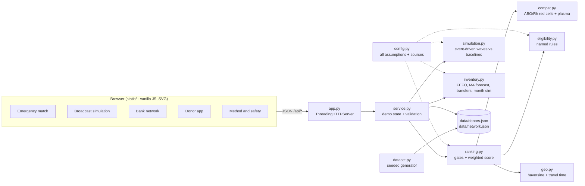

# BloodLink — Find the right blood donor in minutes, not hours

**Domain:** HealthTech & Biomedical Innovation · **Event:** QUANTIX 2K26, K.S.R. College of Engineering · **Demo port:** 8010

> Prototype with synthetic data. BloodLink finds and alerts donors and moves stock between blood banks; every transfusion decision follows ABO/Rh grouping, antibody screening and cross-matching by qualified blood bank staff.

---

## 1. Title, tagline, domain

- **Product:** BloodLink
- **Tagline:** Find the right blood donor in minutes, not hours
- **Domain:** HealthTech & Biomedical Innovation
- **Region modelled:** Salem, Erode and Namakkal districts (Tamil Nadu), approximate town coordinates

## 2. Problem statement

**Who suffers.** A patient in an accident, a mother with post-partum bleeding, a child with thalassaemia or a cancer patient on chemotherapy — and the family who is told "arrange donors".

**What actually happens today.**

- The family forwards a WhatsApp message ("Urgent: A+ needed at ... hospital") to every group they are in. The message spreads unevenly, many people never see it, and nobody knows who is *eligible*: donors who gave blood last month, are under-weight or are travelling still reply and sometimes travel, only to be deferred at the counter.
- The request names one group. Compatible substitutes are not considered, and when they are, the scarce groups (O-negative; ~5% of Indians are Rh-negative, approx.) get used for patients who could have taken a commoner group.
- The same few "reliable" donors are called again and again; they burn out and stop answering.
- Blood banks see the opposite problem at the same time: red cells keep only **35 days (CPDA-1) to 42 days (SAGM)**, a college camp floods a small centre with units it cannot use, and those units expire while a bigger hospital 40 km away is short of the same group.

**Why existing solutions fail.** Donor directories are static lists (no eligibility, no distance, no response history); broadcast apps optimise reach, not the *right* reach; blood bank software tracks one bank's stock but does not suggest transfers across banks before expiry. None of them explains *why* a particular donor was called first.

We deliberately do **not** quote national shortage numbers: published figures vary widely and we cannot verify them here. The prototype's own measurements (Section 8) are from a simulator with stated assumptions.

## 3. Our solution

BloodLink is an offline-first web app that turns a request ("3 units A+, critical, at Tiruchengode") into a ranked, explained list of *eligible, compatible* donors, alerts them in small waves until the units are collected, and keeps the regional blood bank network balanced so units are used before they expire.

- **Correct compatibility first:** red-cell ABO/Rh compatibility derived from antigens, tested on all 64 donor/patient pairs; plasma compatibility too; exact matches preferred to conserve scarce groups.
- **Safety gates before scoring:** whole-blood interval (90 days men / 120 days women), age 18–65, weight ≥ 45 kg, temporary deferral, availability — every excluded donor is shown with the rule that fired and the date they become eligible.
- **Transparent ranking:** four visible score parts (compatibility, proximity, response history, fairness) with "ahead of #N mainly on ..." explanations.
- **Wave broadcast with a live timeline:** alerts the best few, keeps extra acceptors on standby, stands everyone down the moment the units are being drawn; compared live with "forward to everyone" and a "first-come phone list".
- **Blood bank network:** FEFO issue, 7-day moving-average demand forecast, FEFO expiry-risk projection, greedy inter-bank transfer suggestions, and a 30-day simulation with vs without them.
- **Donor app:** eligibility self-check, next eligible date countdown, badges, pause alerts.

## 4. Innovation / what makes it different

1. **Eligibility-aware matching.** Nobody ineligible is ever alerted — the single biggest source of wasted calls and wasted trips in WhatsApp forwards.
2. **Explainability everywhere.** Every rank is a sum of four labelled numbers; every exclusion names a rule; every transfer suggestion says which unit would have expired where and who needs it.
3. **Fairness built into the score.** Recently alerted donors lose points, so load spreads across the registry instead of burning out the same ten people.
4. **One system for both sides of the shortage:** people (donors) and stock (blood banks), with the same compatibility engine underneath.
5. **Honest evaluation.** A discrete-event simulator with *common random numbers* compares strategies on identical donors and identical dice; the simulator's hidden "true willingness" is never shown to the ranker.
6. **Runs on a ₹15k laptop with no internet:** Python standard library, hand-drawn SVG maps/charts.

## 5. System architecture



| Component | File | Responsibility |
|---|---|---|
| HTTP server | `app.py` | Static files, JSON API, input validation, JSON errors with status codes, never crashes |
| Service | `bloodlink/service.py` | In-memory demo state (registry, contact log, stock), caching of Monte Carlo results, reset |
| Compatibility | `bloodlink/compat.py` | Antigen-based red-cell and plasma rules, substitute preference, reasons |
| Eligibility | `bloodlink/eligibility.py` | Interval, age, weight, Hb (optional), illness, deferral; next eligible date |
| Geography | `bloodlink/geo.py` | Haversine great-circle distance, road-time estimate |
| Ranking | `bloodlink/ranking.py` | Hard gates, four-part score, explanations, first-wave size |
| Simulator | `bloodlink/simulation.py` | Discrete-event simulation of waves / broadcast / phone list; Monte Carlo evaluation |
| Inventory | `bloodlink/inventory.py` | FEFO issue, moving-average forecast, expiry-risk projection, greedy transfers, network simulation |
| Data | `bloodlink/dataset.py` | Deterministic synthetic donors (seed 2026) and a 90-day warm-up of the 5-bank network |
| Config | `bloodlink/config.py` | Every tunable constant with source or reasoning ("verify" / "approx." / "assumption") |
| Frontend | `static/` | Five tabs, SVG map without tiles, step/line charts with hover, light/dark, phone layout |

## 6. Algorithms & models

### 6.1 ABO/Rh compatibility (red cells and plasma)
```
red_cell_compatible(donor, patient) = antigens(donor.ABO) ⊆ antigens(patient.ABO)
                                      and (patient.RhD or not donor.RhD)
plasma_compatible(donor, patient)   = antigens(donor.ABO) ⊇ antigens(patient.ABO)   # Rh ignored
antigens: O = {}, A = {A}, B = {B}, AB = {A, B}
```
*Why:* deriving from antigens is easier to audit than a hand-typed table. *Test:* all 64 red-cell pairs and all 64 plasma pairs are checked against an independently written truth table (27 red-cell pairs are compatible). *Limits:* platelets, cryoprecipitate, minor antigens, antibody screening and cross-matching are out of scope; in real emergencies blood banks may issue Rh-positive cells to some Rh-negative patients — BloodLink never does.

### 6.2 Eligibility rules (named constants, verify against current NBTC / blood-bank guidelines)
Age 18–65; weight ≥ 45 kg; ≥ 90 days (men) / 120 days (women) since the last whole-blood donation ("other / not stated" gets the longer interval); optional self-reported Hb ≥ 12.5 g/dL; feeling unwell today; blood-bank deferral date. The next eligible date is the latest clearing date of the failing temporary rules; permanent failures (age above 65, weight, low Hb) give no date. *Limits:* the full donor questionnaire (medication, travel, tattoos, recent illness, pregnancy...) stays with the blood bank.

### 6.3 Haversine distance and travel time
```
a = sin²(Δφ/2) + cos φ1 · cos φ2 · sin²(Δλ/2);   d = 2R · asin(√a),   R = 6371.0088 km
travel_min = 10 (prep) + d × 1.3 (road circuity, approx.) / 35 km/h × 60
```
*Why:* no map API offline; exact great-circle distance on a spherical Earth. *Test:* against the spherical law of cosines, 1° = 111.195 km, quarter meridian, antipodes. *Limits:* real roads, traffic and rivers are not modelled — the circuity factor is an approximation.

### 6.4 Donor ranking
```
score = 0.30·compat + 0.30·proximity + 0.25·response + 0.15·fairness
compat    = 1 − 0.25·[Rh− cells to Rh+ patient] − 0.25·[different ABO group]
proximity = exp(−travel_min / τ),  τ = 25 / 45 / 90 min for critical / urgent / planned
response  = (accepted + 2) / (alerts + 4)          # Beta(2,2) prior: new donor = 0.5
fairness  = min(1, days since last alert / 14)
```
Each donor's explanation lists the four contributions and the component that put them ahead of the next donor. The first wave is the smallest top-k whose estimated unit yield covers the need plus a 25% buffer (3 ≤ k ≤ 12). *Why:* a linear score is explainable to a judge and to a blood bank officer, and the weights are visible and tunable. *Limits:* weights are design choices, not learned; with real data they should be tuned on outcomes.

### 6.5 Wave broadcast simulator (discrete-event, heap-based)
```
every 10 min while units not met:
    need = ceil(1.25·units) − (collected + donating + en_route + standby) − Σ p̂(pending replies)
    if need > 0: alert next  clamp(ceil(need / mean p̂_unit), 3, 12)  ranked donors
reply after Exp(mean 6 min): accept with p_true, else decline (60%) / silent
accepted → travels (90% show up), screening pass 92%, donation 30 min
once every needed unit is being drawn → en-route donors stood down; standby released at fulfilment
```
Baselines on the same donors and the same per-donor random draws:
- **Broadcast to everyone:** all exact-group donors within 60 km; forwards reach people after Exp(mean 20 min); response × 0.6 (diffusion-of-responsibility assumption, sensitivity tested at 1.0); no eligibility knowledge (ineligible acceptors are deferred on arrival = wasted trip); no way to stand people down.
- **First-come phone list:** one coordinator calls exact-group donors in register order, 3 min per call, screens eligibility on the phone, stops at the needed count, resumes on no-shows.

*Limits:* behaviour constants are assumptions (Section 8.4 states them); the simulator compares strategies under identical assumptions, it is not a forecast of real response times.

### 6.6 Blood bank inventory network
- **FEFO issue:** exact group first, then compatible substitutes in preference order; within each tier the unit that expires first leaves first; expired units are never issued.
- **Demand forecast:** 7-day moving average per bank × group, falling back to a 28-day average when the 7-day window has fewer than 3 units (rare groups).
- **Expiry-risk projection:** walk the FEFO queue with a clock `t`; the next unit is consumed at `t + 1/rate`; if that is after its expiry the unit is "at risk" (and does not consume demand time).
- **Transfer suggestions (greedy):** transferable = at-risk units + "excess" beyond 7 days of the sender's own demand. Most urgent unit first, send to the nearest bank within 90 km that has a deficit vs a 3-day target (or, for an at-risk unit, any bank that will use it before expiry) and whose own at-risk count does not rise after a 1-day transit. A unit moves at most once.
- **Month simulation:** 90-day warm-up, then 30 days of seeded Poisson demand and collections (plus periodic college/community camps at the smaller centres), identical for both policies.

*Why greedy:* five banks and a few hundred units — greedy is instant (4.6 ms), explainable unit by unit, and already removes most wastage. *Limits:* no optimality guarantee (a min-cost-flow would be the next step), transport capacity and cold-chain cost are only counted, not optimised; the forecast ignores weekday/seasonal effects.

## 7. Tech stack and why it is offline-first

| Layer | Choice | Why |
|---|---|---|
| Backend | Python 3.9+ standard library (`http.server`, `json`, `heapq`, `random`, `math`) | `python app.py` works on any venue laptop, no pip, no Wi-Fi |
| Algorithms | Written from scratch | Every number is explainable; no black box |
| Frontend | Vanilla HTML/CSS/JS, inline SVG maps and charts | No CDN, no fonts, no map tiles; works from a phone on the LAN |
| Data | Seeded synthetic generator, committed JSON | Identical demo on every machine (verified on Python 3.11 and 3.13) |
| Tests | `unittest` (91 tests) | Runs anywhere Python runs |

## 8. Results / evaluation

All numbers below are produced by `python -m bloodlink.evaluate` on the synthetic registry (300 donors) and network (5 banks). They compare strategies **under the same stated assumptions**; they are not field measurements.

### 8.1 Time to fulfil a request — 300 random requests (random hospital, group by population share, 1–4 units)

| Strategy | Fulfilled ≤ 6 h | ≤ 60 min | ≤ 2 h | Median | P90 | Alerts / calls | Trips not needed | Wasted trips (ineligible) |
|---|---|---|---|---|---|---|---|---|
| **BloodLink waves** | **98.3%** | **51.3%** | **88.0%** | **58.5 min** | **120.7 min** | 12.3 | 1.33 | **0** |
| Broadcast to everyone | 89.7% | 8.0% | 64.7% | 96.2 min | 157.8 min | 75.7 | 7.33 | 0.75 |
| First-come phone list | 88.3% | 1.3% | 15.3% | 180.3 min | 285.8 min | 16.1 | 0 | 0 (1.41 calls to ineligible donors) |

On requests fulfilled by both, BloodLink was faster than the broadcast in **88.8%** of cases and faster than the phone list in **99.6%**.

**Sensitivity (no bystander effect, broadcast response factor 1.0):** broadcast median improves to 78.2 min (P90 125.4, 82.7% within 2 h) but needs 75.7 alerts and causes **13.8 unnecessary trips per request**; BloodLink is still faster in 82.2% of jointly fulfilled requests. The broadcast advantage of "everyone at once" is offset by forward delay, exact-group-only asks and ineligible responders.

**Live demo request** (3 units A+, critical, Tiruchengode, seed 3): BloodLink 69 min with 10 alerts; broadcast 88 min with 52 forwards, 8 unnecessary trips and 2 wasted trips; phone list 183 min with 20 calls (3 to ineligible donors).

### 8.2 Expired and unmet units over a simulated month (20 random months, identical demand and collections)

| Policy | Expired units / month | Unmet demand / month | Units moved | Cold-box trips | Trip km |
|---|---|---|---|---|---|
| Without transfers | 115.3 (range 86–142) | 55.5 (24–116) | 0 | 0 | 0 |
| **With BloodLink transfers** | **17.6 (11–27)** | **5.0 (0–14)** | 462.7 | 108.4 | ~3,741 |

**−84.7% expired units and −91.0% unmet demand** out of ~1,071 units demanded per month. The cost is visible: about 3–4 cold-box trips a day across the five banks (one trip per route per day).

### 8.3 Other measurements

| Measure | Result |
|---|---|
| Demand forecast, MAE per bank-day (7-day MA vs "same as yesterday"), 180 synthetic days × 5 banks | **2.08** vs 2.65 units/day |
| Rank 300 donors (gates + score + explanations) | 5.4 ms |
| Simulate one request under all 3 strategies | 10.4 ms |
| Transfer suggestions for the whole network | 4.6 ms |
| Compatibility tests | 64/64 red-cell and 64/64 plasma pairs match the truth table |
| Unit tests | 91 passing (`python -m unittest discover -s tests`) |

### 8.4 Assumptions behind the numbers (all in `bloodlink/config.py`)
Reply delay mean 6 min; 60% of non-acceptors decline explicitly; 90% show-up; 92% on-site screening pass; 30 min donation; travel = 10 min + 1.3 × straight km at 35 km/h with a −15% / +35% noise range; acceptance falls with distance (×1/(1 + km/40)) and by 30% if alerted in the last 3 days; broadcast reach mean 20 min and response × 0.6; 3 min per phone call. Latent donor willingness ~Beta(2.2, 2.8). Bank demand and collections are synthetic Poisson processes; camp sizes 20–50 units.

## 9. Screenshots


`docs/screenshot.png` (1440×900) shows the *Emergency match* tab after **Run demo**: a critical request for 3 units of A+ at Tiruchengode, the KPI row (171 compatible, 122 eligible and ranked, 49 excluded by safety gates), the SVG map with 10/20/30 km rings and the numbered first wave, and the ranked list with the opened score breakdown of donor #1.

## 10. 3-minute live demo script

1. **(0:00) Problem.** "A family needs 3 units of A+ at Tiruchengode, now. Today they forward a WhatsApp message and wait." Press **Run demo**.
2. **(0:20) Gates.** Point at the KPI row: "300 donors, 171 compatible, 49 excluded *before* anyone is called." Scroll to *Excluded donors and why*: "Donated 11 days ago — eligible from 9 Feb", "43 kg is below 45 kg". Click **Incompatible group** to show the anti-B reasons.
3. **(0:45) Ranking.** Donor #1 is open: "Exact match, 3 km, accepted 3 of 3 alerts, never alerted before — score 78.3, ahead of #2 mainly on compatibility: we don't burn O-positive or O-negative when A+ is available." Click donor #2 to show the O+ substitute penalty; the map highlights them.
4. **(1:15) Simulation.** Open **Broadcast sim**, press **Play live timeline**: wave 1 alerts 10 donors, acceptances arrive, extra acceptors go on standby, units are collected, fulfilled at 69 min. The chart shows broadcast (88 min, 52 forwards, 8 unnecessary trips, 2 ineligible trips) and the phone list (3 h). Point at the 300-request table: median 58 vs 96 vs 180 min. Toggle the bystander factor to 1.0: "even without that assumption, we're faster in 82% of cases and send 6× fewer alerts."
5. **(2:00) Fairness loop.** Press **Send wave plan & update registry**, go back to **Emergency match**: the donors who just gave are now excluded for 90/120 days and the alerted ones lost fairness points.
6. **(2:20) Blood banks.** Open **Bank network**: Tiruchengode is full of camp units at expiry risk while Salem and Erode are short. Read one transfer reason, press **Apply transfers**, risk drops. Point at the month result: 115 → 18 expired units, 56 → 5 unmet.
7. **(2:45) Donor app + safety.** Open **Donor app**: eligibility checklist, next eligible date ring, badges. Close on **Method & safety**: 64/64 compatibility pairs tested, "prototype — cross-matching by blood bank staff decides".

## 11. Impact

- **Social:** fewer hours lost for families in emergencies; in our simulation 88% of requests are met within 2 hours versus 65% (broadcast) and 15% (phone list). Donors stop getting spammed: the fairness term spreads alerts, and nobody ineligible is asked to travel.
- **Health-system:** fewer expired red-cell units means less wasted donor effort and fewer shortages of the same group a few kilometres away (−85% expired / −91% unmet in the simulated network).
- **Economic:** each avoided expiry saves the cost of collecting, testing and storing a unit; each avoided unnecessary trip saves a donor's time and fuel. We do not put a rupee figure on these because unit processing costs vary by blood bank.
- **Honest assumptions:** results come from a simulator with stated parameters and synthetic data. Real impact depends on registry coverage, donor consent and how quickly blood banks act on suggestions.

## 12. Feasibility, scalability & business model

- **Feasibility:** runs today on a laptop; a district pilot needs a donor registry (opt-in sign-up at camps and colleges), SMS/app notifications and one coordinator per blood bank.
- **Scalability:** ranking is O(N) haversine + scoring (5 ms for 300 donors, so roughly 2 s for 100k donors on one core); a geohash/grid pre-filter makes it sub-second. Transfers scale with banks × units per group; a min-cost-flow solver replaces greedy for state-level networks.
- **Privacy & compliance:** consent-based registry, phone numbers never exposed to requesters, compliance with India's Digital Personal Data Protection Act 2023, blood bank SOP sign-off.
- **Business model:** free for donors and families; SaaS for private hospital groups and blood bank networks (stock balancing + donor engagement dashboard); CSR or public-health funding for government blood banks; integration with existing blood bank systems where data-sharing agreements allow.

## 13. Future scope

- Learn ranking weights and response models from real accept/decline outcomes (logistic regression from scratch, calibrated).
- Min-cost-flow transfer optimisation with vehicle capacity and cold-chain time windows.
- Component-level inventory (platelets, plasma) with their own compatibility rules.
- Weekday/seasonal demand forecasting (e.g. Holt-Winters) and camp scheduling to match forecast gaps.
- SMS/IVR alerts in Tamil and English for donors without smartphones; road-network travel times.

## 14. Judges' Q&A prep

1. **Why not just call O-negative donors — they are universal?** O-negative is rare (Rh-negative ~5%, approx.) and is the only option for O-negative patients. Using it for an A+ patient takes it away from someone with no alternative, so exact matches score higher; O- gets a double penalty.
2. **How do you know donors' response probabilities?** In the prototype a hidden simulated "willingness" drives behaviour; the ranker only sees the historical accept/alert counts, smoothed with a Beta(2,2) prior so a new donor starts at 50%. In deployment the same counts come from real alerts.
3. **Wouldn't broadcasting to everyone always be fastest?** Only if everyone sees it instantly, is eligible and responds as reliably as when personally asked. We tested that: with no bystander effect the broadcast median is 78 min vs our 58.5, and it causes ~14 unnecessary trips per request. The comparison depends on stated assumptions, which you can change in `config.py`.
4. **Are the eligibility rules correct?** They are commonly cited Indian whole-blood criteria, kept as named constants and labelled "verify against current NBTC / blood-bank guidelines". The blood bank still screens every donor; BloodLink only avoids calling people who are clearly not eligible.
5. **Who takes medical responsibility?** The blood bank. BloodLink finds people and moves stock; grouping, antibody screening and cross-matching decide every transfusion.
6. **Why a weighted score instead of machine learning?** No real outcome data exists yet, and a judge or blood bank officer can audit four numbers. Once outcomes exist, the weights can be fitted.
7. **Why greedy transfers instead of an optimal solver?** Five banks, a few hundred units: greedy runs in 5 ms, explains each move, and already cuts expiry 85% in simulation. Min-cost flow is the next step for bigger networks.
8. **What about privacy of donors?** Requesters never see phone numbers; alerts go through the system; donors can pause alerts any time; the real deployment needs explicit consent and DPDP Act compliance.
9. **Isn't moving ~460 units a month a lot of logistics?** It is ~3–4 cold-box trips a day across five banks, shown openly in the result. Thresholds (target cover, keep-cover, max km) are tunable to trade trips for waste.
10. **How does it scale beyond a district?** Linear-time ranking with a spatial pre-filter, per-district servers, and a network solver for transfers; the logic package has no web dependency.

## 15. How to run

```bash
cd projects/10-bloodlink
python app.py                         # http://127.0.0.1:8010/  (press "Run demo")
python app.py --host 0.0.0.0          # judges open http://<laptop-LAN-IP>:8010/ on a phone
python -m unittest discover -s tests  # 91 tests
python -m bloodlink.evaluate          # reproduces every number in Section 8 (~10 s)
python -m bloodlink.dataset           # regenerates data/donors.json and data/network.json
```
