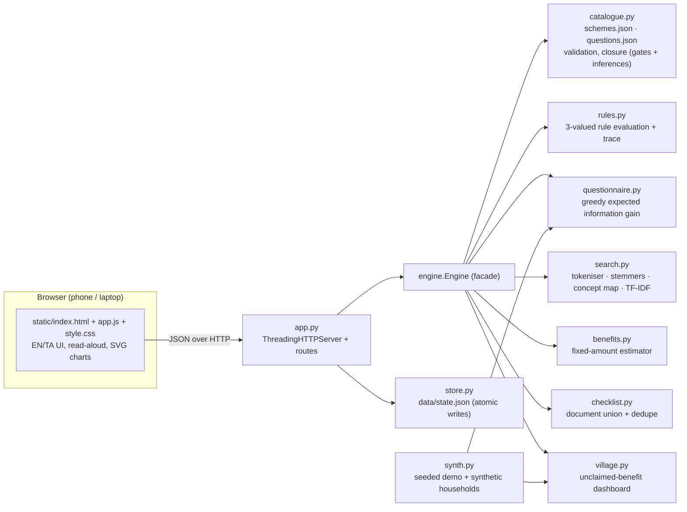

# SchemeSetu — Hackathon Report

## 1. Title, tagline, domain

**SchemeSetu** ("setu" = bridge)
*Every rural family, matched to the welfare schemes they deserve.*
Domain: **Smart Agriculture & Rural Development (AgriTech)** · QUANTIX 2K26, K.S.R. College of Engineering

## 2. Problem statement

**Who suffers.** Small farmers, landless labourers, widows, elderly people, students and women-headed households in villages. These are the people the welfare schemes are meant for. India is still mostly rural (about 69% of people lived in rural areas at Census 2011), and about 86% of farm holdings are small or marginal, under 2 ha (Agriculture Census 2015-16, approx.).

**What goes wrong.**
- **Families don't know what they qualify for.** Support is split across dozens of central and state schemes: income support, crop insurance, credit, pensions, housing, toilets, LPG, health cover, scholarships and women's grants. Each has its own eligibility text.
- **The eligibility text is hard to read.** It uses land in hectares, income ceilings, ration-card categories, age bands and exclusion lists, usually in English or formal Tamil.
- **Offices are far away and visits cost wages.** A family may travel to the VAO, Tahsildar, bank, CSC and Panchayat separately, each with its own document list. Middlemen charge fees to "find" schemes and fill forms.
- **Field workers lack a village-level view.** Volunteers and CSC operators cannot see which eligible families have not yet applied.

**Why existing solutions fall short.** The official portals are online-only, form-heavy and usually ask for everything up front. Paper booklets go out of date and cannot answer "am I eligible?". Neither explains *why* a family is or is not eligible. Neither works offline in a village, and neither gives a field worker a list of whom to visit.

## 3. Our solution

SchemeSetu is an offline web app (Python standard library + vanilla JS) that runs on any laptop. A volunteer can show it to a family on a phone over local Wi-Fi. It asks a short, adaptive set of large-button questions in Tamil or English, then shows every scheme as **Eligible**, **Possibly eligible** (needs a specific missing answer) or **Not eligible**, with the exact condition that passed or failed. It totals the fixed benefit amounts, merges every scheme's document list into one printable checklist, and tracks each application. Field workers register many households and see a village dashboard of eligible-but-unclaimed benefits.

Key features:
- **Explainable rule engine.** Each scheme is a JSON rule tree (`all` / `any` / `not`, comparisons, ranges, membership, named thresholds) evaluated with three-valued logic. Every card shows ✓ / × / ? per condition.
- **Smart questionnaire.** It picks the next question by greedy expected information gain over the schemes still undecided. Screening questions and logical inferences settle several facts in one tap. "Don't know" is allowed.
- **Benefit estimator.** Adds fixed amounts only (annual cash and one-time grants). Insurance cover is listed, not added as cash. It never double-counts two social pensions for one person, and it keeps "if selected in exam" amounts separate.
- **Document checklist + tracker.** One deduplicated list ("Aadhaar ×11 schemes"), printable, plus an applied / pending / received tracker per scheme saved in `data/state.json`.
- **Bilingual search.** "பயிர் காப்பீடு", "pension for widow", "house": a from-scratch TF-IDF index plus a bilingual concept map.
- **Full Tamil / English UI toggle.** Large mobile-first buttons and optional read-aloud (`speechSynthesis`) that fails gracefully.
- **Field-worker mode.** Household register and village dashboard: which schemes have the most eligible-but-not-applied families, which families to visit first, and the unclaimed ₹ per year.
- **22 schemes.** Central schemes (PM-KISAN, PMFBY, KCC, Soil Health Card, PM-KMY, MGNREGA, PMAY-G, SBM-G, PM-JAY, PMMVY, PM Ujjwala, the three NSAP pensions, PMSBY, PMJJBY, NMMSS, Post-Matric SC/ST, women's SHGs under NRLM, run in Tamil Nadu as Mahalir Thittam / TNSRLM) and Tamil Nadu schemes (CMCHIS, Pudhumai Penn, Kalaignar Magalir Urimai Thogai). Every scheme carries *"Rules are simplified for this prototype — verify on the official portal."*

## 4. Innovation / what makes it different

1. **Three-valued, explainable eligibility.** Missing data does not silently mean "no". The engine says "possibly eligible — need: *widow's age*", and only when that answer could change the outcome (Kleene logic plus needed-facts analysis).
2. **Information-theoretic questioning.** The form adapts to each family. A landless family is never asked how many hectares they own. The engine shows *why* each question is asked ("can settle about 3 of the 22 open schemes; information gain 3.0 bits").
3. **Rules are data.** A department officer can edit `schemes.json` (with validation on load) without touching code. Uncertain thresholds are named params with a source note, shown in the UI.
4. **Last-mile view, not only a portal.** The village dashboard turns individual checks into "28 families eligible for PMSBY have not enrolled", so a volunteer knows whom to visit.
5. **Offline and bilingual from scratch.** No cloud, no ML black box, and a Tamil-aware tokeniser and stemmer. It runs on a ₹15k laptop with Wi-Fi down.

## 5. System architecture



| Component | File | Responsibility |
|---|---|---|
| HTTP server | `app.py` | Static files, JSON API, input validation, JSON errors with status codes, never crashes on bad input |
| Catalogue | `schemesetu/catalogue.py`, `data/*.json` | Load and validate 22 schemes, 22 facts, 4 screening questions, 5 inferences; bilingual explanation text |
| Rule engine | `schemesetu/rules.py` | Validate / evaluate rules (PASS / FAIL / UNKNOWN), full trace, needed facts, analytic P(pass) |
| Questionnaire | `schemesetu/questionnaire.py` | Learn answer priors, score candidates, choose and explain the next question, simulate |
| Search | `schemesetu/search.py` | Bilingual TF-IDF with a concept map |
| Benefits | `schemesetu/benefits.py` | Annual / one-time / cover / future / varies; exclusive groups; conditional amounts |
| Checklist | `schemesetu/checklist.py` | Canonical document ids, alias normalisation, "needed for" per document |
| Store | `schemesetu/store.py` | Households + application tracker, thread-safe, atomic JSON writes, created on first run |
| Village | `schemesetu/village.py` | Per-scheme eligible / received / in-progress / unclaimed counts, families to visit first |
| Synthetic data | `schemesetu/synth.py` | 4 demo personas, seeded illustrative households, demo village |
| Evaluation | `schemesetu/evaluate.py` | Reproducible numbers for section 8 (`data/evaluation.json`) |

## 6. Algorithms & models

### 6.1 Three-valued rule evaluation (explainability)
Rule grammar: `{"all":[…]}`, `{"any":[…]}`, `{"not":…}`, `{"fact","op","value"}` with `op ∈ {==, !=, <, <=, >, >=, in, not_in, between}`, and `value` may be `{"param": NAME}`.

```
leaf:  fact missing → UNKNOWN, else compare(op, actual, value) ? PASS : FAIL
all:   any FAIL → FAIL; else any UNKNOWN → UNKNOWN; else PASS
any:   any PASS → PASS; else any UNKNOWN → UNKNOWN; else FAIL
not:   PASS ↔ FAIL, UNKNOWN stays
needed(node) = ∅ if node decided; {fact} for an UNKNOWN leaf; ∪ needed(UNKNOWN children) otherwise
```
The trace is evaluated without short-circuiting, so the UI can show every condition. "Why yes" lists the passing leaves that decide a PASS. "Why not" lists the failing leaves on a FAIL path.
*Why:* eligibility is law-like and must be auditable, and three-valued logic gives an honest "possibly".
*Limits:* rules are only as good as the encoding; the prototype's rules are simplified (for example, PM-JAY uses the ration-card type as a proxy for the SECC 2011 lists).

### 6.2 Smart questionnaire: greedy expected information gain
For each undecided scheme *s*, `p_s = P(rule_s = PASS)` is computed analytically from the rule tree. Unknown facts are drawn independently from answer priors learnt (Laplace-smoothed) from 2,000 synthetic households with seed 7: `all → Π p`, `any → 1 − Π(1−p)`, `not → 1 − p`. For each candidate question *q* (a fact some open scheme still needs, or a screening question covering one):

```
IG(q) = Σ_{s open} [ H(p_s) − Σ_a P(q=a) · H(p_s | q=a) ]     H(p) = −p log₂ p − (1−p) log₂(1−p)
score(q) = IG(q) + 0.05 · E[#schemes decided by q]            (tie-breaker)
```
"| q=a" means: add the answer, then apply the closure. **Screening gates** (for example, "anyone studying in Class 8+?" → No sets 3 student facts) and **inferences** (for example, woman head of family ⇒ adult woman present) fill facts without asking. Stop when no scheme is undecided.
*Why:* it is the standard greedy approach for decision-tree / 20-questions style problems, cheap (1.4 ms per question) and explainable.
*Limits:* it is myopic (one-step look-ahead) and assumes independent facts. The priors come from synthetic data, so they shape the question order but not correctness: final decisions always equal the full-form evaluation. A screening question answered "Yes" costs one extra question.

### 6.3 Bilingual search: TF-IDF + concept map
1. A Unicode tokeniser keeps Tamil vowel signs and virama (Python's `\w` splits `காப்பீடு` into pieces).
2. Light stemming. English: plural / -ing / -ed. Tamil: case suffixes (`-க்கு`, `-த்தின்`, `-கள்` …), the sandhi consonant (`-த்`), oblique gemination (`வீட்டு → வீடு`) and final `-ம்`/`-ை`/`-ு`. So `காப்பீட்டுத்` ≡ `காப்பீடு`.
3. The concept map (`data/keywords.json`) maps EN / TA words, phrases and transliterations to shared concept tokens (`@crop`, `@insurance`, weight 2).
4. `w = (1 + ln tf) · (ln((N+1)/(df+1)) + 1)`, L2-normalised, cosine similarity. Results show the matched terms in the user's own words.

*Limits:* a hand-made dictionary; no spelling-error tolerance; limited transliteration (Tanglish) coverage.

### 6.4 Benefit estimator
`annual_total = Σ fixed annual amounts of eligible schemes`, with tiers chosen by rule (for example, the old-age pension central share is ₹200/month, or ₹500/month from age 80). Schemes in the same `exclusive_group` (one social pension per person) count once, at the maximum amount. `conditional` amounts (NMMS, only if selected) and insurance cover are reported separately. Loans, wages and claims are listed as "varies".
*Limits:* central shares only for NSAP pensions (the Tamil Nadu top-up is not added); the estimate is a floor, not a promise.

### 6.5 Document checklist deduplication
Every document name (ids, English / Tamil names, aliases such as "aadhar card", "patta") is normalised (lower-case, punctuation stripped) and mapped to a canonical id, with trailing words like "card" or "certificate" tolerated. The union is then sorted by how many chosen schemes need each document.

### 6.6 Village "unclaimed benefit" metric
A (household, scheme) pair is *unclaimed* when the household is eligible and its tracker status is `not_applied`. The dashboard aggregates per scheme (received / in progress / unclaimed) and per household (₹ per year of unclaimed fixed cash) to rank which families to visit first.

## 7. Tech stack and why it is offline-first

- **Backend:** Python 3.9+ standard library only (`http.server`, `json`, `math`, `random`, `threading`). No pip install.
- **Frontend:** a single HTML page, vanilla JS and CSS. Charts are hand-drawn inline SVG. No CDN, external fonts or network calls. Light / dark via `prefers-color-scheme`.
- **Storage:** JSON files in `data/` with atomic writes.
- **Speech:** the browser's built-in `speechSynthesis`, used only if available. If not, a toast says so.

Village Wi-Fi and venue networks fail, and CSC laptops are low-end. Everything runs locally: `python app.py --host 0.0.0.0` lets phones on the same hotspot use it. Eligibility answers never leave the laptop.

## 8. Results / evaluation

All numbers come from `python -m schemesetu.evaluate` (stored in `data/evaluation.json`), measured on this build. Questionnaire population: the **4 demo families + 300 synthetic households** (seed 2026). Answer priors are learnt from a **separate** synthetic population (seed 7, n = 2,000).

| Questionnaire strategy | Avg questions | Median | Min–Max | Same decisions as full form |
|---|---|---|---|---|
| **Greedy information gain (shipped)** | **15.23** | 15 | 10–23 | **100%** (304/304) |
| Greedy expected-schemes-resolved | 15.43 | 15 | 11–23 | 100% |
| Fixed question order + skip logic | 18.39 | 19 | 12–22 | 100% |
| Full form (every field) | 22 | 22 | 22 | 100% |
| Checking each of the 22 schemes separately | 54 fields (with repeats) | | | |

- **Questions:** 31% fewer than the 22-field full form, and 72% fewer than filling each scheme's eligibility fields separately (54). Demo families: farmer 17, labourer 19, widow 17, students 17.
- **Honest note on the original "~8 questions" goal:** confirming that a family is eligible needs *every* condition of that scheme, and the average synthetic family is eligible for 7.2 schemes, so about 15 questions is close to the floor for 22 schemes. The most valuable answers come early, though:

| After k questions | 4 | 6 | 8 | 10 | 12 | 15 |
|---|---|---|---|---|---|---|
| Eligible schemes already confirmed | 61% | 69% | **70%** | 78% | 85% | 96% |
| All schemes decided | 45% | 57% | 70% | 78% | 86% | 95% |

- **Search:** hit@1 = **100%**, hit@3 = 100% on 24 bilingual queries (12 Tamil, 12 English). Caveat: the query set was written while building the keyword map, so this is a sanity check, not a blind test.
- **Latency (in-process, mean / p95):** evaluate all 22 schemes 0.36 / 0.43 ms; choose the next question 1.41 / 1.88 ms; search 0.06 / 0.08 ms; full adaptive questionnaire for one household 12.3 ms; village dashboard (36 households) 2.0 ms; engine start-up about 70 ms.
- **Latency over HTTP (localhost, mean):** `POST /api/next` 4.5 ms, `POST /api/evaluate` 2.2 ms, `GET /api/search` 1.1 ms, `POST /api/simulate` 19.8 ms, `GET /api/village` 3.6 ms.
- **Tests:** 66 unit / API tests (`python -m unittest discover -s tests`), all passing. They cover all / any / not, missing data → possibly, needed facts, validation, question selection, TF-IDF, Tamil stemming, checklist dedupe, the benefit estimator, the store and the HTTP API.

## 9. Screenshots


`docs/screenshot.png`: the small-farmer demo after one click. 17 of 22 questions, 12 eligible schemes, ₹18,000/yr fixed cash (+₹12,000 if the son clears NMMS), ₹5 lakh health cover. Each card shows the conditions it met and the verify-on-portal note.

## 10. 3-minute live demo script

1. **(0:00) Open** `http://127.0.0.1:8011/`. *"SchemeSetu bridges rural families and the 22 schemes they may be missing. Fully offline."*
2. **(0:15) Click "Murugan & Kavitha"** (Load demo family). *"Seventeen adaptive questions instead of a 22-field form. Twelve schemes, ₹18,000 a year in fixed cash, ₹5 lakh health cover."*
3. **(0:35) Click "Why?" on PM-KISAN.** *"Every decision is a rule tree: green ticks, red crosses. No black box."* Then click the **Not eligible** filter and open PMAY-G: *"Not met: houseless or kutcha house."*
4. **(0:55) Click "Start over"** and answer 3 questions live. Read the **"Why this question?"** box (information gain in bits). Tap **"Don't know"**: the scheme becomes *Possibly eligible — need: …*.
5. **(1:25) Toggle தமிழ்.** The whole UI switches. Press **Read aloud** (it degrades gracefully if no voice is installed).
6. **(1:45) Search tab:** tap `பயிர் காப்பீடு` → PMFBY (crop insurance). Then type *pension for widow* → widow pension. *"Tamil query, English text: the concept map bridges them."*
7. **(2:05) Documents & tracker:** *"Ten documents cover twelve schemes instead of 43 separate items."* Print preview, save the family, mark PM-KISAN *Applied*.
8. **(2:25) Switch to Field worker → Village dashboard.** *"36 families: ₹1.57 lakh a year of fixed cash still unclaimed, and 28 eligible families not enrolled in PMSBY. Here is whom to visit first."* Click **Open** on the top family.
9. **(2:50) "How it works" tab:** the measured results table and the "how fast eligibility is found" curve. *"Same decisions as the full form, 100% of the time."*

## 11. Impact

- **Social:** families learn their entitlements in about 5 minutes, in Tamil, without travel or a middleman. Women heads of family, widows and the elderly are surfaced explicitly. "Possibly eligible" tells a family exactly what to check instead of silently rejecting them.
- **Economic (illustrative, synthetic village):** in the seeded demo village of 36 households, SchemeSetu finds **₹1.57 lakh a year of fixed cash** plus **₹5.55 lakh of one-time grants** (houses, toilets, maternity) that eligible families have not claimed. This counts only stated fixed amounts and excludes insurance cover, wages and loans. It is synthetic data showing the method, not a real-village estimate.
- **Time saved:** one deduplicated checklist instead of repeated per-scheme lists means fewer trips. For the demo farmer, 43 document mentions collapse to 10 documents.
- **Environmental (minor, honest):** fewer wasted trips to block offices. Offline, low-power hardware.
- **Assumptions:** the rules are simplified, and the official department decides eligibility. Benefit amounts are central / state figures known at build time and may change.

## 12. Feasibility, scalability & business model

- **Feasibility:** it runs today on any laptop with Python 3.9 and no installs. A field worker can serve phones over a hotspot. Rules live in JSON files that a non-programmer can update, validated at start-up.
- **Scalability:** evaluation is O(schemes × conditions), under 0.4 ms for 22 schemes, so about 1,000 schemes should stay in the tens of milliseconds. Question selection grows linearly with candidates × undecided schemes. The store would move to SQLite for thousands of households (also stdlib).
- **Business model:**
  - Free for families, always.
  - Licensed or funded deployment for **CSCs, Panchayats and SHG federations**: the village dashboard is the value for them.
  - **CSR / NGO programmes** (financial inclusion, women's livelihoods) that need measurable "benefits claimed" outcomes.
  - **State rural development / social welfare departments:** an offline companion to official portals, fed with their official rule data.

## 13. Future scope

- Sync field-worker devices to a block-level server; de-duplicate households across volunteers.
- Tamil voice *input* (offline speech recognition) for low-literacy users; more Indian languages.
- Import official scheme data (e.g. from the national myScheme catalogue) instead of hand-encoded rules; per-district thresholds.
- Document OCR to pre-fill answers from a ration card or patta; SMS / WhatsApp reminders for deadlines (PMFBY season cut-offs).
- Grievance tracking and an outcome analytics dashboard (time from application to receipt).

## 14. Judges' Q&A prep

1. **"How do you know the rules are right?"** They are simplified encodings of public guidelines, and every scheme says "verify on the official portal". The engine is provably faithful *to the rules*: 100% identical decisions to the full form on 304 households. Uncertain thresholds are named params with source notes, so an officer can fix them without code.
2. **"Why not machine learning?"** Eligibility is law, not a pattern. It must be exact and auditable. The only learnt part is the question order (answer priors), and it can only change *which* question comes next, never the decision.
3. **"Fifteen questions still sounds like a lot."** Confirming 7 eligible schemes means confirming every one of their conditions, so 15 is close to the floor for 22 schemes. That is 31% fewer than the full form and 72% fewer than per-scheme checking. By question 8, 70% of the family's eligible schemes are already confirmed.
4. **"What happens if the family doesn't know an answer?"** They tap "Don't know". Affected schemes become "Possibly eligible — need: X", and the questionnaire moves on, never asking it again.
5. **"Privacy?"** Nothing leaves the laptop. Only yes/no and band answers are stored (no Aadhaar numbers), in a local JSON file that can be deleted with one click.
6. **"How is this different from government portals?"** Official portals are online and form-heavy. SchemeSetu is offline, adaptive, explains each decision, speaks Tamil, and gives field workers a village-level unclaimed-benefit view. It complements official portals and could consume their data.
7. **"Is the Tamil search real NLP?"** It is a from-scratch TF-IDF with a Tamil-aware tokeniser, a suffix and sandhi stemmer, and a bilingual concept map. Small, but it handles inflections like `காப்பீட்டுத்` and cross-language queries.
8. **"How are benefits estimated?"** Only fixed amounts are added. Cover, loans and wages show as "varies". One pension per person is enforced, and exam-dependent scholarships are kept separate. It is a conservative floor.
9. **"Can it scale to all states?"** Rules are data, so adding a state means adding JSON. Evaluation is sub-millisecond for 22 schemes and linear in rule size.
10. **"Who pays?"** CSCs, Panchayats, SHG federations and CSR programmes that want measurable benefit uptake. It is free for families.

## 15. How to run

```bash
cd projects/11-schemesetu
python app.py                          # http://127.0.0.1:8011/
python app.py --host 0.0.0.0 --port 8011   # judges' phones on the same Wi-Fi
python -m unittest discover -s tests   # 66 tests
python -m schemesetu.evaluate          # regenerate data/evaluation.json
python -m schemesetu.evaluate --http http://127.0.0.1:8011   # include live API latency
python -m schemesetu.synth             # rewrite deterministic demo data files
```
`data/state.json` (registered households and tracker) is created on first run and seeded with the demo village.
