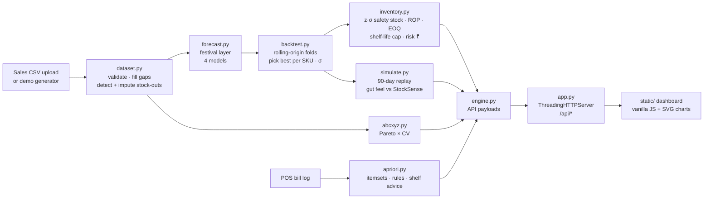

# StockSense — Hackathon Report

## 1. Title, tagline, domain

**Product:** StockSense
**Tagline:** Demand forecasting and smart reordering for neighbourhood stores
**Domain:** Data Science & Analytics
**Event:** QUANTIX 2K26, K.S.R. College of Engineering

## 2. Problem statement

**Who suffers.** India's neighbourhood retail runs on small stores: kirana shops, chemists, college canteens and bakeries. A widely cited industry estimate puts kirana stores alone at over 1 crore (approx.). Most of them reorder by memory and feel. The owner glances at a shelf, phones the distributor, and orders "the usual" plus a bit extra.

**What it costs.**
- **Stock-outs on fast movers.** Milk, bread and biscuits run out by evening, and the customer walks to the next shop. That sale is gone, and some of the customer's loyalty goes with it.
- **Expired perishables.** Curd, paneer, bread and sweets are over-ordered "to be safe" and thrown away.
- **Festival misses.** Sweets and ghee sell several times their normal volume in Diwali week. Gut-feel orders arrive too late, or too much arrives after the festival.
- **Cash locked in slow stock.** Cash is tied up in slow movers while fast movers are short.

In our demo store, the shopkeeper's fixed weekly order loses about 15% of demand to empty shelves (fill rate 84.9%) over 90 days. See section 8.

**Why existing solutions fail.**
- Enterprise forecasting and replenishment suites are built for chains with ERP data, analysts and large budgets.
- Billing apps record sales but stop at reports. They do not say *how much to order today*, or why.
- Spreadsheet rules of thumb ("two weeks of stock") ignore weekday patterns, festivals, shelf life and supplier lead time.
- Cloud tools need reliable internet and send the shop's sales data off the premises.

## 3. Our solution

StockSense turns a plain sales log (`date, sku, qty`) into a morning reorder list. For each SKU it cleans stock-out days, measures festival effects and backtests four forecasting models, then keeps the one that would have predicted the recent past best. It converts that forecast and its measured error into a safety stock, a reorder point and an order quantity, capped by shelf life for perishables. The owner sees what to order, the chance of running out if they skip it, the rupees at stake, and a sentence explaining the arithmetic. Everything runs offline in the Python standard library.

- **Forecasting from scratch:** seasonal naive, moving average, additive Holt-Winters (weekly, damped trend), and ridge-stabilised regression (day-of-week + festival + promotion).
- **Rolling-origin backtesting** with an automatic per-SKU winner and a visible leaderboard.
- **Festival layer:** Diwali, Pongal and other festival uplifts are learned from last year, shrunk when noisy, and re-applied to upcoming dates (approximate calendar).
- **Stock-out-aware cleaning:** censored days are imputed before fitting. When no flag column exists, a Poisson test detects them.
- **Inventory optimisation:** z·σ safety stock (hand-written inverse normal), reorder point, EOQ, shelf-life cap and case-pack rounding.
- **Today's reorder list** with run-out risk (skip vs order), sales at risk, editable stock counts and a CSV export.
- **What-if service-level slider** with the cost-optimal level marked.
- **ABC–XYZ matrix** with a strategy for each cell.
- **Apriori basket rules** turned into shelf-placement and bundle suggestions.
- **90-day policy simulation:** gut feel vs StockSense on the same demand.
- **CSV upload** with validation (aliases, date formats, bad-row tolerance, limits).

## 4. Innovation / what makes it different

1. **Explainable end to end.** Every order line traces back to a forecast, an error σ, a z-score, a reorder point and an EOQ, all printed on screen. The model choice is justified by its backtest score next to the alternatives.
2. **Honest evaluation built in.** Model selection is leak-free: Holt-Winters is tuned on the oldest training window only. The headline accuracy comes from a nested hold-out (models picked on folds 1–3, scored on unseen fold 4). The simulation picks and tunes models only on data from before the replay window.
3. **Indian-retail realism.** It includes a festival calendar with learned per-SKU uplift and noise shrinkage, Friday pooja-shopping patterns, case packs, perishables with shelf-life caps, and stock-out censoring.
4. **One decision loop.** Forecast, inventory policy, risk in rupees, simulation and basket placement all run on the same data in one 1.5-second pass. The shopkeeper never has to think about a "model".
5. **Runs on a ₹15k laptop with no internet.** There are no packages, no cloud and no data leaving the shop.

## 5. System architecture



| Component | Responsibility | Key techniques |
|---|---|---|
| `dataset.py` | Parse and validate the CSV; build dense daily series; detect and impute stock-outs | header aliases, 3 date formats, 5% bad-row tolerance, Poisson P(0) test |
| `festivals.py` | Approximate festival calendar and shape features | 8-day ramp before and after each festival |
| `forecast.py` | Festival layer and the four models | Holt-Winters recursion, ridge OLS via Gaussian elimination |
| `backtest.py` | Rolling-origin splits, metrics, selection, nested hold-out | MAPE, sMAPE, MAE, RMSE, bias, WAPE |
| `stats.py` | Numeric toolkit | Acklam inverse normal + Halley step, normal loss G(z), linear solver |
| `inventory.py` | Policy per SKU, reorder list, what-if curve | safety stock, ROP, EOQ, order-up-to, perishable cap, expected shortage |
| `abcxyz.py` | ABC–XYZ matrix and strategies | Pareto cumulative share, coefficient of variation |
| `apriori.py` | Frequent itemsets, rules, suggestions | level-wise candidate generation with subset pruning |
| `simulate.py` | Day-by-day inventory replay | FIFO batches with expiry, lost sales, stochastic lead times |
| `engine.py` | Orchestration, caching, API shapes | one immutable `Analysis` per dataset, swapped atomically |
| `app.py` | HTTP server and JSON API | input validation, JSON errors, never crashes on bad input |
| `static/` | Dashboard | hand-drawn SVG charts with crosshair tooltips, light/dark, responsive |

## 6. Algorithms & models

**Stock-out detection and imputation.**
- *How:* if a `stockout` column is given, it is used. Otherwise a zero-sales day is flagged when the mean λ of the previous 28 non-flagged days gives P(0) = e^(−λ) < 1%. A flagged day is replaced by the mean of the same weekday over the previous four weeks.
- *Why:* censored sales would bias every forecast downwards, so the store would keep under-ordering.
- *Limits:* the test cannot see partial stock-outs, and it is silent for slow movers, where zeros are normal. On the demo data, detection precision is 76% and recall 41%.

**Festival layer (calendar adjustment).**
- *How:* for a festival-window day t, r_t = y_t / (local level × weekday index) − 1 ≈ u·shape_t. The least-squares estimate is u = Σ shape·r / Σ shape². Its standard error is se = σ_r / √Σshape², where σ_r is the spread of r on ordinary days. The estimate is then shrunk with u ← u · max(0, 1 − (se/u)²) (positive-part James–Stein style). The time-series models fit the series divided by (1 + u·shape), and the uplift is multiplied back onto upcoming festival days.
- *Why:* each festival appears once a year, and a single noisy week should not create a fake spike. Promotion days are excluded from the estimate so they are not mistaken for festival effects.
- *Limits:* dates are approximate. Festivals are grouped (Diwali / Pongal / other). With one occurrence per year, low-volume SKUs mostly shrink to zero uplift.

**Seasonal naive:** ŷ_{n+i} = y_{n−7+(i mod 7)}. This is the classic benchmark that every other model must beat.

**Moving average (14 days):** a flat forecast of the 14-day mean. It is robust for erratic slow movers but ignores weekday pattern and trend.

**Holt-Winters, additive, weekly season, damped trend.**
```
l_t = α(y_t − s_{t−7}) + (1−α)(l_{t−1} + φ b_{t−1})
b_t = β(l_t − l_{t−1}) + (1−β) φ b_{t−1}
s_t = γ(y_t − l_t) + (1−γ) s_{t−7}
ŷ_{n+h} = l_n + (φ+…+φ^h) b_n + s_{n+h−7}
```
- *How:* initialisation uses the means and seasonal deviations of the first four weeks. α, β and γ are grid-searched (4×3×3) on one-step SSE using the oldest training window only, and φ = 0.98.
- *Why:* it handles level, trend and weekly pattern in a few lines with no matrix algebra.
- *Limits:* it has one seasonality, and additive seasonality fits low counts poorly.

**Regression (day-of-week + festival + promotion).**
- *How:* features are intercept, trend, 6 weekday dummies, 3 festival shape features and a promo flag. It is solved with weighted least squares and a small ridge term (λ = 0.5), via normal equations and Gaussian elimination with partial pivoting. Stock-out days get weight 0.
- *Why:* it learns festival effects directly and gives readable coefficients ("Saturday +18%").
- *Limits:* the effects are linear and additive. It assumes no promotion in the future unless one is planned, and the trend can extrapolate.

**Rolling-origin backtest and selection.**
- *How:* 4 folds, each forecasting 14 days ahead, with origins 14 days apart, so the last 56 days are scored out of sample. Metrics are MAPE (days with sales > 0), sMAPE, MAE, RMSE and bias. The lowest sMAPE wins, and ties go to the simpler model. σ for safety stock is the RMSE of the winner's backtest errors.
- *Honest hold-out:* the model is picked on folds 1–3 and reported on fold 4.
- *Limits:* 56 days of tests per SKU is a small sample, and the regression uses the known promotion calendar in its test windows (promotions are planned in advance).

**Inverse normal (Acklam).**
- *How:* rational approximations on three regions (p < 0.02425, central, upper tail), followed by one Halley refinement step against Φ computed with `math.erfc`.
- *Accuracy:* unit tests check table quantiles to 6 decimals and the round-trip |Φ(Φ⁻¹(p)) − p| < 1e-12 for p down to 1e-10.

**Inventory policy (daily review, lost sales).**
```
P       = lead time L + 1 review day
σ_P     = √(P·σ_e² + d̄²·σ_L²)                       forecast error + lead-time variability
SS      = z·σ_P,   z = Φ⁻¹(service level)
ROP     = Σ forecast over the next P days + SS
EOQ     = √(2·D·S / H),   S = ₹50/order line, H = 24% × unit cost per year
Q*      = min(EOQ, demand sellable within 75% of shelf life [perishables], 30 days of demand), case-rounded
order   = ROP + Q* − inventory position   (only if position ≤ ROP)
perishables: leftover at delivery + order ≤ sellable demand + SS
```
- *Why:* these are standard, auditable textbook formulas, and the forecast-based ROP anticipates festivals.
- *Limits:* σ is assumed normal and independent across days. There are no supplier MOQs or multi-SKU truck constraints.

**Risk and rupee impact.**
- *How:* P(run out) = 1 − Φ((stock − μ)/σ). Expected lost units = σ·G(z), where G(z) = φ(z) − z(1−Φ(z)) is the normal loss function. "Skip" uses the P-day horizon; "order" uses exposure until delivery.

**Service-level trade-off.**
- *How:* yearly holding cost of safety stock = SS·H. Expected lost margin = (D/Q*)·σ_P·G(z)·margin. For one SKU, the cost-optimal level is 1 − HQ/(HQ + D·margin) (the classic (Q, r) result with lost sales).

**ABC–XYZ.**
- *How:* ABC uses cumulative revenue share over the last 365 days (A < 80%, B < 95%). XYZ uses the coefficient of variation of weekly demand over the whole history (X < 0.20, Y < 0.35). Each of the 9 cells gets a strategy and a suggested service level.
- *Limits:* the thresholds are store-specific assumptions.

**Apriori.**
- *How:* level-wise frequent itemsets with join-and-prune candidate generation, counted by enumerating k-subsets of each bill. Rules are generated from every frequent itemset with support, confidence and lift = conf / P(consequent). Suggestions are rule-backed: cross-category adjacency, bundles of 3+ items, and same-bay pairs (at most 2 suggestions per SKU).
- *Verified on:* the textbook dataset (Han, Kamber & Pei, Table 6.1).

**Simulation.**
- *How:* a day-by-day replay with FIFO batches that expire, lost sales and stochastic lead times (the same random draws for both policies). The gut-feel policy is a fixed order equal to the 8-week average × 1.10, weekly on Monday (daily for items with shelf life of 7 days or less), skipped if the shelf already holds that much. The StockSense policy is the policy above, with forecasts refreshed weekly using only data known at the time.

## 7. Tech stack and why it is offline-first

- **Backend:** Python 3.9+ standard library only (`http.server`, `csv`, `json`, `math`, `random`, `threading`). No numpy, pandas or Flask. The analytics package is about 2,300 lines of readable Python.
- **Frontend:** vanilla HTML, CSS and JS. Charts are hand-drawn SVG with crosshair tooltips. There are no CDNs or web fonts, and it supports light/dark themes and phone width.
- **Data:** a deterministic generator with a fixed seed (`python -m stocksense.synth`). The committed files are under `data/`.
- **Why offline:** venue Wi-Fi and shop internet are unreliable, and shop sales data is commercially sensitive. A ₹15k laptop or an old desktop at the counter is enough: the full analysis takes about 1.5 s, and API calls take under 0.11 s.

## 8. Results / evaluation

All numbers below were measured on the deterministic demo store (40 SKUs × 400 days, 2025-09-15 to 2026-10-19). The demo data is synthetic, so these numbers show that the method works; they are not a claim about any real shop.

**Forecast accuracy: honest hold-out** (model picked on folds 1–3, scored on the unseen last 14 days, 554 SKU-days)

| Metric | Seasonal naive | StockSense (best model per SKU) |
|---|---|---|
| WAPE (daily, unit-weighted) | 47.9% | **28.4%** (−41% error) |
| Revenue-weighted WAPE | 51.5% | **36.4%** |
| Mean sMAPE across SKUs | 69.7% | **52.3%** |
| Mean MAPE across SKUs | 65.8% | **44.4%** |
| 14-day total demand error per SKU | 28.8% | **11.7%** |

Daily percentage errors look high because many SKUs sell only 1–5 units a day, where Poisson noise alone is large. The 14-day total is what matters for an order, and there the error is 11.7%.

**Backtest leaderboard** (4 folds × 14 days, mean sMAPE across SKUs / wins)

| Model | Mean sMAPE | Wins |
|---|---|---|
| Seasonal naive | 70.4% | 0 |
| Moving average (14 d) | 55.4% | 6 |
| Holt-Winters | 54.9% | 9 |
| Regression (DOW + festival) | 55.4% | 25 |

**Policy simulation: last 90 days (2026-07-22 to 2026-10-19), 95% service level**

| Outcome | Gut feel | StockSense | Change |
|---|---|---|---|
| Stock-out SKU-days | 309 | **17** | −94.5% |
| Lost sales | ₹2,06,333 | **₹9,930** | −95.2% |
| Fill rate | 84.9% | **99.6%** | +14.7 pts |
| Expired units | 98 | **81** | −17.3% |
| Waste cost | ₹10,318 | **₹6,520** | −36.8% |
| Holding cost | ₹5,642 | ₹10,139 | +79.7% |
| Orders placed | 500 | **338** | −32.4% |
| Avg stock value | ₹95,344 | ₹1,71,335 | +79.7% |
| **Total cost** (holding + ordering + waste + lost margin) | ₹69,155 | **₹34,903** | **−49.5%** |

**"Couldn't the shopkeeper just stock more?"** We re-ran gut feel with bigger buffers:

| Gut-feel buffer | Stock-out SKU-days | Expired units | Avg stock value | Total cost |
|---|---|---|---|---|
| ×1.10 (default) | 309 | 98 | ₹95k | ₹69.2k |
| ×1.30 | 184 | 187 | ₹1.17 L | ₹60.7k |
| ×1.60 | 119 | 434 | ₹1.60 L | ₹69.0k |
| ×2.00 | 70 | 777 | ₹2.14 L | ₹83.2k |
| **StockSense 95%** | **17** | **81** | ₹1.71 L | **₹34.9k** |

Doubling every order holds more stock than StockSense, yet still has 4× the stock-outs and nearly 10× the expired units. StockSense puts the stock where it is needed and when it is needed.

**Service-level sensitivity (simulation)**

| Service level | Stock-out SKU-days | Expired units | Total cost |
|---|---|---|---|
| 85% | 40 | 43 | ₹32.4k |
| 90% | 25 | 63 | ₹33.3k |
| 95% | 17 | 81 | ₹34.9k |
| 98% | 11 | 127 | ₹37.9k |

On the analytic what-if curve, the cost-optimal level across all SKUs is about 96%.

**Other measurements**
- Stock-out detection (when no flag column is given): precision 76%, recall 41% against the generator's true flags.
- Festival learning: the learned Diwali peak uplift for sweets is +577% (raw +587% ± 78%), against +550% used by the generator. For jaggery at Pongal it is +286% against +350%.
- Performance: the full analysis (4 models × 4 folds × 40 SKUs + final fits + simulation) takes about 1.5 s on the dev container. API responses take 1–20 ms, and up to 0.11 s for a new simulation service level.
- Tests: 44 unittest tests pass. They cover Holt-Winters on a synthetic seasonal series, split logic and leakage, inverse-normal accuracy, EOQ/ROP maths, Apriori on the textbook dataset, ABC–XYZ, CSV validation, and the end-to-end API.

## 9. Screenshots


The overview shows KPI tiles, store revenue with the 28-day forecast and 80% band (Diwali spike visible), today's reorder list, the festival planner, the model leaderboard and the simulation headline. The other tabs are Reorder today (service-level slider, what-if curve, reasons), SKU explorer (all model forecasts, leaderboard, reorder maths, demand drivers, basket partners, per-SKU replay), ABC–XYZ, Basket insights, Simulation, and Data & method.

## 10. 3-minute live demo script

1. **(0:00) Overview.** Click **Load demo data**. *"This is a Tiruchengode-style kirana with 40 products and 13 months of sales. StockSense analysed everything in 1.5 seconds, offline. It is 20 October, and Diwali is 19 days away."*
2. **(0:20) Point at the trend chart.** *"Black is actual sales. Orange is the forecast with its 80% band, and you can see Diwali coming. It learned that from last year's Diwali week, which is in the history."*
3. **(0:40) Reorder now card → Full list.** *"Nine items will run out before the next delivery. Rice: 15 bags on hand, reorder point 37, order 85."* Click the rice row. *"Every number is explained: forecast demand, safety stock z times sigma, EOQ, case of 5."*
4. **(1:05) Drag the service-level slider to 99%, then back to 95%.** *"Higher service means more safety stock, so the blue holding cost rises, while the orange lost-margin line falls. The green dot marks where total cost is lowest, about 96%."*
5. **(1:25) SKU explorer → choose Assorted Sweets 500 g.** *"Four models were backtested on the last 56 days, and regression won. It learned a Diwali uplift of +577% and shrinks noisy estimates. Sweets are perishable, so the order is capped to what sells within 7 of its 10 shelf-life days."*
6. **(1:55) Simulation tab.** *"We replayed the last 90 days twice on the same demand: once with the owner's fixed weekly order, once with StockSense. Stock-out days fell from 309 to 17, lost sales from ₹2 lakh to ₹10 thousand, and total cost halved. And it isn't just stocking more: doubling gut-feel orders still gives 4× the stock-outs and 10× the waste."* Pick Sandwich Bread in the trajectory chart.
7. **(2:25) ABC–XYZ, then Basket.** *"AX items get automated reorders, and CZ items are candidates to delist. Apriori finds that 72% of bills with camphor also have agarbatti, so we keep them side by side, and it suggests a bread + eggs + milk + butter bundle."*
8. **(2:45) Data & method.** *"Upload any `date, sku, qty` CSV and it validates the file and detects stock-outs itself. Everything is Python standard library: no cloud, no data leaves the shop."*

## 11. Impact

- **Economic.** In the demo replay, lost sales fell by about ₹1.96 lakh over 90 days for a store selling about ₹5.8 lakh a month, with lower total inventory cost. Real gains will be smaller and will vary by store. The approx. figures depend on our cost assumptions (₹50 per order line, 24% yearly holding rate).
- **Social.** Shopkeepers stay competitive with quick-commerce apps without paying for enterprise software, and customers find essentials (milk, bread, medicines in a pharmacy) on the shelf.
- **Environmental.** Fewer expired perishables means less food waste. In the replay, 17% fewer units expired while fill rate rose to 99.6%. Fewer, larger orders (−32%) can also mean fewer delivery trips.
- **Honest assumptions.** The data is synthetic, and demand is assumed independent of our own stocking decisions. Basket analysis needs bill-level data, which many shops do not yet digitise.

## 12. Feasibility, scalability & business model

- **Feasibility.** It runs today on any laptop with Python 3.9+. The input is one CSV export, which most billing apps can produce.
- **Scalability.** The work is O(SKUs × days) per model. At 40 SKUs × 400 days it takes 1.5 s, so a typical kirana with a few hundred SKUs would take seconds. Holt-Winters tuning and regression fits are per SKU, so they parallelise trivially.
- **Business model.**
  - Free offline single-store edition.
  - ₹199–₹499/month (indicative) for multi-store, WhatsApp order dispatch and supplier integration.
  - White-label module for billing-software and distributor apps.
  - Distributors also benefit from smoother, forecastable orders.
- **Go-to-market.** Partner with FMCG distributors and college canteens. A canteen or a campus store is an easy first pilot.

## 13. Future scope

- Read billing-app exports and barcode scans directly, and keep a daily auto-refresh.
- Send the reorder list over WhatsApp/SMS, and send supplier-wise purchase orders with MOQs and truck-load constraints.
- Use multi-store pooling and hierarchical forecasts (category → SKU) for new items with little history.
- Track batch-level expiry with markdown suggestions for near-expiry stock.
- Add weather and local-event features (school terms, exams), plus probabilistic forecasts (quantiles) instead of a normal approximation.
- Add regional festival calendars (Onam, Durga Puja, Eid) with exact dates and a Tamil/Hindi UI.

## 14. Judges' Q&A prep

1. **"Your data is synthetic. Why trust the numbers?"**
   The generator injects known effects (weekday, trend, festivals, promotions, stock-outs), and we check that the models recover them. For example, the learned sweets Diwali uplift is +577% vs +550% in the generator. Accuracy and the simulation use strict out-of-sample protocols. With a real store's CSV, the same pipeline runs unchanged.
2. **"Daily MAPE of ~44% sounds bad."**
   For items selling 1–5 units a day, even a perfect forecast has large daily percentage error, because the noise itself is Poisson. Orders depend on totals over the lead time, and the 14-day total error is 11.7% vs 28.8% for naive. We also report WAPE, which is not inflated by low-volume days.
3. **"Why not Prophet, ARIMA or LightGBM?"**
   Those need packages and internet to install, and they are black boxes for a shopkeeper. Our models are about 300 lines, explainable, and backtested against each other. The architecture accepts any new model as one function.
4. **"Isn't StockSense just holding more stock?"**
   It holds about 80% more on average, because EOQ chooses fewer, larger orders (−32% orders). But gut feel with a 2× buffer holds even more stock (₹2.14 L) and still has 70 stock-out days vs 17, and 777 expired units vs 81. Total cost halves.
5. **"How do you avoid look-ahead bias?"**
   Holt-Winters parameters are tuned on the oldest training window only, and each fold uses only earlier data. The headline accuracy comes from a nested hold-out. The simulation picks and tunes models on data from before the replay window and re-forecasts weekly from past data only. A unit test confirms that a spike on the last day cannot change earlier forecasts.
6. **"How is service level different from fill rate?"**
   Service level here is the cycle service level: the probability of not running out before the next delivery. Fill rate is the share of demand served, and it is higher. At 95% cycle service, the expected fill rate is about 99.8%. The slider shows both.
7. **"What about perishables?"**
   Order quantity is capped so that leftover stock plus the new order sells within 75% of shelf life. The simulation tracks each batch's expiry with FIFO selling, which is why waste is measured rather than assumed.
8. **"Festival dates change every year."**
   The calendar is one table in `config.py`, with dates marked approximate. Uplifts are learned per festival group from the store's own history and shrunk toward zero when the evidence is weak.
9. **"Will a shopkeeper actually use this?"**
   The output is one list: what to order, how many, and why. Stock counts can be edited inline, and the list exports to CSV for a WhatsApp order. The next step is pushing the list to WhatsApp.
10. **"Where do the ₹ assumptions come from?"**
    They are all in `stocksense/config.py` with reasoning: ₹50 per order line (owner time and a share of delivery), and 24% yearly holding (capital plus space, shrinkage and damage). They are shown in the Data & method tab and easy to change.

## 15. How to run

```bash
cd projects/12-stocksense
python app.py                          # http://127.0.0.1:8012/
python app.py --host 0.0.0.0 --port 8012   # open from a phone on the same Wi-Fi
python -m unittest discover -s tests   # 44 tests
python -m stocksense.synth             # regenerate deterministic demo data into data/
```

Try your own data with **Upload CSV** (or `curl -X POST --data-binary @sales.csv -H "Content-Type: text/csv" http://127.0.0.1:8012/api/upload`). You can download a sample at `/api/sample.csv`.
