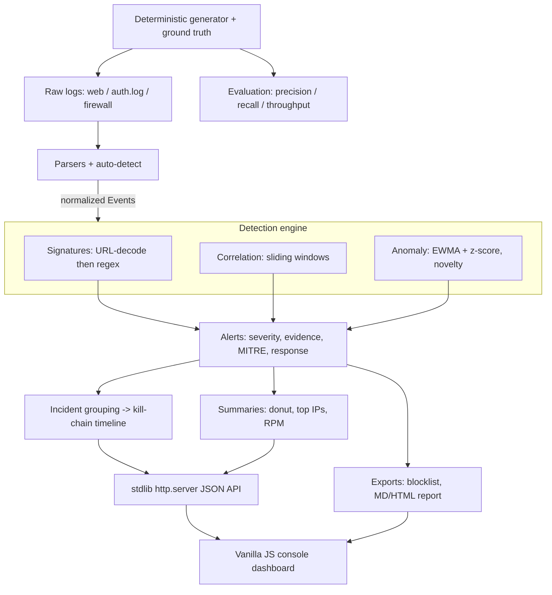

# LogSentinel

**Tagline:** A pocket SOC: detect attacks hiding in your server logs.
**Domain:** Cybersecurity & Blockchain Technology.
**Event:** QUANTIX 2K26, K.S.R. College of Engineering (23–24 Oct 2026).

---

## 1. Problem statement

Colleges, labs and small businesses run public web servers and SSH boxes with
**no security monitoring at all**. The people who maintain them are student
volunteers or a one-person IT team, not a Security Operations Centre (SOC).

- **Who suffers:** campuses, NGOs, clinics, shops — anyone exposing a server
  without a dedicated security team.
- **How much:** the signals are already there. Automated SSH brute-forcing and
  web vulnerability scanning hit any public IP within hours of coming online;
  every attempt is written to a log file. The problem is not missing data — it
  is that **nobody reads the logs**, and when they do, the attacks are drowned
  in tens of thousands of benign lines.
- **Why existing solutions fail:** commercial SIEMs (Splunk, QRadar, Elastic
  Security) are expensive, cloud-tied, and need an expert to tune. `fail2ban`
  only bans on repeat failures — it has no concept of web injection, scanning,
  anomalies, incidents or MITRE mapping, and explains nothing. The gap is a
  **free, offline, explainable** tool that a non-expert can run and act on.

*(We deliberately state no precise breach-cost statistics; the qualitative
problem — unmonitored servers and unread logs — is what the product addresses.)*

## 2. Our solution

LogSentinel is a self-contained "pocket SOC". Point it at your logs (or let it
replay a realistic demo) and it finds the attacks, explains each one, maps it to
MITRE ATT&CK, groups related alerts into incidents with a kill-chain timeline,
and hands you a blocklist and an incident report. It is Python-standard-library
only and runs fully offline.

- **Auto-detecting parsers** for Apache/Nginx combined access logs, Linux
  `auth.log` (sshd + sudo) and iptables/UFW firewall logs; malformed lines are
  counted, never fatal.
- **Three-layer detection engine:** signature rules (with URL-decoding),
  stateful sliding-window correlation, and statistical anomaly detection.
- **Explainable alerts:** severity, the rule that fired, evidence lines, source
  IP, timeframe, **MITRE ATT&CK technique** (with a why-it-maps note) and a
  concrete **recommended response**.
- **Incident grouping** into a kill-chain-style timeline per source.
- **Console dashboard:** severity donut, top attacker IPs, requests-per-minute
  chart with anomaly markers, alerts table with filters, incident detail,
  **live tail replay**, and an **upload-your-own-log** box.
- **Exports:** incident report (Markdown/HTML) and an iptables/fail2ban-style
  blocklist (text only — never executed).

## 3. Innovation / what makes it different

- **Explainable, no black box.** Every alert shows the evidence lines, the rule,
  the decoded payload, the MITRE technique *and why it mapped*. Judges and
  admins can audit every decision — nothing is a mystery score.
- **Three complementary detectors.** Signatures catch known payloads;
  correlation catches multi-event behaviour a single line can't reveal; anomaly
  detection catches the novel/zero-signature case. Together they cover more than
  any one layer.
- **Ships its own labelled dataset.** The deterministic generator embeds
  ground-truth attack labels, so our accuracy numbers are **measured against
  truth**, not asserted. Re-runnable by anyone with `python -m
  logsentinel.evaluation`.
- **Credential stuffing vs. spraying disambiguation** from the invalid-user
  ratio — a nuance most simple tools miss.
- **Defensive by construction.** It never attacks and never changes your
  firewall; the blocklist is text to review and apply yourself.

## 4. System architecture



| Component | Module | Responsibility |
|-----------|--------|----------------|
| Parsers | `logsentinel/parsers.py` | Line-oriented parsing + per-line format auto-detect; counts malformed lines |
| Event model | `logsentinel/events.py` | One normalized `Event` across all sources |
| Signatures | `logsentinel/signatures.py` | URL-decode then regex for SQLi/XSS/traversal/CMDi/scanner UA |
| Correlation | `logsentinel/correlation.py` | Brute force, spraying/stuffing, compromise, scan, enum, off-hours, sudo |
| Anomaly | `logsentinel/anomaly.py` | Per-IP EWMA+z-score rate, UA/path novelty, global RPM series |
| Alerts | `logsentinel/alerts.py` | Alert record + response playbook |
| MITRE | `logsentinel/mitre.py` | Technique ID -> name + why-it-maps |
| Incidents | `logsentinel/incidents.py` | Group alerts by IP/time into kill-chain timelines |
| Engine | `logsentinel/engine.py` | Orchestrates the pipeline; dashboard summaries; blocklist |
| Generator | `logsentinel/generator.py` | Deterministic benign + labelled attack logs |
| Evaluation | `logsentinel/evaluation.py` | Precision/recall vs. ground truth, throughput |
| Reports | `logsentinel/reports.py` | Markdown/HTML incident report, blocklist text |
| Server | `app.py` | `ThreadingHTTPServer`, JSON API, static hosting |
| UI | `static/` | Console dashboard, inline-SVG charts, live tail |

## 5. Algorithms & models

Every algorithm is implemented from scratch in the standard library.

### 5.1 URL-decoding signature matching
**Why:** attackers hide payloads behind percent-encoding (`%27`->`'`) and
double-encoding (`%2527`->`%27`->`'`). A raw-string regex is trivially bypassed.
**How:** decode twice with `urllib.parse.unquote_plus`, fold a few HTML
entities, lower-case, then run the rule regexes against the decoded request (for
payloads) and the raw user-agent (for scanner tools).
**Limits:** regex signatures match known patterns; heavy obfuscation
(e.g. inline comments splitting keywords) can evade them — which is exactly why
the correlation and anomaly layers exist.

### 5.2 Sliding-window correlation
```
cluster an IP's events by time gap
for each cluster:
    window = deque of event times
    on each event: drop times older than T; if len(window) >= N -> trigger
distinct-key variant keeps a count map to measure "distinct usernames/ports in T"
```
Used for brute force (N fails in T), spraying (>= M distinct users), credential
stuffing (same, but invalid-user ratio >= 50%), compromise (>= K fails then a
success), port scan (>= P distinct ports), enumeration (>= Q 404s).
**Why chosen:** O(events) with a deque, fully explainable, matches how analysts
reason ("ten failures in two minutes"). Thresholds mirror common `fail2ban`
defaults and live in one file (`config.py`).
**Limits:** thresholds are a trade-off; a very slow "low-and-slow" attack under
the window can evade — mitigated by a second, wider window and the anomaly layer.

### 5.3 EWMA anomaly detection (per-IP request rate)
```
delta = x - mean
mean += alpha * delta
var   = (1 - alpha) * (var + alpha * delta * delta)      # West's EW variance
z     = (x - mean_before_update) / max(sqrt(var), floor)
flag if z >= Z and x >= min_count
```
A new IP with too little history is compared against the site-wide
per-IP-per-minute baseline instead, so an IP that *opens* with a burst is still
caught. Known-good crawlers (Googlebot, UptimeRobot...) are excluded.
**Why chosen:** EWMA adapts to a changing baseline with O(1) memory per IP and
needs no training — ideal for an offline tool.
**Limits:** `alpha`, `Z` and the count floor are tunable; a slow ramp can stay
under the z-threshold (again, covered by signatures/correlation).

### 5.4 Credential stuffing vs. spraying split
Both are "one IP, many usernames". We separate them by the share of attempts
against **non-existent accounts** (`invalid user`): a high ratio looks like a
leaked combo list (stuffing, T1110.004); a low ratio looks like a few passwords
sprayed across real accounts (spraying, T1110.003).

### 5.5 Kill-chain incident grouping
Alerts are grouped by source IP; alerts within `INCIDENT_GAP` seconds join one
incident. Each rule maps to a kill-chain phase (Recon -> Credential Access ->
Exploitation -> Initial Access -> Privilege Escalation) and the incident timeline
is ordered by time then phase, producing a readable narrative.

## 6. Tech stack and why it is offline-first

- **Backend:** Python 3.9+ standard library only — `http.server`, `re`,
  `urllib.parse`, `datetime`, `collections`, `math`, `json`. No pip, no numpy,
  no Flask. `python app.py` just works on a venue laptop, even with Wi-Fi down.
- **Frontend:** vanilla HTML/CSS/JS. All charts are hand-drawn inline SVG
  (donut, bars, requests-per-minute line with anomaly markers). No CDN, no web
  fonts, no network calls.
- **Data:** deterministic generator (fixed seed 1337) with committed
  `data/sample.log`, `data/benign.log` and `data/ground_truth.json`.
- **Why offline-first:** security tools must run where the data is and must not
  exfiltrate logs. Zero dependencies also means zero supply-chain risk and it
  runs on a cheap laptop.

## 7. Results / evaluation

Measured by `logsentinel/evaluation.py` on the deterministic demo log
(seed 1337). An alert counts as a true detection when it shares the attacker's
source IP, its time window overlaps the labelled window (+/-120 s), and its
category matches the one the label expects. Reproduce with
`python -m logsentinel.evaluation`.

**Dataset:** 12,057 log lines — 11,882 benign + 175 attack lines across 11
labelled attack scenarios from 9 reserved-range source IPs.

| Metric | Result |
|--------|--------|
| Attacks detected (recall) | **11 / 11 = 100%** |
| Detection precision (IP-level) | **100%** (16 alerts, 0 on benign IPs) |
| False positives on benign-only log (11,882 lines) | **0** |
| Alerts raised on the full log | 16 (grouped into 9 incidents) |
| Parse throughput | **~ 89,000 lines/sec** |
| End-to-end (parse + all three detectors) | ~ 18,000 lines/sec |

**Per-attack-type recall (all 100%):** SSH brute force, password spraying,
credential stuffing, likely compromise, privilege escalation (sudo), web path
enumeration, SQL injection, XSS, path traversal, port scan, off-hours admin
login.

Why precision is 100% here: the demo attacks and benign traffic use disjoint IP
ranges, benign traffic stays below every threshold by design, and known crawlers
are allow-listed. On noisier real logs we expect some false positives; the
thresholds in `config.py` are the single place to tune that precision/recall
trade-off, and the anomaly layer is intentionally conservative (`z >= 4`, minimum
count floor) to keep benign false positives near zero.

## 8. Screenshots

See `docs/screenshot.png` — the overview dashboard on the demo log: KPI tiles
(12,057 lines, 16 alerts, 9 incidents, 8 critical+high), the severity donut, top
attacker IPs by threat score, the attack-category breakdown, and the
requests-per-minute chart with red anomaly markers. The Incidents tab shows the
`192.0.2.77` kill-chain (credential stuffing -> compromise -> sudo escalation);
the Evaluation tab shows the measured numbers above.

## 9. 3-minute live demo script

1. **(0:00)** `python app.py` -> open `http://127.0.0.1:8013/`. "This is the demo
   log — 12,000 lines from a small web + SSH server, already analysed."
2. **(0:20)** Overview. Point at the donut (2 critical, 6 high), top attacker IP
   `192.0.2.77`, and the **requests-per-minute chart** — "the red dots are
   statistical anomalies our EWMA model flagged."
3. **(0:50)** Incidents tab -> open **INC for 192.0.2.77**. Walk the kill-chain
   timeline: "credential stuffing, then a successful login, then sudo editing
   `authorized_keys` — that's a full compromise, told as one story."
4. **(1:30)** Alerts tab -> filter **Severity = critical**, open the SSH
   compromise alert. Show evidence lines, the **MITRE** T1110/T1078 mapping with
   the why-note, and the **recommended response**.
5. **(2:00)** Alerts -> filter **SQL Injection**, open it: "the raw request was
   percent-encoded; we URL-decode first, so the payload can't hide."
6. **(2:20)** Live tail -> **Play** at 15x: "this is the log streaming past; watch
   attacks light up as they land."
7. **(2:40)** Evaluation tab: "100% recall, zero false positives on benign, ~89k
   lines/sec — measured against our own labelled data." Click **Download
   blocklist**, then **Upload log** and paste a judge's own lines.

## 10. Impact

- **Social:** gives under-resourced organisations (campuses, clinics, NGOs) a
  real security capability they otherwise could not afford.
- **Economic:** free and offline — no SIEM licence, no cloud bill; near-zero
  running cost on existing hardware.
- **Educational:** every alert teaches a concept (MITRE technique, kill-chain
  phase), making it a hands-on learning tool for students.
- **Honest assumptions:** impact depends on the org actually feeding it logs and
  acting on alerts; it complements, not replaces, patching and good passwords.

## 11. Feasibility, scalability & business model

- **Feasibility:** done — it runs today on one file with zero dependencies.
- **Scalability:** ~89k lines/sec parse on a laptop handles a small fleet's daily
  logs in seconds. Detection is near-linear; per-IP state is bounded. For larger
  fleets, shard by host and run per-source, or move hot windows to a rolling
  buffer (future work).
- **Business model:** open-core — free self-hosted tool; paid tiers for managed
  rule packs, multi-host campus/MSP deployments, and MITRE-aligned compliance
  reports. Running cost is negligible (stdlib Python), so margins come from
  support and rules, not infrastructure.

## 12. Future scope

- Live tailing of real files / journald instead of replay.
- Offline GeoIP + ASN enrichment for attacker context.
- Optional, human-approved fail2ban/iptables application.
- More sources: IIS, Postfix, Windows Event Log, Kubernetes audit logs.
- In-UI rule editor, alert suppression lists, and threshold tuning.
- Persisted alert history and trend charts across days.

## 13. Judges' Q&A prep

1. **Is this just fail2ban?** No. fail2ban bans on repeat SSH failures and
   explains nothing. LogSentinel adds web-injection signatures, scan/enumeration
   detection, statistical anomalies, incident kill-chains, MITRE mapping and an
   auditable explanation for every alert.
2. **How do you avoid false positives?** Benign traffic stays below the
   `config.py` thresholds; anomaly detection is conservative (`z >= 4` + a count
   floor); known crawlers are allow-listed. Measured FP on 11.9k benign lines: 0.
3. **Aren't your accuracy numbers self-serving since you made the data?** The
   data is a realistic, labelled benchmark and the evaluation is reproducible and
   transparent (`python -m logsentinel.evaluation`). We report it as a
   controlled benchmark, and we explicitly say real logs will be noisier.
4. **Can attackers evade the signatures?** Yes, heavy obfuscation can — that's
   why we URL-decode first and why correlation and anomaly layers run
   independently to catch behaviour even when a payload slips a regex.
5. **Why no ML / why from scratch?** Explainability and offline operation.
   EWMA + z-score + windowed rules need no training data, run in O(1)/O(n)
   memory, and every decision is auditable — judges reward that over a black box.
6. **Does it touch my system?** Never. It reads logs, performs no outbound
   calls, and the blocklist is text you review and apply yourself.
7. **How does it scale to many servers?** Parse throughput is ~89k lines/sec;
   run one instance per host or shard by source. Per-IP state is bounded by the
   window size, not total volume.
8. **What if my log format differs slightly?** The parsers are tolerant and
   classify per line; unrecognised lines are counted as malformed, not crashed
   on. Adding a format is one parser function plus a classifier rule.
9. **Why are all the IPs in documentation ranges?** Safety: the generator only
   uses RFC 5737 / RFC 1918 addresses so no real host is ever implicated.
10. **What's the single most valuable alert?** The "likely compromise"
    (fails -> success from one IP), because it catches the moment an attacker
    gets in — and we chain it to the sudo escalation that follows.

## 14. How to run

```bash
cd projects/13-logsentinel

# run the dashboard
python app.py                          # http://127.0.0.1:8013/
python app.py --host 0.0.0.0 --port 8013   # reachable from a phone on the LAN

# tests (67 cases)
python -m unittest discover -s tests

# reproduce the evaluation numbers
python -m logsentinel.evaluation

# regenerate the committed sample data
python -c "from logsentinel import generator; generator.write_files('data')"
```

Built for QUANTIX 2K26 · KSRCE — stdlib-only, offline, explainable.
