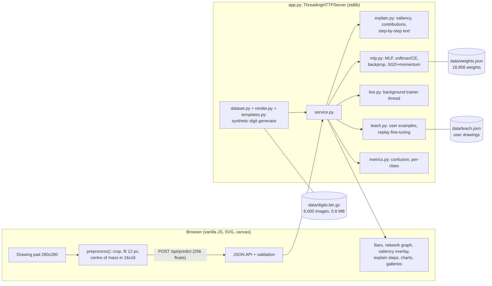

# NeuroCanvas: hackathon report

## 1. Title, tagline, domain

**NeuroCanvas: draw a digit, watch a neural network think.**
Domain: **Artificial Intelligence & Machine Learning**. QUANTIX 2K26, K.S.R. College of Engineering.

## 2. Problem statement

**Who suffers.** Engineering and science students who are told that AI is the skill of the decade,
and the teachers who have to teach it. In India that is a very large group: higher education enrols
roughly 4.3 crore students (AISHE 2021-22, approx.), and AI/ML now appears in most CSE, IT, ECE and
data-science syllabi.

**How.** Most students meet neural networks as three library calls: `model = Sequential(...)`,
`model.fit(X, y)`, `model.predict(x)`. Backpropagation, activations, softmax and the learning rate
are equations on a slide. Students never see:

- what a hidden neuron actually responds to,
- why the model gave *this* answer for *this* input,
- what a gradient looks like, or what one step of gradient descent changes,
- how a model fails: confident mistakes, overfitting, divergence, forgetting.

**Why existing options fall short.**

| Option | Gap |
|---|---|
| Framework tutorials (Keras/PyTorch notebooks) | The maths happens inside compiled code; they usually assume cloud notebooks, GPUs or large installs |
| Videos and blog animations | Passive: you cannot draw your own input or change the network |
| Toy 2-D playgrounds | Good for decision boundaries, but there is no image input and no step-by-step backprop with numbers |
| Lab sessions | Many college labs have unreliable Wi-Fi and no GPU, so a cloud-based session simply cannot run |

## 3. Our solution

NeuroCanvas is an offline web app that puts a small neural network on a drawing pad. You draw a digit
and see the network's 10 probabilities change *while you draw*, every hidden neuron light up, which
pixels argue for and against the answer, and a plain-English walk through the forward pass and
backpropagation with the real numbers for your drawing. You can train a fresh network live, break it
on purpose (learning rate too high, too few neurons, too little data), and teach it your own
handwriting. Everything, from the digit generator to backprop, is written in plain Python with no
libraries, so a student can open the file and read every line.

Key features:

- **Live prediction**: probability bars update about 10–20 times a second while drawing (forward + backward pass ~2 ms).
- **Inside the network**: input grid, the activation of all 64 + 32 hidden neurons as heat cells, the strongest connections into the winning class, top voting neurons, and the weight image of each top first-layer neuron.
- **Saliency map**: ∂(winning score)/∂pixel, shown as a glow over your own strokes (cyan = for, rose = against).
- **Explain mode**: 11 numbered steps (pixels → layers → logits → softmax → loss → backprop ×3 → saliency → one SGD step) using the actual numbers. Pick a different "true" label to watch backprop push harder.
- **Live training lab**: a background thread trains a fresh network with your learning rate, layer sizes, epochs, data size, activation, batch size and momentum. Loss and accuracy curves and first-layer weight images update every epoch. Six one-click experiments are included.
- **Evaluation**: confusion matrix (click a cell to filter), per-class recall and precision, the most confident mistakes, the training curve, and a gallery of training digits.
- **Teach it**: draw and label your own examples (or load a seven-segment "LCD" lesson, a style missing from training), fine-tune for a few SGD steps with replay, and see before → after for your examples, for unseen LCD digits, and for the original test set (forgetting).

## 4. Innovation / what makes it different

1. **No black box anywhere.** The network, backprop, optimiser, data generator and preprocessing are about 1,000 lines of readable Python. A finite-difference gradient check proves the hand-written backprop is correct (relative error < 1e-6; observed ~1e-9).
2. **Explanations with your numbers.** It does not say "the network computes a weighted sum"; it says "neuron #28 computed z = 4.60 − 0.07 = 4.53 and its biggest inputs were …".
3. **Exact attributions.** For a ReLU network the winning logit splits *exactly* into pixel evidence (gradient × input) plus bias terms. This identity is unit-tested, so the "+13.8 from your pixels" line is a fact, not a heuristic.
4. **It shows failure honestly.** Confidently wrong curly-tailed 9s, a learning rate that collapses the network to chance, overfitting with 100 images, and catastrophic forgetting when you fine-tune without replay are all one click away and measured.
5. **Truly offline and tiny.** Starts in ~0.1 s, the dataset is 0.8 MB and the weights 160 KB. It needs no install, no GPU, no internet and no API key.

## 5. System architecture



| Component | File | Responsibility |
|---|---|---|
| Stroke templates | `neurocanvas/templates.py` | Digits 0–9 as pen strokes (arcs, Béziers, lines), 2–3 styles each, every control point randomised; LCD style for Teach-it |
| Renderer | `neurocanvas/render.py` | Densify → elastic warp → tremor → affine (scale, shear, rotation) → anti-aliased round-pen rasteriser → preprocess → noise |
| Preprocessing | `neurocanvas/preprocess.py` + `static/app.js` | Bounding box, area-average resize to 12 px, sub-pixel centre-of-mass shift into 16×16, normalise. Python and JS are mirror implementations |
| Dataset cache | `neurocanvas/dataset.py` | 6,000 images, deterministic per-sample seeds, gzip (mtime 0) so it is byte-stable |
| Network | `neurocanvas/mlp.py` | MLP of any depth, ReLU/tanh, softmax + cross-entropy, backprop, input gradients, SGD with momentum + L2 |
| Training | `neurocanvas/train.py` | Mini-batch loop, LR decay, divergence detection, CLI that writes `data/weights.json` |
| Explanations | `neurocanvas/explain.py` | Contributions (gradient × activation), network-graph edges, 11-step explanation, one-step SGD probe |
| Live trainer | `neurocanvas/live.py` | Background thread, parameter validation, per-epoch history and weight tiles, stop/adopt |
| Teach it | `neurocanvas/teach.py` | Persistent user examples, fine-tuning with replay and ±1 px shift augmentation |
| Service + HTTP | `neurocanvas/service.py`, `app.py` | State, model swapping under a lock, JSON errors (400/404/405/409/413), static files |

## 6. Algorithms & models

**6.1 Synthetic handwriting generator.** Each digit is a function that returns pen strokes in a unit
box, built from arcs `(cx + rx cos θ, cy + ry sin θ)`, cubic Béziers and polylines. Every parameter
is jittered and a style is picked at random (a 1 with or without a flag or base, an open or closed 4,
a 7 with or without a crossbar, a one-stroke or two-loop 8, a straight or curved 9 stem). Then:

```
pts   = densify(strokes, step 0.035)
pts  += A/2 · Σ_k sin(f_k·(x, y) + φ_k)          # smooth elastic warp, 2 waves per axis, A ≤ 0.075
pts  += N(0, 0.008)                               # tremor
pts   = R(±18°) · Shear(±0.36) · Scale(sx 0.62–1.3, sy 0.85–1.15) · pts
img   = max over segments of clamp(w/2 + 0.5 − dist(pixel, segment), 0, 1)   # anti-aliased round pen, w = 6–20% of height
x     = preprocess(img);  with p = 0.35: x += N(0, ≤0.05)
```

Some strokes are also cut short (up to 10%) to mimic a sloppy pen. *Why*: it is deterministic,
offline and explainable (students can see exactly how the data was made), and it creates the
variation a classifier must cope with. *Limits*: it is not real handwriting. Its styles are the ones
we wrote down, so styles we did not think of (e.g. a 9 whose tail curls left) are missing. Section 8
measures this.

**6.2 MNIST-style preprocessing** (same code path for training data and for the browser):
bounding box of pixels > 0.08 → scale so the longest side is 12 px (aspect kept) with an exact
area-averaging filter → shift by a *fractional* amount so the centre of mass lands on (8, 8) (each
pixel's mass is split over the 4 cells it overlaps) → divide by the peak. An earlier integer shift
made the input jump a whole pixel when the centre of mass crossed .5, which flickered predictions
while drawing; the fractional shift fixed that. *Limit*: it normalises position and size, not
rotation or slant.

**6.3 Multi-layer perceptron.** 256 → 64 → 32 → 10, 18,858 parameters.

```
z_l = W_l a_l + b_l ;   a_{l+1} = ReLU(z_l) ;   p = softmax(z_out) ;   L = −ln p_y + (λ/2)‖W‖²
softmax(z)_c = exp(z_c − max z) / Σ_k exp(z_k − max z)          # overflow-safe
```

Backprop, derived by hand:
`δ_out = p − onehot(y)`, `∂L/∂W_l = δ_l a_lᵀ (+ λW_l)`, `∂L/∂b_l = δ_l`, `δ_{l−1} = (W_lᵀ δ_l) ⊙ ReLU′(z_{l−1})`.
Optimiser: mini-batch SGD with classical momentum, `v ← μv − η(g/n + λW)`, `W ← W + v`, with μ = 0.9,
η = 0.06 decayed ×0.85 per epoch, batch 32, λ = 1e-4. He initialisation (σ = √(2/n_in)) for ReLU
layers and Xavier for the output/tanh. *Why an MLP*: every weight is a pixel image you can look at,
it trains in pure Python in under 2 minutes, and its maths fits on one slide. *Limits*: no
translation invariance (a CNN would be more robust), and 16×16 input loses fine detail.

**6.4 Saliency and contributions.** Saliency is `s_i = ∂z_pred/∂x_i`, one extra backward pass from
`onehot(pred)` (Simonyan et al.-style gradient saliency). Contribution of hidden unit j is
`a_j · ∂z_c/∂a_j`. For ReLU networks this is exact: inside the current on/off pattern,
`z_c = Σ_i x_i s_i + Σ_l Σ_j b_lj ∂z_c/∂z_lj` (verified to 1e-10 in a unit test). *Limit*: raw
gradients are noisy and only describe a local, linear neighbourhood. They say "more ink here would
raise the score", not "this is the part that makes it a 3".

**6.5 Teach-it fine-tuning with replay.** Each step uses a batch of the user's examples (each
shifted by up to ±1 px) plus `R` random original training images (default 48), then one
SGD-with-momentum step (η = 0.03, 30 steps). *Why*: without replay, fine-tuning overwrites old
knowledge (catastrophic forgetting). Replay is the simplest cure and is easy to explain. *Limit*:
the right balance between learning and forgetting depends on R, η and steps (measured below).

**6.6 Evaluation.** Accuracy, confusion matrix, per-class precision/recall/F1 and the most
confident mistakes on a held-out split generated with different per-sample seeds.

## 7. Tech stack and why it is offline-first

| Layer | Choice | Why |
|---|---|---|
| Backend | Python 3.9+ standard library only (`http.server`, `math`, `random`, `gzip`, `json`, `threading`) | `python app.py` works on any venue laptop, including Windows, with no pip |
| Maths | Plain lists with `sum(map(mul, …))` inner loops | Fastest pure-Python option and readable; no numpy |
| Frontend | Vanilla HTML/CSS/JS, inline SVG and `<canvas>` | No CDN, no fonts, no build step; light and dark themes; works on phones (`--host 0.0.0.0`) |
| Data | Generated by code with fixed seeds, cached (0.8 MB) | Reproducible, no download, no licence questions |
| Tests | `unittest` (50 tests) + optional Playwright hand-drawing check | Runs offline in ~5 s |

Startup takes 0.07 s because the dataset and weights are cached. If they are missing, the app
rebuilds them itself.

## 8. Results / evaluation

All numbers were measured in this repository's container (pure CPython 3.13, one core per process).
A college laptop will be in the same ballpark, but these are not benchmarks of one.

**Synthetic hold-out (1,000 digits never used in training):**

| Metric | Value |
|---|---|
| Test accuracy | **99.4 %** (6 / 1,000 wrong), test loss 0.024 |
| Train accuracy | 99.9 % |
| Per-class recall | 99–100 % for every digit; lowest precision is "9" at 97 % (it absorbs 0, 2, 5) |
| Training time | 108 s for 14 epochs on 5,000 images (~7 s per epoch), pure Python |
| Forward pass | 0.41 ms median per image (p95 0.46 ms) |
| Full `/api/predict` work (forward + backward + contributions + edges) | 1.8 ms median |
| HTTP round trip for `/api/predict` (curl, localhost, 20 calls) | 2.5 ms median, 4.7 ms max |
| Full explanation (11 steps, incl. a one-step SGD probe on a copy) | 7.7 ms median |
| Server startup | 0.07 s (cached data + weights) |

**Honest caveat.** The test digits come from the same generator as the training digits, so 99.4 %
says the network learned *our* synthetic handwriting, not human handwriting. An earlier, milder
generator (v1) scored 99.9 % and reached 97.6 % from only 100 training images: the data was too
uniform to show overfitting. We widened the augmentation (v2: rotation ±18°, shear ±0.36, stronger
elastic warp, pen width 6–20 %, stroke trimming). With v2, 100 images give 100 % train vs 87.6 %
test, so the playground's overfitting lesson is visible.

**Drawn with a real mouse in a real browser.** `tests/handdraw_check.js` uses Playwright to drive the
UI the way a person does. It draws 20 hand-written stroke designs (2 per digit, written separately
from the training templates), each 3 times at a random size, position and tilt with wobble, and
reads the answer off the page.

| Model | Mouse-drawn accuracy | Errors |
|---|---|---|
| v1 generator (integer centring) | 58 / 60 (96.7 %) | curly-tailed 9 → 5 (98 %), → 3 (98 %) |
| v1 + fractional centring | 58 / 60 (96.7 %) | curly-tailed 9 → 3 |
| **v2 (shipped)** | **57 / 60 (95.0 %)** | curly-tailed 9 → 3 (75 %, 93 %, 99 % confidence) |
| v2 after teaching 3 curly-9 drawings (1.8 s fine-tune) | **60 / 60 (100 %)** on fresh placements | none; synthetic test 99.4 % → 98.7 % |

What we observed: digits written the way our templates imagine them are recognised reliably,
wherever and however large they are drawn. Every miss was one style (a 9 whose tail curls left at the
bottom), and the network was *confidently* wrong about it, which is the classic out-of-distribution
failure. Wider augmentation did not fix it (v1 and v2 are within one drawing of each other on this
small set), while three taught examples did. Caveats: 60 drawings of 20 designs is a small sample,
we drew the designs ourselves (with a mouse script, not a classroom of real hands), and the
"after teaching" test uses the same designs at new positions. Real students' handwriting will be
more varied and accuracy will be lower.

**JS vs Python preprocessing parity:** on 20 canvases the browser's 16×16 grid matched the
server's Python preprocessing of the raw bitmap to within 5e-4. That is the API's 3-decimal
rounding, so the two implementations are equivalent.

**Teach it: the LCD lesson** (20 seven-segment digits, a style missing from training; scored on 30
*other* LCD digits never shown):

| Replay per step | Your 20 examples right | Unseen LCD digits | Original synthetic test |
|---|---|---|---|
| (before) | 12 / 20 | 60 % | 99.4 % |
| **48 (default), 2.6 s** | **20 / 20** | **83 %** | 97.0 % |
| 96 | 19 / 20 | 80 % | 97.9 % |
| 128 | 20 / 20 | 77 % | 98.2 % |
| 0 (no replay) | 19 / 20 | 73 % | **69.0 %**, catastrophic forgetting |

**Live-training experiments** (fresh networks, 2,000 images unless stated, 500 test images):

| Experiment | Result |
|---|---|
| Defaults: 256-32-10, lr 0.05 | 91.8 % → 94.8 % → 96.4 % test after epochs 1–3, ~1.3 s per epoch |
| Learning rate 2.0 | collapses to chance: 10 % accuracy, loss 2.5 (> ln 10) |
| 4 hidden neurons | stuck near 85 % (84.8 % after 8 epochs) |
| 100 images, 128 neurons, 20 epochs | train 100 %, test 87.6 % (overfitting) |
| No momentum, lr 0.01 | 79.4 % after 8 epochs (vs ~98 % with momentum) |
| tanh 64 + 32 | 98.2 % after 6 epochs, ~4 s per epoch |

**Correctness tests:** 50 unit tests pass in ~5 s. They cover finite-difference gradient checks
(ReLU and tanh, 1 and 2 hidden layers, with L2, plus input gradients), softmax/cross-entropy at
logits of ±1000, XOR learned to 100 %, loss decreasing on separable blobs, the momentum update rule,
the exact ReLU logit decomposition, renderer and dataset byte-determinism, centring, scaling and
aspect ratio, mass conservation, the committed dataset matching the generator, API validation, live
training, fine-tuning, and HTTP errors and path traversal.

## 9. Screenshots


`docs/screenshot.png` (1440×900, dark theme) shows the Draw & inspect tab right after the demo digit
draws itself: live probabilities, the 16×16 input and saliency, the saliency glow on the strokes, all
96 hidden neurons with the strongest connections into the winning class, the top voting neurons, and
the weight images of the top first-layer neurons. The app also has a light theme, which follows
`prefers-color-scheme` and can be toggled in the header.

## 10. 3-minute live demo script

1. **(0:00) Open `http://127.0.0.1:8014`.** A 3 draws itself. *"This is a neural network written from scratch in plain Python. No TensorFlow, no internet. Every number you see is computed live."*
2. **(0:20) Clear and draw a 7 slowly.** Point at the bars changing as you draw. *"It thinks 1 after the first stroke, then 7 once the bar appears. Each update is a full forward and backward pass in about 2 ms."*
3. **(0:40) Point at Inside the network.** *"These 64 and 32 squares are the hidden neurons. Bright ones fired. The cyan lines are the connections that pushed hardest towards 7. The glow on my drawing is the saliency map: the gradient of the score with respect to each pixel."*
4. **(1:00) Explain tab.** Scroll through a few steps, then click label **1**. *"Here's the real arithmetic: this neuron computed 4.53, softmax gave 99%. If I say the truth is 1, the loss jumps and backprop pushes hard. You can see one SGD step move p(1) from almost nothing to high."*
5. **(1:30) Live training.** Click **Learning rate far too high**, then **Sensible defaults**. *"Too big a step and the network collapses to guessing, 10%. Sensible settings reach 96% in 3 epochs, and you can watch the first-layer weights turn from noise into detectors."*
6. **(2:05) Evaluation.** *"99.4% on held-out synthetic digits. Here's the confusion matrix and the mistakes. But that's our own synthetic data, so here's the honest test."*
7. **(2:20) Teach it.** Draw a curly-tailed 9 (it says 3), label it 9, add 2–3 examples, click **Teach it!**. *"It was confidently wrong. Three examples and two seconds of training later it gets it right, and with replay it barely forgets anything else. Set replay to 0 and you'll see catastrophic forgetting."* (Backup: **Load demo lesson** → **Teach it!**.)
8. **(2:50) Close.** *"Runs on any ₹15k laptop with Wi-Fi off. Every line is readable by a second-year student."*

## 11. Impact

- **Social:** makes AI literacy practical in labs without reliable internet or GPUs, and it is in English, with simple wording students can follow. It teaches *critical* understanding (why models fail, confident mistakes, forgetting), not just "AI is magic".
- **Educational:** one laptop on a projector covers backprop, softmax, learning rate, capacity, overfitting and fine-tuning in a single session. With `--host 0.0.0.0` students can open it on their phones over the lab Wi-Fi.
- **Economic:** no cloud credits, GPU or licence. The cost is an existing laptop. (Assumption: a typical college lab already has one PC per 1–2 students.)
- **Environmental:** training uses ~2 minutes of one CPU core and inference ~2 ms per request. That is negligible next to cloud notebooks left running for a class (assumption-level, not measured).

## 12. Feasibility, scalability & business model

- **Feasibility:** it works today. 50 tests pass, every endpoint is exercised, and it starts in 0.1 s with nothing to install.
- **Scalability:** a prediction costs ~2 ms of CPU, so one laptop can serve roughly a few hundred predictions per second. With live drawing throttled per student, that is about one classroom (~30 students, approx.) on the LAN. Larger groups need a second laptop, nothing more. The Python GIL is the limit; there is no shared state beyond the model, which is swapped atomically.
- **Business model:** free and open for students and teachers. Revenue from (a) workshop kits for colleges and school Atal Tinkering Labs (lesson plans, worksheets, a trainer session), (b) a teacher edition with exercises such as "find the learning rate that diverges" with auto-checking, and (c) customised versions for other scripts (Tamil, Devanagari) for state boards.

## 13. Future scope

- A small convolutional layer with visible feature maps, to compare with the MLP.
- Tamil and Devanagari character sets (the stroke-template generator extends naturally).
- Classroom mode: pool every student's labelled drawings into a shared dataset and retrain live.
- Import a real MNIST copy from a USB stick when available, to compare synthetic vs real training.
- Step-through backprop animation, one neuron at a time; SmoothGrad to denoise saliency.

## 14. Judges' Q&A prep

1. **"99.4% sounds too good."** It is on synthetic test digits from the same generator, and we say so on screen. On mouse-drawn digits we measured 95% (57/60), and all misses were one style, which teaching fixed. Real students will be harder; that is exactly what Teach-it is for.
2. **"Why not train on MNIST?"** MNIST is a download of about 11 MB, and the brief requires offline, deterministically generated data. Generating digits also lets us show *how* training data is made and augmented. Importing MNIST offline is on the roadmap.
3. **"Is your backprop actually correct?"** Yes. Unit tests compare every analytic gradient against central finite differences: relative error below 1e-6 (we observe ~1e-9) for ReLU and tanh networks, with and without L2, including gradients with respect to the input.
4. **"Pure Python must be slow."** 0.4 ms for a forward pass and 1.8 ms including saliency (2.5 ms over HTTP), which is plenty for live drawing. Full training takes ~2 minutes once, and the result is cached. Speed was never the goal; readability was.
5. **"Why an MLP and not a CNN?"** Every first-layer neuron is a 16×16 weight image students can look at, and the whole forward pass fits on one slide. A CNN would be more robust to shifts, and it is our next step, but we wanted the simplest network that genuinely works.
6. **"Is saliency trustworthy?"** It is a local gradient: "what would change the score", which is noisy and not a causal explanation. We also show gradient × input, which for ReLU networks splits the score *exactly* into pixel and bias parts (tested to 1e-10).
7. **"What stops fine-tuning from ruining the model?"** Replay. Every step mixes in 48 original images. Without replay, synthetic accuracy fell from 99.4% to 69%; with replay it stayed at 97%. **Reset to pretrained** is one click.
8. **"How is this different from TensorFlow Playground or a YouTube video?"** Those are great, but they are 2-D toy data or passive viewing. Here you draw your own input, see backprop with real numbers, retrain, and teach it, all offline, and the code is short enough to read.
9. **"Can it handle many students?"** One laptop serves about a classroom over LAN (~2 ms CPU per prediction). Live-training runs are one at a time per server by design.
10. **"Privacy?"** Nothing leaves the laptop. Teaching examples are stored in `data/teach.json` on the device and can be cleared in one click.

## 15. How to run

```bash
cd projects/14-neurocanvas
python app.py                      # http://127.0.0.1:8014/
python app.py --host 0.0.0.0       # allow phones on the same Wi-Fi
python -m unittest discover -s tests

# rebuild the committed artefacts (deterministic)
python -m neurocanvas.dataset      # data/digits.bin.gz  (~14 s)
python -m neurocanvas.train        # data/weights.json   (~110 s)

# optional: mouse-drawing check in a real browser (Node + Playwright)
NODE_PATH="$(npm root -g)" node tests/handdraw_check.js http://127.0.0.1:8014/ 3 teach
```
