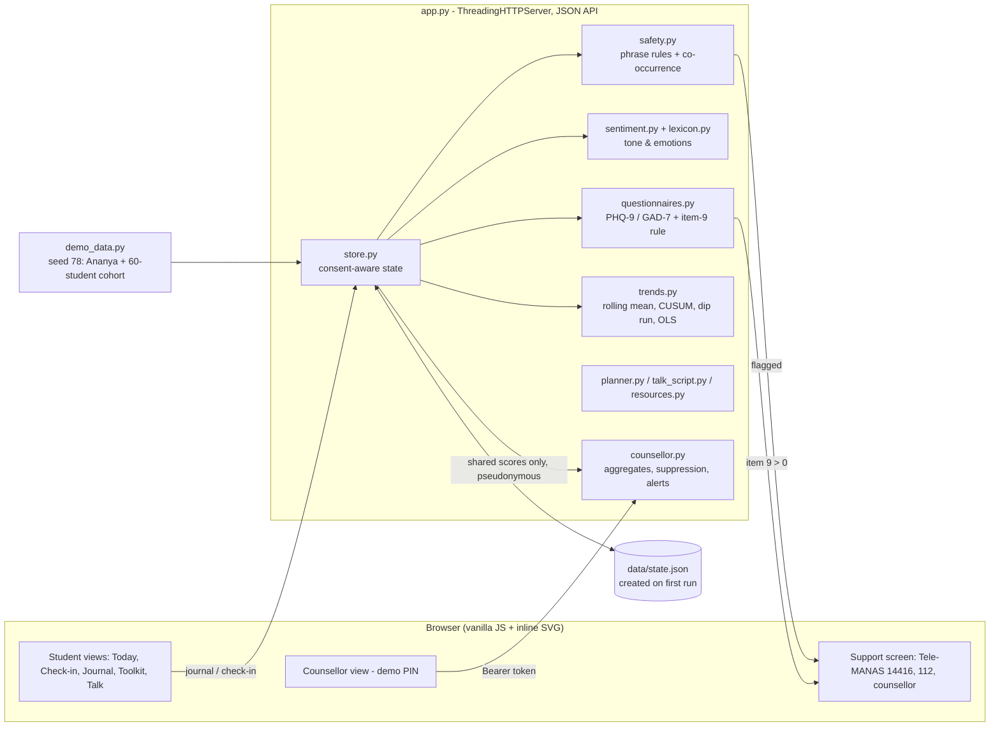
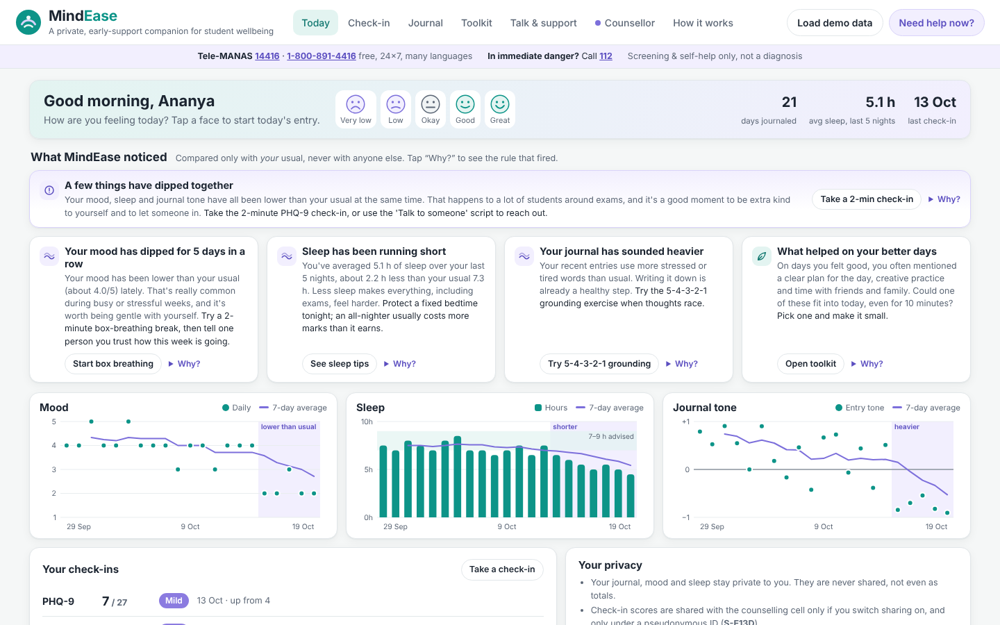

# MindEase: hackathon report

## 1. Title, tagline, domain

**MindEase**: *A private, early-support companion for student mental wellbeing.*
Domain: **HealthTech & Biomedical Innovation**. QUANTIX 2K26, K.S.R. College of Engineering.

> MindEase is a supportive screening and self-help prototype. It does **not** diagnose or treat
> any condition and is not a substitute for professional care. Every screen shows Tele-MANAS
> **14416 / 1-800-891-4416** (free, 24×7) and **112** for emergencies. All student data in this
> report and in the demo is synthetic.

## 2. Problem statement

**Who suffers.** College students under exam pressure, especially first-generation and hostel
students far from home. Anxiety and low mood build quietly over weeks, and the student usually
notices last. Counsellors are affected too. A typical college counselling cell sees only the
students who walk in, and often only once things have become a crisis.

**How much it matters.** We use only widely cited figures and mark the rough ones:
- India records **approx. 13,000 student suicides a year** (NCRB *Accidental Deaths & Suicides
  in India*, 2021 and 2022 editions, approx.). Behind each one are many more students who
  struggled without help.
- The National Mental Health Survey 2015–16 (NIMHANS) estimated a **treatment gap of
  70–92%** for mental disorders in India. Most people who need care never receive it.
- The WHO notes that **half of all mental health conditions start by age 14**, and most by the
  mid-twenties. That is exactly the college years.

**Why existing solutions fail.**
1. **Stigma and visibility.** Walking into the counselling room is a public act on a small
   campus. Many students won't take that step until things are severe.
2. **No early signal.** Counsellors learn about a student's distress from a friend, a warden or
   an incident, not from a trend.
3. **Help is hard to find at the moment it's needed.** Helpline numbers live on a notice board.
   At 2 a.m. in a hostel room, nobody remembers them.
4. **Generic wellness apps** are often cloud-based and English-only. They are opaque about what
   they do with diary text, and some claim to "detect depression", which is neither honest nor
   safe.

## 3. Our solution

MindEase is a private companion on the student's side. It is offline, explainable and free.
Each day the student logs their mood, their sleep and a line or two in English, Tanglish or
emoji. Every two weeks they can take the standard PHQ-9 and GAD-7 check-ins. MindEase compares
the student only with *their own* usual. When mood, sleep or journal tone dip, it says so kindly,
shows the exact evidence, and suggests a small step. If anything suggests risk (PHQ-9 item 9
above 0, or self-harm or hopelessness language in the journal), a gentle support screen opens at
once. It offers Tele-MANAS, 112 and "talk to a counsellor now". Counsellors get a separate view
with opt-in, pseudonymous aggregates, so they can see an exam-time spike coming and follow up on
alerts, without reading anyone's journal.

Key features:
- **PHQ-9 & GAD-7**: the standard item wording, 0–3 scoring and the published severity bands,
  with a per-item explanation. The item-9 rule triggers support regardless of the total.
- **Mood journal with "what the app noticed"**: a from-scratch lexicon analyser handles
  negation, intensifiers, "but", emoji, CAPS, "!" and Tanglish. Each word is highlighted with its
  score and the rule that changed it.
- **Safety net**: 41 phrase rules plus a co-occurrence layer. Everyday hyperbole ("this exam is
  killing me") does not trigger it.
- **Personal trend engine**: rolling means, CUSUM, a dip run and an OLS slope test. It produces
  messages like "Your mood has dipped for 5 days in a row", with a "Why?" panel.
- **Offline self-help toolkit**: box breathing, 5-4-3-2-1 grounding, an exam-stress Pomodoro
  planner and timer, and sleep tips.
- **Prepare to talk to someone**: a few taps generate words for a friend, a parent, a counsellor,
  a mentor or a doctor, plus a short message asking for a time.
- **Peer-support page**: how to help a friend, when to get help, and campus peer-support ideas.
- **Counsellor dashboard** (demo login): weekly band counts, exam weeks marked, a by-year table
  with small-cell suppression, contact requests, and an item-9 alert queue with acknowledge →
  followed-up.
- **Privacy controls**: opt-in sharing, pseudonymous IDs, "delete all my data", and a journal
  that never leaves the student's record.

## 4. Innovation / what makes it different

- **Safety first, without alarm.** Crisis help is on every screen, and the support screen is
  triggered by a validated signal (PHQ-9 item 9) as well as by journal language. The wording is
  warm and never labels the student.
- **Explainable, not a black box.** Every insight carries its evidence. For example, from the
  committed demo snapshot: "CUSUM crossed h = 5 on 19 Oct (S = 6.2); last 5 days 2, 2, 3, 2, 2
  vs your usual 4.0 ± 0.6". Every word's sentiment score can be inspected.
- **Personal baseline, not a population norm.** A naturally quiet student isn't flagged for
  being quiet. Only a change from their own usual counts.
- **Written the way students write.** Tanglish ("romba tension", "nalla illa", "thookam
  varala"), Tamil post-negation and emoji are first-class inputs.
- **An early signal for counsellors without surveillance.** The counsellor sees opt-in totals
  under pseudonyms, small cells are suppressed, and nothing is shared from the journal.
- **Honest measurement.** We report where it fails. On indirect phrasings the first version of
  the safety net caught **0 of 12**, and we show what we changed.
- **Fully offline** on a ₹15k laptop. There is no cloud, no API key, and no student text
  leaving the device.

## 5. System architecture



| Component | Responsibility | Key detail |
|---|---|---|
| `questionnaires.py` | PHQ-9 / GAD-7 definitions, validation, scoring, bands, explanations | Item 9 > 0 → `support.show = true` whatever the total |
| `lexicon.py` | 319 words, 68 phrases, 58 emoji/emoticons; 56 Tanglish terms; negators, intensifiers | −4…+4 valence, optional emotion tag |
| `sentiment.py` | Tokenise → merge phrases → rules → compound score, emotions, reasons | Offsets kept so the UI highlights exact words |
| `safety.py` | 41 regex rules (self-harm, hopelessness, someone else, Tanglish) + co-occurrence layer | Negated mentions soften to "concern"; hyperbole excluded |
| `trends.py` | Daily series, 7-day rolling means, baseline, CUSUM, dip run, OLS slope, insights | `dip_decision()` is shared by app and evaluation |
| `planner.py` | Pomodoro study plan | need × urgency greedy allocation, 22:30 cut-off |
| `talk_script.py` | "Prepare to talk" templates | Deterministic; self-harm option adds a safe sentence and shows support |
| `resources.py` | Helplines, support screen, peer support, sleep tips, grounding | Only 14416 / 1-800-891-4416 and 112 |
| `store.py` | Thread-safe JSON persistence, consent, alert creation, contact requests, erase | Journal never copied into cohort data |
| `counsellor.py` | Weekly band counts, KPIs, narrative, by-year suppression, alert workflow | `<3` suppression; new → acknowledged → followed up |
| `demo_data.py` | Deterministic demo (Ananya, 21 days; 60 students × 8 weeks) | Exam weeks 7–8 spike |
| `evaluation.py` | All numbers in §8 → `data/evaluation.json` | Labelled sets in `eval_sets.py` |
| `app.py` | HTTP server, static files, JSON errors, demo counsellor auth | Never crashes on bad input |

## 6. Algorithms & models

### 6.1 PHQ-9 and GAD-7 scoring
Each item is scored 0 (not at all), 1 (several days), 2 (more than half the days) or 3 (nearly
every day), and the total is the sum. PHQ-9 bands: 0–4 minimal, 5–9 mild, 10–14 moderate, 15–19
moderately severe, 20–27 severe (Kroenke et al. 2001). GAD-7 bands: 0–4, 5–9, 10–14, 15–21
(Spitzer et al. 2006). Both instruments are free to reproduce.
```
support = (instrument == PHQ-9) and answers[8] > 0      # item-9 rule, any total
suggest_counsellor = total >= 10 or support               # published cut-point
```
*Why:* these are the most widely used, validated self-report screeners, and counsellors already
know them. *Limits:* they measure the last two weeks of symptoms, not a diagnosis. They are
self-report, so they can be under-reported, and we use the English wording (official Indian
language versions would be needed for a pilot).

### 6.2 Lexicon-based sentiment and emotion (from scratch)
Structure follows VADER (Hutto & Gilbert 2014). The lexicon, the Tanglish handling and the code
are ours.
```
tokens  = tokenize(text)            # words, contractions, emoticons, emoji (offsets kept)
units   = merge_phrases(tokens)     # "burnt out", "can't sleep", "vera level", "thookam varala"
for each unit u with valence v:
    if intensifier/diminisher in 2 previous units: |v| += ±0.293
    if negator in 3 previous units (no punctuation / "but" between): v *= −0.74
    elif Tamil post-negator ("illa", "venam") in 2 next units:       v *= −0.74
    if u is ALL CAPS in mixed text: |v| += 0.733
in each sentence with "but"/"however": before × 0.5, after × 1.5
s = Σ v  (+0.292 per "!", max 3, in the direction of s)
compound = s / sqrt(s² + 15);  label = pos if ≥ 0.2, neg if ≤ −0.2, else neutral
```
"Dual" words act as intensifiers when a feeling word follows. So "semma" alone is positive, and
"semma tension" means *a lot of* tension. Emotions (joy, calm, sadness, worry/stress,
frustration, tiredness, loneliness, self-doubt) add up |score| per tagged, non-negated word.
We widened the neutral band from VADER's ±0.05 to ±0.2. We tuned this on the dev set only,
because students use mild words ("okay", "late") neutrally.

*Why:* it is explainable word by word, fast (≈0.1 ms), works offline, and can be extended by a
student volunteer. *Limits:* it misses out-of-vocabulary words, idioms and sarcasm. Its negation
window is 3 tokens, so "nothing will ever get *better*" is read as mildly positive by the
sentiment layer. The safety layer catches that phrase separately.

### 6.3 Concerning-language safety net
- **Layer 1, phrase rules (41):** specific multi-word patterns grouped into self-harm
  (*urgent*), hopelessness (*concern*), Tanglish, recognised warning signs (goodbye notes,
  giving belongings away, extra pills) and *someone else* ("she wants to kill herself" →
  how-to-help-a-friend screen).
- **Layer 2, co-occurrence:** this layer flags a sentence that contains all of:
  - a first-person reference;
  - a death or absence cue ("alive", "die", "forever", "wasn't around", "future");
  - a wish or hopelessness cue ("want", "tired of", "easier", "don't see", "ways to").

  It skips sentences with everyday-context guards ("battery", "lol", "book", "exam week").
- **Rules:** a negated single word is dropped ("not hopeless"). A negated self-harm mention
  still triggers, at the softer level ("I would never kill myself" → a gentle check-in).
  Phrases are specific, so "killing me" ≠ "killing myself".

*Why:* recall matters more than precision. A false alarm costs one gentle screen the student can
close. A miss costs far more. *Limits:* it is a keyword safety net, not a risk assessment, and
it misses indirect or metaphorical language (§8.2). PHQ-9 item 9 remains the primary, validated
signal.

### 6.4 Trend engine
*Baseline:* the up to 21 entries before the most recent 7 days (at least 5 are needed). The
baseline gives a mean μ and a spread σ, with σ floored at 0.5 (mood), 0.6 h (sleep) and 0.25
(tone).
```
z_t = (x_t − μ) / σ
CUSUM:   S_t = max(0, S_{t−1} − z_t − k),  k = 0.5;  alarm when S_t > h = 5
Dip run: number of most recent consecutive days with x < μ − 1·σ
Slope:   OLS over the last 7 days; t = b / SE(b); significant if t < −t_crit(df, 95%)
Dip  ⇔  CUSUM alarm  AND  dip run ≥ 2         (dip_decision)
```
Mood, sleep and tone are each checked. If two or more dip together, an extra "a few things have
dipped together" card suggests a check-in or reaching out. The app also lists "what helped on
your better days", which counts activities mentioned on days with mood ≥ 4. Messages are always
kind, and the evidence sits behind "Why?".

*Why:* CUSUM accumulates small, persistent drops that a single bad day can't produce. The run
rule makes the message human ("for 5 days in a row"). The slope test is shown as supporting
evidence. *Limits and tuning (honest):* our first rule was *run ≥ 3 OR (CUSUM h = 4 + run ≥ 2)
OR (slope + run ≥ 2)*. On simulated stable journals it flagged **21% of weeks**, which is far too
chatty. On its own, the slope test fired on 26% of stable weeks, because integer moods are
checked every day. We tuned on simulation seed 7 and report held-out seed 101 (§8.3).

### 6.5 Pomodoro study planner
`score(subject, day) = (6 − confidence) × (1 + 2/days_left) / (1 + sessions_given)`, filled
greedily into 25/5-minute blocks (a 15-minute break after every 4). The rules: at most 2
consecutive blocks of the same subject; the day before an exam is at least half revision of
that subject; exam days get half the blocks; no block ends after 22:30; and a day is capped at
8 h. *Limits:* it is a heuristic, not an optimiser. It doesn't model syllabus size or topic
dependencies.

### 6.6 Privacy-preserving aggregation
Weekly counts by band, using the latest check-in per student per week. The by-year breakdown
replaces any count of 1–2 with "<3", and rows with fewer than 3 students are suppressed
entirely. PHQ-9 item 9 > 0 on a *shared* check-in creates a pseudonymous alert. Contact details
exist only if the student asks to be contacted.

## 7. Tech stack

| Layer | Choice | Why offline-first |
|---|---|---|
| Backend | Python 3.9+ standard library (`http.server`, `json`, `re`, `statistics`, `hashlib`, `secrets`) | `python app.py` works on any venue laptop with no internet and no `pip` |
| Logic | Pure modules in `mindease/`, no HTTP code | Unit-testable, explainable |
| Frontend | Vanilla HTML/CSS/JS, hand-drawn inline SVG charts, CSS animation | No CDN, no fonts, no tracking; light and dark mode; phone-friendly |
| Storage | `data/state.json`, written atomically and created on first run | No database server to install |
| Tests | `unittest`, 100 tests | Run in about 2 s |

## 8. Results / evaluation

All numbers come from `python -m mindease.evaluation` and are saved in `data/evaluation.json`.
The labelled sets are in `mindease/eval_sets.py`. **Important caveats:** every set was written
and labelled by **one person**, the same person who wrote the lexicon and rules. That is why we
report several sets, written at different times, and say which were used for tuning. None of
these numbers come from real students or from clinicians.

### 8.1 Sentiment accuracy (3 classes: positive / negative / neutral)

| Set | n | When written | Used for tuning? | Accuracy | Macro-F1 | Plain word-count baseline |
|---|---|---|---|---|---|---|
| Dev | 30 | before the lexicon | **yes** (neutral band) | 100% | 1.00 | 73% |
| Held-out | 30 | before the lexicon | no | **93%** (28/30) | 0.93 | 80% |
| Fresh | 20 | after the lexicon was frozen, deliberately new wording | no | **55%** (11/20) | 0.55 | 55% |
| **Untuned combined** | **50** | | no | **78%** (39/50) | 0.78 | 70% |

- **Read the held-out 93% with care.** The held-out sentences were written just before the
  lexicon, so their vocabulary ("shaking", "made sense") probably leaked into it. The **fresh
  set (55%)** is our most honest estimate for new wording.
- **The fresh-set errors default to neutral, not to the wrong side.** 8 of the 9 errors are
  out-of-vocabulary words read as neutral ("heavy heart", "drowning in assignments",
  "appreciated", "pleasant"). There is 1 polarity flip: "I feel lighter after crying it out"
  was read as negative. So the app usually says less rather than something wrong.
- The 2 held-out errors: "My chest feels tight…" (no feeling word, read as neutral) and "class
  was cancelled so I went to the library" ("cancelled" read as mildly negative).
- **Negation checks: 16/16.** "not happy" → negative, "not bad" → positive, "I don't feel
  stressed" → positive, "Nalla illa" → negative, "No worries today" → positive, and so on.
- We **deliberately did not add** the fresh-set misses to the lexicon, so these numbers stay
  reproducible. They are listed as future work.

### 8.2 Concerning-phrase alert sensitivity

| Set | Phrasing | Caught (sensitivity) | False alarms | Without co-occurrence layer |
|---|---|---|---|---|
| Held-out (written before the rules) | direct ("I want to die", "I'm a burden", Tanglish) | **24/24 (100%)** | **0/22** | 24/24, 0/22 |
| Fresh, **first run** (phrase rules only) | indirect ("I'm tired of being alive", "nothing matters anymore") | **0/12 (0%)** | 1/8 | – |
| Fresh, after the fixes below | indirect | 12/12 (optimistic, tuned on it) | 0/8 | 7/12 |
| Check-3 (written before the co-occurrence layer existed), **first run** | indirect | **8/10 (80%)** | **0/10** | 4/10 |

- **The honest story.** Fixed phrases caught every direct statement, but on first contact with
  indirect wording they caught **0 of 12**. We then made three changes:
  1. added a generalising co-occurrence layer;
  2. added recognised warning signs (goodbye notes, giving belongings away, taking extra pills);
  3. added an exclusion for "hopeless *at* chess".

  On the next unseen set (Check-3), the system caught **8/10 with no false alarms**. The
  co-occurrence layer alone doubled recall there, from 4/10 to 8/10.
- **Still missed:** "I feel like I'm drowning and there's no way I'll get through this" and
  "What if I just never came back from the terrace." We left these unfixed so the Check-3
  figure stays honest.
- **The false-alarm sets** cover everyday hyperbole: "this exam is killing me", "dead tired",
  "I'd kill for a coffee", "the movie was to die for", "my laptop battery is dying", "I could
  sleep forever after this exam week" and "bored to death". None of these trigger.
- **PHQ-9 item-9 rule:** 16/16 combinations of item-9 value × other answers behave correctly,
  and unit tests cover every value at every possible total. This is the validated signal. The
  journal detector is an extra safety net, and the help numbers are visible on every screen
  regardless.

### 8.3 Trend detector (simulated journals)

These come from simulated journals, not real students. Each journal has 21 normal days of
integer mood = round(N(3.8, 0.7)) clipped to 1–5, then a 7-day watch window. In the window mood
either stays the same (no dip) or drops by 1.0 or 1.5 points. There are 300 journals per
condition. A "false alarm" is any insight during the 7 stable days.

| Rule | Seed | False alarms per stable week | 1-point dip flagged | 1.5-point dip flagged | Median delay (1.5 pt) |
|---|---|---|---|---|---|
| First rule (run ≥3 or CUSUM h=4 or slope, + run) | 7 (tuning) | 21% | 78% | 96% | 2 days |
| **Shipped: CUSUM h = 5 + 2-day run** | 7 (tuning) | 3.3% | 62% | 90% | 3 days |
| **Shipped** | **101 (held-out)** | **3.3%** | **59%** | **90%** | **3 days** |
| Slope test alone | 101 | 27% | 68% | 84% | – |
| CUSUM alone (h = 5) | 101 | 5.0% | 68% | 97% | – |

We chose a **6× drop in false alarms** at the cost of catching fewer subtle (1-point) dips. A
nudge that fires every few weeks for no reason teaches students to ignore it. A 1-point dip is
about 1.4 σ of the simulated noise. The demo student, Ananya, is flagged on the second day of
her dip (CUSUM S = 6.2 > 5). In the committed snapshot that is 19 Oct; demo dates shift so her
journal always ends yesterday.

### 8.4 Latency

Measured on the development container (Python 3.13). The numbers will vary on venue laptops.

| Operation | Latency |
|---|---|
| `sentiment.analyse` on one journal entry (3,000 runs) | **≈ 0.1 ms** (106 µs) |
| `safety.detect` on one entry | ≈ 88 µs |
| PHQ-9 scoring | ≈ 10 µs |
| Trend analysis of a 21-day journal (all 3 metrics, insights) | ≈ 1.7 ms |
| Counsellor dashboard aggregation (60 students × 8 weeks) | ≈ 2.7 ms |
| `POST /api/analyze` over HTTP on localhost (200 requests) | median 2.1 ms, p95 6.1 ms |
| `GET /api/student` (journal + trends) | median 3.2 ms, p95 8.0 ms |

The live "what the app noticed" panel updates 350 ms after the student stops typing, so the
model is never the bottleneck.

### 8.5 Tests
There are **100 unittest tests** covering:
- every PHQ-9 and GAD-7 band boundary, and the item-9 rule at every possible total;
- validation;
- negation ("not happy", "not bad", Tamil post-negation), intensifiers, "but", emoji and phrase
  offsets;
- concerning phrases, the figurative-language exclusions, someone-else detection and the
  co-occurrence layer;
- the CUSUM and OLS values against hand calculations, and the dip/no-dip, recovery, sleep and
  lift insights;
- the planner invariants and the script generator;
- consent, privacy (journal never shared, erase), small-cell suppression and the alert workflow;
- every API endpoint, including auth (401), conflicts (409) and bad JSON.

## 9. Screenshots



`docs/screenshot.png` shows Ananya's **Today** view, three weeks into the term with exams close.
- The banner reads "A few things have dipped together".
- Cards follow for mood (dipped 5 days in a row), sleep (5.1 h vs her usual 7.3 h), journal tone
  and "what helped on your better days".
- The three charts underneath shade the days each detector flagged.
- The Tele-MANAS / 112 help bar sits under the header on every screen.

## 10. 3-minute live demo script

1. **(0:00) Open** `http://127.0.0.1:8016` and click **Load demo data**. *"Exam season. This is
   Ananya, a second-year student. She has used MindEase privately for 3 weeks."*
2. **(0:15) Today view.** Point at the banner, then click **Why?** on "Your mood has dipped for 5
   days in a row". *"No black box: her last 5 days were 2, 2, 3, 2, 2 against her own usual
   4.0, and CUSUM crossed its threshold on day 2. We compare her only with herself, never with
   classmates."* Point at the shaded dip on the charts.
3. **(0:40) Journal.** Click **Use example entry**: "Exams are killing me. Couldn't sleep again
   and I feel like nothing will ever get better." *"See what it noticed: 'killing me' is
   ordinary student talk and isn't treated as self-harm. But 'nothing will ever get better' is
   hopelessness."* Click **Save entry**: the gentle support screen opens with Tele-MANAS 14416,
   112 and **Talk to a counsellor now**. Click it. *"Her journal stays private; only a 'please
   reach out' request goes to the counselling cell."*
4. **(1:15) Check-in.** Click **Fill example answers**, then pick **Several days** on question 9.
   *"Item 9 is about self-harm thoughts. Any answer above 'not at all' opens support
   immediately, whatever the total score."* Close it and click **See my result**. Show the band
   gauge, the per-item explanation and the "not a diagnosis" note.
5. **(1:45) Toolkit.** Start **box breathing** (the dot traces the square) and click **Use
   example timetable** to get a Pomodoro plan. *"Less-prepared subjects get more blocks, and
   nothing is scheduled after 10:30 p.m."* Optionally, **Talk & support → Example** writes words
   to say to a counsellor.
6. **(2:10) Counsellor** tab, PIN **2468**. *"The counsellor sees only opt-in totals under
   pseudonyms."* Point at the exam-week spike (moderate-or-above about 7% → 35%). Show Ananya's
   new alert as **S-E13D** with no name, and her "respond today" contact request. Type a note and
   click **Acknowledge**. Point at the by-year table, where Year 4 shows "<3 suppressed", and at
   the privacy principles.
7. **(2:40) How it works** tab. *"We measured it honestly: 93% on held-out sentences, but 55% on
   brand-new wording. Our first safety net missed 0 of 12 indirect phrasings, so we fixed it and
   re-tested on unseen sentences: 8 of 10. That is why MindEase is a safety net and a nudge to
   talk, never a replacement for people."*

## 11. Impact

**Social.**
- **A stigma-free first step.** Students can check in privately at 2 a.m. and get help numbers
  instantly, without walking into a room.
- **Earlier conversations.** The trend engine and the "prepare to talk" script turn "I'm fine"
  into a concrete opening line for a friend, a parent or a counsellor.
- **Counsellors plan instead of react.** The cohort view shows when stress is rising (exam weeks
  7–8 in the demo). The counselling cell can schedule drop-in hours, send cohort-wide support
  messages, or ask faculty to space deadlines.
- **Peer support.** The "worried about a friend?" guidance teaches every student the basics:
  listen, ask directly, don't keep it secret if they're unsafe, and help them connect.

**Economic.** MindEase runs on existing college laptops with zero licence or cloud cost.
Counsellor time is the scarce resource, and aggregate signals help target it.

**Environmental.** Negligible. There are no servers or data centres, and it runs on hardware
the college already owns.

**Honest assumptions.** We have not measured outcomes. Whether MindEase increases help-seeking
must be tested in a pilot (§12). An illustrative scenario, not a claim: if a college of 3,000
students had 30% weekly use, about 900 students a week would see their own trends and the help
numbers.

### 11.1 Ethics & safety

| Principle | How MindEase implements it |
|---|---|
| **Not a diagnosis** | Every result carries "screening check, not a diagnosis". The wording describes symptoms over 2 weeks ("your answers are in the moderate range") and never says "you have…". Insight texts are tested to exclude words like "disorder" and "diagnosis". |
| **Non-alarmist, kind tone** | Dips are framed as common during exams. Calm teal and lavender, no red alarms. Every insight suggests a small step. |
| **Help on every screen** | A persistent help bar with Tele-MANAS 14416 / 1-800-891-4416 and 112 (tap to call on phones), and a "Need help now?" button in the header. No other phone numbers are listed, because a wrong number is worse than none. |
| **Immediate support on risk** | PHQ-9 item 9 > 0 opens the support screen the moment it is tapped. Journal self-harm or hopelessness language does the same. Options: call Tele-MANAS, call 112, ask a counsellor to reach out, or breathe for a minute. |
| **Consent and minimal data** | Sharing is opt-in and can be switched off. Only totals, bands, week and year are shared. The journal is never shared, not even in aggregate. "Delete all my data" removes every trace, including cohort records. |
| **Pseudonymity and small cells** | Counsellors see IDs like S-E13D. Breakdowns hide counts below 3. A student becomes reachable only by asking to be contacted. |
| **Safety over silence, within consent** | An item-9 alert reaches the counsellor only on a shared check-in. Without contact consent the counsellor can't identify the student, but the alert is still counted and the student has already seen crisis resources. The counsellor can respond with a cohort-wide support message. We chose this deliberately, and it needs review by the college's ethics committee. |
| **Support, not surveillance** | Scores must never be used for grades, attendance or discipline. This is stated in the counsellor UI. |
| **Honest limits** | Keyword detectors miss indirect language (§8.2). MindEase never claims to "detect depression" or predict suicide. |
| **Human in the loop** | Every alert needs a counsellor to acknowledge it and follow up. Nothing is automated beyond showing resources. |

Before any real use: approval from an Institutional Ethics Committee, a documented escalation
protocol owned by the counselling cell, consent text reviewed for India's Digital Personal Data
Protection Act 2023, and clinician review of all wording.

## 12. Feasibility, scalability & business model

**Feasibility.**
- It works today: a single `python app.py`, no installation and no network. It runs on any
  ₹15k laptop and opens on phones over campus Wi-Fi.
- Each algorithm module is a few hundred lines of plain, commented Python (the largest,
  `trends.py`, is about 440 lines), so the college IT team can maintain it.
- Pilot plan:
  1. a silent pilot in one department with consenting volunteers and counsellor oversight;
  2. compare the app's flags with counsellor judgement, and collect consented, anonymised
     journal lines labelled by 2 or more annotators to re-measure §8;
  3. then expand.

**Scalability.**
- Move `state.json` to SQLite or PostgreSQL and the demo PIN to college SSO (OIDC).
- Encrypt the student's own data at rest. The ideal is on-device storage in a PWA, with only
  the opt-in totals sent to the server.
- The analysis runs at about 0.1 ms per entry on the server, or entirely in the student's
  browser if ported to JS.
- Multi-campus deployments would aggregate only pseudonymous, suppressed counts.

**Risks.**
1. **Over-reliance.** Mitigation: the UI repeats that MindEase is not a substitute for people,
   and help numbers are always shown.
2. **Missed indirect language.** Mitigation: PHQ-9 item 9, the co-occurrence layer, and peer
   training.
3. **Misuse of data by institutions.** Mitigation: aggregate-only access, written
   "support, not surveillance" terms, and audit logs as future work.

**Business model.**
- **Free for students, always.** No ads and no data sales.
- **College licence** for the counsellor dashboard, multi-counsellor workflow and reports. This
  is an assumption to validate: a small per-student yearly fee, comparable to what a college
  already spends on its counselling cell.
- **Deployment partners:** student-welfare offices, NSS units, and CSR programmes of companies
  that recruit from the campus.
- **Paid add-ons:** SSO, multi-campus analytics, Tamil/Hindi interfaces with official
  questionnaire translations, and counsellor training content.

## 13. Future scope

- **Clinical validation** with the counselling cell under IEC approval. Measure detector
  sensitivity against clinician interviews, not author-written sentences.
- **Official local-language PHQ-9 / GAD-7 translations** (Tamil, Hindi) and a Tamil-script UI.
- **A bigger lexicon, labelled by several raters**, including the fresh-set misses ("heavy
  heart", "drowning in", "appreciated") and more Tanglish. Native speakers would validate it.
- **Safety-net improvements**, such as metaphor patterns ("never came back from the terrace")
  and conversation-level context, always tested on unseen sets.
- **Mobile PWA with encrypted on-device storage** and optional daily reminders.
- **A trained peer-listener rota** and counsellor-booking integration.

## 14. Judges' Q&A prep

1. **"Isn't this diagnosing students with an algorithm?"** No. PHQ-9 and GAD-7 are standard
   screeners. We show their published bands with "not a diagnosis" on every result, and the
   journal analysis is labelled "what the app noticed". Decisions stay with the student and the
   counsellor.
2. **"What if it misses someone at risk?"** It will sometimes, and we measured that: 0/12 on
   indirect phrasing in the first version, 8/10 now. That's why help numbers are on every
   screen whatever the detector says, why PHQ-9 item 9 is the primary signal, and why we teach
   peers how to help. MindEase adds safety nets; it doesn't replace people.
3. **"Won't false alarms annoy students?"** The trend rule flags about 3% of stable weeks in
   simulation, down from 21% in our first version. The safety net ignores hyperbole like "this
   exam is killing me" (0/22 and 0/10 false alarms on our sets). The support screen is gentle
   and closes with one tap.
4. **"Can the college identify students from the dashboard?"** No. Counsellors see pseudonymous
   IDs, opt-in data only, and no journal text, and counts under 3 are suppressed. A student is
   reachable only by asking for contact. Deleting your data removes your cohort records too.
5. **"Why not use ChatGPT or another LLM?"** In a crisis we need predictable, auditable
   behaviour, not generated advice. The approach is offline and explainable word by word, and
   no student text goes to a third-party cloud. It runs on a ₹15k laptop with no API key.
6. **"How accurate is your sentiment analysis really?"** On new wording, 55% (n=20); on
   held-out, 93% (n=30); combined untuned, 78% vs 70% for plain word counting. Most errors fall
   back to "neutral". We report all three because one author wrote every set.
7. **"Why CUSUM rather than just averages?"** A 7-day average reacts slowly and is moved by one
   bad day. CUSUM accumulates small, persistent drops relative to the student's own baseline.
   In simulation it flags 90% of 1.5-point dips with a median delay of 3 days.
8. **"What does a counsellor do with an alert from a student who didn't consent to contact?"**
   They acknowledge it, and they can respond with a cohort-wide support message or extra
   drop-in hours. The student already saw Tele-MANAS and 112 the moment they answered. We chose
   consent over identification on purpose, and we'd review that choice with the ethics
   committee.
9. **"Is the Tanglish support real?"** It is small: 56 terms, Tamil post-negation ("nalla illa"),
   intensifiers ("romba", "semma") and phrases like "thookam varala". It works in the demo and
   in tests, but native-speaker validation is future work.
10. **"Who pays, and why would a college adopt it?"** Students never pay. Colleges already fund
    counselling cells. MindEase gives that cell an early, privacy-respecting signal and a
    follow-up workflow on hardware they already own.

## 15. How to run

```bash
cd projects/16-mindease
python app.py                          # http://127.0.0.1:8016/  (counsellor PIN 2468)
python app.py --host 0.0.0.0 --port 8016   # open from phones on the same Wi-Fi
python -m unittest discover -s tests   # 100 tests
python -m mindease.evaluation          # recompute §8 -> data/evaluation.json
python -m mindease.demo_data           # re-export the deterministic demo -> data/demo_seed.json
```

Python 3.9+ only. No `pip install` is needed, and no network access is used. `data/state.json`
is created on first run, and **Load demo data** resets it.
