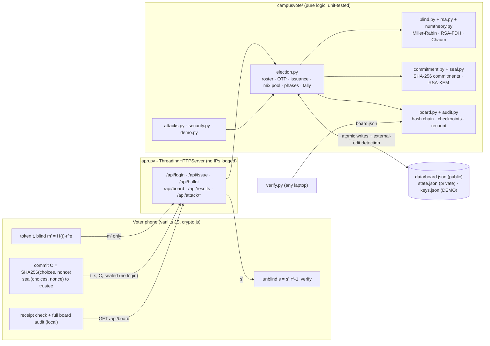

# CampusVote: hackathon report

## 1. Title, tagline, domain

**CampusVote**: *Verifiable, anonymous e-voting for student elections*
**Domain:** Cybersecurity & Blockchain Technology
**Event:** QUANTIX 2K26, K.S.R. College of Engineering

## 2. Problem statement

- **Who suffers:**
  - **Students and candidates** in student-council, hostel, department-association and club elections.
  - **Faculty election officers**, who have to run these elections and defend the result.
- **How elections are run today and why it hurts:**
  - **Paper ballots.** Printing, a supervised booth, and then manual counting that can take an evening for a few
    thousand ballots (approx.). Recounts are disputed ("that pile was counted twice") and there is no record anyone
    else can check.
  - **Google Forms or spreadsheets.** The admin can see which signed-in account submitted which answer and can edit
    or delete rows. Nobody outside can detect that. A shared link or a borrowed login lets one person vote several
    times. The "result" is a chart that only the admin can check.
  - **Hand-raising or WhatsApp polls.** No secrecy at all, so peer pressure decides the vote.
- **Why existing solutions fail:** they force a choice between **secrecy** (nobody can see my vote) and
  **verifiability** (I can check the count). The usual fix is "trust the admin". In a campus election the admin is
  often a senior student or faculty member close to one of the candidates. We did not find a reliable statistic on
  disputed campus elections, so we do not quote one. The failure modes above are structural, not anecdotal.

## 3. Our solution

CampusVote is an offline, single-laptop e-voting server. Students vote from their phones over campus Wi-Fi. It
implements a FOO'92-style protocol (Fujioka–Okamoto–Ohta) from scratch:

1. A student signs in with their register number and a one-time code.
2. Their phone gets a **Chaum RSA blind signature** on a random ballot token. The authority sees only a blinded
   number, so it cannot link the token to the student.
3. The phone casts the token, the signature, a **SHA-256 commitment** to the choices, and the choices **sealed to a
   trustee key**. The ballot goes through a simulated anonymous channel: a mix pool that posts ballots in shuffled
   batches.
4. Every ballot lands on a **public, hash-chained bulletin board** with **RSA-signed checkpoints**.
5. When voting closes, the trustee opens every ballot and publishes each opening next to its commitment. The result
   is signed, and **anyone** can download `board.json` and recount it: in the browser, with `verify.py`, or on the
   server.

Key features:

- Mobile-first voter UI with large buttons. It works over plain-HTTP LAN: all crypto is implemented in JS on BigInt,
  with no `crypto.subtle` needed.
- One token per register number. A network retry with the same blinded value returns the same signature, and a
  second, different request is refused.
- Voter receipt. The phone checks the board **locally**, so the server never learns which ballot you looked for.
  After the count it confirms your ballot was "counted exactly as you chose".
- Bulletin board explorer with "Verify in my browser" (a full re-audit in JS) and "Download board.json".
- Results with bar charts and a 10-step verification report that explains each check.
- **Attack lab** with 12 live attacks:
  - double token
  - double cast
  - replay
  - random forgery
  - multiplicative forgery
  - cross-election replay
  - OTP brute force
  - authority de-anonymisation
  - ballot stuffing
  - edit, edit + re-hash, and delete in `board.json`
- Admin panel:
  - create an election (posts, candidates, voting window)
  - upload a roster CSV and get downloadable one-time code slips, shown once and stored only as PBKDF2 hashes
  - move through the phases (setup → registration → voting → tally)
  - simulate voters
  - unlock an account
- Live turnout dashboard: tokens issued by department, ballots over time, mix pool, board head, last checkpoint, and
  the published key fingerprints.

## 4. Innovation / what makes it different

- **The admin runs the election but cannot see, link or alter votes.** The UI says this in plain words, and the
  attack lab proves each part of it.
- **Perfect unlinkability, demonstrated live.** For any issuance record (m', s') and any ballot (t, s), the factor
  r = s'·s⁻¹ mod n satisfies FDH(t)·rᵉ ≡ m'. Every pairing is equally consistent, so the authority's best guess is
  1/N. The "Authority de-anonymises a voter" button computes this over every ballot on the board.
- **No trust in our server for the count.** The browser downloads the board and re-verifies, in about 60–150 ms for
  the demo:
  - every hash
  - every checkpoint signature
  - every blind signature
  - every ballot signature
  - every commitment opening
  - the recount
- **All crypto is from scratch and mirrored in two languages.** Miller–Rabin, RSA key generation with CRT and a
  Bellcore fault check, RSA-FDH, Chaum blinding, RSA-KEM hybrid encryption, SHA-256 and HMAC (in JS). Python and JS
  are cross-checked byte for byte: JS blinds, Python signs, JS unblinds, JS seals, Python opens.
- **A layered tamper story.**
  - A naive edit breaks the chain at that exact entry.
  - A smart insider who re-hashes the chain is caught by the signed checkpoints.
  - A deletion is caught by sequence numbers and by the affected voter's receipt.
  - A vote flip after the count is caught by the binding commitment and the signed result.
- **Honest limits.** We show what is *not* solved:
  - coercion: receipts are not receipt-free
  - stuffing up to the number of token-holders who did not vote
  - a single trustee key
  - a simulated mix

## 5. System architecture



| Component | Responsibility |
|---|---|
| `static/crypto.js` | SHA-256, HMAC, BigInt modpow and modinv, FDH, blind/unblind, commitments, RSA-KEM seal, full board audit |
| `static/app.js` | Vote wizard, dashboard, board explorer, results, attack lab, admin. No libraries, SVG charts |
| `app.py` | HTTP and JSON API, input limits, JSON errors, CSP and security headers, admin-key check, no client IPs in logs |
| `campusvote/numtheory.py` | Extended Euclid, modular inverse, sieve, Miller–Rabin, prime generation |
| `campusvote/rsa.py` | Key generation (λ(n), FIPS-style \|p−q\| check), CRT signing with self-check, FDH |
| `campusvote/blind.py` | Token message (bound to the election id), blind, sign_blinded, unblind, verify, linking factor |
| `campusvote/commitment.py` | Hiding and binding SHA-256 commitments with a 256-bit nonce |
| `campusvote/seal.py` | RSA-KEM + SHA-256-CTR + HMAC-SHA256 (encrypt-then-MAC, token as associated data) |
| `campusvote/board.py` | Entry hashing, chain verification with exact break location, checkpoint and result messages |
| `campusvote/audit.py` | 10-step universal verification and independent recount |
| `campusvote/election.py` | Service state machine, mix pool, trustee tally, receipts, tamper simulation, integrity halt |
| `campusvote/attacks.py` | 12 attack demos that use the real validation code paths |
| `verify.py` / `bench.py` | Offline auditor CLI / measurements |

## 6. Algorithms & models

### 6.1 Miller–Rabin primality and RSA key generation

Write n − 1 = d·2^s with d odd. For each random base a ∈ [2, n−2], compute x = a^d mod n. If x ∉ {1, n−1} and
squaring s−1 times never gives n−1, then a is a witness and n is composite.

```
gen_prime(bits): repeat c = random | top-two-bits | 1
                 skip if gcd(e, c-1) != 1; trial-divide by primes < 2000; 40 MR rounds
keygen: p, q = gen_prime(1024); require |p-q| > 2^(1024-100)
        n = pq; d = e^-1 mod lcm(p-1, q-1); e = 65537
```

- **Why chosen:** it is the standard probabilistic test. Error is at most 4⁻⁴⁰ even for adversarial inputs
  (Carmichael numbers and strong pseudoprimes are in the tests).
- **Limits:** 40 rounds is more than needed for random candidates (FIPS 186-4 allows fewer). Key generation in pure
  Python takes about 0.6–1.3 s per 2048-bit key. Keys are cached in `data/keys.json`.

### 6.2 RSA-FDH signatures with CRT

FDH(m) = SHA-256(“CV1-FDH” ‖ ctr ‖ m) for ctr = 0, 1, …, truncated to |n|−1 bits, so the value is below n.
Signing computes s = FDH(m)^d mod n with CRT (s₁ = m^dp mod p, s₂ = m^dq mod q, then Garner recombination). The
result is checked with sᵉ ≡ m before it is released, which defeats the Bellcore fault attack.

- **Why chosen:** FDH is what makes blind RSA safe. Textbook RSA is malleable (s₁s₂ signs m₁m₂). With FDH, a forger
  would need a token t with FDH(t) = m₁m₂, which is a SHA-256 preimage. The attack lab shows that the product really
  is a valid textbook signature on m₁m₂, and that it is still rejected as a token.
- **Limits:** RSA-2048 is about 112-bit security. Post-quantum it is broken (see future scope).

### 6.3 Chaum blind signatures (eligibility without identity)

```
phone:     t <- 256 random bits; m = FDH("CV1-token|eid|t"); r <- Z_n*; m' = m·r^e mod n   -> send m'
authority: check OTP session, one per register number; s' = m'^d mod n                      -> return s'
phone:     s = s'·r^-1 mod n; check s^e == m; forget r
```

- **Unlinkability property (tested):** for every issuance record and every ballot there is a consistent r, so the
  authority's view, which never contains t, s or m, carries no information.
- **Key separation:** the blind-signing key is used **only** for tokens. Anyone can get the issuer to sign a value of
  their choice, so checkpoints and results are signed by a separate *board* key. Sealing uses a third, *trustee* key.
- **Limits:**
  - Whoever holds the issuer key can mint tokens. Mitigation: every issuance is posted publicly, so ballots must stay
    at or below the number of tokens issued.
  - Stuffing up to (tokens issued − ballots cast) is not detectable by counting. The next step is threshold signing.

### 6.4 Hash commitments plus sealed openings, and why not homomorphic ElGamal

The commitment is C = SHA-256(“CV1-commit|eid|t|” ‖ canonical(choices) ‖ “|” ‖ nonce), with a 256-bit nonce. It is
**hiding**: there are no running totals during voting. It is **binding**: changing a vote needs a second preimage.

In classic FOO, voters must come back after the close to reveal their opening, and many don't. So each ballot also
carries **sealed = RSA-KEM(trustee) of (choices, nonce)**:

```
r <- [2, n-2]; c0 = r^e mod n; K = SHA-256("CV1-KEM" || I2OSP(r))
kE = HMAC(K, "enc"); kM = HMAC(K, "mac")
ct = pt XOR SHA-256(kE || i)...; tag = HMAC(kM, token | c0 | ct)
```

After the close, the trustee opens every ballot and publishes (choices, nonce). Anyone checks each opening against
its commitment. A trustee that publishes a false opening fails the binding check, and the tests cover this.

Why not exponential ElGamal with a homomorphic tally? It is only sound with zero-knowledge proofs that each ciphertext
encrypts 0 or 1 and that exactly one candidate is chosen per post. We estimated about 100 pure-Python modular
exponentiations per 3-post ballot to verify those proofs. That is roughly 0.15 s per ballot, or about 5 minutes for
2,000 ballots. Shipping it *without* proofs would let one voter add 50 votes. We chose the scheme we could implement
correctly and fast. Homomorphic tallying is in future scope.

### 6.5 Hash-chained bulletin board with signed checkpoints

- **Entry hash:** hash = SHA-256(canonical{seq, type, time, data, prev}).
- **Entry types:** genesis (manifest + public keys + roster hash), phase, issuance (voter_ref, m', s'), ballot,
  checkpoint, opening, result.
- **Checkpoints:** after each mix batch and every 25 entries, the board key signs
  “CV1-checkpoint|eid|upto|head|ballots”.
- **Audit (10 steps):**
  1. genesis
  2. chain
  3. checkpoints
  4. phases (ballots only inside voting)
  5. issuance (one per voter, blind signatures well-formed)
  6. ballot signatures
  7. duplicates
  8. ballots ≤ tokens ≤ eligible
  9. openings match commitments
  10. recount equals the signed result
- **Limits:**
  - A single server holds the board. Mitigation: anyone can download it, voters keep the hash of their own entry,
    and checkpoint heads can be published externally (projector, notice board, WhatsApp group).
  - Genesis keys must be anchored externally. The UI shows the fingerprints to print.

### 6.6 Simulated anonymous channel (mix pool)

`/api/ballot` takes no login or cookie, and the server does not log client IPs. Ballots wait in a pool and are posted
in a **random order** with **one shared timestamp**, when 4 are waiting or after 12 s. That breaks arrival-order
and timing links.

- **Limits:** this runs on the same server, so it is a simulation. A small batch gives little cover. A real
  deployment needs a separate mix operator or relay.

### 6.7 Authentication

One-time 6-digit codes are generated with `secrets` and stored as salted PBKDF2-SHA256 hashes. Codes are compared in
constant time, and an account locks after 5 failures, so 5 guesses out of 10⁶ succeed with probability 0.0005%. A
session can request one token.

## 7. Tech stack and why it is offline-first

- **Backend:** Python 3.9+ standard library only (`hashlib`, `hmac`, `secrets`, `json`, `csv`, `http.server`). There
  is no pip install. `python app.py` just works on a venue laptop, including Windows.
- **Frontend:** vanilla HTML/CSS/JS, inline SVG charts, no CDN, no fonts, no network calls. All crypto runs on JS
  `BigInt` plus our own SHA-256, so it works over plain HTTP on the LAN, where browsers disable `crypto.subtle`.
  Light and dark themes, and usable down to a 390 px phone width.
- **Storage:** JSON files with atomic writes. The service records the SHA-256 of what it last wrote. If `board.json`
  changes behind its back, or fails verification at start-up, it **halts all appends** until the board is restored.
- **Deployment:** one laptop as a hotspot or on campus Wi-Fi, started with `python app.py --host 0.0.0.0`. Phones open
  `http://<ip>:8017/#vote`.

## 8. Results / evaluation

The numbers below were measured with `python bench.py` (saved in `docs/bench.json`) on Python 3.13, x86-64, in a
**shared 4-core container** with other demo servers running. Treat them as rough, conservative figures.

| Measurement | Result |
|---|---|
| RSA-2048 key generation (6 runs, own Miller–Rabin, 40 rounds) | **mean 0.81 s**, median 0.65 s, range 0.56–1.27 s; ~643 candidates per key |
| Voter: blind a token | 0.60 ms |
| Authority: blind-sign (CRT + fault self-check) | **9.7 ms** mean (9.3 ms median) |
| Voter: unblind + verify | 0.76 ms + 0.22 ms |
| Verify one ballot token signature (e = 65537) | **0.22 ms** |
| Voter: seal opening (RSA-KEM) / trustee: open | 0.21 ms / 8.5 ms |
| Cast validation per ballot (shape, signature, duplicate, mix, amortised checkpoint signing) | 2.5–2.8 ms |
| **Tally, 200 ballots**: close + trustee opens all + signed result | **2.1 s** (666 board entries, 0.8 MB) |
| **Independent recount, 200 ballots** (full 10-step audit) | **0.12 s** |
| **Tally, 2,000 ballots** | **21.2 s** (8.5 ms of RSA decryption per ballot dominates; done once, after the close) |
| **Independent recount, 2,000 ballots** (Python audit) | **1.07 s** (6,588 entries, 7.8 MB) |
| Browser/V8 audit of the 2,000-ballot board (`crypto.js` in Node 22) | 1.18 s |
| Browser audit of the demo board (153 ballots, headless Chromium) | 58–80 ms |
| Unit and integration tests | **65 pass** in ~4 s (`python -m unittest discover -s tests`) |
| Attack demos | **12 / 12** rejected, blocked or detected (asserted in `test_every_attack_is_stopped`) |

What the tests cover:

- **Miller–Rabin:**
  - agrees with trial division for every n < 20,000 and for random 8-digit odd numbers
  - 15 Carmichael numbers (each checked against Korselt's criterion)
  - strong pseudoprimes, including 3215031751, which fools bases 2, 3, 5 and 7
  - Mersenne primes up to M1279
- **RSA and blinding:**
  - modular inverse checked against `pow(a, -1, m)`
  - CRT result equals plain `pow`
  - a FDH known-answer test
  - 25 blind/unblind/verify round trips
  - the unlinkability property (6×6 pairings, all consistent)
  - the authority's stored view contains no token, signature or FDH value
  - multiplicative forgery and cross-election replay fail
- **Commitments and sealing:** commitment binding and hiding; seal round trip, plus a swapped token, a bit flip, a bad
  tag and the wrong key.
- **Bulletin board:**
  - an edit breaks the chain at that exact entry
  - re-hashing is caught by checkpoints
  - deletion and insertion are detected
  - an external text-editor edit halts appends
- **Election flow:**
  - double voting is rejected at issuance, in the pool and on the board
  - issuance is idempotent on retry
  - sessions are single-use
  - OTP lockout
  - mix batching and timeout
  - spoiled ballots are not counted
  - a false trustee opening is detected
  - the end-to-end tally equals the expected counts and every receipt shows "counted"
  - the demo data is deterministic
- **HTTP:** status codes, CSP header, path traversal, and the voter flow over the network.

**Threat model**

| Threat | Attacker | Defence | Status |
|---|---|---|---|
| Second token (double voting) | Student | Issuer serves each register number once; the same blinded value gets the same signature | Prevented |
| Same token twice / replay | Student, network | Token unique on board and in pool, re-checked by every auditor | Prevented |
| Forged token | Anyone | RSA-FDH 2048-bit; FDH blocks s₁s₂ forgery | Prevented |
| Cross-election replay | Anyone | Election id inside the signed message | Prevented |
| Guessing a classmate's code | Classmate | 5-try lockout, salted PBKDF2 at rest | Prevented |
| Authority links voter ↔ ballot | Admin / authority | Chaum blindness, information-theoretic: every pairing consistent | Prevented |
| Timing/IP linkage of ballot to sender | Admin watching server | No login on cast, no IP logging, shuffled batches with one timestamp | Mitigated (simulated mix) |
| Admin edits or deletes a stored ballot | Insider with file access | Hash chain locates the entry; signed checkpoints catch re-hashing; receipts; integrity halt | Detected |
| Admin peeks at running totals | Admin | Hiding commitments; openings sealed to a separate trustee key | Mitigated (the trustee-key holder could open early) |
| Trustee changes or drops votes when opening | Trustee | Binding commitments; spoiled ballots listed by token for voters to contest | Detected |
| Ballot stuffing with the signing key | Corrupt authority | Public issuance log: ballots ≤ tokens issued | Partly detected (up to issued − cast is invisible) |
| Coercion / vote buying | Coercer | None cryptographic: token + public opening proves the vote | **Not solved** |
| Malware on the voter's phone | Malware | Out of scope; the voter re-checks the opened choice after the tally | Out of scope |

## 9. Screenshots


`docs/screenshot.png` shows the live dashboard on the demo election: phase bar, turnout KPIs, tokens by department,
ballots over time, the phone voting URL and the published key fingerprints. The other views are reached from the
tabs: Vote (phone wizard), Bulletin board, Results, Attack lab and Admin.

## 10. 3-minute live demo script

1. **(0:00) Problem.** "Paper takes an evening to count. With Google Forms, the admin can see and edit votes. Today
   the admin can do neither." Show the dashboard: 200 students, 168 tokens, 152 ballots, board verified.
2. **(0:20) Vote on a phone.** Open `http://<ip>:8017/#vote` and tap **Use a demo voter**, then **Get my anonymous
   ballot token**. Read out the 4 lines: "My phone blinded the token. The authority signed a number it cannot read."
3. **(0:50) Cast.** Pick three candidates, then **Review** and **Cast anonymously**. "No login is sent, just the token,
   the signature, a commitment and a sealed opening." Show the receipt code and *Waiting in the mix*, then the ballot
   being posted.
4. **(1:15) Attack lab.**
   - **Vote twice with one token** is rejected.
   - **Multiply two real signatures** is rejected: "FDH beats RSA malleability."
   - **Authority de-anonymises a voter** returns *consistent with 153 of 153 ballots*, so the best guess is 1/153.
5. **(1:45) Insider tampering.**
   - **Edit a stored ballot** is *DETECTED, chain breaks at #273*. Click **See it on the board** to show the red row.
   - **Edit + re-hash**: the chain looks fine, but the signed checkpoints fail.
   - Click **Restore board**.
6. **(2:15) Count.** Click **Close voting & tally**. The trustee opens every ballot and the results appear with
   winners, plus **10 / 10 checks passed**. Click **Re-verify in my browser**: "identical to the published result".
7. **(2:40) Individual check.** On the phone, tap **Check my receipt**: *Opened and COUNTED exactly as you chose*.
   Close on the honest limit: "Receipts prove your vote, so this is not coercion-proof. Use supervised booths when
   that matters."

## 11. Impact

- **Social:** students can trust an election result without trusting the organiser. Disputes are settled by
  recounting a public file, not by arguing. Secret ballots reduce peer pressure. Students vote from hostels, labs or
  home-town bus rides within the window.
- **Economic:** no ballot printing and no counting evening. Results arrive seconds after the close. Our assumption: a
  2,000-student election needs about 20 s of trustee time on one laptop, against a counting team's evening (approx.).
- **Environmental:** no paper ballots. The energy cost is a few seconds of laptop CPU, with no proof-of-work and no
  public blockchain.
- **Assumptions:** students have a smartphone or can use a shared kiosk. Campus Wi-Fi or a laptop hotspot is enough.
  The college can print code slips or SMS them.

## 12. Feasibility, scalability & business model

- **Feasibility:** it runs today on one ₹15k-class laptop with no install. Every step is unit-tested, and the demo
  data is generated deterministically (seed 2026).
- **Scalability (measured):**
  - Verification is linear: about 1 s per 2,000 ballots.
  - Issuing tokens takes about 10 ms each, so 2,000 students need about 20 s of signer CPU spread over the
    registration window.
  - The tally is about 10 ms per ballot and could be parallelised across cores.
  - The board is about 4 KB per ballot, so 10,000 ballots is about 40 MB, which is fine for JSON. Beyond that, move to
    SQLite or append-only files.
- **Business model:**
  - Free for clubs on one laptop.
  - An annual college licence for council, hostel, department and alumni elections, with training for election
    officers.
  - Paid "observer" audits for university-wide polls.
  - The same engine fits RWAs, cooperatives and union ballots.

## 13. Future scope

- Threshold keys: split the issuer and trustee keys across 3 faculty (Shamir + threshold RSA), so no single person can
  mint tokens or open ballots early.
- A real anonymous channel: a separate mix operator or onion relay, so the vote server never sees ballot IPs.
- Exponential ElGamal homomorphic tallying with Chaum–Pedersen / CDS zero-knowledge proofs, so individual openings
  never need to be published.
- Anchor checkpoint heads externally: a QR on the notice board, the college website, or a public chain.
- Coercion resistance: allow re-voting with the last ballot counting, or JCJ-style fake credentials.
- Ranked-choice and multi-seat posts. SMS or email delivery of codes. A post-quantum signature option.

## 14. Judges' Q&A prep

1. **"Can the admin see how I voted?"** No. The admin only ever sees the blinded number m' when issuing your token.
   For any issuance record, every ballot on the board is an equally valid match (the attack lab computes this), so
   the best guess is 1/N. Before the close, ballots are only commitments.
2. **"What stops me voting twice?"** One signature per register number at issuance, and one ballot per token on the
   board. Both are checked live and again by every auditor. A network retry with the same blinded value gets the same
   signature, so retries never create extra tokens.
3. **"What if the admin edits the database?"** `board.json` is hash-chained, so the audit points to the exact broken
   entry. Re-hashing everything is caught by the RSA-signed checkpoints. The voter's receipt holds their entry hash,
   and the server halts all appends when the file changes behind its back. We demo all three tamper modes live.
4. **"Isn't this just a blockchain buzzword?"** It is the useful part of a blockchain: an append-only, hash-linked
   public log anyone can verify. There is no mining, no token and no gas. Trust comes from signatures and public
   verifiability, not from proof-of-work.
5. **"Why RSA blind signatures and not something newer?"** Chaum's scheme is simple, well studied and implementable
   correctly in pure Python, and its blindness is information-theoretic. Using FDH and separate keys avoids the known
   pitfalls (malleability, and signing arbitrary messages with the issuer key).
6. **"Why not homomorphic encryption?"** Without zero-knowledge proofs it is unsafe: one ballot could carry 50 votes.
   With proofs, pure Python needs about 5 minutes to verify 2,000 ballots. We chose commitments we could make correct
   and fast, and listed ElGamal with proofs as the next step.
7. **"Can the authority stuff ballots?"** It cannot exceed the number of tokens issued, because every issuance is
   public and each student can check their own record. It *could* use the slots of token-holders who did not vote. We
   say so honestly, and the fix is threshold signing by 3 officials.
8. **"What about vote buying?"** A voter can prove their vote with the receipt and the public opening, so CampusVote
   is not receipt-free. For student elections we accept this and recommend supervised booths where coercion is a
   risk. Re-voting or JCJ credentials are future work.
9. **"Do I have to trust your server or your JavaScript?"** No. `verify.py` (a separate Python program) and the
   browser audit each recount independently from `board.json`. The phone checks its own receipt locally, so the server
   doesn't even learn which ballot you checked.
10. **"Is 2048-bit RSA in pure Python fast enough?"** Yes. We measured 9.7 ms per blind signature, 0.22 ms per
    verification, 1.07 s to recount 2,000 ballots, and 21 s for the trustee to open 2,000 ballots once, after the
    close.

## 15. How to run

```bash
cd projects/17-campusvote
python app.py                        # http://127.0.0.1:8017/ (builds the demo election on first run)
python app.py --host 0.0.0.0         # phones on the same Wi-Fi: http://<laptop-ip>:8017/#vote
python -m unittest discover -s tests # 65 tests
python verify.py                     # independent audit + recount of data/board.json (or a URL / downloaded file)
python bench.py                      # measurements -> docs/bench.json (~2-3 min; --quick for a short run)
python -m campusvote.demo            # regenerate the deterministic demo election (add --keys for new demo keys)
```

The demo admin key is `ksrce-admin-2026`. The UI fills it in automatically for the demo election; set
`CAMPUSVOTE_ADMIN_KEY` to change it. Delete `data/keys.json` and start with `--fresh-keys` to generate real random
keys for a non-demo election.
