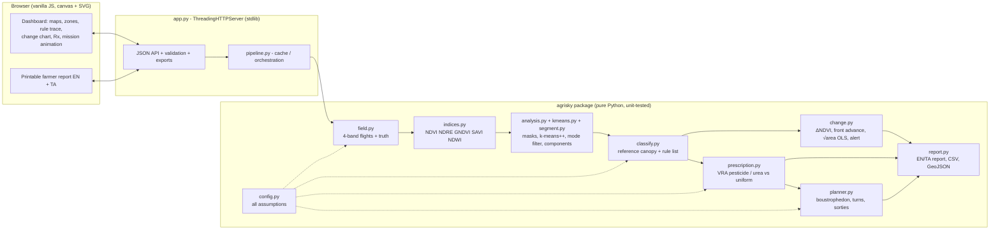

# AgriSky · அக்ரிஸ்கை — Hackathon Report

## 1. Title, tagline, domain

- **Title:** AgriSky
- **Tagline:** Drone crop-health maps, and spray only where the crop needs it
- **Domain:** Smart Agriculture & Rural Development (AgriTech)
- **Event:** QUANTIX 2K26, K.S.R. College of Engineering (23–24 Oct 2026)

## 2. Problem statement

**Who suffers.** Smallholder farmers. Most Indian holdings are small or marginal (about 86% in Agriculture Census 2015-16, approx.). The same field stresses in patches: a low spot waterlogs, a fertiliser pass gets missed and leaves a yellow strip, a pest outbreak starts in one corner and spreads. The usual response is still to spray pesticide and broadcast urea **uniformly over the whole field**.

**How much it hurts.**
- **Money.** The farmer pays for chemical on the 80–90% of the field that did not need it. In our demo field the stressed area needing pesticide is under 9% of the crop.
- **Soil and water.** Excess urea is lost to the air and to groundwater, especially on waterlogged soil. Spray drift reaches irrigation channels.
- **The person spraying.** Knapsack spraying exposes the operator to pesticide for the whole field, not just the patch.
- **Timing.** From above, stress shows as a change in red-edge and NIR reflectance before the eye notices yellowing or holes. By the time a walking farmer sees a pest patch, it has usually doubled.

**Why existing solutions fail.**
- **Satellite NDVI apps** have about 10 m pixels (Sentinel-2), which is too coarse for a 1-acre plot, and clouds block them in the monsoon.
- **Commercial drone-analytics platforms** are subscription, cloud-upload services that need good internet. They usually stop at a coloured map. They do not say *what* the stress is, *how much* to apply, or *how the drone should fly*.
- They are **black boxes** ("zone 3 is red") with no reason a farmer or agronomist can check, and they are English-only.

## 3. Our solution

AgriSky is an offline web app. A drone operator, KVK field worker or FPO technician loads the multispectral flights of a field, and AgriSky produces, for each flight:
1. **crop-health maps** (NDVI, NDRE, GNDVI, SAVI, NDWI, colour-IR)
2. **management zones**
3. **a diagnosis per zone** with the rule that fired
4. **change detection** between weekly flights, including a pest **spread-rate estimate and early warning**
5. **a variable-rate prescription**, with chemical and rupees saved compared with uniform spraying
6. **a drone spray mission** that flies lanes only over the cells that need product, split into sorties by tank and battery
7. a **printable farmer report in English and Tamil**, plus **CSV / GeoJSON** prescription export

Features:
- Deterministic synthetic 4-band (G, R, RE, NIR) field generator with ground truth, five weekly flights over four weeks
- Five vegetation/water indices on canvas heat maps with legends, hover read-out and a click-to-check index calculator
- k-means++ zoning on crop cells, mode-filter smoothing, connected components, zone statistics (area, % of field, mean indices)
- An explainable, ordered rule list: water / soil / waterlogging / pest / nitrogen / healthy, with a full rule trace
- ΔNDVI map relative to the field's own change, decline hotspots, front advance, √area trend, days until the patch covers 10% of the crop
- Pesticide spot spray (pest zone + 2 m safety ring, 3 m no-spray buffer next to water) and urea scaled by the red-edge deficit, held on waterlogged zones
- Boustrophedon coverage with automatic lane orientation (fewest turns), tank / battery limits, return-to-home and an animated map
- Whole-field blanket mission for comparison: sorties, distance, flight time, liquid

## 4. Innovation / what makes it different

1. **From pixels to a flight plan in one tool.** Most tools stop at a map. AgriSky goes map → zones → diagnosis → dose → drone path, and the path is planned *from the prescription*, so the drone sprays only the treatment cells.
2. **Explainable diagnosis.** Every zone shows the tests it passed and failed, with the actual values and thresholds. For example: "NIR 58% of reference ≤ 87% ✓, Red 2.15× ≥ 1.25× ✓, NDVI falling 0.114/week faster than the field ✓ → pest, actively spreading."
3. **Self-referenced rules.** Thresholds are relative to a *reference canopy from the same flight*, the top-quartile NDVI cells. The rules therefore adapt to crop stage, light and camera calibration instead of using fixed absolute NDVI cut-offs.
4. **Warns on speed, not just damage.** The early warning triggers on how fast NDVI is falling and how fast the front is moving. It fired at the **first flight after the outbreak appeared on all 20 hold-out fields**, when the patch averaged only 1.2% of the crop, and **never on 50 pest-free control flights**.
5. **Safety and environment built into the plan.** It never under-doses (spot spraying uses the full label rate), keeps a no-spray buffer from water, and holds urea on waterlogged soil.
6. **Offline, from scratch.** Python standard library only, runs on a ₹15k laptop with Wi-Fi off. The report is in Tamil as well as English.

## 5. System architecture



| Component | File | Responsibility |
|---|---|---|
| HTTP server | `app.py` | Serves `static/`, JSON API, input validation, CSV/GeoJSON downloads, JSON errors (400/404/405/413/500) |
| Orchestration | `agrisky/pipeline.py` | Generates or loads flights, runs analyses in flight order (each needs the previous one for ΔNDVI), LRU caches, assembles the dashboard "scene" |
| Field generator | `agrisky/field.py` | Seeded layout + linear mixing model → G/R/RE/NIR per 1 m cell, ground-truth class, five flights, optional pest-free control |
| Indices | `agrisky/indices.py` | NDVI, GNDVI, NDRE, SAVI, NDWI per cell / raster |
| Zoning | `agrisky/analysis.py`, `kmeans.py`, `segment.py` | Masks, z-scored k-means++, mode filter, connected components, small-piece merging, merge by label |
| Diagnosis | `agrisky/classify.py` | Reference canopy, ordered rule list with trace, confusion matrix |
| Change detection | `agrisky/change.py` | ΔNDVI, hotspots, front advance, √area OLS, projection, alert (EN/TA) |
| Prescription | `agrisky/prescription.py` | Per-cell dose maps, zone rows, VRA vs uniform amounts and ₹ |
| Mission planner | `agrisky/planner.py` | Blocks, bands, orientation search, capacity-aware sorties, coverage verification |
| Reports / export | `agrisky/report.py` | Farmer report lines, CSV, GeoJSON (rectangle-merged zone polygons) |
| Evaluation | `agrisky/evaluate.py`, `bench.py` | Hold-out accuracy, control fields, savings, path metrics, latency → `data/metrics.json` |
| Frontend | `static/` | Dashboard (`index.html`, `app.js`, `style.css`), printable report (`report.html`, `report.js`) |

## 6. Algorithms & models

### 6.1 Synthetic multispectral field (`field.py`)
**What.** 120 × 80 cells of 1 m² each (0.96 ha; 0.89 ha cropped) of maize, 30–58 days after sowing, flown weekly (days 0, 7, 14, 21, 28). Each cell's reflectance in band *b* comes from linear spectral mixing:

```
leaf_b  = lerp(LEAF_HEALTHY_b, LEAF_CHLOROTIC_b, chlorosis);  leaf_NIR *= (1 − tissue_damage)
bg_b    = lerp(lerp(SOIL_DRY_b, SOIL_WET_b, wetness), WATER_b, standing_water)
R_b     = cover · leaf_b + (1 − cover) · bg_b + N(0, 0.008)
```
Scenarios change the physical state:
- **Nitrogen strip** (a missed fertiliser pass, 10–14 m wide): chlorosis 0.50 → 0.66 over the weeks, cover −6%.
- **Waterlogged patch** (ellipse near the channel): up to 90% standing water under the canopy, cover −45%, mild chlorosis.
- **Pest outbreak** from a bottom corner: the front radius grows linearly (0.8–1.2 m/day, with angular harmonics for an irregular edge), and damage builds over 6 m behind the front (defoliation 50%, NIR tissue loss 30%).
- **Bunds** (bare soil) and a 2 m **irrigation channel** (open water).

Every seed changes the layout: pest corner, strip position, patch size and position, front speed, vigour pattern and noise.

**Why.** It gives exact per-cell ground truth to *measure* accuracy, spread rate and savings, and it is deterministic for a reliable live demo.
**Limits.** Linear mixing ignores canopy structure, BRDF, shadows and illumination changes. Endmembers are textbook-shaped and approximate. Real imagery needs radiometric calibration (a reflectance panel) and orthomosaicking first.

### 6.2 Vegetation and water indices (`indices.py`)
```
NDVI  = (NIR − Red) / (NIR + Red)                vigour / biomass
GNDVI = (NIR − Green) / (NIR + Green)            chlorophyll, saturates later
NDRE  = (NIR − RedEdge) / (NIR + RedEdge)        chlorophyll / nitrogen status
SAVI  = (1 + L)(NIR − Red) / (NIR + Red + L), L = 0.5   soil-brightness corrected
NDWI  = (Green − NIR) / (Green + NIR)            > 0 over open water (McFeeters)
```
A zero denominator returns 0. The hand-computed test cell is G 0.10, R 0.05, RE 0.25, NIR 0.50, which gives NDVI 0.8182, GNDVI 0.6667, NDRE 0.3333, SAVI 0.6429 and NDWI −0.6667.
**Limits.** NDVI saturates over dense canopy. That is why the nitrogen rule uses NDRE.

### 6.3 Zoning: masks + k-means++ (`analysis.py`, `kmeans.py`)
1. **Mask** obvious non-crop: open water (NDWI > 0) and bare soil / bunds (NDVI < 0.35).
2. **Features** for crop cells: [NDVI, NDRE, NDWI, SAVI], each clipped to its physical range and **z-scored** so no index dominates.
3. **k-means++** (k = 5 by default, selectable 3–8): first centre uniform; each next centre is drawn with probability ∝ D². Lloyd iterations (assign to nearest centre, move centre to mean) run until no centre moves more than 1e-4 or labels stop changing. Three restarts keep the lowest inertia. Centroids are fitted on a 1-in-4 grid sample (about 2,200 cells), then every cell is labelled. Clusters are ordered by NDVI so colours are stable.

**Why.** k-means is the standard management-zone method, it is fast, and its centroids can be explained ("cluster C0 = NDVI 0.50, NDRE 0.13"). Masking first stops water and soil extremes from compressing the crop variance in z-space. Without the mask, the severe pest core merged with the bunds.
**Limits.** k must be chosen. k-means assumes round clusters and has no spatial awareness, which steps 6.4 and 6.5 make up for.

### 6.4 Spatial clean-up: mode filter + connected components (`segment.py`)
- **Mode filter (3×3, 3 passes).** A crop cell takes the most common crop label in its window when that label has ≥ 5 of 9 votes. The soil and water masks are *protected* (never changed, never spread), so 1 m bunds and the 2 m channel survive.
- **Connected components** use 4-connectivity BFS labelling.
- **Small pieces (< 12 m²)** merge into the neighbour that shares the longest border within the same group (crop stays crop). A 1–2 cell speck joins whichever group surrounds it, so one bright weed cannot break a bund line.
- **Merge by label.** After classification, touching zones with the same diagnosis are joined by union-find, which turns 31 pieces into 9 management zones on the demo flight.

### 6.5 Stress diagnosis: an ordered rule list (`classify.py`)
The **reference canopy** is the median band and index values of the top-quartile-NDVI crop cells of *this* flight. Each zone's mean values are tested in order, and the first rule that fires wins:

| # | Label | Condition | Agronomic reasoning |
|---|---|---|---|
| 1 | Open water | NDWI > 0 | Only water reflects more green than NIR |
| 2 | Bare soil / bund | NDVI < 0.35 | Almost no green canopy |
| 3 | Waterlogging | NDWI ≥ ref + 0.08 **and** Red ≤ 1.35 × ref | Wetter surface while red stays dark: standing water, not exposed soil |
| 4 | Pest damage | (NIR ≤ 0.87 × ref **and** Red ≥ 1.25 × ref) **or** NDVI falling ≥ 0.06/week faster than the field | Leaf tissue and canopy lost (NIR down), soil and damaged tissue exposed (red up); rapid decline = active attack |
| 5 | Nitrogen deficiency | NDRE ≤ 0.90 × ref (canopy intact) | Chlorophyll loss shows in red-edge first |
| 6 | Healthy | otherwise | — |

"Spreading" is flagged when the zone's NDVI falls ≥ 0.03/week faster than the field median change. Confidence is a 0.55–0.99 score based on how far the deciding value is past its threshold. Severity drives the urea dose.

**Why rules, not a black-box classifier.** The judges and the farmer can read every decision. The thresholds have agronomic meaning, and the rules were tuned on **one** seed (42) and then frozen before testing on 20 unseen fields.
**Limits.** The rules only know the five conditions in the generator. Mixed causes (pest + N) get the first matching label. Waterlogging fringe cells are mostly called healthy (recall 68%, see §8). Real fields need calibration against scouted ground truth.

### 6.6 Change detection, spread rate, early warning (`change.py`)
```
ΔNDVI_rel(i) = (NDVI_t(i) − NDVI_t−1(i)) − median_crop(ΔNDVI)      # cancels normal growth
hotspots     = 8-connected groups of ΔNDVI_rel ≤ −0.08, size ≥ 6 m²
front advance = p90 over newly infested cells of  min distance to last week's patch edge
front speed  = mean of the last two (advance / days)
trend        : OLS  √A(day) = a + b·day        (radial spread ⇒ √area is linear in time)
growth now   = dA/dt = 2·√A·b ;  projection: day when A = 10% of crop
alert        : red  if front speed ≥ 0.4 m/day, or a new pest zone is falling ≥ 0.03/week faster
               amber if pest present but stable;  green if none
```
**Why.** These are geometry-free (no need to know where the outbreak started) and explainable with one chart.
**Limits.** The p90 distance underestimates the true front speed slightly (−7% on average). The projection assumes the speed stays constant, with no spraying and no weather change.

### 6.7 Variable-rate prescription (`prescription.py`)
- **Pesticide:** target = (pest cells dilated by a 2 m disc) ∩ crop − (3 m buffer around water). The **full label rate** (0.4 L/ha product, illustrative) goes on target cells and nothing elsewhere. The drone tank mix is 20 L/ha (approx.).
- **Urea:** only nitrogen zones get urea. Dose = 60 kg/ha × clamp((1 − NDRE/ref) / 0.25, 0.6, 1.5). Waterlogged zones get 0 and the advice "drain first".
- **Baseline:** the same corrective dose over the whole cropped area. Saved = uniform − VRA, in L or kg, %, ₹ and ₹/ha. Prices: urea ₹266.50 per 45-kg bag (subsidised MRP, approx.), pesticide ₹1,500/L (illustrative). All are named constants in `config.py`.

**Limits.** This is a *corrective* application compared with a blanket corrective application. It does not replace the scheduled basal and top-dress fertiliser plan.

### 6.8 Drone spray-mission planner (`planner.py`)
```
blocks  = 8-connected components of (targets dilated by one swath)      # swaths of two blocks never overlap
for each block, orientation ∈ {E–W, N–S}, start corner ∈ 4:
    bands of one swath width from the block's first row; per band, runs of columns containing targets
    passes alternate direction (boustrophedon); gaps ≤ 3 m flown nozzles-off
    cost = ferry + spray time + shifts + TURN_S × turns            → keep cheapest  (turn minimisation)
order blocks greedily by cheapest entry from the current position
simulate one 1 m swath-column at a time:
    need = flow × swath cells; if tank < need or t + step + return_home > endurance × (1 − reserve):
        RTH, refill / swap battery (turnaround), ferry back, resume
verify: coverage count per cell → every target exactly once? missed? overspray?
```
**Why.** Boustrophedon coverage is the standard, provably complete coverage pattern for convex strips. Fewer lanes mean fewer 180° turns, and turns are where a drone loses time and battery. Checking capacity at every metre gives exact sortie splits and safe returns.
**Limits.** A full swath sprays partial edge columns (overspray 5–7% of target area on small patches). Nozzle-section control would remove it. Wind, drift, obstacles, altitude and acceleration curves are not modelled. Home is a fixed point at the field gate.

### 6.9 Exports and report (`report.py`)
- **CSV** has one row per zone (area, mean NDVI/NDRE, pesticide and urea area / rate / amount, centroid lat/lon, reason) plus a TOTAL row.
- **GeoJSON** is a FeatureCollection with one MultiPolygon per zone (row runs merged into rectangles), lon/lat from an illustrative origin near Tiruchengode.
- The **farmer report** has 9 short action lines in English and Tamil, shown in the dashboard and as a printable page.

## 7. Tech stack and why it is offline-first

| Layer | Choice | Why |
|---|---|---|
| Backend | Python 3.9+ **standard library only** (`http.server`, `json`, `random`, `math`, `csv`) | `python app.py` works on any venue laptop, Windows included. No pip, no internet |
| Algorithms | Hand-written k-means++, BFS components, mode filter, OLS, dilation, coverage planner | Explainable, no black box, no binary dependencies |
| Frontend | Vanilla HTML/CSS/JS, `<canvas>` rasters, inline SVG charts | No CDN, no fonts, no build step. Works offline in light and dark mode, down to phone width |
| Data | Seeded generator; `data/sample_flights.json` written on first run; `data/metrics.json` | Same numbers on every run and every laptop |
| Tests | `unittest` (79 tests) | Ships with Python |

Phones on the same Wi-Fi hotspot can open it with `--host 0.0.0.0`, so judges can follow on their own phones with no internet.

## 8. Results / evaluation

All numbers come from `python -m agrisky.evaluate` and `python bench.py` (`data/metrics.json`). The rules and constants were tuned on **seed 42 only**. Hold-out = **20 unseen fields (seeds 101–120) × 5 flights = 100 flights, 960,000 cells**. Each hold-out seed has a different layout, pest corner, front speed, vigour pattern and noise.

### 8.1 Zone classification accuracy vs generator ground truth (per cell)

| Set | Accuracy | Macro-F1 |
|---|---|---|
| Hold-out, all 100 flights | **98.63%** mean (min 97.09%) | **0.942** |
| Hold-out, flight 1 only (no history) | 98.52% | — |
| Hold-out, flights 2–5 (with ΔNDVI) | 98.65% | — |
| Demo seed 42, flights 1–5 | 98.88 / 98.21 / 98.72 / 98.79 / 99.05% | 0.796 / 0.948 / 0.956 / 0.960 / 0.976 |
| Control fields with **no pest** (seeds 201–210, 50 flights) | 98.64% | — |

Per class, pooled over the hold-out:

| Class | Precision | Recall | F1 | Cells |
|---|---|---|---|---|
| Healthy | 0.988 | 0.995 | 0.991 | 733,969 |
| Nitrogen deficiency | 0.966 | 1.000 | 0.983 | 93,480 |
| Waterlogging | 0.996 | **0.684** | 0.811 | 25,270 |
| Pest damage | 0.992 | 0.962 | 0.977 | 36,481 |
| Bare soil / bund | 0.994 | 0.999 | 0.996 | 47,200 |
| Open water | 1.000 | 1.000 | 1.000 | 23,600 |

**Honest weaknesses.**
- Waterlogging fringe cells (water covering 50–70% of the ground) look like healthy canopy and are mostly labelled healthy (7,985 cells).
- Pest-front cells with fresh, mild damage are partly missed (1,200 cells).
- On flight 1 of the demo field the outbreak is only 6 cells, below the 12 m² minimum zone, so it is not detected (hence macro-F1 0.796).

### 8.2 Early warning and spread rate

| Metric | Result |
|---|---|
| First red alert, hold-out fields | **flight 2 (day 7) on 20 / 20 fields**, when the detected patch averaged **1.18% of the crop** |
| False alarms on 50 pest-free flights | **0 red alerts.** One flight had a 19 m² false pest zone (amber) |
| Front-speed estimate vs generator truth | mean error **6.9%**, max 12.6% (demo: 0.89 vs 0.99 m/day) |
| √area OLS fit on the demo field | R² = 1.000, +43 m²/day at day 28, reaches 10% of crop in ~4 days |

### 8.3 Chemical savings vs uniform application (last flight)

| | Hold-out mean | Demo field (0.89 ha crop) |
|---|---|---|
| Pesticide product saved | **89.3%** | 91.2% (0.031 L vs 0.356 L) |
| Urea saved | **85.6%** | 88.3% (6.3 kg vs 53.4 kg) |
| Money saved per corrective round | ₹746 | ₹766 (≈ ₹862/ha) |

Prices are illustrative (pesticide) or approximate (urea MRP). The baseline is a blanket corrective application, not the whole season's fertiliser plan.

### 8.4 Coverage-path quality

| Metric | Prescription (VRA) | Whole field |
|---|---|---|
| Demo: sorties | **1** | 2 |
| Demo: flight distance / time | 0.48 km / 2.3 min | 2.65 km / 12.2 min (15.2 min incl. refill) |
| Demo: tank mix sprayed | 1.64 L | 17.3 L |
| Demo: target cells sprayed exactly once / missed / twice | 779 / 0 / 0 | 8,541 / 0 / 0 |
| Demo: overspray at swath edges | 42 m² (5.4%) | 119 m² (1.4%) |
| Demo: path efficiency (spray ÷ all distance) / in-field | 43% / 83% (ferry from the gate dominates) | 84% / 96% |
| Hold-out mean flight time | **142.6 s** | 731.1 s (**−80%**) |
| Hold-out exact coverage (40 missions) | **all targets exactly once, 0 missed, 0 double** | same |

**Turn minimisation** (auto vs forced lane orientation, same targets, 10 hold-out fields):

| Target shape | Auto | Forced E–W | Forced N–S |
|---|---|---|---|
| Nitrogen strip (urea mission) | **3.2 turns / 131.9 s** | 19.1 turns / 193.3 s | 3.7 turns / 133.9 s |
| Pest corner patch | **7.4 / 138.2 s** | 7.6 / 139.3 s | 7.9 / 140.9 s |
| Whole field (demo) | **18 / 731 s** | 18 / 731 s | 29 / 767 s |

### 8.5 Latency (laptop-class container, single-core Python)

| Step | Time |
|---|---|
| Analyse one flight (indices + k-means + zoning + rules) | 356 ms median, 476 ms p90 |
| Cold start: all 5 flights + change + prescriptions + missions | 2.6–2.9 s (done in a background thread at start-up) |
| Mission planner | 8.6 ms (VRA), 51 ms (whole field) |
| HTTP `/api/scene` (all layers, ~520 KB) | 47 ms median (warm) |
| HTTP `/api/zones` · `/api/prescription` · `/api/mission` · CSV · GeoJSON | 1.5 · 10.3 · 1.1 (cached; 25 ms new params) · 14.2 · 16.9 ms |

**Tests:** `python -m unittest discover -s tests` runs **79 tests in ~15 s**. They cover:
- indices on hand-computed cells
- k-means hand example, convergence, monotone inertia, determinism
- 4/8-connectivity components, mode filter, merges, dilation
- generator determinism, signatures and the pest-free control
- every rule
- ΔNDVI, front advance, √area trend and alerts
- coverage exactly once, capacity and battery limits, RTH legs, turn choice, boustrophedon alternation
- prescription masks and savings arithmetic
- CSV / GeoJSON, Tamil text present
- every API endpoint and error code

## 9. Screenshots


`docs/screenshot.png` (1440×900) shows the following after **Run demo** on flight 5:
- the red early-warning banner (English + Tamil)
- KPI tiles (82% healthy, 0.89 m/day front, 91% pesticide saved, ₹766, 1 vs 2 sorties)
- the stress map with management-zone outlines and the drone flying its single sortie over the pest corner
- the zone table and the rule trace for the pest zone

## 10. 3-minute live demo script

1. **(0:00) Hook.** Open the dashboard with Wi-Fi off, phone mirrored. Say: "A farmer sprays the whole field when only a corner is sick. AgriSky looks from above and sprays only that corner."
2. **(0:20) Flights.** Click **Weeks** and watch flights 1→5. Say: "Five weekly drone flights over a 1-hectare maize field. Watch the bottom-right corner: a pest patch is growing about a metre a day."
3. **(0:45) Early warning.** Stop on **Flight 2**. Point at the red banner: "New pest patch, NDVI falling 0.18/week faster than the field." Say: "We raised the alarm when the patch was 79 m², under 1% of the crop. On 20 unseen fields the alarm came at the first flight after the outbreak every time, and never on 50 pest-free flights."
4. **(1:05) Maps and zones.** Go to **Flight 5**. Click the NDVI, then NDRE, then Stress tabs. Say: "NDVI shows vigour; red-edge NDRE shows nitrogen. k-means finds the zones and simple rules diagnose them."
5. **(1:25) Explainability.** Click the **Pest damage** row. Read the trace: "NIR 58% of the healthy canopy, red up 2.15×, NDVI falling 0.11 per week, so pest, actively spreading." Then click the yellow strip on the map: "Canopy intact but NDRE down 36%, so nitrogen. The blue patch: wet but dark red, so waterlogging. Drain it and hold the urea."
6. **(1:50) Accuracy.** Scroll to *Accuracy vs ground truth*: "99% on this flight, 98.6% averaged over 100 unseen flights. We show our weakest class too: the waterlogging fringe."
7. **(2:05) Prescription.** Show the prescription card: "91% less pesticide, 88% less urea, ₹766 saved this round on one hectare." Click **Download CSV** / **GeoJSON**.
8. **(2:25) Mission.** Click **Run demo**. Say: "The drone plans lanes only over the treatment cells, chooses the direction with the fewest turns, and checks tank and battery every metre: 1 sortie, 2.3 minutes." Switch to **Whole field** and click **Fly mission**: "Blanket spraying: 2 sorties, 12 minutes, ten times the liquid." Mention that every target cell is sprayed exactly once.
9. **(2:45) Farmer report.** Click **Farmer report**. Say: "One page in English and Tamil the farmer can keep. All of this runs offline on a ₹15,000 laptop."

## 11. Impact

- **Economic.** On the demo field, spot treatment saves about 90% of the chemical in a corrective round (₹766 on 0.89 ha with our illustrative prices). With several pest and nutrient rounds per season and per-acre drone service rates, the saving recurs every round. These are estimates from the model, not field trial results.
- **Environmental.**
  - Less pesticide on the 90% of the field that is healthy.
  - A 3 m no-spray buffer protects irrigation channels.
  - Urea is held on waterlogged soil, where much of it would otherwise be lost.
  - Smaller drone flights use less battery energy.
- **Health.** The operator handles about a tenth of the tank mix, and the drone sprays only small patches. That means less exposure than knapsack spraying of the whole field.
- **Social.** The Tamil report and plain-language "why" lines let a farmer check the advice. KVK and FPO technicians can offer it as a low-cost service from one laptop.
- **Assumptions (honest).**
  - The data is synthetic.
  - Doses and prices are illustrative.
  - Savings compare against blanket *corrective* treatment.
  - Real benefit depends on correct diagnosis in the field and on label-compliant products.

## 12. Feasibility, scalability & business model

- **Feasibility.**
  - Multispectral drone cameras with green, red, red-edge and NIR bands are commercially available, and agri-spray drones with about 10 L tanks are already used in India.
  - The algorithms are light: about 0.36 s per hectare-flight in pure Python on one core.
  - The remaining work is ingesting real orthomosaics (GeoTIFF reader) and radiometric calibration.
- **Scalability.**
  - Each field is independent, so many fields can be processed in parallel.
  - At 1 m cells a 10 ha farm is 100k cells. k-means already samples, and the other steps are linear in cells.
  - A numpy/C port (or tiling) would handle large estates.
- **Business model.**
  1. **Per-acre analytics and spray service** for drone operators, custom hiring centres and drone-didi style operator programmes.
  2. **SaaS / licence for FPOs and agri-input dealers** to plan spray rounds and stock.
  3. **B2G** crop-health monitoring for KVKs and state agriculture departments.
  4. **OEM add-on**: prescription export for drone and sprayer makers.

## 13. Future scope

- Import real multispectral orthomosaics (GeoTIFF), with reflectance-panel calibration and cloud/shadow masks.
- Learn rule thresholds, or a Naive Bayes / small tree model, from field-scouted labels. Add more stresses (disease, weeds, potassium).
- Nozzle-section control and variable flow to cut the 5–7% edge overspray. Wind-aware drift buffers.
- Spray-window advice from weather (wind, rain), plus re-entry and pre-harvest intervals.
- Export missions in drone-controller formats, add obstacle and no-fly polygons, and handle multi-field routing.
- Voice read-out of the Tamil report, and SMS for farmers with feature phones.

## 14. Judges' Q&A prep

1. **"Your data is synthetic. How do we know it works on real fields?"** The generator uses standard canopy–soil–water mixing with textbook reflectance shapes. That lets us measure accuracy exactly, which real fields rarely allow. The rules are relative to each flight's own healthy canopy, not absolute numbers, so they transfer better. The next step is calibrating thresholds against scouted plots. The pipeline (indices → zones → rules → Rx → path) does not change.
2. **"Why rules instead of deep learning?"** We have no labelled real imagery, and judges and farmers must be able to verify each decision. Rules with agronomic meaning reached 98.6% on unseen fields and print their full trace. A learned model can replace the rule list later without changing the rest of the pipeline.
3. **"How did you avoid overfitting the rules?"** We tuned on seed 42 only, froze the constants, then evaluated on 20 new seeds with different layouts, pest corners, speeds and noise, plus 10 pest-free control fields (0 red alerts in 50 flights).
4. **"What is your weakest result?"** Waterlogging recall is 68%: the fringe of the patch looks like healthy canopy. Pest-front cells with fresh damage are partly missed (96% recall). We report both.
5. **"Why k-means plus rules? Why not classify each pixel?"** Zones are what a farmer and a drone can act on. A 1 m pixel-level map is noisy and cannot be sprayed pixel by pixel. k-means + mode filter + components gives contiguous management zones, and the rules label each zone using its mean values, which reduces noise.
6. **"Isn't spot spraying risky for resistance?"** We never reduce the dose below the label rate: variable rate here means *where*, not *how little*. We add a 2 m safety ring because the front moves about 1 m/day.
7. **"How is 'exactly once' guaranteed?"**
   - Targets closer than one swath share a block, so swaths of different blocks cannot overlap.
   - Within a block the bands partition the rows, and each band column is sprayed once.
   - We then *verify* by counting coverage per cell. That check passed on all 40 hold-out missions and in the unit tests.
8. **"Where does turn minimisation matter?"** On elongated targets. For the nitrogen strip, auto lanes use 3.2 turns instead of 19.1 (−32% flight time). On a roughly square pest patch both directions are similar, and the planner still picks the cheaper one.
9. **"Are the ₹ savings real?"** The urea price is the approximate subsidised MRP (₹266.50 per 45 kg). The pesticide price and doses are illustrative constants in `config.py`. Change them and every number updates. The baseline is a blanket corrective round.
10. **"Can it run at the venue with no internet, on Windows?"** Yes. Python standard library only, no CDN or fonts. `python app.py` serves everything, and phones join over a local hotspot with `--host 0.0.0.0`.

## 15. How to run

```bash
cd projects/18-agrisky
python app.py                              # http://127.0.0.1:8018/  (Run demo button top-right)
python app.py --host 0.0.0.0 --port 8018   # allow phones on the same Wi-Fi
python -m unittest discover -s tests       # 79 tests
python -m agrisky.evaluate                 # hold-out accuracy, controls, savings, paths -> data/metrics.json
python bench.py                            # HTTP latency -> data/metrics.json
```
Printable report: `http://127.0.0.1:8018/report.html?seed=42&flight=5`.
Exports: `/api/export/prescription.csv?flight=5` and `/api/export/prescription.geojson?flight=5`.
