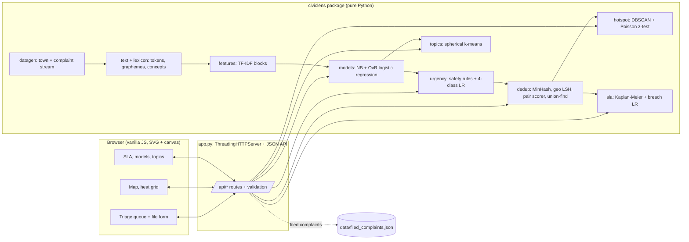

# CivicLens: AI triage and analytics for citizen complaints

**Domain:** Data Science & Analytics · **Event:** QUANTIX 2K26, K.S.R. College of Engineering · **Port:** 8019

> Route, prioritise, de-duplicate and map every citizen complaint in milliseconds. It works in English,
> Tamil and Tanglish, explains every decision, and runs offline on a ₹15k laptop.

---

## 1. Title, tagline, domain

- **Product:** CivicLens
- **Tagline:** AI triage and analytics for citizen complaints
- **Domain:** Data Science & Analytics (NLP + spatial and temporal analytics + survival analysis)

## 2. Problem statement

**Who suffers.** Municipal offices and college administrations receive a steady stream of grievances:
potholes, uncollected garbage, dead streetlights, leaking pipes, overflowing drains, stray dogs, and hostel
water, food and electrical problems. Complaints come through an app, a call centre, WhatsApp, social media
and walk-ins. In Tamil Nadu they are written in English, in Tamil script, and in Tanglish (Tamil typed in
Latin letters, e.g. *"drainage overflow ah iruku"*). Roughly half of Tamil Nadu's population is urban
(about 48% in Census 2011, approx.), so town administrations carry a large share of this load.

**How it fails today.**
- **Manual routing.** A clerk reads each complaint and forwards it, and mistakes bounce between departments.
- **Duplicates pile up.** When a streetlight dies, five neighbours report it in three languages and the
  department sees five tickets. In our synthetic stream, about **36% of complaints repeat an incident that
  is still open** (the real share varies by town).
- **Urgent complaints wait.** "Live wire hanging near the school" sits in the same first-in-first-out queue
  as "illegal flex banner".
- **Nobody sees patterns.** Hotspots, such as a garbage dump behind a market or a broken pipeline that leaks
  every week, and sudden surges, such as drains after the first monsoon rain, show up only in anecdotes.
- **SLA breaches are found after the fact**, when the monthly report is compiled.

**Why existing tools fall short.** Generic ticketing tools only *store* complaints. Cloud NLP APIs need
internet and money, are weak on Tamil and Tanglish, and give no reasons for their answers. Keyword rules
miss paraphrases and typos and cannot de-duplicate across languages.

## 3. Our solution

CivicLens is an officer dashboard that runs a six-step pipeline on every complaint in about 3 ms:
**language detection → department routing → urgency → duplicate search → hotspot check → SLA breach risk**.
Each step shows its reasons. Around the pipeline, an analytics layer finds spatial hotspots (DBSCAN),
emerging wards (Poisson test), resolution-time curves (Kaplan-Meier), breach-risk queues (logistic
regression) and topics in uncategorised complaints (k-means). Everything is pure Python standard library
and runs offline.

Key features:
- **Tamil-aware routing:** TF-IDF logistic regression and Naive Bayes, compared side by side, on word
  1-2 grams, *grapheme* 3-4 grams and bilingual *concept* tokens. Word-level contribution highlighting
  shows why a complaint went where it did.
- **Explainable urgency P1–P4:** safety rules (live wire, sewage in drinking water, open manhole, accident,
  dog bite) force P1. A 4-class model weighs softer cues such as a school nearby, elderly residents, days
  pending or the word "dangerous".
- **Duplicate merging across languages:** MinHash + geo-tagged LSH on concept shingles. A learned scorer
  combines text similarity, distance and time gap, and complaints are merged into incidents with union-find.
- **Hotspots and surges:** DBSCAN on de-duplicated incidents per department, a weekly ward heat grid,
  and a Poisson z-test of this week against the 4-week baseline.
- **SLA analytics:** "% still open after N days" survival curves, resolution box plots, department
  scorecards, ward ranking, and an at-risk queue with the reasons behind each risk.
- **Topic discovery:** spherical k-means on "General / Other" complaints surfaces themes such as noise,
  encroachment, fallen trees, mosquitoes, banners and parking.
- **A live "file a complaint" form** runs the whole pipeline instantly. A scripted **Run demo** button
  means the demo never depends on typing.

## 4. Innovation / what makes it different

1. **Tamil-correct text processing.** Python's `\w` regex treats Tamil vowel signs and the virama as
   non-word characters, so `re.findall(r"\w+", "குப்பை")` returns broken pieces. Our tokenizer scans
   characters by Unicode category and keeps the marks attached. N-grams are built over **graphemes**, so
   "கு" is never split from its vowel sign. This is unit-tested.
2. **Bilingual concept layer.** About 700 hand-written lexicon entries map English synonyms, Tamil-script
   stems (matched as grapheme prefixes, so தெருவில் → தெரு → *street*) and Tanglish (kuppai → *garbage*)
   to shared concepts, with typo tolerance (one edit) on critical words. The same concepts feed
   routing, the safety rules, duplicate shingles and topics. On complaint phrasings the model never saw,
   adding concepts lifts routing accuracy from 62.8% (words only) to 94.2%.
3. **Duplicates across scripts, places and time.** A Tamil report and an English report of the same
   dead streetlight share concept shingles. LSH buckets are keyed by a ~300 m geo cell, so candidate search
   is local. A rule that "a resolved incident cannot be duplicated" prevents false merges at recurring hotspots.
4. **Safety first, but explained.** Rules can only *raise* priority and never lower the model's choice. The
   result card names the rule that fired and the words that moved the model.
5. **Honest evaluation.** Every metric is measured against planted ground truth on hold-out data: a split
   by incident so duplicates never leak, time-based splits for duplicates and SLA, unseen-template tests,
   hotspot parameters chosen on *other* towns, and three random towns.

## 5. System architecture



| Component | File | Responsibility |
|---|---|---|
| HTTP server | `app.py` | Static files, 19 JSON endpoints, input validation, JSON errors, no crash on bad input |
| Config | `civiclens/config.py` | Every tunable assumption (SLA days, rates, thresholds), each with its reason |
| Generator | `civiclens/datagen.py` | 20-ward town, 36 complaint sub-issues with 169 templates in 3 languages, duplicates, hotspots, resolution times |
| Text | `civiclens/text.py`, `lexicon.py` | Unicode tokenizer, graphemes, n-grams, concepts, typo tolerance, script detection |
| Features | `civiclens/features.py` | TF-IDF with per-block L2 normalisation and weights (word / grapheme / concept) |
| Models | `civiclens/models.py` | Multinomial NB, logistic regression (SGD, lazy L2), one-vs-rest |
| Urgency | `civiclens/urgency.py` | 15 rules (critical / high / soft) and the rules + model policy |
| Duplicates | `civiclens/dedup.py` | MinHash, banded LSH with geo tags, haversine, learned pair scorer, union-find |
| Hotspots | `civiclens/hotspot.py` | DBSCAN with a grid index, matching to planted hotspots, Poisson z-test and tail probability |
| SLA | `civiclens/sla.py` | Kaplan-Meier estimator, resolution statistics, breach-model features |
| Topics | `civiclens/topics.py` | Spherical k-means++, silhouette, purity |
| Engine | `civiclens/engine.py` | Builds, trains and evaluates everything; serves views and the live pipeline |
| Front-end | `static/` | Dashboard with five tabs, light and dark themes, phone layout, no libraries |

## 6. Algorithms & models

**6.1 Tokenisation and features.** A token is a run of characters whose Unicode category is a letter, a
mark or a number, plus ZWJ/ZWNJ. Latin text is case-folded and runs of 3+ repeated letters are cut to two.
Graphemes are a base character plus the marks that follow it. Each document gets three sparse blocks:
`w:` word 1-2 grams, `c:` grapheme 3-4 grams with `<`/`>` boundaries, and `k:` concepts. TF-IDF uses
`tf = 1 + ln(count)` and `idf = ln((1+N)/(1+df)) + 1` with min_df = 2. Each block is L2-normalised and
scaled by weights (w 0.7, c 0.3, k 1.0). The weights were chosen by accuracy on *unseen templates* in two
validation towns (seeds 2027 and 2028), not on the demo town. A heavy character weight memorised template
strings. *Limit:* the lexicon is hand-written (about 700 entries), so new slang needs entries or retraining.

**6.2 Multinomial Naive Bayes.** `P(c|d) ∝ P(c) · Π_j P(f_j|c)^{x_j}` with
`P(f|c) = (N_cf + α)/(N_c + αV)`, α = 0.3, computed in log space with log-sum-exp. *Why:* it is the
classic fast text baseline (training takes 0.04 s). *Limit:* its independence assumption makes it
over-confident (mean confidence 99.7%), and it generalises poorly to new phrasings (61% on unseen templates).

**6.3 Logistic regression, one-vs-rest.** For each department, `p = σ(w·x + b)` is trained by SGD on
log-loss with a decaying rate `η_t = η₀/(1 + t/n)` and lazy L2 shrinkage `w_j ← w_j(1 − ηλ) − η(p − y)x_j`
on the features present in each example. There are 6 epochs, η₀ = 0.6 and λ = 2e-5, and class scores
are normalised to sum to 1. *Why:* it is linear, so the contribution `w_j x_j` of each feature, summed
back onto each word, is an exact explanation. *Limit:* it cannot model word interactions beyond the bigram.

**6.4 Urgency.** 15 rules match sets of concepts. Examples: `{live, wire}`, `{wire, hanging}`,
`{current, leak}`, `{sewage, drinkingwater}`, `{manhole, cover}`, `{accident}` or `{bike, fallen}`,
`{dog, bite}`, and "N ≥ 7 days" found by regex across the three languages. Rule hits are added as features
to a 4-class one-vs-rest logistic regression over P1–P4. Policy: any *critical* rule gives P1, any *high*
rule gives at least P2, otherwise the model's argmax decides. The explanation lists the rules that fired,
the four probabilities and the top words. *Limit:* the ground-truth urgency includes some context that is
not in the text (6% of incidents), which caps achievable accuracy.

**6.5 MinHash + LSH duplicate detection.** Shingles are the set of concept tokens (unigram concepts
survive paraphrase and Tamil word order better than bigrams). The signature is
`sig_i(S) = min_{x∈S} (a_i·h(x) + b_i) mod (2^61 − 1)` for i = 1..64, with h a BLAKE2b hash so results
are the same in every run. `P[sig_i(A) = sig_i(B)] = Jaccard(A, B)`. Banding uses b = 32 bands of r = 2
rows, so a pair becomes a candidate with probability `1 − (1 − s^r)^b`, an S-curve centred near
s ≈ 0.18. That favours recall, and the bucket key also includes a ~300 m geo cell, with each query
checking the 3×3 neighbourhood. A candidate pair is *eligible* if the earlier complaint is still open,
both are in the same routed department (or have Jaccard ≥ 0.6), they are ≤ 300 m apart (haversine),
≤ 5 days apart, and have Jaccard ≥ 0.15. A logistic **pair scorer** on (Jaccard, geo closeness, time
closeness, Jaccard×geo, geo×time) gives P(same incident). It is trained on weeks 1–7, and its threshold
(0.5) is tuned for pairwise F1 on those weeks. Each complaint links to its best match, and union-find
(the earliest complaint is the root) forms incidents. *Limit:* two genuinely different problems at the
same landmark in the same few days can merge. The "already resolved" rule reduces this but cannot remove it.

**6.6 DBSCAN hotspots.** Points are de-duplicated incidents of one department. A point is *core* if at
least minPts points lie within eps (haversine), and clusters are core points chained together plus the
border points they reach. A grid index with cell size eps checks only the 3×3 neighbouring cells. Defaults
are eps = 100 m and minPts = 9 over 13 weeks. These were chosen by F1 against planted hotspots in two other
synthetic towns and then scored once on the demo town. The hostel department is excluded because campus
complaints cluster at buildings by design. A detected cluster is matched one-to-one to a planted hotspot of
the same department within 250 m. *Limit:* a single eps does not fit dense and sparse wards equally well.
HDBSCAN would adapt, but is heavier to build.

**6.7 Emerging hotspots (Poisson z-test).** For each ward × department, x is this week's incident count and
λ is the mean over the previous 4 weeks, floored at 0.5. The test statistic is `z = (x − λ)/√λ`, and we also
show the exact tail `P(X ≥ x | λ)`. A cell is flagged if z ≥ 3 and x ≥ 5. *Limit:* real counts are
overdispersed (they vary more than a Poisson model expects), so the false-flag rate is above what the
Poisson model predicts. A negative-binomial test would be stricter.

**6.8 SLA analytics.** The Kaplan-Meier estimator is `S(t) = Π_{t_j ≤ t} (1 − d_j/n_j)`. Open complaints are
*censored* at their current age, so they still count as "at risk" and are not dropped or treated as
resolved. We report "% still open after N days", the KM median, and the share still open at the SLA.
**Breach model:** logistic regression on one-hot department, ward, weekday and priority, plus backlog at
filing (log-scaled, and relative to the department's normal backlog). It is trained only on complaints
whose outcome is already known (`filed + SLA ≤ now`), on weeks 1–10, and tested on weeks 11–13. It is then
refitted on all labelled rows to serve the at-risk queue of open complaints still inside their SLA, with
the top positive contributions shown as reasons. *Limit:* it is a linear model, so it cannot capture a
ward × department interaction such as "roads in W17 are slow".

**6.9 Topic discovery.** Each complaint routed to "General / Other" becomes a TF-IDF vector of concepts,
with place names removed so clusters form around *what* is wrong, not *where*. Spherical k-means
(cosine similarity) uses k-means++ seeding and 4 restarts and keeps the lowest inertia. k ∈ 3..8 is
chosen by mean silhouette. *Limit:* k is picked automatically, but the topics still need a human to name them.

**6.10 Synthetic data.** The data comes from a deterministic generator (seed 2026). It has 20 wards of
1 km in a 5 × 4 grid, about 5 landmarks and 3 streets per ward with English, Tamil and Tanglish names, and
36 sub-issues with 169 templates in total. On top of the templates it adds severity modifiers, vague
complaints (4%), a second issue from another department (6%), typos (20% of Latin-script text), 0–4
duplicate reports per incident written in other languages and channels, 6 persistent hotspots, 3
emerging surges, and a monsoon rise in drainage complaints from week 9. Resolution times are log-normal,
scaled by department, ward efficiency, weekday, priority and live backlog.

## 7. Tech stack and why it is offline-first

- **Python 3.9+ standard library only:** `http.server`, `json`, `math`, `random`, `hashlib`, `bisect`,
  `heapq`, `unicodedata`. No pip, no numpy. `python app.py` works on a venue laptop without Wi-Fi.
- **Vanilla HTML/CSS/JS.** Charts are hand-drawn: SVG for line, bar, box and diverging charts, canvas for
  the map and the heat grid. There are no CDNs or web fonts, and a light/dark theme follows the OS.
- **Deterministic data** (`data/complaints.csv`, `data/ground_truth.json`) is regenerated from code.
  State filed during a session goes to `data/filed_complaints.json` and is replayed on restart.
- **unittest:** 70 tests (tokenizer and Tamil graphemes, NB, LR, MinHash vs exact Jaccard, LSH banding,
  DBSCAN on toy clusters, Poisson z-test, Kaplan-Meier, k-means, urgency rules, generator, engine, HTTP API).

The whole system builds and trains in **about 9 s** at start-up on a laptop CPU. A municipality can run it
on any office PC, with no cloud bill and no citizen data leaving the building.

## 8. Results / evaluation

All numbers below were measured by the code in this repo (`python bench.py`, `/api/models`). The data
is synthetic, so treat absolute numbers as optimistic upper bounds. The *comparisons* between methods are
the more transferable result.

**Stream:** 3,017 complaints (1,506 English, 630 Tamil script, 881 Tanglish), 1,852 true incidents,
13 weeks (20 Jul – 18 Oct 2026), 8 departments, 20 wards.

**Department routing** (hold-out split by incident: 2,402 train / 615 test, 7,414 features)

| Model | Accuracy | Macro-F1 | English | Tamil | Tanglish | Train | Predict |
|---|---|---|---|---|---|---|---|
| TF-IDF logistic regression (served) | **95.3%** | **0.957** | 96.8% | 95.4% | 92.6% | 2.9 s | 0.09 ms |
| Multinomial Naive Bayes | 94.3% | 0.941 | 95.9% | 91.7% | 93.1% | 0.04 s | 0.08 ms |

The two models agree on 95.4% of the hold-out set; disagreements can be sent to a human. Calibration
(ECE): LR 0.069 (slightly under-confident, mean confidence 0.89), NB 0.054, but NB's mean confidence is
0.997, so its probabilities cannot be used for "ask a human when unsure".

**Routing on unseen phrasings.** For each (sub-issue, language) with at least two templates, one template
was held out entirely: 46 templates, 826 test complaints.

| Features | LR accuracy | NB accuracy |
|---|---|---|
| words only | 62.8% | 49.3% |
| words + grapheme n-grams | 68.6% | 57.6% |
| words + concepts | 94.1% | 68.2% |
| **words + graphemes + concepts (served)** | **94.2%** (F1 0.950) | 61.4% |

On familiar phrasing the two models tie, but on new phrasing LR is **33 points** better. The bilingual
concept layer is the biggest single gain. Note: the block weights were tuned for this test on two
*other* towns (first weights: 87.9%), not on the demo town.

**Urgency** (615 hold-out complaints; under-triage = truly P1/P2 but sent to P3/P4)

| Approach | Accuracy | Macro-F1 | P1 recall | P1 precision | Under-triage |
|---|---|---|---|---|---|
| Safety rules only | 67.2% | 0.504 | 69.3% | 92.9% | 47.8% |
| Model only | 87.3% | 0.849 | 80.0% | 89.6% | 10.6% |
| **Rules + model (served)** | **87.5%** | **0.851** | **80.0%** | **89.6%** | **10.2%** |

99.2% of predictions are within one priority level of the truth.

**Duplicate detection.** The scorer was learned and its threshold tuned on weeks 1–7, then evaluated on
weeks 8–13 (1,321 complaints, 739 true duplicate pairs).

| Method | Pair precision | Pair recall | Pair F1 |
|---|---|---|---|
| **MinHash LSH + geo + time scorer (served)** | **0.821** | **0.823** | **0.822** |
| Text only (MinHash ≥ 0.5, within 5 days) | 0.531 | 0.424 | 0.471 |
| Place + time only (≤ 100 m, ≤ 2 days, same dept) | 0.876 | 0.705 | 0.781 |

- LSH checked **55,782 candidate pairs instead of 4,549,636 (98.8% fewer)**, while keeping 88.8% of
  true duplicate pairs as candidates, at 0.26 ms per complaint.
- MinHash error vs exact Jaccard (mean absolute): 0.051 with 16 permutations, 0.033 with 32, **0.028 with 64
  (used)**, 0.018 with 128.
- 1,092 complaints (36%) were merged, giving 1,925 predicted incidents against 1,852 true ones.

**Hotspots vs planted ground truth**
- DBSCAN (eps 100 m, minPts 9, chosen on two other towns): **6 clusters, all 6 matching planted hotspots
  (precision 100%), 6 / 6 planted persistent hotspots found (recall 100%)**, mean centre error 27.5 m.
  Before validation-based selection, eps = 140 m gave 10 clusters and 70% precision.
- Emerging surges (Poisson z-test): **3 / 3 planted surges flagged in the right week** (the W11 garbage
  surge scores z = 15.3), with 9 false flags in 1,242 ward-department-weeks (0.72%).

**SLA breach model** (train weeks 1–10, test weeks 11–13, 584 complaints): **ROC-AUC 0.775** vs 0.620 for
a "department breach rate" baseline, Brier score 0.163, precision 72% / recall 35% at p ≥ 0.5. The
strongest learned risk factors match the slow wards (W17, W16, W19) and low priority that the generator
planted.

**Topics:** 126 incidents routed to Other. The best silhouette is at k = 8 (0.687, the top of the 3–8 range
tried), and purity against the 6 planted sub-topics is **97.6%** (mosquito and fallen-tree complaints split
into two clusters each).

**Robustness across random towns** (seed 2026 is the demo; 2027 and 2028 were also used to choose the
DBSCAN parameters and block weights, so their hotspot scores are not independent)

| Seed | Routing acc | Urgency acc | P1 recall | Dup F1 | Surges | Breach AUC |
|---|---|---|---|---|---|---|
| 2026 | 95.3% | 87.5% | 80.0% | 0.822 | 3 / 3 | 0.775 |
| 2027 | 95.0% | 85.2% | 82.1% | 0.827 | 3 / 3 | 0.770 |
| 2028 | 94.2% | 89.3% | 80.3% | 0.802 | 3 / 3 | 0.738 |

**Latency** (300 hold-out complaints, laptop CPU, pure Python)
- Full pipeline per complaint in-process: **p50 2.6 ms, p95 4.5 ms**
- Over HTTP (`POST /api/analyze`): **p50 3.6 ms, p95 6.3 ms**
- Cold start (generate data + train and evaluate every model): about 9 s

## 9. Screenshots


`docs/screenshot.png` shows the Triage tab after two filings. A Tanglish live-wire report went straight to
**P1 Critical** by safety rule. A second, English report of the same wire was merged as a **duplicate**
(P(same) 100%, 27 m apart, 3 minutes later). The result card highlights the words that pushed the routing
toward Streetlights.

## 10. 3-minute live demo script

1. **(0:00) Triage tab.** "This is a 20-ward demo town with 3,000 complaints over 13 weeks in English,
   Tamil and Tanglish. The KPIs show 104 open, 36 already past their SLA, and 3 emerging hotspots this week."
2. **(0:20) Click Run demo.** The first complaint is Tanglish: *"current wire thongitu iruku, romba danger"*.
   "It is routed to Streetlights. The red words show why. The live-wire safety rule forces P1, with no
   waiting for a model."
3. **(0:45) Second filing, the Tamil duplicate.** "This Tamil report matched an open English complaint: the
   same concepts, a few tens of metres apart, the same week. The officer sees one incident with two
   reports, not two tickets."
4. **(1:05) Point out the garbage complaint in W11** as it scrolls by: "Ward W11 is an *emerging* hotspot:
   14 incidents this week against a usual 0.75. That is z = 15." Then the **typo complaint** *"big pothle,
   acident happend"*: "Typo-tolerant rules still catch the accident, so it goes to P1."
5. **(1:30) Map & hotspots tab.** "DBSCAN found 6 hotspots, and all 6 match the ones we planted in the
   data. The dashed rings are ground truth." Drag minPts down to show false hotspots appearing: "this is why
   we chose the parameters on other towns." Show the heat grid's outlined W11 cell.
6. **(2:00) SLA & risk tab.** "Survival curve: 21% of water complaints are still open after the 2-day SLA.
   The at-risk queue ranks open complaints by breach probability and gives the reason, such as a slow ward,
   low priority or high backlog. The model's AUC is 0.78, against 0.62 for the department-average baseline."
7. **(2:30) Models tab.** "Honest numbers on held-out data: routing 95%. On phrasings the model has
   never seen, logistic regression keeps 94% and Naive Bayes drops to 61%. Our Tamil concept layer is the
   reason. Duplicate F1 is 0.82 against 0.47 for text alone." Finish on Topics: "The 'Other' bin splits
   itself into noise, encroachment, trees, mosquitoes, banners and parking. Everything is written from
   scratch and runs offline."

## 11. Impact

- **Safety:** live wires, open manholes and sewage in drinking water reach the top of the queue in seconds,
  not when someone gets to them. Under-triage of truly urgent complaints falls from 48% (keyword rules) to 10%.
- **Workload:** merging duplicate reports turned 3,017 tickets into 1,925 incidents in the demo stream,
  about **36% fewer tickets** to open, assign and close. The real share depends on the town.
- **Fairness and access:** Tamil-script complaints are routed as accurately as English ones (95.4% vs
  96.8%), so citizens are not pushed toward English to be heard.
- **Planning:** a weekly ward heat grid and hotspot list let engineers fix the *cause*, such as a leaking
  main or an illegal dump site, instead of the 30th complaint about it. Fewer repeat site visits
  also saves fuel and crew time (an assumption, not measured).

## 12. Feasibility, scalability & business model

- **Feasibility:** it runs today on a laptop with no network. The input is plain text plus a location,
  which every complaint channel already captures.
- **Scalability:** routing and urgency are O(document length). Duplicate search touches only LSH buckets in
  nearby cells (0.26 ms per complaint). DBSCAN uses a grid index. A town with 100k complaints a year is
  about 300 a day, far below the measured throughput of a few hundred complaints per second. Larger cities
  can shard by zone.
- **Adoption:** it can sit behind an existing grievance portal, call-centre software or WhatsApp line as a
  JSON API (`POST /api/analyze`). No rip-and-replace is needed.
- **Business model:** a free open-source edition for colleges and small towns; a paid hosted edition for
  municipal corporations (integrations, role logins, history, SLA reports); paid services to tune the
  lexicon and categories for each district's own language and department structure.

## 13. Future scope

- Learn from officers' re-routing corrections (active learning) and from the cases where NB and LR disagree.
- Speech-to-text for call-centre audio and WhatsApp voice notes in Tamil.
- Image checks on attached photos (pothole or garbage present) to filter spam and confirm fixes.
- Crew routing: batch nearby incidents of one department into a single route.
- A citizen-facing status page with "your complaint is merged with 4 others and due on Thursday".
- Negative-binomial surge test and HDBSCAN for density that varies across wards.

## 14. Judges' Q&A prep

1. **"Your data is synthetic. Why should we believe the numbers?"** We say so up front. The generator
   plants known structure, so we can measure precision and recall at all, which real data rarely allows
   without labels. We used hold-out splits, unseen-template tests, parameters chosen on *other* towns, and
   three seeds. The comparisons are what carry over: LR vs NB on new phrasing, text-only vs text+geo+time
   for duplicates.
2. **"Why not use an LLM or a cloud API?"** We need offline use, zero running cost, Tamil and Tanglish,
   and a reason for every decision. A safety rule that forces P1 is auditable; an opaque model is not.
   The pipeline takes about 3 ms per complaint on a laptop CPU.
3. **"Naive Bayes is almost as accurate. Why keep logistic regression?"** On familiar phrasing they tie.
   On unseen phrasing LR scores 94% and NB 61%. NB is also over-confident (99.7% mean confidence), so its
   probabilities are useless for "ask a human". LR's linear weights give exact per-word explanations.
4. **"How do you handle Tamil properly?"** We use a Unicode-category tokenizer, because a regex breaks Tamil
   words at vowel signs. We build grapheme n-grams, map Tamil stems by grapheme prefix (தெருவில் → street),
   and use a bilingual concept lexicon. All of this is unit-tested.
5. **"What stops two different potholes on the same street from being merged?"** The scorer needs text,
   distance and time together. A pair is ineligible if the earlier incident is already resolved. Pairwise
   precision is 0.82, so some wrong merges remain; officers can split them, and future versions can learn
   from those splits.
6. **"Isn't P1 recall of 80% too low for safety?"** The critical *rules* have 93% precision and catch
   explicit hazards. The remaining misses are mostly reports that do not mention the hazard, or that carry
   context the text lacks. The P1 threshold can be biased toward recall, at the cost of more P1 alerts.
7. **"How did you pick eps and minPts?"** By F1 against planted hotspots on two other generated towns,
   then scored once on the demo town (6 / 6, no false clusters). The sliders show how sensitive DBSCAN is.
8. **"What does the Poisson test assume?"** That weekly counts are Poisson around a 4-week mean. Real
   counts are overdispersed, which is why we also require at least 5 incidents. We saw 0.7% false flags.
   A negative-binomial test is planned.
9. **"Why Kaplan-Meier instead of an average resolution time?"** An average over resolved complaints only
   ignores the ones still open, which are the slowest. That makes performance look better than it is.
   Kaplan-Meier treats open complaints as censored.
10. **"Can a municipality actually deploy this?"** Yes. It is one Python file to start, a JSON API to
    integrate, and the lexicon and categories are editable data. It needs no GPU, no internet and no licence.

## 15. How to run

```bash
cd projects/19-civiclens
python app.py                         # http://127.0.0.1:8019/  (about 9 s to build and train)
python app.py --host 0.0.0.0          # open from a phone on the same Wi-Fi
python -m unittest discover -s tests  # 70 tests
python bench.py                       # reproduces section 8 (about 1 minute) -> data/bench.json
python -m civiclens.datagen           # regenerate data/complaints.csv and data/ground_truth.json
```

Click **Run demo** for the scripted 8-complaint walkthrough and **Reset** to clear it. All tunable
assumptions (SLA days, rates, thresholds) are in `civiclens/config.py`.
